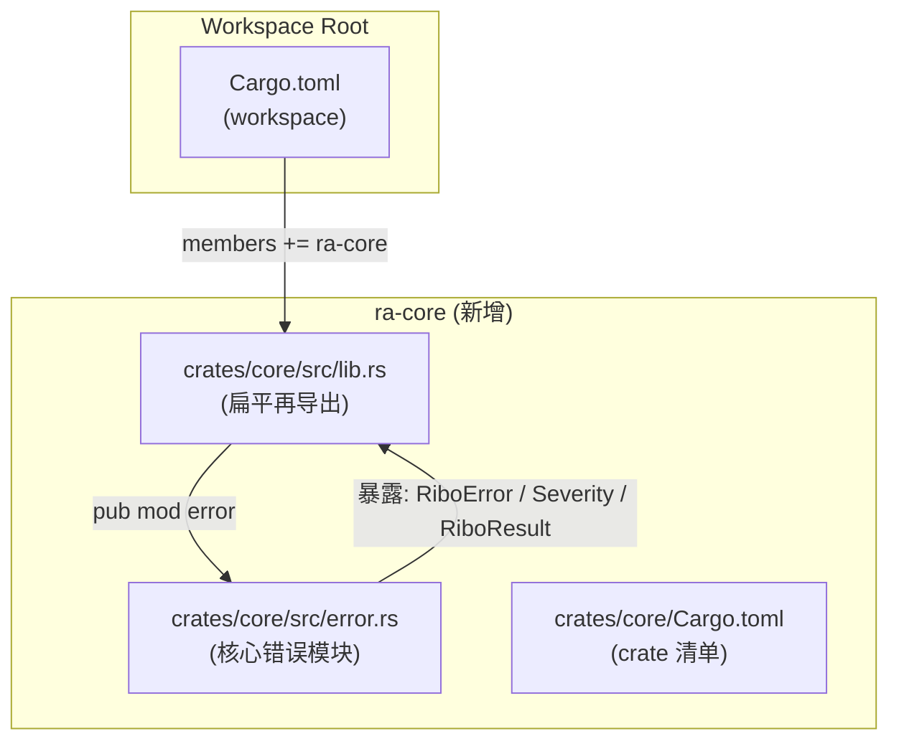
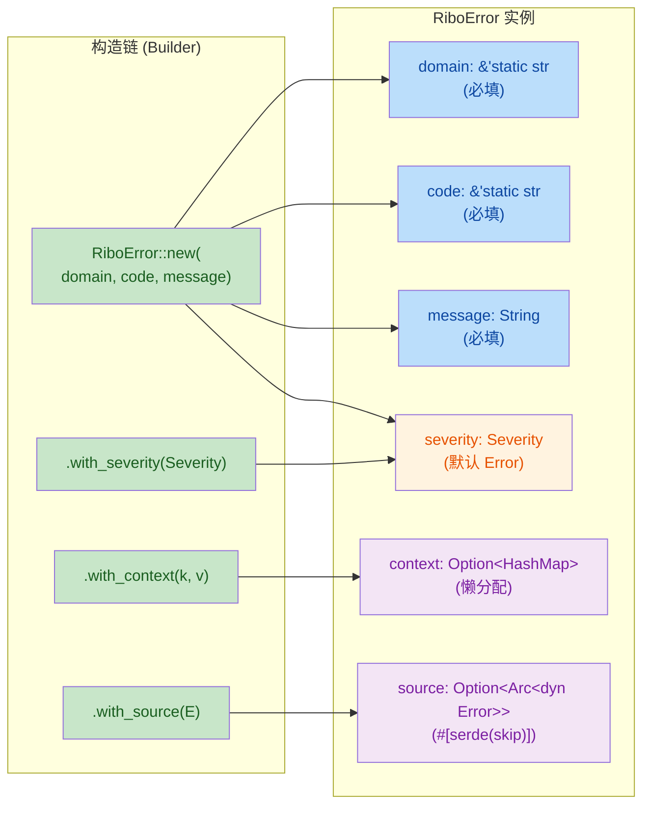
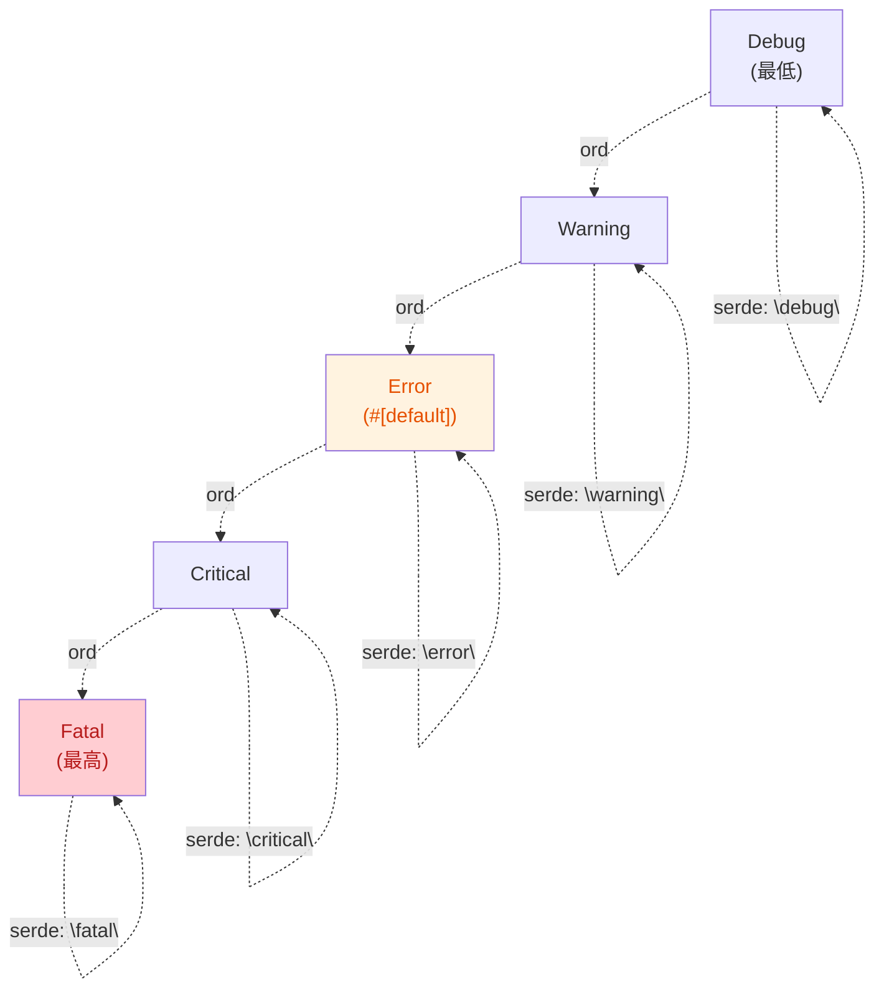

## 1. 高层摘要 (TL;DR)

> 2026-10-14

*   **影响范围:** 🟡 **中** - 新增独立的 **`ra-core`** workspace 成员，引入跨 crate 复用的统一错误模型，但**尚未接入任何业务模块**。
*   **核心目标:** 为整个工作空间提供**统一的结构化错误设施**（`RiboError` + `Severity` + `RiboResult`），具备**领域/错误码语义**、**严重程度分级**、**结构化上下文**与**安全序列化契约**。
*   **关键变更:**
    *   ✨ 新增 `ra-core` crate，含 545 行业务错误模块 `error.rs`。
    *   ✨ 引入 **`RiboError`**（构建器式 API：`new` + `with_severity`/`with_context`/`with_source`）。
    *   ✨ 引入五级 **`Severity`** 枚举（默认 `Error`，支持序数比较与小写序列化）。
    *   ✨ 引入 **`RiboResult<T>`** 别名 + 在 `lib.rs` 扁平再导出。

---

## 2. 🎨 可视化总览 (Code & Logic Map)

### 2.1 Crate 结构与文件关系



### 2.2 `RiboError` 构建与字段关系



### 2.3 `Severity` 排序与序列化



---

## 3. 🔍 详细变更分析

### 3.1 📦 工作空间清单 (`Cargo.toml`)

*   **变更位置:** `Cargo.toml` 末尾追加一行
*   **逻辑:** 把新建的 `ra-core` 注册为 workspace 成员，使根 crate 可在路径依赖中引用。

| 新增成员 | 路径 | 用途 |
| :-- | :-- | :-- |
| `ra-core` | `./crates/core` | 跨模块共享的错误基础设施 |

> ⚠️ 注意：根 `Cargo.toml` 末尾此前**没有换行符**（`\ No newline at end of file`），提交时可能触发 lint 警告，建议补齐行尾换行。

---

### 3.2 📄 `ra-core` crate 清单 (`crates/core/Cargo.toml`)

*   **变更类型:** 🆕 **新建文件** (17 行)
*   **关键设计:**
    *   继承 root workspace 的元信息（`name/version/authors/edition/publish/...` 均为 `workspace = true`），避免重复。
    *   **运行时依赖：** `serde` + `thiserror`，前者提供序列化，后者为 `Display` 与 `Error::source()` 提供派生宏。
    *   **开发依赖：** `serde_json` 仅用于文档测试和单元测试中校验序列化形状，不污染运行时依赖树。

| 项 | 值 | 说明 |
| :-- | :-- | :-- |
| `name` | `ra-core` | crate 名 |
| `version / authors / edition` | `workspace = true` | 继承根清单 |
| 运行时 deps | `serde`, `thiserror` | 错误机制核心 |
| dev-deps | `serde_json` | 仅用于测试序列化契约 |
| `[package].publish` | `workspace = true` | 默认不应发布到 crates.io |

---

### 3.3 🧱 核心错误模块 (`crates/core/src/error.rs`)

#### 3.3.1 `RiboError` 结构体与派生

*   **变更类型:** 🆕 **新建模块**
*   **派生宏选择意图:**

| 派生项 | 作用 | 选择依据 |
| :-- | :-- | :-- |
| `Debug` | 调试输出 | 开发通用需求 |
| `Clone` | 错误可克隆 | `source` 用 **`Arc`** 持有，克隆只增引用计数，避免 `Box` 导致无法 `Clone` |
| `thiserror::Error` | 生成 `Display` 与 `Error::source()` | `Display` 模板 `[domain] {code}: {message}` |
| `Serialize` / `Deserialize` | 跨进程传输 (HTTP/RPC) | 详见序列化契约小节 |

*   **字段设计:**

| 字段 | 类型 | 约束 | 序列化策略 |
| :-- | :-- | :-- | :-- |
| `domain` | `&'static str` | 编译期常量 | 必出 |
| `code` | `&'static str` | 编译期常量 | 必出 |
| `severity` | `Severity` | 默认 `Error` | 小写字符串（`rename_all = "lowercase"`） |
| `message` | `String` | 运行时动态文本 | 必出 |
| `context` | `Option<HashMap<String, String>>` | **懒分配**：未调用 `with_context` 时为 `None` | `skip_serializing_if = "Option::is_none"` + `default` |
| `source` | `Option<Arc<dyn Error + Send + Sync>>` | trait object 不可序列化 | `#[serde(skip)]` |

#### 3.3.2 构造 API（Builder 模式）

| 方法 | 签名 | 关键设计点 |
| :-- | :-- | :-- |
| `new(domain, code, message)` | `pub fn new(domain: &'static str, code: &'static str, message: impl Into<String>) -> Self` | 三要素必填，其余字段取默认值 |
| `with_severity(severity)` | `fn with_severity(mut self, severity: Severity) -> Self` | 链式覆写严重程度 |
| `with_context(k, v)` | `fn with_context(mut self, k: impl Into<String>, v: impl Into<String>) -> Self` | 使用 `get_or_insert_with(HashMap::new)` 懒分配；同键**覆盖**旧值 |
| `with_source(source)` | `fn with_source<E: Error + Send + Sync + 'static>(mut self, source: E) -> Self` | 包装进 `Arc<dyn Error + Send + Sync>`，保留 `Clone` 能力 |

#### 3.3.3 访问器 (Getters)

| 方法 | 返回 | 备注 |
| :-- | :-- | :-- |
| `domain()` | `&'static str` | - |
| `code()` | `&'static str` | - |
| `message()` | `&str` | **不带** `[domain] code:` 前缀 |
| `severity()` | `&Severity` | 通过引用返回，避免破坏严重程度内部状态 |
| `context()` | `Option<&HashMap<String, String>>` | 未设置时为 `None` |
| `source()` | `Option<&(dyn Error + Send + Sync + 'static)>` | **双重实现**：固有方法 + `thiserror` 派生 trait，二者等价 |

> 💡 **设计亮点（双重 `source()`）**
> - 直接写 `err.source()` 命中固有方法，签名带 `Send + Sync`；
> - 通过 `<dyn Error>::source(&err)` 走 trait 方法，签名不带 auto trait；
> - 文档明确说明两者指向同一份上游错误，并配有断言示例。

#### 3.3.4 `Severity` 严重程度枚举

*   **5 级变体，** 排序按声明顺序递增：`Debug < Warning < Error < Critical < Fatal`。
*   **默认值为 `Error`**，所有新构造的错误在没有显式 `with_severity` 时为该级。
*   **派生宏集合**：`Debug, Default, Clone, PartialEq, Eq, PartialOrd, Ord, Hash, Serialize, Deserialize`，注释解释了**为什么不派生 `thiserror::Error`**（`Severity` 不是错误类型，仅是字段，避免过度派生）。
*   **序列化契约：** `#[serde(rename_all = "lowercase")]`，对外固定为 `"debug"`/`"warning"`/`"error"`/`"critical"`/`"fatal"`。
*   **`Display` 自实现：** 手写 `fmt::Display`，输出与 serde 一致的小写名称（用于日志与用户可见文本）。

#### 3.3.5 `RiboResult<T>` 别名

*   **定义：** `pub type RiboResult<T> = Result<T, RiboError>;`
*   **意义:** 把工作空间所有 `Result<T, E>` 的错误侧**统一为 `RiboError`**，减少上层样板代码。

#### 3.3.6 序列化契约 (JSON 形态)

```text
{
  "domain": "provider",
  "code": "request_failed",
  "severity": "critical",     // 注意：小写变体名
  "message": "server is down",
  "context": { "attempt": "3" }  // 缺省时整字段不出现
  // source: 此字段不参与序列化
}
```

⚠️ **三点契约细节**（已在模块文档中以注释列出）:
1. **`severity` 是小写**，而非 Rust 变体名大写。
2. **未设置 `context` 时整字段缺省**，反序列化方必须处理字段不存在。
3. **`source` 不跨进程**，需要传递原因时应显式写入 `context`。

#### 3.3.7 单元测试 (`#[cfg(test)] mod tests`)

| 测试函数 | 验证目标 |
| :-- | :-- |
| `error_test` | `new` 构造后 `context` 为 `None`、`severity` 为默认值、领域与错误码正确 |
| `error_with_severity_test` | `with_severity` 覆盖默认严重程度 |
| `error_with_context_test` | `with_context` 后 `Option` 由 `None` 变为 `Some` |
| `severity_serde_lowercase_test` | 双向：① 序列化为小写；② 小写字符串可反序列化；③ 驼峰变体名 (`"Critical"`) 被拒绝 |

除以上单元测试外，文档示例中还嵌入了 6+ 个 **doctest**，覆盖：基础 `Display`、序列化形状、`with_source`、`source()` 双重路径等关键行为。

---

### 3.4 🪪 Crate 入口 (`crates/core/src/lib.rs`)

*   **变更类型:** 🆕 **新建** (23 行)
*   **核心逻辑:**
    *   声明 `pub mod error;`
    *   扁平再导出：`pub use error::{RiboError, RiboResult, Severity};`
    *   注释明确说明「`error` 模块路径与 crate 根路径**同时保留可用**」，便于上层按需选择访问方式。

> 💡 这是一个小而关键的 API 设计：上层 crate 可以写 `use ra_core::RiboError`（推荐）或 `use ra_core::error::RiboError`（保留）。

---

## 4. ⚠️ 影响与风险评估

### 4.1 风险等级: 🟢 低 (新增基础设施，未触碰业务)

| 风险类别 | 评估 | 说明 |
| :-- | :-- | :-- |
| **破坏性变更** | ✅ 无 | 全部为新增内容，根 `Cargo.toml` 也仅追加成员，尚未影响其他 crate |
| **API 兼容性** | ✅ 向后兼容 | 仅在工作空间中新增一个从未被引用的新 crate |
| **序列化稳定性** | ⚠️ **需提早锁定契约** | 文档已明确 `"domain"`/`"code"`/`"severity(小写)"`/`"message"`/`"context(可选)"`，未来若调整需走破坏性升级 |
| **内存开销** | 🟢 受控 | `source` 用 `Arc`（共享而非深拷贝）、`context` 懒分配 `HashMap`，无上下文错误零额外分配 |
| **线程安全** | ✅ 安全 | `Arc<dyn Error + Send + Sync>` 同时约束 `Send + Sync`，可直接跨线程移动与共享 |

### 4.2 测试建议清单

| # | 场景 | 期望结果 |
| :-- | :-- | :-- |
| 1 | 仅 `new()` 构造错误，不追加任何可选字段 | `context` 为 `None`、`severity == Error`、序列化不含 `context` 字段 |
| 2 | 链式调用 `.with_severity().with_context().with_source()` | 所有 getter 返回预期值，且仍可 `Clone` |
| 3 | 序列化后用 `serde_json::from_str` 反序列化 | 能成功重建（注意 `source` 恒为 `None`） |
| 4 | 反序列化 `"Critical"`（大写） | 返回 `Err` —— 验证小写严格契约 |
| 5 | 调用 `<dyn Error>::source(&err)` 与 `err.source()` | 返回同一个上游错误引用 |
| 6 | 在 `HashMap<String, RiboError>` 中存储 `RiboError` | 能正常 `clone()` / `insert()`，确认 `Arc` 设计有效 |

### 4.3 后续可期待工作 (本次 PR 未涉及)

*   🧩 **业务接入：** 上层 crate（如 `ra-provider`、`ra-config`、`ra-tool` 等）尚未开始使用 `RiboError`，下一步应在这些 crate 中引入并替换原有错误类型。
*   📥 **错误分类约定：** 建议在工作空间根文档或独立的 `errors.md` 中列出标准 `domain`/`code` 取值集合（如 `provider.request_failed`、`config.parse_failed`），避免散落拼接。
*   🔍 **`From` 转换实现：** 尚未为常用标准错误（`std::io::Error`、`serde_json::Error`、`reqwest::Error` 等）实现 `From<E> for RiboError`，后续可补充以进一步简化调用。
*   ✅ **行尾换行修复：** 根 `Cargo.toml` 末尾需补一个换行符，已观察到 `\ No newline at end of file` 警告。

---

## 📎 附录: 文件清单

| 文件 | 类型 | 行数 | 角色 |
| :-- | :-- | :-- | :-- |
| `Cargo.toml` | 修改 | +1 行 | 注册 `ra-core` 为 workspace 成员 |
| `crates/core/Cargo.toml` | 🆕 新建 | 17 行 | `ra-core` crate 清单 |
| `crates/core/src/error.rs` | 🆕 新建 | 545 行 | 错误模型实现（含大量 doctest 与 4 个单元测试） |
| `crates/core/src/lib.rs` | 🆕 新建 | 23 行 | crate 入口与扁平再导出 |