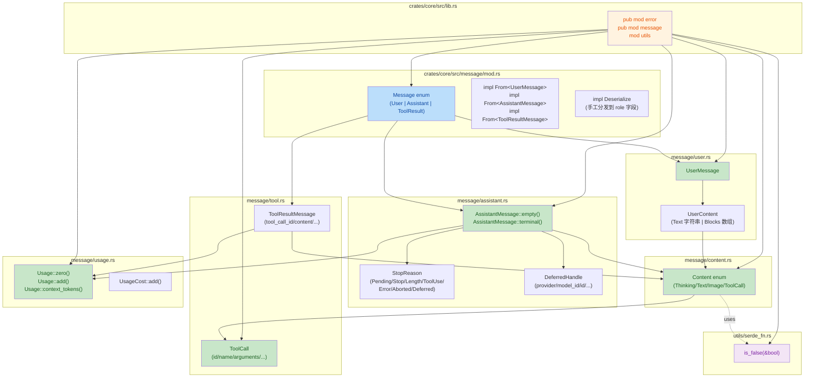

## 1. 高层摘要（TL;DR）

> 2026-10-15

* **影响：** **中** — 调整了 `ra-core` crate 的公开导出结构（**破坏性变更**），同时新增了完整的对话消息模型。
*   **关键变更：**
    *   🚨 **破坏性变更：** 移除 `ra_core::{RiboError, RiboResult, Severity}` 的扁平再导出，统一改为 `ra_core::error::{...}`。
    *   ✨ **新增 `message` 模块：** 引入用户/助手/工具结果三类消息模型（`UserMessage`、`AssistantMessage`、`ToolResultMessage`、`Content`、`ToolCall`、`Usage` 等）。
    *   📦 **依赖调整：** `serde_json` 由 `[dev-dependencies]` 提升为 `[dependencies]`（运行期序列化所需）。
    *   🔧 **新增 `utils::serde_fn::is_false`：** 给 `#[serde(skip_serializing_if)]` 提供「值为 false 时跳过」的能力。

---

## 2. 可视化总览（代码与逻辑图）



---

## 3. 详细变更分析

### 🟠 A. `crates/core/Cargo.toml` — 依赖级别调整

| 项 | 旧值 | 新值 |
|---|---|---|
| `serde_json` | 仅 `dev-dependencies`（带中文注释） | `[dependencies]`（正式运行依赖） |

`serde_json` 现在运行期就需要（`Message` 手工反序列化、`Content::ToolCall.arguments`、`ToolResultMessage::details`、`DeferredHandle::data` 都是 `serde_json::Value`），因此从测试依赖改为正式依赖。

---

### 🔴 B. ⚠️ 破坏性变更：移除 crate 根的扁平再导出

**影响文件：** `crates/core/src/lib.rs`、`crates/core/src/error.rs`

**变更前：**
```rust
pub use error::{RiboError, RiboResult, Severity};
// 上层直接 use ra_core::RiboError;
```

**变更后：**
```rust
pub mod error;
// 上层必须 use ra_core::error::RiboError;
```

模块文档明确表态：各模块的原始路径为稳定公开路径，统一从对应模块引入。

> `error.rs` 中所有 doc-test 示例已同步由 `use ra_core::{RiboError, Severity}` 改为 `use ra_core::error::{RiboError, Severity}`（约 12 处批量替换）。

---

### ✨ C. 新增 `message` 模块（`crates/core/src/message/`）

#### C-1 `mod.rs` — `Message` 枚举与手工反序列化

*   **新增类型：** `pub enum Message { User(UserMessage), Assistant(AssistantMessage), ToolResult(ToolResultMessage) }`
*   **序列化策略：** `#[serde(tag = "role", rename_all = "camelCase")]` —— 序列化时由派生宏生成。
*   **反序列化策略：** ✍️ **手写 `Deserialize` 实现** —— 先整体反序列化为 `serde_json::Value`，按 `role` 字段分发到具体变体；遇到未知角色返回 `unknown_field` 错误，避免静默丢数据。
*   **便利实现：** `From<UserMessage>` / `From<AssistantMessage>` / `From<ToolResultMessage>` 三种 `Message::from`，便于 `.map(Message::from)` 收集。
*   **子模块扁平再导出：** `pub use self::{assistant::*, content::*, tool::*, usage::*, user::*};`

> 设计要点：反序列化手写而非依赖 `#[serde(tag)]` 派生宏，是为了在遇到未知角色时给出更精准的 `unknown_field` 错误而非默认错误。

#### C-2 `assistant.rs` — 助手消息与停止原因

| 类型 | 关键字段 | 备注 |
|---|---|---|
| `AssistantMessage` | `content/model/provider/usage/stop_reason/timestamp` + `response_model/response_id/deferred/error_message/raw_stop_reason/end_turn`（均为 `Option`） | 序列化全部 `camelCase`；可选字段 `skip_serializing_if = "Option::is_none"` |
| `StopReason` | `Pending / Stop / Length / ToolUse / Error / Aborted / Deferred` | `rename_all = "snake_case"`；提供 `as_str() -> &'static str` 用于日志或私有协议手工映射 |
| `DeferredHandle` | `provider/model_id/id/expires_at/poll_after_ms/data` | 用于延迟响应的轮询句柄 |

*   **构造器：**
    *   `AssistantMessage::empty(provider, model, timestamp)` —— 流式占位消息（`StopReason::Pending`、空内容、零用量）。
    *   `AssistantMessage::terminal(provider, model, stop_reason, error_message, timestamp)` —— 终结性失败消息（请求未拿到有效内容就失败）。

#### C-3 `content.rs` — 混合内容块模型

```rust
#[serde(tag = "type", rename_all = "camelCase")]
pub enum Content {
    Thinking(ThinkingContent),
    Text(TextContent),
    Image(ImageContent),
    ToolCall(ToolCall),
}
```

| 子结构 | 字段要点 |
|---|---|
| `ThinkingContent` | `content: String`、`signature: Option<String>`、`redacted: bool`（使用 `is_false` 跳过默认值） |
| `TextContent` | `content: String`、`signature: Option<String>` |
| `ImageContent` | `data: String`（base64 内联）、`mime_type: String`（如 `"image/png"`） |

> `redacted: bool` 通过 `#[serde(skip_serializing_if = "crate::utils::serde_fn::is_false")]` 仅在 `true` 时输出。

#### C-4 `tool.rs` — 工具调用与结果

| 类型 | 关键约束 |
|---|---|
| `ToolCall` | `id/name/arguments: serde_json::Value/signature/namespace` —— 同时作为 `Content::ToolCall` 存在 |
| `ToolResultMessage` | `tool_call_id/tool_name/is_error/timestamp/content: Vec<Content>/details: Option/usage: Option/added_tool_names: Vec<String>` |

> 关联约束：`ToolResultMessage::tool_call_id` 必须对应某条助手消息中的 `ToolCall::id`。

#### C-5 `usage.rs` — 用量与费用

```rust
pub struct Usage {
    pub input: i64,
    pub output: i64,
    pub cache_read: i64,
    pub cache_write: i64,
    pub total_tokens: i64,
    pub cost: UsageCost,
    pub cache_write_1h: Option<i64>,   // 1h 缓存写入，部分提供方单独计费
    pub reasoning: Option<i64>,         // 思考 token
}

pub struct UsageCost {
    pub input: f64,
    pub output: f64,
    pub cache_read: f64,
    pub cache_write: f64,
    pub total: f64,
}
```

| 方法 | 行为 |
|---|---|
| `Usage::zero()` | 全零用量占位（供 `AssistantMessage::empty` 使用） |
| `Usage::add(&mut self, other)` | 必填字段逐项相加；`cache_write_1h` / `reasoning` 在对方有值时按 `0` 补齐后相加，避免累加后变 `None` |
| `Usage::context_tokens()` | 优先返回 `total_tokens`（提供方已上报）；若为 `0`，退化为 `input + output + cache_read + cache_write` |
| `UsageCost::add(&mut self, other)` | 私有方法，仅供 `Usage::add` 内部调用 |

#### C-6 `user.rs` — 用户消息

```rust
pub struct UserMessage {
    pub content: UserContent,
    pub timestamp: i64,
}

#[serde(untagged)]
pub enum UserContent {
    Text(String),       // 纯文本：JSON 字符串
    Blocks(Vec<Content>), // 多模态：JSON 数组
}
```

> 设计要点：`UserContent` 使用 **无标签**序列化，以兼容各提供方「纯文本」与「多模态内容块数组」两种请求格式。

---

### 🔧 D. 新增 `utils/serde_fn.rs` — serde 辅助函数

```rust
pub(crate) fn is_false(b: &bool) -> bool { !*b }
```

*   **可见性：** `pub(crate)`，**仅 crate 内可见**，不属于公开 API。
*   **用途：** 作为 `#[serde(skip_serializing_if = "crate::utils::serde_fn::is_false")]` 的函数路径，配合 `ThinkingContent::redacted` 实现「默认值 `false` 不输出、为 `true` 时才输出」的语义。

---

## 4. 影响与风险评估

### 🚨 破坏性变更清单

| 维度 | 影响 |
|---|---|
| **Crate公开 API** | `ra_core::RiboError` / `RiboResult` / `Severity` 已不可用；必须改为 `ra_core::error::{...}`。 |
| **依赖** | `serde_json` 从 `dev-dependencies` 提升为 `dependencies`，会进入生产二进制产物（体积影响视项目而定）。 |

### ⚠️ 注意事项

*   **`Message` 手工 `Deserialize`**：遇到缺失 `role` 字段返回 `missing_field("role")`；遇到未知角色返回 `unknown_field(other, &["user","assistant","toolResult"])`，不会静默接受未知角色。
*   **`Usage::add` 的可选字段语义**：仅在 *对方* 有值时才累加；若双方均为 `None`，累加后仍为 `None`。
*   **`UserContent` 是无标签枚举**：反序列化时若传入非字符串/非数组/空数组以外结构，会直接报错；目前 `[]`（空数组）按 `Blocks(Vec::new())` 解析。
*   **跨轮签名**：`ThinkingContent.signature`、`TextContent.signature`、`ToolCall.signature` 都是可选项，多轮对话中需要原样回传给提供方做校验。

### ✅ 测试场景建议

| 场景 | 建议 |
|---|---|
| 🔁 `Message` 反序列化 | 构造 `role` 为 `user/assistant/toolResult` 三种 JSON，确认 `from_value::<Message>` 正确分发；额外测试**未知 role**（如 `"system"`）应报 `unknown_field` 错误 |
| 🔁 `UserContent` 反序列化 | JSON 字符串 → `Text`；JSON 数组 → `Blocks`；空数组 → `Blocks(Vec::new())` |
| ➕ `Usage::add` 累加 | 双方均有值、仅一方有值、双方都 `None` 三种组合下累加结果是否符合预期 |
| 📐 `Usage::context_tokens` | `total_tokens > 0` 时取其值；`total_tokens == 0` 时退回各分量求和 |
| 🪧 `StopReason::as_str` | 各枚举值对应 snake_case 字符串（`"pending"` / `"tool_use"` 等） |
| 📤序列化可选字段 | `AssistantMessage` 的所有 `Option` 字段为 `None` 时不出现于 JSON；`ThinkingContent::redacted = false` 时不出现于 JSON |
| 🔧 `serde_json` 依赖升级 | 确认 cargo锁文件、其他 crate 的传递依赖能正常解析 |
| 🧪 Doc-test | 移除扁平再导出后，`error.rs` 中 12+ 处示例需保证通过 `cargo test --doc` |

---

> 📌 **总结：** 本次变更在 `ra-core` 中确立了「**模块路径为稳定公开 API**」的约定（详见 §3-B注释文档），并铺设了与上游 LLM 交互所需的核心消息模型。下游 `ra-provider` 等 crate 应统一从 `ra_core::error::...` / `ra_core::message::...` 引入，**不要依赖 crate 根扁平再导出**。