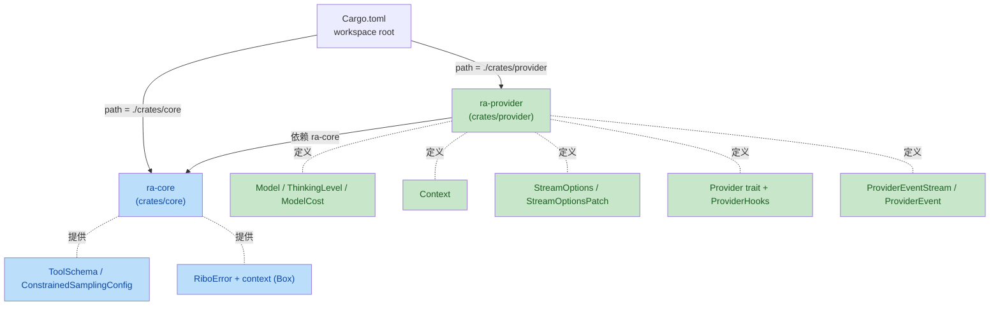
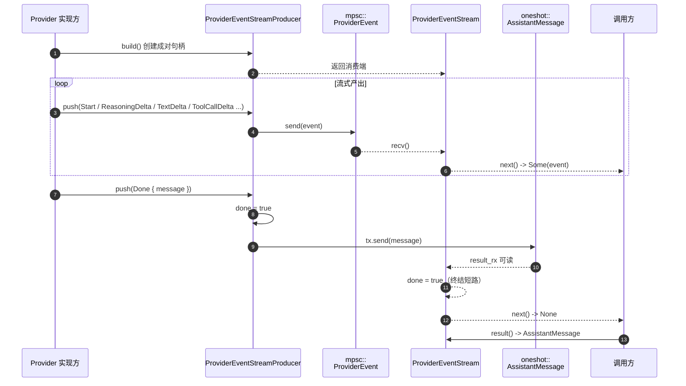
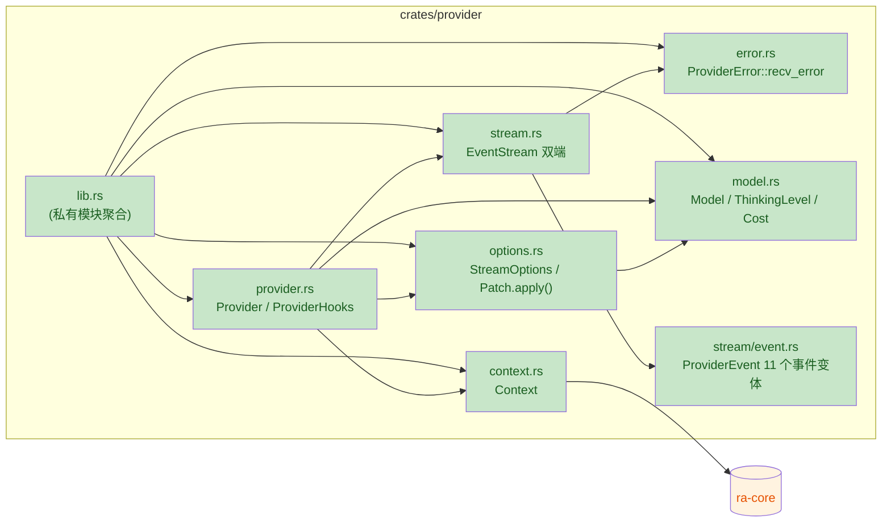

## 1. High-Level Summary (TL;DR) 📋

> 2026年10月15日

* **Impact:** 🟠 **High** — 引入全新 crate `ra-provider`，奠定「多模型提供方接入」的基础设施。
*   **Key Changes:**
    *   ✨ 新增 **`crates/provider`** 子 crate，定义 `Provider`/`ProviderEventStream` 等核心抽象。
    * 🧱 在 `ra-core` 中新增 **工具 Schema 模型**（`ToolSchema`/`Schema`/`ConstrainedSamplingConfig` 等）。
    *   ⚙️ 启用工作区依赖：`async-trait`、`futures`、`reqwest`、`tokio`、`tokio-util`、`tracing-subscriber`。
    *   🐛 优化 `RiboError`：将 `context` 字段改为 `Box<HashMap>` 以缩减结构体尺寸。

---

## 2. Visual Overview (Code & Logic Map) 🗺️

### 2.1 工作区拓扑


### 2.2 事件流生产/消费链路


### 2.3 模块组织


---

## 3. Detailed Change Analysis 🔬

### 3.1 🏗️ 工作区配置（`Cargo.toml`）

启用一批此前被注释的依赖，并新增工作区成员与 `tracing-subscriber`。

| 类型 | 项目 | 旧值 | 新值 |
| --- | --- | --- | --- |
| 依赖启用 | `async-trait` | `# async-trait = "0.1"` | `async-trait = "0.1"` |
| 依赖启用 | `futures` | `# futures = "0.3"` | `futures = "0.3"` |
| 依赖启用 | `reqwest` | `# reqwest = "0.13.5"` | `reqwest = "0.13.5"` |
| 依赖启用 | `tokio` | `# tokio = { version = "1", features = ["full"] }` | `tokio = { version = "1", features = ["full"] }` |
| 依赖启用 | `tokio-util` | `# tokio-util = "0.7"` | `tokio-util = "0.7"` |
| 新增依赖 | `tracing-subscriber` | — | `tracing-subscriber = "0.3"` |
| 工作区成员 | `ra-provider` | — | `ra-provider = { path = "./crates/provider" }` |

> 作用：为新建的 `ra-provider` crate 准备好所需生态（异步运行时、HTTP、tracing），同时把日志订阅器纳入工作区版本。

---

### 3.2 🐛 `crates/core/src/error.rs` —— `RiboError.context` 装箱

**What Changed:**

*   字段类型由 `Option<HashMap<String, String>>` 改为 `Option<Box<HashMap<String, String>>>`，目的是**降低 `RiboError` 结构体的尺寸**（避免一个未使用的 HashMap 占用 ~56 B）。
*   惰性初始化处将 `HashMap::new()` 改为 `Box::new(HashMap::new())`。
*   `context()` 访问器使用 `as_deref()`，透明解开外层 `Box`。

**Code Snippet:**

```rust
#[allow(clippy::box_collection)]
context: Option<Box<HashMap<String, String>>>,

let context = self.context.get_or_insert_with(|| Box::new(HashMap::new()));
pub fn context(&self) -> Option<&HashMap<String, String>> {
    self.context.as_deref()
}
```

> ⚠️ `clippy::box_collection` lint 被显式抑制，因为「为错误结构体瘦身」的语义性需求大于「避免堆分配」的一般建议。

---

### 3.3 ✨ `crates/core/src/message/tool.rs` —— 工具 Schema 模型（相对 `ra-core`）

新增 5 个公共类型，用于描述「可提供给模型的工具」：

| 类型 | 作用 | 关键字段 |
| --- | --- | --- |
| `ToolSchema` | 一个可调用工具的完整描述 | `name`, `description`, `input_schema`, `constrained_sampling` |
| `Schema` | JSON Schema 的 newtype 包装（`serde_json::Value`） | `pub serde_json::Value` |
| `ConstrainedSamplingConfig` | 约束采样的**内部标签枚举** | `JsonSchema { strict }` / `Grammar { variants }` |
| `ConstrainedStrictness` | 约束强度（`Prefer` / `Require`） | — |
| `GrammarFormat` | 语法格式（`OpenaiLark` / `OpenaiRegex`） | serde 字符串：`"openai_lark"` / `"openai_regex"` |
| `GrammarVariants` | `BTreeMap<GrammarFormat, String>` 的类型别名 | — |

要点：

*   所有结构体序列化时采用 `camelCase`，与外部 API 风格一致。
*   `Schema` 用 `#[serde(transparent)]` 直接展开为 JSON 对象，便于任意 schema 字段透传。
*   `ConstrainedSamplingConfig` 使用 `#[serde(tag = "type", rename_all = "snake_case")]`：`{"type":"json_schema", ...}` 或 `{"type":"grammar", ...}`。
*   `GrammarFormat` 由于是**提供方私有字符串**，未走自动派生，逐变体显式 `#[serde(rename = "...")]`。

---

### 3.4 ✨ 新 crate：`crates/provider/`

#### 3.4.1 `Cargo.toml`

| 字段 | 值 |
| --- | --- |
| `package.name` | `ra-provider` |
|关键依赖 | `async-trait`, `futures`, `reqwest`, `tokio`, `tokio-util`, `tracing`, `ra-core`, `serde`, `serde_json` |

#### 3.4.2 `lib.rs` —— 模块聚合

> 仅在 crate 内部以 `mod` 形式注册 6 个私有模块；当前属于开发脚手架，未做 `pub use`。这是**显式的可见性策略**，提醒调用方「API 仍在演化」。

```rust
mod context;
mod error;
mod model;
mod options;
mod provider;
mod stream;
```

#### 3.4.3 `context.rs` —— `Context`

*   字段：`system_prompt: Option<String>`、`messages: Vec<Message>`、`tools: Vec<ToolSchema>`。
*   `tools` 为空时跳过序列化（缺省即纯对话请求）。
*   文档明确：与 `StreamOptions`（运行参数）**关注点分离**——`Context` 描述「让模型基于什么内容作答」。

#### 3.4.4 `error.rs` —— `ProviderError`

*   **不是**错误类型，而是**命名空间**，通过关联函数构造带 `domain = "provider"` 的 `RiboError`。
*   当前仅提供 `recv_error<S>(source: S)`：当 oneshot 在未推送终结事件时被丢弃，原始错误挂载为 `source`。

#### 3.4.5 `model.rs` —— 模型元信息

| 类型 | 关键点 |
| --- | --- |
| `Model` | `id`/`name`/`provider`/`base_url`/`reasoning`/`thinking_level_map`/`input`/`cost`/`context_window`/`max_tokens`/`header`/`sampling_params`/`compat` |
| `ThinkingLevel` | `Off`(默认) < `Minimal` < `Low` < `Medium` < `High` < `Extreme` < `Max`，派生 `Ord` |
| `ThinkingBudgets` | 仅列出需要显式预算的档位字段 |
| `ThinkingLevelMap` | `BTreeMap<ThinkingLevel, Option<String>>` |
| `InputModality` | `Text` / `Image` / `Audio` / `Video` / `Document` |
| `ModelCost` | `#[serde(flatten)] rates: ModelCostRates` + 阶梯 `tiers: Vec<ModelCostTiers>` |
| `ModelCostRates` | `input_token` / `output_token` / `cache_read` / `cache_write` |
| `ModelCostTiers` | 字段展平 + `input_token_above: i64` 阈值 |

> ⚠️ `ModelCostRates` 字段当前为**私有**（仅反序列化注入），由计费逻辑读取；序列化时借助 `#[serde(flatten)]` 直接展平到外层结构。

#### 3.4.6 `options.rs` —— `StreamOptions` + `StreamOptionsPatch`

*   **`StreamOptions`**：运行时参数（`api_key`/`timeout`/`max_retries`/`headers`/`signal` 等），`signal` 直接持 `CancellationToken`。
*   **`CacheRetention`**：`None` / `Short`(默认) / `Long`。
*   **`StreamOptionsPatch`**：双层 `Option` 的局部覆盖——**内层 `None` 表示「显式清空」**。
*   **`Patch::apply(&self, &mut StreamOptions)`**：
    *   标量字段：整体替换。
    *   `headers` / `metadata`：按键合并，`Some(v)` 插入/覆盖、`None` 删除某键。
    *   Map 合并后若为空，**收敛为 `None`**，避免发送空对象。
    *   `cache_retention` 的内层 `None` 回落到枚举默认值 `Short`（与基准 derive(Default) 行为一致）。

```rust
if let Some(v) = self.cache_retention {
    options.cache_retention = v.unwrap_or_default();
}
```

#### 3.4.7 `provider.rs` —— `Provider` + `ProviderHooks`

```rust
#[async_trait::async_trait]
pub trait Provider: Sync + Send {
    fn provider(&self) -> &str;
    fn models(&self) -> &[Model];
    async fn stream(&self, model: &Model, ctx: &Context, options: &StreamOptions)
        -> ProviderEventStream;
}

pub trait ProviderHooks: Send + Sync {
    fn before_request(&self, _: &Model, _: &Context, _: &StreamOptions)
        -> Option<StreamOptionsPatch> { None }
    fn after_response(&self, _: &Model, _: &AssistantMessage) {}
}
```

要点：

*   **错误不以 `Result::Err` 返回**，而是通过事件流的 `ProviderEvent::Error` 终结事件统一走一条消费路径。
*   `ProviderHooks` 与 `Provider` 解耦，默认空操作，便于**按需覆盖**（观测 / 选项改写）。
*   `before_request` 返回 `StreamOptionsPatch`，由 `Patch::apply()` 合并到基准选项上。

#### 3.4.8 `stream/event.rs` —— `ProviderEvent`

11 个变体，构成 `开始 → 增量 → 结束 → 终结` 的事件模式：

| 类别 | 变体 |
| --- | --- |
| 流边界 | `Start { partial }` |
| 思考 | `ReasoningStart { index, partial }` / `ReasoningDelta { index, delta, partial }` / `ReasoningEnd { index, content, partial }` |
| 文本 | `TextStart` / `TextDelta` / `TextEnd` |
| 工具调用 | `ToolCallStart` / `ToolCallDelta` / `ToolCallEnd { tool_call }` |
| 终结 | `Done { reason, message }` / `Error { reason, message }` |

*   每个「进行中」事件都携带 `partial: Arc<AssistantMessage>`，调用方可直接用于实时渲染。
*   `is_terminal(&self) -> bool`：仅对 `Done` / `Error` 返回 `true`。

#### 3.4.9 `stream.rs` —— 事件流双端 + 完整测试套件

核心结构：

| 类型 | 职责 |
| --- | --- |
| `ProviderEventStream` | 消费端：`next()` / `result()` / `split()` |
| `ProviderEventStreamProducer` | 生产端：`push()` / `is_done()` / `close()` / `build()` |

**关键约定：**

*   `push(Done)` / `push(Error)` 时立即标记 `done = true`，并通过 `oneshot` 兑现最终消息。
*   终结后再 `push` 的事件被静默丢弃，**仍返回 `true`**（避免消费方被「假失败」误导）。
*   接收端全部被丢弃时 `push` 返回 `false`。
*   `next()` 在终结后**短路**返回 `None`，避免重复 await 无意义的通道。
*   `result()` 在生产端未发终结即被丢弃时，返回由 `ProviderError::recv_error` 构造的 `RiboError`（`code = "recv_error"`）。

测试覆盖（10 个用例，`mod tests`）：

| # | 用例 | 验证点 |
| --- | --- | --- |
| 1 | `push_non_terminal_event_test` | 非终结事件按原样转发 |
| 2 | `done_event_terminates_stream_test` | 终结事件触发结束，且 `next()` 持续返回 `None` |
| 3 | `result_returns_done_message_test` | `Done` 兑现与事件中相同消息 |
| 4 | `error_event_fulfills_result_test` | `Error` 同样能兑现结果 |
| 5 | `push_after_terminal_is_ignored_test` | 终结后事件被丢弃 |
| 6 | `producer_drop_closes_event_stream_test` | 生产端 drop 不影响已缓冲事件 |
| 7 | `result_errors_when_producer_dropped_test` | 生产端未发终结被 drop 时 → `recv_error` |
| 8 | `push_returns_false_when_receiver_dropped_test` | 消费端全部 drop 后 `push` 返回 `false` |
| 9 | `split_delivers_event_and_result_test` | `split()` 拆分后双通道独立工作 |
| 10 | `close_ends_stream_test` | `close()` 与 drop 等价 |

---

## 4. Impact & Risk Assessment ⚠️

### 4.1 Breaking Changes 🔴

| 位置 | 影响 | 备注 |
| --- | --- | --- |
| `RiboError.context` 类型 | **外部 API 行为兼容**，但**内存布局变化** | 现有调用 `context()` 的代码无需修改（语义保持）；序列化结果不变 |
| 新 crate `ra-provider` | 不影响已有调用，但**新增可依赖面** | 需评估是否对外暴露（当前 `lib.rs` 中各模块均为私有） |

### 4.2 Risks / Things to Watch 🟡

* 🟡 **`ra_provider` 全部模块当前为 `mod`（私有）**，`stream` 模块的文档示例也因此标注 `ignore`。文档与示例不能编译验证，建议**在导出前补一轮 doctest**。
*   🟡 **`ModelCostRates` 字段为私有**——意味着构造 / 修改成本结构必须借助构造器或反序列化，序列化层面有但无法直接构造。审阅时关注是否提供 `pub fn` 工厂或 builder。
*   🟡 **``StreamOptionsPatch::apply` 对 `cache_retention` 的 `None` 落到默认值 `Short`**，而其它标量字段的 `None` 落到「清空」。文档注释已经强调这一点，**调用方要避免误用**。
*   🟡 **`push` 在终结后仍返回 `true`**，与「接收端 drop 返回 `false」**形成语义上的**不对称**——务必通过 `is_done()` 二次确认状态，避免日志 / 监控误报。
*   🟡 **`Provider` trait 要求 `Sync + Send`**，未来引入非 `Send` 内部状态（例如 `Rc`）的实现需要谨慎。

### 4.3 Testing Suggestions ✅

|场景 | 建议 |
| --- | --- |
| `Patch::apply` |验证「Map 合并为空时收敛为 `None`」「`cache_retention` 的内层 `None` 回落到 `Short`」「标量字段内层 `None` 真的清空」三个边界 |
| `ProviderEvent::Stream` | 已覆盖；可补充跨多个 `index` 的并发增量事件以验证事件序 |
| `Model` / `Cost` | 序列化往返（camelCase + flatten）一致性测试，**特别是 `ModelCostTiers`** |
| `RiboError.context` | 验证 `Box` 装箱后 `context()` 仍返回 `Option<&HashMap<...>>` |
| `ToolSchema` | 反序列化不同 `constrained_sampling` 形态（`json_schema` vs `grammar`） |
| 工作区编译 | `cargo build --workspace`，确认 `tracing-subscriber` 与 `reqwest` 版本与其它 crate 共存无冲突 |