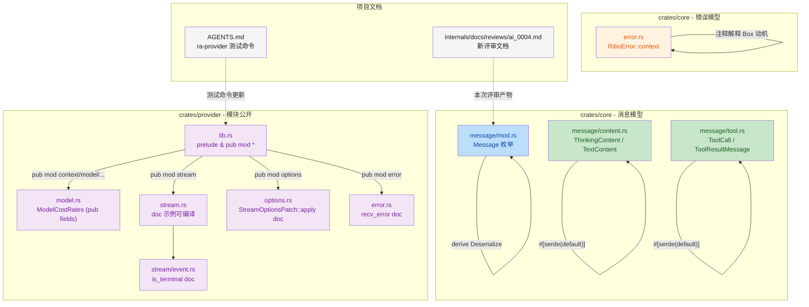
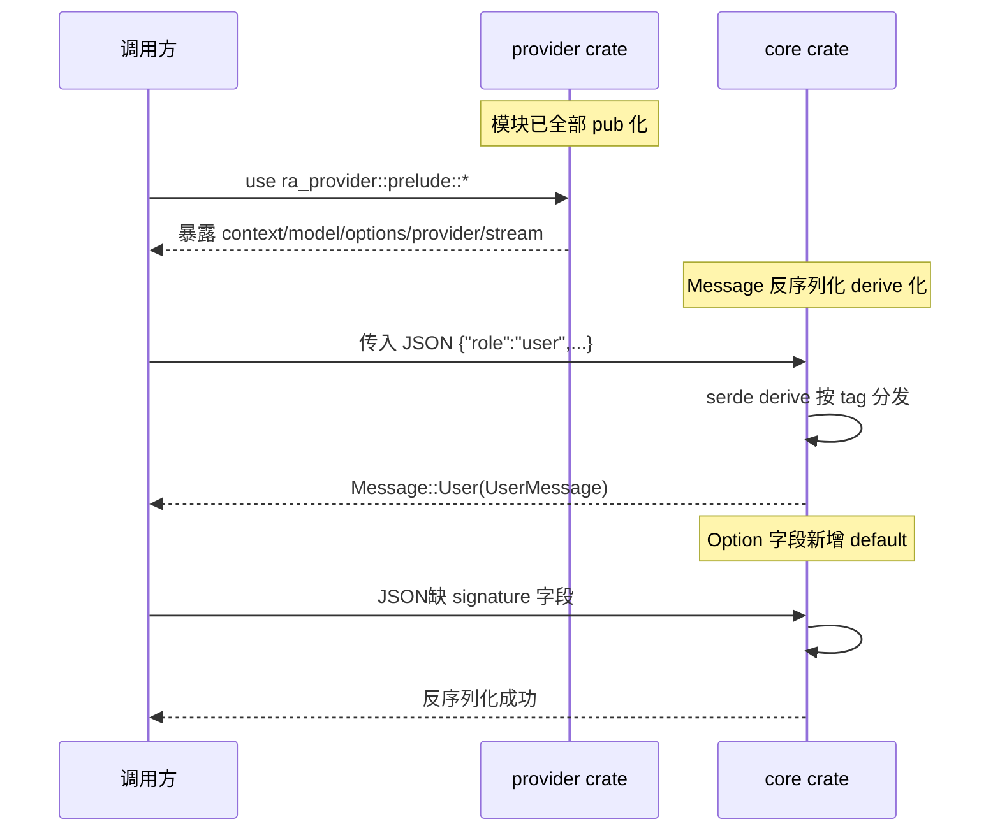

## 1. 高层摘要（TL;DR）

> 2026-10-16

*   **影响范围：** **中** —— 涵盖序列化语义、模块可见性、字段访问性以及 crate 命名的多类调整，部分变更对下游使用者有感知。
*   **关键变更：**
    *   ✨ **`Message` 枚举改用 `serde::Deserialize` derive**：移除手写 `Deserialize` 实现，回归到 derive 宏派生，并新增 `user` / `assistant` 角色往返测试。
    * ✨ **`provider` crate 模块全面 `pub` 化**：将原私有的 `context/model/options/provider/stream` 五个模块提升为 `pub mod`，并新增 `prelude` 统一导出入口。
    *   ✨ **`ModelCostRates` 字段公开**：原本私有的四个费率字段全部改为 `pub`，便于外部直接访问。
    *   🛠️ **`Option` 字段加 `#[serde(default)]`**：在 `signature` / `details` 等字段补齐 `default`，保证反序列化时缺省字段不会失败。
    *   📝 **文档与示例调整**：补充 `RiboError::context` 使用 `Box<HashMap>` 的设计动机；`provider` 流式模块文档示例从 `ignore` 改为正常编译；`AGENTS.md` 中测试命令从 `ribo-provider` 改为 `ra-provider`。

---

## 2. 可视化总览（代码与逻辑地图）





---

## 3. 详细变更分析

### 🔧 A. 序列化/反序列化语义补强

**涉及文件：** `crates/core/src/message/content.rs`、`crates/core/src/message/tool.rs`

在 `Option<T>` 字段上同时加上了 `#[serde(default, skip_serializing_if = "Option::is_none")]`：

| 结构体 | 字段 | 调整 |
| --- | --- | --- |
| `ThinkingContent` | `signature: Option<String>` | 新增 `default`，反序列化缺省时为 `None` |
| `TextContent` | `signature: Option<String>` | 新增 `default`，反序列化缺省时为 `None` |
| `ToolCall` | `signature: Option<String>` | 新增 `default`，反序列化缺省时为 `None` |
| `ToolResultMessage` | `details: Option<serde_json::Value>` | 新增 `default`，反序列化缺省时为 `None` |

**逻辑含义：** 仅 `skip_serializing_if` 时，反序列化侧若 JSON 中缺字段仍会报错；新增 `default` 后，前后端 JSON 缺省场景都能优雅降级，不再因字段缺失导致反序列化失败。

---

### ✨ B. `Message` 枚举 derive `Deserialize`

**涉及文件：** `crates/core/src/message/mod.rs`

| 调整项 | 旧 | 新 |
| --- | --- | --- |
| `derive` 列表 | `Debug, Clone, PartialEq, serde::Serialize` | `Debug, Clone, PartialEq, serde::Serialize, serde::Deserialize` |
| `Deserialize` 实现 | 手写：先取 `role`，再分发到具体类型 | 由 `serde` derive 自动生成 |

手写实现（约 30 行）被完全移除，依赖 `#[serde(tag = "role", rename_all = "camelCase")]` 让 derive 自动完成 `role` 标签分发与 camelCase 映射。同时新增两个往返测试：

*   `user_role_roundtrip_test()` —— 校验 `UserMessage` 序列化为 `"role": "user"` 后能完整反序列化。
*   `assistant_role_roundtrip_test()` —— 同上，针对 `AssistantMessage`。

> ⚠️ **注意：** 原手写实现对未知 role 报 `unknown_field`；derive 版本对未知 role 会按 `tag` 规则直接报错，行为略变，但已被新测试覆盖核心正路径。

---

### ✨ C. `provider` crate 模块公开 & `prelude`

**涉及文件：** `crates/provider/src/lib.rs`

```rust
// 旧
mod context;
mod model;
mod options;
mod provider;
mod stream;
pub use self::{context::*, model::*, options::*, provider::*, stream::*};

// 新
pub mod context;
pub mod model;
pub mod options;
pub mod provider;
pub mod stream;
pub mod prelude {
    pub use super::{context::*, model::*, options::*, provider::*, stream::*};
}
```

**含义：** 模块从「crate 内部脚手架」升级为「对外 API」，`prelude` 提供一次性引入所有子模块的便捷方式，旧式 `pub use self::{...}` 顶层 glob 被移除。

---

### ✨ D. `ModelCostRates` 字段改为 `pub`

**涉及文件：** `crates/provider/src/model.rs`

| 字段 | 旧可见性 | 新可见性 |
| --- | --- | --- |
| `input_token: f64` | private | `pub` |
| `output_token: f64` | private | `pub` |
| `cache_read: f64` | private | `pub` |
| `cache_write: f64` | private | `pub` |

**含义：** 由于模块本身现在公开，费率字段也必须对外可见，否则下游即便能拿到 `ModelCostRates`，也无法读取或构造实例。

---

### 📝 E. 文档与示例微调

| 文件 | 改动 |
| --- | --- |
| `crates/core/src/error.rs` | 在 `context` 字段上补充 doc comment，说明用 `Box<HashMap>` 是为了规避 `result_large_err` lint（无 context 时仅占 8 字节指针）；同步细化 `Clone` 派生语义注释 |
| `crates/provider/src/error.rs` | 为 `recv_error` 新增 `# Examples` doc test片段 |
| `crates/provider/src/options.rs` | 为 `StreamOptionsPatch::apply` 新增 `# Examples` doc test 片段 |
| `crates/provider/src/stream.rs` | 模块顶层示例从 ` ```ignore ` 改为 ` ``` `；为 `next/result/split/push/is_done/close/build` 等共新增6 段 doc 示例 |
| `crates/provider/src/stream/event.rs` | 为 `ProviderEvent::is_terminal` 新增 `# Examples` doc test 片段 |
| `AGENTS.md` | 将测试命令中的 crate 名从 `ribo-provider` 改为 `ra-provider` |

> 🔑 **关键收益：** `stream.rs` 文档示例从 `ignore` 切换为正常编译，结合 `lib.rs` 的模块公开改动，现在 `cargo test --doc` 会真实验证示例代码，文档不再是"看得见跑不动"。

---

### 🆕 F. 新增评审文档

**涉及文件：** `internals/docs/reviews/ai_0004.md`

新增的内部评审归档文档，结构与本报告一致（TL;DR / 可视化 / 详细变更 / 影响评估），作为本次修改的评审产物入库。

---

## 4. 影响与风险评估

### ⚠️ 破坏性变更

| 类型 | 影响 |
| --- | --- |
| **API 暴露面扩大** | `provider::context/model/options/provider/stream` 与 `ModelCostRates` 字段升级为 `pub`，未来再做破坏性变更会更困难。 |
| **`prelude` 引入** | 旧版依赖 `pub use self::{...}` 的用户侧代码不受影响；推荐后续示例改用 `use ra_provider::prelude::*;`。 |
| **`Message` 未知 role 报错信息变化** | 由手写的 `unknown_field` 错误转为 serde 默认的 tag-enum 错误，下游若依赖错误信息做分支需要更新。 |
| **crate 命名差异** | `AGENTS.md` 中的 `ribo-provider` → `ra-provider`，需与 `Cargo.toml` 中的实际 crate 名确认是否一致；当前 review 文档中示例代码已统一使用 `ra_provider::xxx`。 |

### 🧪 测试建议

*   **序列化/反序列化兜底**：构造 JSON 时**缺省** `signature` / `details` 字段，确认反序列化成功且字段为 `None`。
*   **`Message` 往返**：除新增的 `user` / `assistant` 往返测试外，建议补充 `ToolResultMessage`（`toolResult` 角色）的往返测试，覆盖全部变体。
*   **`ra_provider::prelude`**：编写一个最小使用 `use ra_provider::prelude::*;` 的 cargo test，确保所有子模块符号都能被解析。
*   **`stream` doc 示例**：执行 `cargo test -p ra-provider --doc`，确认原本被 `ignore` 的示例在新公开后能正常编译。
*   **`AGENTS.md` crate 名核对**：确认 `ra-provider` 是否对应仓库中真实存在的 crate；当前 review 文档中也存在 `provider` 与 `ra-provider` 混用，需同步修正 `Cargo.toml` 或文档命令。
*   **`RiboError::context` 克隆语义**：手写 `Clone` impl 被替换为 derive 后，行为应与文档承诺一致（message/context 深拷贝、source Arc 共享），建议补充针对该语义的单元测试。