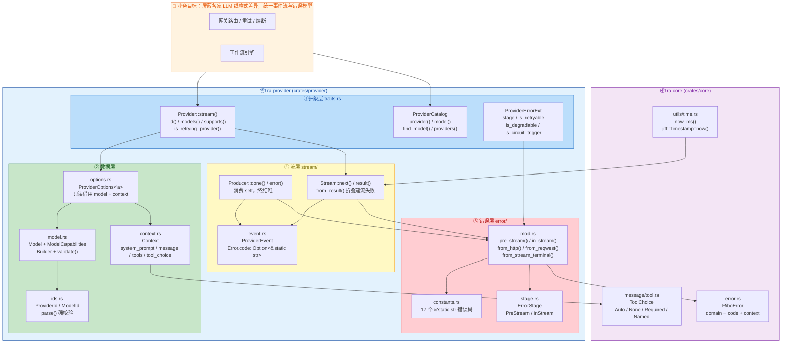
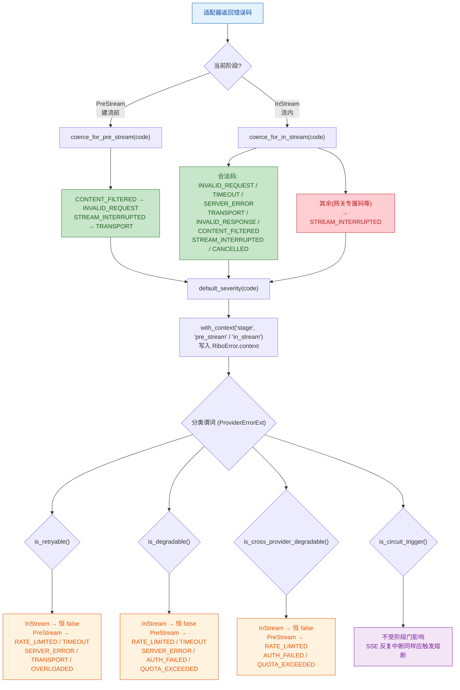
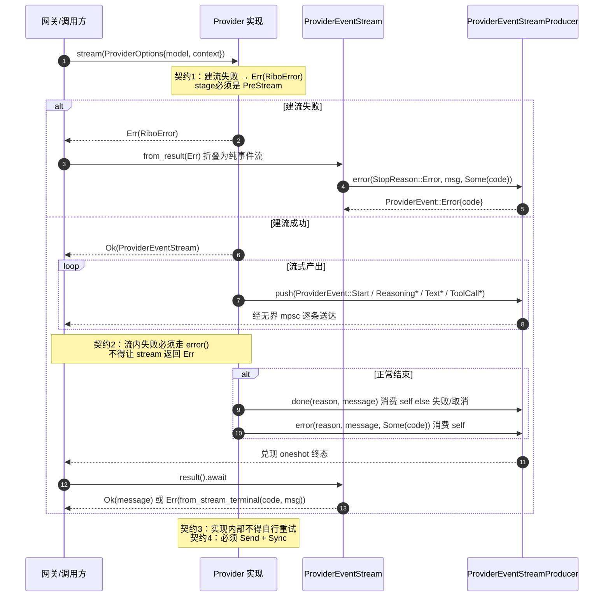

# 🏗️ `ra-provider` 抽象层重构 + `ra-core` 工具化改造

> 2026-10-22

## 1. High-Level Summary (TL;DR)

- **Impact: 🔴 High** —— `ra-provider` crate 的公开 API 被**整体重写**：错误体系、trait 定义、模型元信息结构、事件流协议全部换血，属于破坏性重构而非增量迭代。同时 `ra-core` 新增 `ToolChoice` 枚举与公开的时间工具模块，为上层（网关 / 工作流引擎）打底。

- **Key Changes:**
  - ✨ **本地化错误体系**：新增 `error/` 子模块（`constants.rs` + `stage.rs` + `mod.rs`），定义 **17 个结构化错误码**、**PreStream / InStream 阶段门**（运行期自动纠正非法 code 配对）、以及 4 个分类谓词（重试 / 降级 / 跨 provider 降级 / 熔断）。
  - ✨ **强类型标识**：新增 `ids.rs`，`ProviderId` / `ModelId` 采用 `Arc<str>` newtype，**禁用 `From<String>`**，强制走 `parse()` 显式校验。
  - ✨ **Provider trait 重构**：`provider.rs` 删除 → `traits.rs`，新增 `Provider`（含 `supports()` / `is_retrying_provider()` 默认实现）、`ProviderCatalog`（注册表只读视图）、`ProviderErrorExt`（错误谓词扩展）。
  - ✨ **事件流协议升级**：`stream.rs` → `stream/mod.rs` + `stream/event.rs`；终结事件改为**消费 producer**（类型层面保证只终结一次），`ProviderEvent::Error` 新增结构化 `code` 字段，新增 `ProviderEventStream::from_result()` 折叠建流失败。
  - 🔧 **模型元信息重构**：`Model` 改用强类型 ID、拆出 `ModelCapabilities`、计费从 `f64` 换为**微美元 `u64`**、新增 Builder 模式与 `validate()`。
  - ⚠️ **移除 `StreamOptions` / `StreamOptionsPatch`**，精简为只读借用的 `ProviderOptions<'a> { model, context }`。

---

## 2. Visual Overview (Code & Logic Map)

### 2.1 模块全景：业务目标 ↔ 文件 ↔ 关键类型



### 2.2 错误阶段门（Phase Gate）运行期纠正逻辑



### 2.3 `Provider::stream()` 契约时序



---

## 3. Detailed Change Analysis

### 3.1 📦 依赖与构建配置

**What Changed：** 引入 `jiff` 提供跨平台毫秒时间戳；为 provider crate补上测试用 `tokio` 特性。

| 文件 | 变更 | 详情 |
|---|---|---|
| `Cargo.toml` (workspace) | ➕ 新增 | `jiff = "0.2.38"` |
| `crates/core/Cargo.toml` | ➕ 新增 | `jiff.workspace = true` |
| `crates/provider/Cargo.toml` | ➕ 新增 | `[dev-dependencies]` → `tokio = { workspace = true, features = ["test-util"] }`（`start_paused` 时间测试需要） |

> ⚠️ 根 `Cargo.toml` 仍**缺少换行符**（`\ No newline at end of file`）。

---

### 3.2 ⏱️ `ra-core` 工具模块对外开放

**What Changed：** `utils` 从 crate 私有提升为公开模块，`provider` crate 才能跨 crate 复用 `now_ms()`（Source: `crates/core/src/lib.rs`、`crates/core/src/utils/mod.rs`）。

| 符号 | 位置 | 说明 |
|---|---|---|
| `pub mod utils` | `crates/core/src/lib.rs` | 由 `mod utils` 改为公开 |
| `pub mod time` | `crates/core/src/utils/mod.rs` | `serde_fn` 仍保持 `pub(crate)` |
| `now_ms() -> i64` | `crates/core/src/utils/time.rs`（新增） | `jiff::Timestamp::now().as_millisecond()`，用于事件流时间戳 |

**附带调整：** `crates/core/src/error.rs` 移除 `std::fmt` 导入，改用完全限定路径 `impl core::fmt::Display for Severity`，避免与 `core` crate 名产生歧义。

> ⚠️ **文档不一致**：`crates/core/src/utils/mod.rs` 的模块注释仍写着「本模块仅对 crate 内部可见（`mod utils`）」，与 `lib.rs` 的实际改动矛盾，建议同步更新。

---

### 3.3 🎛️ `ra-core` 新增 `ToolChoice` 工具选择策略

**What Changed：** `crates/core/src/message/tool.rs` 新增枚举，为 `Context.tool_choice` 提供取值域。

| 变体 | 语义 | 备注 |
|---|---|---|
| `Auto` | 由模型自行决定 | `#[default]`，默认值 |
| `None` | 禁止调用工具 | 显式关闭工具 |
| `Required` | 必须调用工具 | 至少一次 |
| `Named(String)` | 必须调用指定工具 | 携带工具名 |

**设计意图（来自 `context.rs` 注释）：** `tools` 与 `tool_choice` 共同决定适配器是否附带工具声明 —— 不支持工具调用的 provider 应据此跳过声明。

---

### 3.4 🔴 `ra-provider` 错误体系重建（`error.rs` → `error/`）

**What Changed：** 删除旧的单文件 `ProviderError` 命名空间（仅有 `recv_error` 一个构造器），替换为三层结构：**错误码常量** + **阶段枚举** + **构造器/谓词实现**。

#### 3.4.1 错误码常量表（`error/constants.rs`，共 17 个）

全部以 `"provider."` 前缀，与 `RiboError.domain = "provider"` 配对成 `(domain, code)` 二元组。

| 错误码常量 | 实际取值 | 生命周期分组 | 默认 Severity |
|---|---|---|---|
| `INVALID_REQUEST` | `provider.invalid_request` | 请求参数 / 服务端 | Warning |
| `AUTH_FAILED` | `provider.auth_failed` | 请求参数 / 服务端 | Error |
| `QUOTA_EXCEEDED` | `provider.quota_exceeded` | 请求参数 / 服务端 | Error |
| `RATE_LIMITED` | `provider.rate_limited` | 请求参数 / 服务端 | Error |
| `TIMEOUT` | `provider.timeout` | 请求参数 / 服务端 | Error |
| `SERVER_ERROR` | `provider.server_error` | 请求参数 / 服务端 | Error |
| `TRANSPORT` | `provider.transport_error` | 请求参数 / 服务端 | Error |
| `INVALID_RESPONSE` | `provider.invalid_response` | 请求参数 / 服务端 | Error |
| `CONTENT_FILTERED` | `provider.content_filtered` | **流式专属** | Warning |
| `STREAM_INTERRUPTED` | `provider.stream_interrupted` | **流式专属** | Error |
| `CANCELLED` | `provider.cancelled` | **流式专属** | Debug |
| `PROVIDER_NOT_FOUND` | `provider.provider_not_found` | **网关专属** | Critical |
| `MODEL_NOT_FOUND` | `provider.model_not_found` | **网关专属** | Critical |
| `CIRCUIT_OPEN` | `provider.circuit_open` | **网关专属** | Critical |
| `OVERLOADED` | `provider.overloaded` | **网关专属** | Critical |
| `DUPLICATE_PROVIDER` | `provider.duplicate_provider` | **网关专属** | Critical |
| `RETRY_PROVIDER_REFUSED` | `provider.retry_provider_refused` | **网关专属** | Critical |

#### 3.4.2 分类谓词矩阵（`error/mod.rs` + `traits.rs`）

| 谓词 | PreStream 下为 `true` 的 code | InStream 行为 |
|---|---|---|
| `is_retryable()` | `RATE_LIMITED` `TIMEOUT` `SERVER_ERROR` `TRANSPORT` `OVERLOADED` | **恒 `false`**（重试会与已产出内容重复） |
| `is_degradable()` | `RATE_LIMITED` `TIMEOUT` `SERVER_ERROR` `AUTH_FAILED` `QUOTA_EXCEEDED` | **恒 `false`** |
| `is_cross_provider_degradable()` | `RATE_LIMITED` `AUTH_FAILED` `QUOTA_EXCEEDED` | **恒 `false`** |
| `is_circuit_trigger()` | `RATE_LIMITED` `TIMEOUT` `SERVER_ERROR` `TRANSPORT` `INVALID_RESPONSE` `STREAM_INTERRUPTED` `CIRCUIT_OPEN` `OVERLOADED` | **不受阶段门影响**（SSE 反复中断同样应熔断） |

#### 3.4.3 公开构造器

| 构造器 | 签名要点 | 行为 |
|---|---|---|
| `pre_stream(code, msg)` | `&'static str` code | 阶段门纠正 → 注入 `context["stage"]="pre_stream"` |
| `in_stream(code, msg)` | `&'static str` code | 阶段门纠正 → 注入 `context["stage"]="in_stream"` |
| `from_http(status, body)` | `u16` + `&str` | HTTP 状态码映射；body **UTF-8 安全截断至 512 字节**；注入 `context["http_status"]` |
| `from_reqwest(err)` | `reqwest::Error` | ⚠️ **仅限建流阶段**；`is_timeout`→`TIMEOUT`，`is_connect`→`TRANSPORT`，`is_decode/is_body`→`INVALID_RESPONSE`，其余→`TRANSPORT` |
| `from_stream_terminal(code, msg)` | `Option<&'static str>` | 阶段固定 `InStream`；`code` 为 `None` 回落 `STREAM_INTERRUPTED` |

**HTTP 状态码映射表：**

| HTTP 状态 | 错误码 | Severity |
|---|---|---|
| `400` / `422` / `409` / 其他 | `INVALID_REQUEST` | Warning |
| `401` / `403` | `AUTH_FAILED` | Error |
| `402` | `QUOTA_EXCEEDED` | Error |
| `408` / `504` | `TIMEOUT` | Error |
| `429` | `RATE_LIMITED` | Error |
| `5xx` | `SERVER_ERROR` | Error |

**UTF-8 安全截断关键实现（Source: `crates/provider/src/error/mod.rs`）：**

```rust
let mut end = 512;
while end > 0 && !body.is_char_boundary(end) {
  end -= 1;
}
format!("{}...(truncated)", &body[..end])
```

---

### 3.5 🆔 强类型标识 `ids.rs`（新增）

**What Changed：** 用 newtype 消除裸 `String` 在 provider id / model id 间的混用风险。

| 类型 | 内部表示 | 校验规则 | 失败返回 |
|---|---|---|---|
| `ProviderId` | `Arc<str>` | 非空 **且** 仅含 `[a-z0-9_-]`（**大小写不归一化，大写即非法**） | `pre_stream(INVALID_REQUEST, ..)` |
| `ModelId` | `Arc<str>` | 仅非空 / 非全空白（不收窄字符集，避免误杀 `anthropic/claude` 等模型名） | `pre_stream(INVALID_REQUEST, ..)` |

**`impl_id!` 宏统一提供的实现：** `as_str()`、`Display`、`AsRef<str>`、`Serialize`（按原始字符串）、`Deserialize`（按原始字符串）、私有 `new()`。

> ⚠️ **校验可被绕过**：`Deserialize` 实现直接 `Ok(Self::new(s))`，**不做任何字符集/空值校验**。这意味着从配置文件反序列化出来的 `ProviderId` 可能包含大写或非法字符，与 `parse()` 的不变量冲突。若不变量需要强保证，应在 `Deserialize` 中复用校验逻辑。
>
> ⚠️ **命名易混淆**：`ModelId::parse` 与 `ProviderId::parse` 是两个独立方法，都叫 `parse`，且 `ModelId::parse` 与标准库 `str::parse` 同名（不同 trait，无冲突但阅读时易混）。

---

### 3.6 📋 `Context` 请求上下文重构

**What Changed（Source: `crates/provider/src/context.rs`）：**

| 字段 | 旧类型 | 新类型 | 变更原因 |
|---|---|---|---|
| `system_prompt` | `Option<String>` | `Vec<Content>` | 支持多模态系统提示 |
| `messages` | `Vec<Message>` | `message: Vec<Message>` | **字段重命名**（见下方风险） |
| `tools` | `Vec<ToolSchema>` | `Vec<ToolSchema>` | 不变 |
| `tool_choice` | —（不存在） | `ToolChoice` | 新增，配合 `ra_core::message::ToolChoice` |
| 派生 | `Serialize` + `Deserialize`（camelCase） | **移除** | 上下文不再作为配置载荷序列化 |

> ⚠️ **字段名疑似笔误**：`messages` → `message`（单数）承载 `Vec<Message>`，与 crate 内其他集合字段（`tools`、`tiers`、`models`）一律复数的命名约定不一致。建议确认是否应为 `messages`。

> ⚠️ **能力回退**：`Context` 移除 `Serialize/Deserialize` 后，**无法再直接落盘或跨进程传输**。若网关需要把上下文持久化（会话恢复），需另加 DTO。

---

### 3.7 ⚙️ `options.rs` 大幅精简

**What Changed：** 删除 `StreamOptions`（14 个字段：`api_key` / `timeout` / `max_retries` / `max_retry_delay` / `headers` / `metadata` / `cache_retention` / `session_id` / `signal` / `reasoning` / `max_tokens` / `temperature` / `thinking_budgets`）、`CacheRetention` 枚举、`StreamOptionsPatch` 及其 `apply()` 方法（约 176 行 → 18 行）。

**替换为：**

| 字段 | 类型 | 说明 |
|---|---|---|
| `model` | `&'a Model` | 模型描述（base_url / 能力位 / 计费 / 思考档位） |
| `context` | `&'a Context` | 系统提示 + 历史消息 + 工具声明 |

**影响评估：** 🔴 **鉴权 / 超时 / 重试 / 取消信号 / 采样参数的能力被整体移除**。这些职责被上移至网关层（与 `Provider::is_retrying_provider()` 的注释一致：网关接管重试）。但 `api_key` 与 `CancellationToken` 暂无替代承载点 —— 适配器实现如何拿到 API Key 与取消信号，当前 trait 中**没有位置**，需在后续设计中补齐。

---

### 3.8 🧩 `model.rs` 模型元信息重构

#### 3.8.1 `Model` 结构体字段变更

| 字段 | 旧 | 新 | 备注 |
|---|---|---|---|
| `id` | `String` | `ModelId` | 强类型 |
| `provider` | `String` | `ProviderId` | 强类型 |
| `name` | `String` | `String` | 不变 |
| `base_url` | `String` | `String` | 不变 |
| `reasoning` | `bool` | *（移除）* | 被 `capabilities` 覆盖 |
| `capabilities` | —（不存在） | `ModelCapabilities` | 🆕 |
| `context_window` | `u64` | `u32` | 收窄 |
| `max_tokens` | `u64` | `u32` | 收窄 |
| `input` | `Vec<InputModality>` | `Vec<InputModality>` | 不变（移至文件前部） |
| `thinking_level_map` | `Option<ThinkingLevelMap>` | `Option<ThinkingLevelMap>` | 不变 |
| `thinking_budgets` | —（不存在） | `Option<ThinkingBudgets>` | 🆕 |
| `cost` | `ModelCost` | `ModelCost` | 内部类型重构（见下） |
| `header` / `sampling_params` / `compat` | `Option<...>` | `Option<...>` | 不变 |

#### 3.8.2 `ModelCapabilities`（新增结构体）

| 能力位 | 含义 |
|---|---|
| `streaming` | 是否支持流式输出 |
| `tool_calling` | 是否支持工具调用 |
| `parallel_tool_calls` | 是否支持并行工具调用 |
| `structured_output` | 是否支持 JSON Schema 结构化输出 |

#### 3.8.3 计费体系：浮点 → 微美元整数

| 位置 | 旧 | 新 |
|---|---|---|
| `ModelCostRates.input_token` | `f64` | `input_per_million_micros: u64` |
| `ModelCostRates.output_token` | `f64` | `output_per_million_micros: u64` |
| `ModelCostRates.cache_read` | `f64` | `cache_read_per_million_micros: u64` |
| `ModelCostRates.cache_write` | `f64` | `cache_write_per_million_micros: u64` |
| `ModelCostTiers.input_token_above` | `i64` | `u64` |
| `ThinkingBudgets.*` | `Option<u64>` | `Option<u32>` |

**单位约定：** `1 USD = 1,000,000 micros`（微美元），单价为**每百万 token**的微美元数，彻底消除浮点精度丢失。

> ⚠️ **语义与单位双重变更**：字段名从「每 token 单价」变为「每百万 token 微美元」，数值量级完全改变。配置文件中已有的计费数据**必须全部重算**，否则会差 10^6 倍。`ModelCost` 保留 `#[serde(flatten)]`，字段名本身也变了，serde 层不会给出任何提示。

#### 3.8.4 Builder 模式与校验

**新增方法：** `Model::new(provider, id, name, base_url)` + 9 个链式方法 `with_context_window` / `with_max_tokens` / `with_input` / `with_capabilities` / `with_thinking_level_map` / `with_thinking_budgets` / `with_cost` / `with_header` / `with_sampling_params` / `with_compat`。

**新增校验 `Model::validate() -> Result<(), String>`：**

| 校验项 | 错误信息 |
|---|---|
| `base_url` 非空 | `Model '{}' has empty base_url` |
| `context_window != 0` | `Model '{}' context_window cannot be zero` |
| `max_tokens != 0` | `Model '{}' max_tokens cannot be zero` |
| `max_tokens <= context_window` | `Model '{}' max_tokens ({}) cannot exceed context_window ({})` |

> ⚠️ **`Model::new()` 产出的实例必然校验失败**：`new()`内部将 `context_window` / `max_tokens` 置为 `0`，而 `validate()` 拒绝0。调用方必须至少调用 `with_context_window` + `with_max_tokens` 才能通过校验。建议 `new()` 直接接收这两个参数，或在文档中明确标注。
>
> ⚠️ **返回类型不一致**：`validate()` 返回 `Result<(), String>`（裸字符串），与本 crate 统一收敛到 `RiboError` 的错误模型相悖。建议改为 `RiboResult<()>` 并使用 `pre_stream(INVALID_REQUEST, ..)`。

---

### 3.9 🔌 `provider.rs` → `traits.rs`（Provider trait 重写）

**What Changed（Source: `crates/provider/src/traits.rs`）：**

| 项 | 旧 `provider.rs` | 新 `traits.rs` |
|---|---|---|
| `Provider::provider()` | `fn provider(&self) -> &str` | `fn id(&self) -> &ProviderId` |
| `Provider::models()` | `fn models(&self) -> &[Model]` | 不变 |
| `Provider::supports()` | — | 🆕 `fn supports(&self, model: &ModelId) -> bool`（默认按 id 精确匹配） |
| `Provider::is_retrying_provider()` | — | 🆕 默认 `false`；`Arc<dyn Provider>` 无法 `type_name` 判别，此标记是**防重试叠加的唯一手段** |
| `Provider::stream()` | `async fn stream(&self, model, ctx, options) -> ProviderEventStream` | `async fn stream(&self, options: ProviderOptions<'_>) -> RiboResult<ProviderEventStream>` |
| `ProviderHooks` trait | 存在（`before_request` / `after_response`） | **已删除**（钩子职责随 `StreamOptionsPatch` 一并移除） |
| `ProviderCatalog` trait | — | 🆕 `provider()` / `model()` / `find_model()` / `providers()` |

**`Provider::stream()` 的 4 条硬性契约（Provider 实现方必须遵守）：**

| # | 契约 |
|---|---|
| 1 | 建流阶段失败（HTTP 连接 / 认证 / 限流）必须返回 `Err(RiboError)`，且 `stage` 为 **PreStream** |
| 2 | 流内阶段失败必须通过 `Producer::error()` 终结，**不得**让 `stream` 返回 `Err` |
| 3 | 实现内部**不得自行重试**，重试归属 `ra-retry` 层或网关 |
| 4 | 必须实现 `Send + Sync` |

**语义反转提示：** 旧 `stream()` 永不返回错误（错误走 `ProviderEvent::Error`）；新 `stream()` 的 `Err` **仅**表示建流失败，流内失败一律走事件流。**两级错误通道职责被明确切分**。

---

### 3.10 🌊 `stream.rs` → `stream/mod.rs` + `stream/event.rs`

#### 3.10.1 生产端 API 变更

| 方法 | 旧签名 | 新签名 | 语义变化 |
|---|---|---|---|
| `push` | `fn push(&mut self, event) -> bool` | `fn push(&self, event) -> bool` | 放宽为共享借用（`UnboundedSender` 本身 `Clone` 且 `send` 只需 `&self`） |
| 终结 | `push(ProviderEvent::Done{..})` | `fn done(self, reason, message)` | **消费 `self`**，终结唯一性在类型层面成立 |
| 终结 | `push(ProviderEvent::Error{..})` | `fn error(self, reason, message, code: Option<&'static str>)` | 同上；`code` 由 `Option<ErrorKind>` 改为 `Option<&'static str>` |
| `is_done()` | 存在 | **已删除** | 由「终结消费 self」替代 |
| `close()` | 存在 | **已删除** | 由 drop 语义替代 |
| `build()` | `-> (Self, ProviderEventStream)` | 不变 | — |

> ⚠️ **陷阱：`push()` 未阻止终结事件**。文档写「推送一个**非终结**事件」，但实现只是 `self.tx.send(event).is_ok()`。若适配器误用 `push(ProviderEvent::Done{..})`：
>1. 事件会被投递到 mpsc（`next()` 能看到 Done）；
> 2. 但 **oneshot 永远不会被兑现** → `result()` 会一直挂起，直到 producer 被 drop 才回落为 `Err(STREAM_INTERRUPTED)`。
>
> 这是一个**静默的语义地雷**，建议在 `push()` 中 `debug_assert!(!event.is_terminal())`，或把 `Done`/`Error` 变体从 `ProviderEvent` 中移出、只保留为 `done()`/`error()` 的内部实现。

#### 3.10.2 消费端 API 变更

| 方法 | 旧行为 | 新行为 |
|---|---|---|
| `next()` | 终结后短路返回 `None` | 不变 |
| `result()` | producer 未终结即 drop → `Err(code="recv_error")` | producer 未终结即 drop → `Err(in_stream(STREAM_INTERRUPTED, "stream interrupted"))` + `tracing::warn!` |
| `split()` | 返回 `(mpsc rx, oneshot rx)` | 不变（字段名 `result_rx`→`res_rx`） |
| `from_result()` | —（不存在） | 🆕 `fn from_result(RiboResult<ProviderEventStream>) -> Self`：把建流失败折叠成一条只含 `Error` 终结事件的即时流，**保留原始错误码** |

**`from_result()` 的降级路径：** 从 `err.context()` 中读取 `"provider"` / `"model"` 键还原元信息 →构造 `AssistantMessage::terminal(provider, model, StopReason::Error, err.message(), now_ms())` → `producer.error(StopReason::Error, msg, Some(err.code()))`。

> ⚠️ **上下文键未注入**：注释声称「§5.5.4 约定构造器会注入这两个键」，但本次 diff 中 `pre_stream()` / `in_stream()` / `from_http()` **均未注入 `"provider"` / `"model"`**。因此 `from_result()` 折叠出的消息，其 `provider` / `model` 会是**空字符串**。需要补齐注入逻辑或调整约定。

#### 3.10.3 `ProviderEvent` 变更

| 变更 | 详情 |
|---|---|
| `Error` 变体 🆕 字段 | `code: Option<&'static str>` —— 结构化错误码，供上层区分处置路径（`TIMEOUT`/`TRANSPORT`→重试，`CONTENT_FILTERED`→改写输入，`CANCELLED`→非故障） |
| 🆕 `is_content()` | 判断是否为内容事件（`ReasoningStart/Delta/End`、`TextStart/Delta/End`、`ToolCallStart/Delta/End`）；**`Start` 不算内容** —— 对 TTFT 守卫至关重要 |
| 🆕 `partial()` | 返回 `Option<&Arc<AssistantMessage>>`；终结事件返回 `None` |

> ⚠️ **`ProviderEvent::Error` 新增字段是破坏性变更**：所有构造 `Error{..}` 的地方（含 `PartialEq` 断言、测试替身、适配器实现）都必须补上 `code`。

---

### 3.11 📚 `lib.rs` 模块出口调整

**What Changed（Source: `crates/provider/src/lib.rs`）：**

| 变更前 | 变更后 |
|---|---|
| `pub mod provider;` | `pub mod traits;`（并新增 `pub mod ids;`） |
| `pub mod prelude { pub use super::{context::*, model::*, options::*, provider::*, stream::*}; }` | **已移除** |
| 模块注释：「当前模块均为私有，属于开发中的脚手架」 | 重写为正式的六模块导览（`ids` / `model` / `context` / `traits` / `error` / `stream`） |

> 🔴 **破坏性变更**：下游 `use ra_provider::prelude::*;` 全部失效，且 `prelude` 中不再包含 `provider::*`（该模块已不存在）。需同步更新所有引用方。

---

## 4. Impact & Risk Assessment

### 4.1 🔴 Breaking Changes清单

| # | 破坏项 | 影响面 | 迁移建议 |
|---|---|---|---|
| 1 | `ra_provider::prelude` 模块删除 | 所有 `use ra_provider::prelude::*` | 改为按模块显式导入 |
| 2 | `ra_provider::provider` 模块 → `ra_provider::traits` | 所有 `provider::Provider` 引用 | 改 `use ra_provider::traits::Provider` |
| 3 | `Provider::stream()` 返回类型由 `ProviderEventStream` 改为 `RiboResult<ProviderEventStream>` | 全部适配器实现与调用方 | 适配器需处理建流期 `Err`；调用方需解包 |
| 4 | `Provider::provider() -> &str` 改为 `id() -> &ProviderId` | 全部适配器 | 返回 `&ProviderId` |
| 5 | `ProviderEvent::Error` 新增 `code` 字段 | 所有构造/匹配该变体的代码 | 补 `code: None` 或真实码 |
| 6 | `ProviderEventStreamProducer::push` 不再处理终结 | 适配器终结逻辑 | 改用 `producer.done()` / `producer.error()` |
| 7 | `StreamOptions` / `StreamOptionsPatch` / `CacheRetention`全部删除 | 依赖运行参数的调用方 | 改用 `ProviderOptions`；鉴权/超时/取消需另寻承载 |
| 8 | `ProviderHooks` trait 删除 | 使用钩子的中间件 | 需自行实现或等待新钩子机制 |
| 9 | `Model.id/provider` 改为强类型 newtype | 所有模型注册代码 | 先 `ProviderId::parse` / `ModelId::parse` |
| 10 | `ModelCostRates` 浮点 → 微美元 `u64` 且**字段名变更** | **配置文件** | 全部计价数据需换算重填（量级差 10⁶） |
| 11 | `Model.context_window` / `max_tokens`：`u64` → `u32` | 边界值与类型推导 | 确认无超大值场景 |
| 12 | `Model.reasoning: bool` 移除 | 依赖该字段的能力判断 | 改读 `capabilities` / `thinking_level_map` |
| 13 | `Context` 移除 `Serialize`/`Deserialize` | 会话持久化 | 另加 DTO |
| 14 | `ProviderError::recv_error` 删除；`recv_error` 码废弃 | 错误码匹配逻辑 | 改用 `STREAM_INTERRUPTED` |
| 15 | `Context.messages` → `Context.message` | 上下文构造代码 | 字段改名 |

### 4.2 ⚠️ 逻辑与一致性风险（需 reviewer 重点确认）

| # | 风险 | 位置 | 建议 |
|---|---|---|---|
| R1 | **`push()` 不阻止终结事件** → oneshot 永不兑现，`result()` 挂起至 drop | `stream/mod.rs` | 加 `debug_assert!` 或从 `ProviderEvent` 移除终结变体 |
| R2 | **`from_result()` 读取的 `"provider"`/`"model"` context 键无人注入** → 折叠消息元信息为空串 | `stream/mod.rs` vs `error/mod.rs` | 在 `pre_stream`/`in_stream` 注入，或补构造参数 |
| R3 | **`impl_id!` 的 `Deserialize` 绕过校验** → 不变量可被配置文件破坏 | `ids.rs` | `Deserialize` 内复用 `parse()` 逻辑 |
| R4 | **`Model::new()` 产出的实例必定 `validate()` 失败**（两个 token 字段为 0） | `model.rs` | 调整 `new()` 签名或默认值 |
| R5 | **`validate()` 返回 `Result<(), String>`**，绕过了 crate 统一的 `RiboError` 错误模型 | `model.rs` | 改为 `RiboResult<()>` |
| R6 | **`Context.message`（单数）承载 `Vec<Message>`**，与 crate复数命名约定冲突 | `context.rs` | 确认是否笔误 |
| R7 | **`stage()` 缺失 context 时保守回落 `PreStream`** → 旧错误被判为可重试 | `error/mod.rs` | 确认回落方向（宁可不可重试？） |
| R8 | **`Model::validate()` 未在 `Provider` 注册路径上被强制调用** | `traits.rs` | 在注册表 `register()` 中调用 |
| R9 | **单元测试覆盖大幅下降**：旧 `stream.rs` 内含 10 个测试用例，重写后的 `stream/mod.rs` 与整个 `error/` 模块**无任何测试** | `stream/mod.rs`、`error/` | 补充阶段门、谓词矩阵、UTF-8 截断、drop 兜底等测试 |
| R10 | **`api_key` 与 `CancellationToken` 无承载点** | `options.rs` / `traits.rs` | 明确适配器如何获取凭证与取消信号 |
| R11 | **文档链接指向私有模块**：`stream/event.rs` 中 `crate::error::constants` 为私有模块（`mod constants;`） | `stream/event.rs` | 改为 `crate::error::TIMEOUT` 等具体常量或重新导出 |
| R12 | **`crates/core/src/utils/mod.rs` 模块注释仍称「仅对 crate 内部可见」** | `utils/mod.rs` | 同步更新注释 |
| R13 | **根 `Cargo.toml` 缺少末尾换行** | `Cargo.toml` | 补换行 |

### 4.3 🧪建议的测试场景

**错误阶段门（`error/mod.rs`）**
- `pre_stream(CONTENT_FILTERED, ..)` → 实际 code 为 `INVALID_REQUEST`，Severity 为 `Warning`
- `pre_stream(STREAM_INTERRUPTED, ..)` → 实际 code 为 `TRANSPORT`
- `in_stream(PROVIDER_NOT_FOUND, ..)` → 实际 code 为 `STREAM_INTERRUPTED`
- `in_stream(TIMEOUT, ..)` → 保持 `TIMEOUT` 不被改写
- `from_stream_terminal(None, ..)` → 回落 `STREAM_INTERRUPTED`
- 阶段 context 注入与读回：`context()["stage"]` 分别为 `"pre_stream"` / `"in_stream"`

**分类谓词（`ProviderErrorExt`）**
- 逐一枚举 17 个错误码 × 2 个阶段，断言 `is_retryable` / `is_degradable` / `is_cross_provider_degradable` / `is_circuit_trigger` 的真值表
- `InStream` 阶段下前三个谓词**恒为 `false`**，但 `is_circuit_trigger` 仍可为 `true`
- 无 `stage` context 的错误 → `stage() == PreStream`

**HTTP / reqwest 映射（`from_http` / `from_reqwest`）**
- 逐个状态码 `400/401/402/403/408/409/422/429/500/504/418` 断言 code 与 severity
- body 恰好512 字节 / 513 字节 / 含多字节 UTF-8 字符（如 `中`）→ 断言**不 panic 且不截断半个字符**
- `reqwest::Error` 的 timeout / connect / decode / body / 其他五种路径

**标识校验（`ids.rs`）**
- `ProviderId::parse`：`""`、`"OpenAI"`（大写）、`"a b"`、`"a/b"`、`"open_ai-1"`（合法）
- `ModelId::parse`：`""`、`"   "`、`"gpt-4o"`、`"anthropic/claude-3"`（合法）
- `Deserialize` 反序列化含大写的 `ProviderId`（**验证 R3 是否为可接受行为**）
- `Serialize` → `Deserialize` 往返一致性

**模型（`model.rs`）**
- `Model::new()` 后 `validate()` 应报错（确认 R4）
- `max_tokens > context_window` 的拒绝路径
- `ModelCost` 阶梯：`input_token_above` 升序时的费率选择逻辑
- Builder 链式调用后各字段值正确

**事件流（`stream/`）**
- 正常路径：`Start → 若干内容事件 → done()`，`next()` 依次返回且终结后恒 `None`，`result()` 返回最终消息
- 失败路径：`error(reason, msg, Some(code))` → `result()` 返回 `Err(from_stream_terminal(code, msg))`，**code 需完整保留**
- **producer 未终结即 drop** → `result()` 返回 `Err(in_stream(STREAM_INTERRUPTED, ..))`，**不得永久挂起**（可用 `tokio::time::timeout` 包裹断言）
- `push()` 误推 `ProviderEvent::Done` 的行为（**验证 R1 的实际后果**）
- `from_result(Err(...))` → 折叠流的 `Error.code` 与原错误 code 一致，`provider`/`model` 字段（**验证 R2**）
- `is_content()` 对 `Start` 返回 `false`，对 9 种内容事件返回 `true`
- `partial()` 对终结事件返回 `None`
- `split()` 后两个任务分别消费事件与终态

**上下文（`context.rs`）**
- `system_prompt` 为空 `Vec` / 含 `Content::Text` / 含 `Content::Image` 三种形态
- `tool_choice` 四个变体（`Auto` / `None` / `Required` / `Named`）能否正确透传到适配器

---

## 5. 变更文件清单速览

| 文件 | 类型 | 变更摘要 |
|---|---|---|
| `Cargo.toml` | 改 | ➕ `jiff = "0.2.38"` |
| `crates/core/Cargo.toml` | 改 | ➕ `jiff.workspace = true` |
| `crates/core/src/lib.rs` | 改 | `mod utils` → `pub mod utils` |
| `crates/core/src/utils/mod.rs` | 改 | ➕ `pub mod time;` |
| `crates/core/src/utils/time.rs` | 🆕 | `now_ms()` 毫秒时间戳 |
| `crates/core/src/error.rs` | 改 | `fmt` → `core::fmt` 完全限定 |
| `crates/core/src/message/tool.rs` | 改 | ➕ `ToolChoice` 枚举（4 变体） |
| `crates/provider/Cargo.toml` | 改 | ➕ `[dev-dependencies]` tokio `test-util` |
| `crates/provider/src/lib.rs` | 改 | `provider`→`traits`，➕`ids`，➖`prelude` |
| `crates/provider/src/context.rs` | 改 | `system_prompt`→`Vec<Content>`，`messages`→`message`，➕`tool_choice`，➖serde |
| `crates/provider/src/options.rs` | 改 | `StreamOptions`/`Patch` 删除 → `ProviderOptions<'a>` |
| `crates/provider/src/model.rs` | 改 | 强类型 ID、`ModelCapabilities`、微美元计费、Builder、`validate()` |
| `crates/provider/src/provider.rs` | ❌ 删除 | → `traits.rs` |
| `crates/provider/src/traits.rs` | 🆕 | `Provider` / `ProviderCatalog` / `ProviderErrorExt` |
| `crates/provider/src/error.rs` | ❌ 删除 | → `error/` 目录 |
| `crates/provider/src/error/constants.rs` | 🆕 | 17 个错误码常量 |
| `crates/provider/src/error/stage.rs` | 🆕 | `ErrorStage` 枚举 |
| `crates/provider/src/error/mod.rs` | 🆕 | 5 个构造器 + 阶段门 + 谓词实现 |
| `crates/provider/src/ids.rs` | 🆕 | `ProviderId` / `ModelId` + `impl_id!` 宏 |
| `crates/provider/src/stream.rs` | ❌ 删除 | → `stream/mod.rs` + `stream/event.rs` |
| `crates/provider/src/stream/mod.rs` | 🆕 | 生产/消费端重写、`done`/`error` 消费 self、`from_result()` |
| `crates/provider/src/stream/event.rs` | 改 | `Error.code` 字段、➕`is_content()`、➕`partial()` |