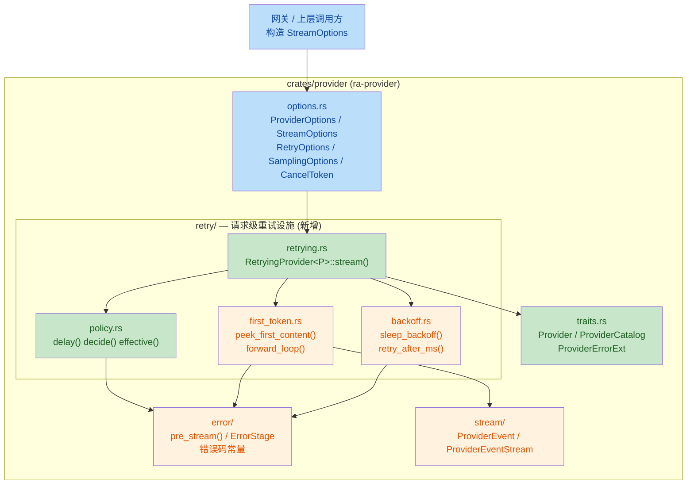
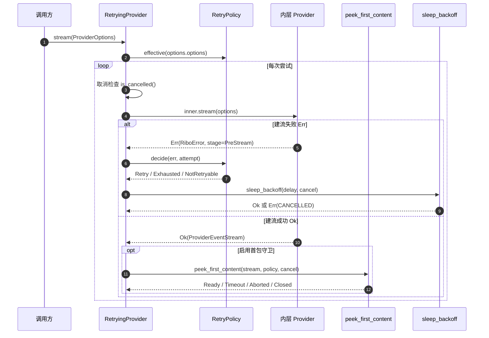
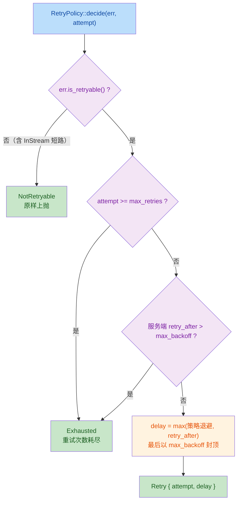

# 📋 代码变更审查报告 — `ra-provider` 重试设施与流式选项扩展

> 2026年10月23日

## 1. High-Level Summary (TL;DR)

> **Impact: 🔴 High**
> 本次变更在 `ra-provider` crate 内落地了完整的**请求级重试设施**（指数退避 + 抖动、服务端 `retry_after` 协商、首包超时守卫、自带重试的 Provider 包装器），同时**扩展了流式请求的入参模型**（`StreamOptions` / `RetryOptions` / `SamplingOptions` / `CancelToken`），并顺带修复了 `ra-core` 的一个模块声明缺失导致的编译错误。

**Key Changes（5 项）**

| # | 变更 | 位置 | 性质 |
|---|------|------|------|
| 1 | 🆕 新增 `retry/` 模块（4 个子模块 + 统一导出） | `crates/provider/src/retry/` | **核心新增** |
| 2 | 🆕 `ProviderOptions` 新增 `options: &'a StreamOptions` 字段，新增 4 个入参结构体 | `crates/provider/src/options.rs` | **破坏性 API 变更** |
| 3 | 🔧 `Provider` / `ProviderCatalog` trait 契约文档精简重写（签名未变） | `crates/provider/src/traits.rs` | 文档 |
| 4 | 🔧 `ra-core` 补上 `pub(crate) mod serde_fn;` 声明 | `crates/core/src/utils/mod.rs` | **编译修复** |
| 5 | 📦 `rand` 从"注释状态"提升为 workspace 正式依赖并接入 provider | `Cargo.toml`、`crates/provider/Cargo.toml` | 依赖 |

---

## 2. Visual Overview（代码与逻辑地图）

### 2.1 模块职责与依赖关系

### 2.2 `RetryingProvider::stream()` 请求时序

### 2.3 `RetryPolicy::decide()` 决策树

---

## 3. Detailed Change Analysis（详细变更分析）

### 3.1 🆕 组件 A：请求级重试设施 `retry/`（全新模块）

模块入口 `crates/provider/src/retry/mod.rs` 统一导出 `first_token::*`、`policy::*`、`retrying::*`（`backoff` 保持 `pub(crate)` 私有，仅内部使用）。

#### A-1 `policy.rs` — 指数退避曲线 + 重试判定

**What Changed**：新增 `RetryPolicy` 结构体，把"等待多久"与"要不要重试"两个决策分离。

- `delay(attempt)`：`initial_backoff × multiplier^attempt` → 以 `max_backoff` 封顶 → 叠加 `±jitter_ratio` 的随机抖动 → `.max(0.)` 防负值。
- `decide(err, attempt)`：按 **不可重试 → 次数耗尽 → 服务端建议超限** 三级短路判定。
- `effective(options)`：按请求级 `StreamOptions.retry` 覆盖策略副本。

> ⚠️ **注意**：`jitter_ratio` 使用 `rand::random_range(-jitter_range..jitter_range)`，`jitter_range` 为 `f64` 纳秒值；`initial_backoff.as_nanos() as f64 * exp` 在 `attempt` 较大时可能先溢出 `f64` 精度，但因 `max_backoff` 封顶发生在乘法之后、结果远小于 `u64::MAX`，实际安全。

| `RetryPolicy` 字段 | 类型 | 默认值 | 说明 |
|---|---|---|---|
| `initial_backoff` | `Duration` | `500ms` | 首次重试的基础退避 |
| `max_backoff` | `Duration` | `30s` | 单次退避上限 |
| `multiplier` | `f64` | `2.0` | 指数底数 |
| `max_retries` | `u32` | `3` | 最大重试次数（不含首次请求） |
| `jitter_ratio` | `f64` | `0.25` | 抖动比例，防重试风暴 |

| `RetryDecision` 变体 | 触发条件 | 上层动作 |
|---|---|---|
| `Retry { attempt, delay }` | 可重试且未耗尽 | `sleep_backoff(delay)` 后 `attempt += 1` 重来 |
| `Exhausted` | `attempt >= max_retries` **或** `retry_after > max_backoff` | 原样上抛错误 |
| `NotRetryable` | `err.is_retryable() == false` | 原样上抛错误 |

#### A-2 `backoff.rs` — 可取消的退避休眠

**What Changed**：

- `retry_after_ms(err)`：从 `err.context()["retry_after_ms"]` 解析服务端建议等待时长（毫秒）。
- `sleep_backoff(delay, cancel)`：**零延迟直接返回**；无令牌走普通 `tokio::time::sleep`；有令牌则用 `tokio::select!` 让"休眠"与"取消"竞争，取消先到即返回 `pre_stream(CANCELLED, "retry backoff aborted")`——避免在已取消的任务上白等一个完整退避周期。

#### A-3 `first_token.rs` — 首包（TTFT）超时守卫 ⭐

**What Changed**：新增"**窥视（peek）**"机制——在把事件流交付给调用方**之前**，先在限定时限内等待首个**内容事件**，确认上游真的在产出内容后再交付。

- `FirstTokenPolicy { timeout: Duration, retry_on_timeout: bool }`
- `Peeked` 枚举（`pub(crate)`）四态：`Ready(new_stream)` / `Timeout` / `Aborted` / `Closed`。
- `peek_first_content(stream, policy, cancel)`：循环检查取消 → `tokio::time::timeout` 等待下一事件 → 命中内容或终结事件即**无损转发**已窥视事件到新流后返回 `Ready`。
- `forward_loop()`：后台任务，先推送缓存事件，再转发原流剩余事件；**若原流在终结事件前意外关闭，合成 `STREAM_INTERRUPTED` 错误终结新流**，防止调用方永久挂起。
- `terminal_producer()`：按 `Done` / `Error` 类型分派终结。

> 💡 **关键设计**：`ProviderEvent::is_content()` **不把 `Start` 事件算作内容**（`stream/event.rs:132`），这正是 TTFT 守卫的语义基础——"从建流成功到首内容事件的间隔"必须排除流建立信号。

#### A-4 `retrying.rs` — 自带重试的 `Provider` 包装器

**What Changed**：新增 `RetryingProvider
 { inner: P, policy: RetryPolicy, first_token: Option<FirstTokenPolicy> }`，以 builder 风格 `with_first_token_guard()` 启用首包守卫。

`impl<P: Provider> Provider for RetryingProvider
` 的三条分流路径：

| 分支 | 触发条件 | 处置 |
|---|---|---|
| 建流失败 | `inner.stream()` 返回 `Err` | 走 `decide()` → 重试 / 上抛 |
| 首包超时 | `Peeked::Timeout` 且 `retry_on_timeout == true` | 构造 `TIMEOUT` 错误 → `decide()` → 重试 |
| 首包超时（禁重试） | `Peeked::Timeout` 且 `retry_on_timeout == false` | 直接返回 `TIMEOUT` 错误 |
| 流提前关闭 | `Peeked::Closed` | 视为 `TRANSPORT` 错误 → `decide()` → 重试 |
| 取消 | `Peeked::Aborted` / 尝试前已取消 / 退避期间取消 | 返回 `CANCELLED`，**不计入上游故障** |

同时覆写 `is_retrying_provider() -> true`，供上层避免"重试的重试"。

---

### 3.2 🆕 组件 B：流式请求入参模型（`options.rs`）

**What Changed**：`ProviderOptions` 从"2 字段"扩展为"3 字段"，并引入一整套运行时选项结构体。

| 结构体 | 字段 | 类型 | 默认值 | 当前消费方 |
|---|---|---|---|---|
| `ProviderOptions<'a>` | `model` | `&'a Model` | — | 适配器 |
| | `context` | `&'a Context` | — | 适配器 |
| | **`options`** 🆕 | **`&'a StreamOptions`** | — | **重试层 / 适配器** |
| `StreamOptions` | `timeout` | `Option<Duration>` | `None` | ⚠️ **无消费点** |
| | `retry` | `RetryOptions` | `default()` | `RetryPolicy::effective()` |
| | `sampling` | `SamplingOptions` | `default()` | 适配器（尚未实现） |
| | `max_tokens` | `Option<u64>` | `None` | 适配器 |
| | `thinking_budgets` | `Option<ThinkingBudgets>` | `None` | 适配器 |
| | `cancel` | `Option<CancelToken>` | `Some(CancelToken::new())` | 重试层 / 首包守卫 |
| | `extra_headers` | `Vec<(String, String)>` | 空 | 适配器 |
| | `labels` | `BTreeMap<String, String>` | 空 | 打点 / 路由 |
| `RetryOptions` | `max_retries` | `Option<u32>` | `None` → 策略默认 `3` | ✅ `effective()` 消费 |
| | `max_backoff` | `Option<Duration>` | `None` → 策略默认 `30s` | ✅ `effective()` 消费 |
| | `first_token_timeout` | `Option<Duration>` | `None` | ❌ **无消费点（文档已声明为预留）** |
| `SamplingOptions` | `temperature` / `top_p` / `stop` / `seed` | `Option<f64>` / `Option<f32>` / `Vec<String>` / `Option<u64>` | 全空 | 适配器 |
| `CancelToken` | 包装 `tokio_util::sync::CancellationToken` | — | `new()` | 提供 `cancel()` / `is_cancelled()` / `cancelled()` |

> 📌 **API 设计亮点**：`CancelToken` 用**新类型包装**屏蔽了 `tokio_util` 的具体类型，避免把第三方依赖泄漏进公共 API；同时 `StreamOptions::default()` 预置一个**未触发的**令牌，使"上层随时可中止"成为零成本默认能力。

---

### 3.3 🔧 组件 C：`Provider` / `ProviderCatalog` 契约文档（`traits.rs`）

**What Changed**：**签名完全未变**，仅重写文档注释。

| 方法 | 变更前 | 变更后 |
|---|---|---|
| `Provider::models()` | "全部模型描述…返回借用切片，调用方不得跨越 `await` 长期持有" | "模型列表"（删去生命周期告警） |
| `Provider::supports()` | "按 `models` 的 `id` 做**精确匹配**" | "**线性查找**，实现方可按需覆盖"（更贴合 `iter().any()` 实现） |
| `Provider::is_retrying_provider()` | 详细说明"由于 `Arc<dyn Provider>` 无法通过 `type_name` 判别具体类型，该标记是唯一的叠加防护手段" | 精简为一句，**丢失了关键设计理由** ⚠️ |
| `Provider::stream()` | 详述参数/返回值 + "provider/模型不存在、鉴权失败、限流、连接失败等" | 改为标准 `# Errors` 段，并**新增重要约束**："流内失败必须经 `ProviderEventStreamProducer::error` 终结" |
| `ProviderCatalog` | "注册表的只读查询视图…不关心具体实现" | "提供方注册表抽象…支持跨全部已注册提供方检索模型，供网关层做路由与降级选型" |

> ⚠️ **契约冲突**：trait 级"实现契约"第 3 条仍写着 *"实现内部不得自行重试，重试归属 `ra-retry` 层或网关"*，但本仓库**并不存在 `ra-retry` crate**（`crates/` 下仅 `core` 与 `provider`），而重试已内置于 `ra-provider::retry`。该文案已过时。

---

### 3.4 🔧 组件 D：`ra-core` 编译修复（`utils/mod.rs`）

**What Changed**：新增一行模块声明 `pub(crate) mod serde_fn;`。

**为什么这是关键修复**：`crates/core/src/message/content.rs:48` 已经在使用
`#[serde(default, skip_serializing_if = "crate::utils::serde_fn::is_false")]`
而 `serde_fn.rs` 文件虽然存在，但 `utils/mod.rs` **未声明该模块** → 触发 `E0433: use of unresolved module or unlinked crate`。本次改动补齐了声明，**修复了 `ra-core` 的编译**。

> 同时该文件顶部注释自述"本模块仅对 crate 内部可见（`mod utils`）"，但 `crates/core/src/lib.rs:28` 实际是 `pub mod utils;`——注释与实现不符（`pub(crate)` 的 `serde_fn` 子模块除外）。

---

### 3.5 📦 组件 E：依赖变更

| 包 | 变更前 | 变更后 | 用途 |
|---|---|---|---|
| `rand` (workspace) | 注释状态 `# rand = "0.10.2"` | **正式依赖** `rand = "0.10.2"` | 退避抖动 |
| `ra-provider` | 无 `rand` | `rand.workspace = true` | 同上 |

> 📌 `Cargo.lock` 实际解析到 **`rand 0.10.3`**。使用 `rand::random_range()`（0.9+ 改名后的 API），与 0.10 兼容。

---

### 3.6 📝 组件 F：rustdoc 链接修复与注释清理

| 文件 | 修复内容 | 原因 |
|---|---|---|
| `error/mod.rs` | `[`constants`]` → `` `constants` ``；`[`stage`]` → `` `stage` `` | `constants` / `stage` 是**私有模块**（`mod constants;`），公开文档链接到私有项会触发 rustdoc 告警 |
| `error/stage.rs` | `[`crate::error::ProviderErrorExt::stage`]` → `[`crate::traits::ProviderErrorExt::stage`]` | `ProviderErrorExt` 在 `error` 中仅为**私有 import**，路径不可达 |
| `error/stage.rs` | `use std::fmt;` → 全面改用 `core::fmt::` | 消除外部 crate `std` 与内置 `core` 的路径歧义，风格统一 |
| `stream/event.rs`、`stream/mod.rs` | `[`crate::error::constants`]` → `` `crate::error` 的错误码常量 `` | 同上，私有模块不可链接 |
| `core/message/tool.rs` | `//` 普通注释 → `///` **文档注释** | `ConstrainedSamplingConfig` 两个变体字段的说明应进入 rustdoc |
| `core/message/tool.rs` | 新增 `ToolChoice` 枚举的文档注释 | 同上 |
| `provider/model.rs` | `ThinkingBudgets` 四个字段注释由"XX 档位的 Token 预算"改为"XX 强度思考的 Token **上限**" | 语义修正：这些值是**上限**而非固定预算 |

---

## 4. Impact & Risk Assessment（影响与风险评估）

### 4.1 ⚠️ 破坏性变更

| # | 破坏点 | 影响面 | 说明 |
|---|---|---|---|
| **B1** | `ProviderOptions` 新增**必填**字段 `options: &'a StreamOptions` | 🔴 全部 Provider 适配器 + 全部调用点 | 结构体字面量构造必须补该字段。当前仓库内**无其他 `impl Provider for`**（仅 `RetryingProvider`），故**当前爆炸半径小**，但适配器落地前必须统一改造 |
| **B2** | `pub mod retry;` 对外导出 | 🟡 公共 API 表面扩大 | `RetryPolicy` / `FirstTokenPolicy` / `RetryingProvider` 成为对外承诺，需考虑语义化版本约束 |
| **B3** | `rand` 进入 workspace 依赖 | 🟡 lockfile 变更 | 解析到 `0.10.3`，需确认 CI 环境的 MSRV 兼容 |

> ✅ **无数据库 Schema 变更、无 HTTP 接口变更**。

---

### 4.2 🔍 风险与待办清单（Review 时重点确认）

| 级别 | 位置 | 问题 | 建议 |
|---|---|---|---|
| 🔴 高 | `options.rs:81` + `policy.rs:107` | **`RetryOptions.first_token_timeout` 无任何消费点**。`effective()` 只覆盖 `max_retries` / `max_backoff`；`FirstTokenPolicy` 只能通过 `with_first_token_guard()` 手工构造。→ 通过 `StreamOptions` 配置的首包超时**永远不会生效** | 在 `effective()` 或 `RetryingProvider::new/stream` 中把该字段接入 `FirstTokenPolicy` |
| 🔴 高 | `retrying.rs:34` | **`RetryingProvider
` 无法包装 trait object**。`P: Provider` 泛型绑定，而 `ProviderCatalog::provider()` 返回的是 `Arc<dyn Provider>`，仓库中**不存在** `impl Provider for Arc<dyn Provider>` → 网关想用重试包装注册表里的提供方时**无法编译** | 补 `impl<P: Provider + ?Sized> Provider for Arc
`，或令 `RetryingProvider` 持有 `Arc<dyn Provider>` |
| 🟠 中 | `first_token.rs:84` | **首包超时是"每事件"计时而非"总时限"**：`tokio::time::timeout(policy.timeout, s.next())` 每轮循环重置计时器。文档语义是"从建流成功到首个内容事件的**最大**等待时长"，实现存在偏差（当前仅 `Start` 一个非内容事件，最坏约 2× timeout，但语义不严谨） | 改用基于 `Instant::now() + policy.timeout` 的**绝对 deadline** |
| 🟠 中 | `traits.rs:96` | **`is_retrying_provider()` 只定义、无人消费**（全仓库检索无调用点）→ "避免叠加多层重试"的防护**尚未接线** | 网关/注册表装配时读取该标记，拒绝二次包装 |
| 🟠 中 | `backoff.rs:24` | **`retry_after_ms` 读取的 `context["retry_after_ms"]` 全仓库无写入方** → 服务端 `Retry-After` 协商路径完全休眠 | 在 `from_http` / `from_reqwest` 中解析 `Retry-After` 头并写入 context |
| 🟡 低 | `options.rs:36` | `StreamOptions.timeout`（整体调用超时）同样**无消费点** | 在 `RetryingProvider::stream` 或适配器层落实 |
| 🟡 低 | `policy.rs:93` | 服务端建议等待超过 `max_backoff` 时返回 **`Exhausted`**，日志会误报为"重试次数已耗尽"，排障时易误判 | 增设 `RetryDecision::Aborted`（或 `ServerSaysWaitLonger`）区分 |
| 🟡 低 | `traits.rs:78` | trait 级"契约"第 3 条仍指向**不存在的 `ra-retry` crate** | 同步更新为 `ra-provider::retry` |
| 🟡 低 | `traits.rs:92` | `is_retrying_provider` 文档删除了"`Arc<dyn Provider>` 无法 `type_name` 判别具体类型，该标记是唯一的叠加防护手段"这一**关键设计理由** | 建议恢复该句 |
| 🟡 低 | `first_token.rs:103` | `tokio::spawn(forward_loop(...))` 引入**后台任务**；若调用方立即丢弃 `new_stream`，转发任务会因 `producer.push()` 返回 `false` 而退出——行为正确，但需确认无任务泄漏 | 补一个"消费端提前 drop"的用例 |

---

### 4.3 🧪 测试建议（Reviewer 应覆盖的场景）

**`RetryPolicy`（纯函数，最易测）**
- [ ] `delay(0/1/2/3)`：验证 `500ms → 1s → 2s → 4s`，并确认 `max_backoff=30s` 封顶生效
- [ ] 抖动边界：连续采样 100 次，结果均落在 `±25%` 区间内且**恒为非负**
- [ ] `decide()`：不可重试码（如 `AUTH_FAILED`）→ `NotRetryable`；`attempt >= max_retries` → `Exhausted`；`retry_after > max_backoff` → `Exhausted`；`retry_after < max_backoff` → `Retry` 且 `delay = max(退避, retry_after)`
- [ ] `effective()`：显式覆盖 `max_retries`/`max_backoff` 生效；`None` 时保留策略原值

**`sleep_backoff`**
- [ ] `delay = 0` → 立即返回 `Ok`
- [ ] 无取消令牌 → 正常休眠后 `Ok`
- [ ] 退避期间触发取消 → 返回 `CANCELLED` 且**不计入上游故障**

**`peek_first_content` / `forward_loop`**
- [ ] 内容事件在时限内到达 → `Ready`，且**窥视到的事件无损转发**（数量、顺序、内容完全一致）
- [ ] `Start` 事件**不**被判定为内容（TTFT 语义）
- [ ] 超时 → `Timeout`；取消 → `Aborted`；流提前关闭 → `Closed`
- [ ] 原流在终结事件前关闭 → 合成 `STREAM_INTERRUPTED` 终结事件，消费端**不永久挂起**（`result()` 能收到终态）

**`RetryingProvider`**
- [ ] 内层前 2 次 `Err(SERVER_ERROR)`、第 3 次 `Ok` → 最终返回 `Ok`，且实际调用次数为 3
- [ ] 内层始终 `Err` → 耗尽后**上抛原始错误**（不吞错、不改码）
- [ ] `is_retrying_provider()` 返回 `true`
- [ ] 退避期间取消 → 返回 `CANCELLED`，重试次数**不再增加**
- [ ] **契约回归**：`InStream` 阶段错误**绝不触发重试**（`is_retryable()` 阶段门短路生效）

**构建与文档**
- [ ] `cargo build --workspace` / `cargo clippy --all-targets -- -D warnings` 通过
- [ ] `cargo doc --no-deps` **零 broken intra-doc link 告警**（本次大量修改 rustdoc 链接）
- [ ] `cargo test -p ra-core`（验证 `serde_fn` 模块声明修复后 `ThinkingContent` 的 `skip_serializing_if` 行为不变：`redacted=false` 不输出）

---

### 4.4 ✅ 做得好的地方

- **阶段门纪律性好**：`retrying.rs` 严格遵守 Provider 契约——只对 `PreStream` 错误重试，流内错误一律经终结事件上抛。
- **取消语义正确**：退避期取消返回 `CANCELLED`（`Severity::Debug`，非故障），不污染上游错误统计。
- **防挂起兜底**：`forward_loop` 在原流异常关闭时**合成 `STREAM_INTERRUPTED`** 终结事件，符合 `ProviderEventStreamProducer` 的"永不永久挂起"不变量。
- **API 不泄漏依赖**：`CancelToken` 新类型包装屏蔽 `tokio_util`；`RetryingProvider` 以 builder 而非多参数暴露配置。
- **文档注释质量高**：新增模块的 rustdoc 含参数表、返回值、处理流程伪码与 `# Errors` 段，符合 crate 既有文档风格。