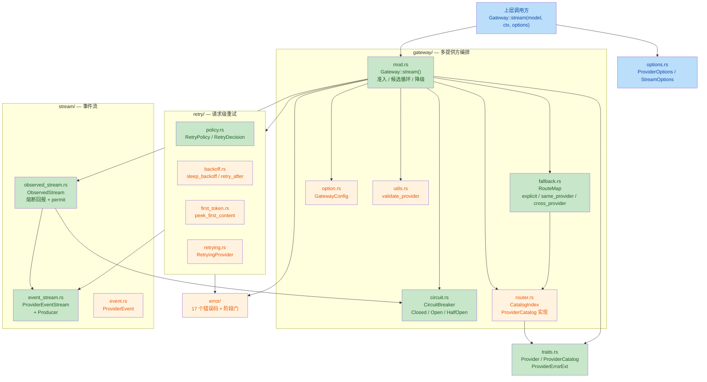
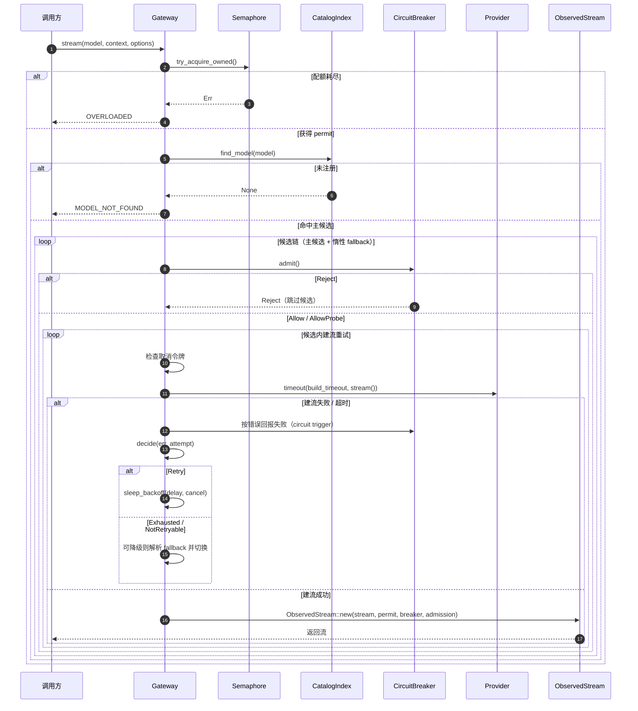
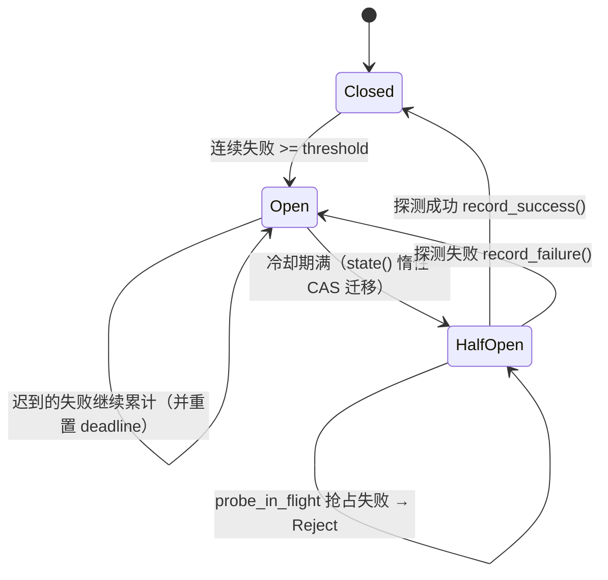
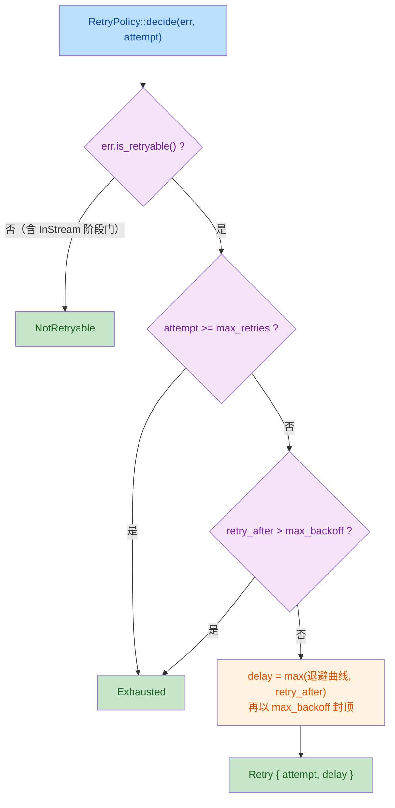

# 🔍 代码审查与总结报告 — `ra-provider` 网关、重试与事件流

> 2026年10月27日

## 1. High-Level Summary (TL;DR)

> **Impact: 🔴 High**
> 本次变更在 `ra-provider` 中落地了**多提供方网关**（信号量准入 → 目录路由 → 熔断准入 → 建流重试 → 降级链切换 → 观察流），把事件流传输层从 `stream/mod.rs` 拆分为 `event_stream.rs`，并新增 `ObservedStream` 承担熔断回报与在途配额释放。重试层同时修复了零抖动配置下的随机采样 panic。

**审查范围**：工作区暂存区 15 个文件，`+1474 / −242` 行。重点为 `gateway/` 六个新文件、`stream/` 拆分与新增、`retry/policy.rs` 修复。

**质量门禁结果**

| 门禁 | 命令 | 结果 |
|---|---|---|
| 格式化 | `cargo fmt --all -- --check` | ✅ 通过 |
| 静态检查 | `cargo clippy --workspace --all-targets -- -D warnings` | ✅ 0 告警 |
| 编译 | `cargo check --workspace` | ✅ 通过 |
| 测试 | `cargo test --workspace` | ✅ 61 passed / 1 ignored（10 ra-core + 22 ra-provider + 29 doctest） |

**Key Changes（5 项）**

| # | 变更 | 位置 | 性质 |
|---|------|------|------|
| 1 | 🆕 新增 `gateway/`（熔断、降级、目录、配置、校验、编排） | `crates/provider/src/gateway/` | **核心新增** |
| 2 | 🆕 新增 `ObservedStream`（熔断回报 + 配额释放 + 空闲超时） | `crates/provider/src/stream/observed_stream.rs` | **核心新增** |
| 3 | 🔧 事件流传输层拆出 `event_stream.rs` | `crates/provider/src/stream/` | 结构重构 |
| 4 | 🔧 退避抖动空区间保护（`jitter_ratio = 0` 不再 panic） | `crates/provider/src/retry/policy.rs#L62-L71` | **缺陷修复** |
| 5 | 🔧 模块出口补 `options` / `retry` / `gateway`，`ids` 增加 `ModelRef` | `lib.rs`、`ids.rs` | API 表面扩大 |

**核心结论（按优先级）**

1. 🔴 **网关无法在 crate 外配置**：`GatewayConfig` 与 `RouteMap` 所在模块是私有的且未重新导出，`Gateway::new` / `Gateway::with_routes` 对外不可用（只能靠类型推断传 `Default`，无法改字段或插入路由）。
2. 🔴 **半开探测许可可能永久泄漏**：探测请求在“准入后、首次尝试前”被取消时，`probe_in_flight` 保持 `true`，后续请求在半开状态被永久拒绝。
3. 🟠 **路由不确定**：`CatalogIndex::find_model` 遍历 `HashMap`，同一模型存在于多个提供方时，选中哪一家取决于哈希顺序。
4. 🟠 **超时语义漂移**：`StreamOptions.timeout` 文档写“整个流式调用”，网关实际只把它当**建流超时**；流内空闲由另一配置控制。
5. 🟠 **测试覆盖失衡**：22 个 provider 单元测试全部集中在 `retry/`，`gateway/` 与 `ObservedStream` **零单元测试**。

---

## 2. Visual Overview（代码与逻辑地图）

### 2.1 模块职责与依赖关系

### 2.2 `Gateway::stream()` 请求时序

### 2.3 熔断器状态机

### 2.4 重试决策树

---

## 3. Detailed Change Analysis（详细审查）

### 3.1 🌐 网关编排 `gateway/mod.rs`

**What Changed**：新增 `Gateway`，把“准入、解析、熔断、建流、重试、降级、观察”串成一条请求路径。

**请求路径（`Gateway::stream`）**

| 阶段 | 行为 | 位置 |
|---|---|---|
| 1. 并发准入 | `try_acquire_owned()`，超限立即 `OVERLOADED`；permit 由 `ObservedStream` 持有至终结 | `#L182-L186` |
| 2. 主候选解析 | 读锁内 `find_model`，未注册返回 `MODEL_NOT_FOUND` | `#L188-L200` |
| 3. 超时与策略合并 | `timeout` 缺省填入 `default_timeout`；`retry.effective(&options)` | `#L202-L213` |
| 4. 候选链循环 | 主候选 + 惰性解析的 fallback；提供方缺失则跳过 | `#L215-L240` |
| 5. 熔断准入 | `Reject` 跳过并记入链摘要；`AllowProbe` 需终结时回报 | `#L241-L249` |
| 6. 候选内重试 | 每轮取消检查 → `timeout(build_timeout, stream())` | `#L251-L381` |
| 7. 建流成功 | 移交 `ObservedStream`（permit、breaker、admission、idle timeout） | `#L277-L285` |
| 8. 建流失败/超时 | `is_circuit_trigger` 回报失败；`decide` 分派重试或降级 | `#L287-L380` |
| 9. 链耗尽 | `last_err` 或被熔断全拒（`CIRCUIT_OPEN`），附链摘要返回 | `#L385-L389` |

**熔断回报的 `accounted` 语义（正确但隐蔽）**

- 错误为 `is_circuit_trigger()` 时立即 `record_failure()` 并置 `accounted = true`（`#L288-L291`、`#L342-L345`）。
- 进入 `Exhausted | NotRetryable` 后，仅当“半开探测且此前未回报”才补记失败（`#L310-L312`、`#L361-L363`），避免同一错误二次计数。
- 该设计依赖“所有可重试错误都是 circuit trigger”这一事实（`is_retryable` 的五个码全部包含在 `is_circuit_trigger` 中），当前成立，但属于隐式耦合。

**错误链摘要 `with_chain_summary`**

- 仅在 message 末尾追加 `fallback chain: ...`，保留原错误全部 context（`#L396-L410`）。
- 但重建时调用 `pre_stream(err.code(), ..)`，会**重新推导 severity 并丢弃 `source`**（见风险 R17）。

### 3.2 ⚡ 熔断器 `gateway/circuit.rs`

**What Changed**：新增无锁三态熔断器，用 `AtomicU8` + CAS 完成状态迁移，用相对 `tokio::time::Instant` 计时。

| 方法 | 语义 | 关键实现 |
|---|---|---|
| `state()` | 读取状态；Open 且冷却期满时惰性迁移 HalfOpen | `compare_exchange(OPEN, HALF_OPEN)` 抢占（`#L79-L102`） |
| `admit()` | Closed 放行；Open 拒绝；HalfOpen 用 CAS 抢占唯一探测 | `probe_in_flight.compare_exchange(false, true)`（`#L108-L125`） |
| `record_success()` | 清零失败计数、闭合、复位探测 | `#L127-L132` |
| `record_failure()` | 累计失败；HalfOpen 或达阈值即打开 | `#L138-L152` |

**设计亮点**

- 状态机无锁，可直接在并发请求路径调用。
- 时间基准用 `Instant` 而非墙钟，避免系统时间回拨影响冷却判断。
- 探测资格用 CAS 抢占，保证半开状态同时只有一个探测请求。

**注意点**

- `state()` 是一个“会写状态的 getter”，调用即可能触发 Open → HalfOpen 迁移，属于有副作用查询。
- 熔断已 Open 后，迟到失败仍执行 `deadline_ms.store(now)`，会不断延后冷却起点（R9）。
- `threshold = 0` 时首次失败即打开；无配置校验（R18）。

### 3.3 🧭 降级路由 `gateway/fallback.rs`

**What Changed**：新增 `RouteMap`，按优先级解析降级候选。

| 级别 | 触发条件 | 行为 |
|---|---|---|
| 一级 `explicit` | `(provider, model)` 精确命中 | 目标存在即只返回该候选并短路；映射到自身或目标缺失则告警后继续 |
| 二级 `same_provider` | 错误可降级 | 把**模型名级**备选链投到主提供方目录求值 |
| 三级 `cross_provider` | 错误可跨提供方降级 | 目标提供方有同名模型则直命中；否则把同一份模型名级链投到目标目录求值（“主链 ∩ 目标目录”） |

**语义确认**：`same_provider` 的键是 `ModelId`（提供方无关），不存在“主提供方专属链 / 目标提供方链”的区分；跨命名体系的精确备选应通过 `explicit` 表达。该实现与注释一致。

**候选去重**：`push_candidate` 剔除与主候选完全相同、以及结果中已存在的 `(provider, model)`（`#L157-L171`）。

**已知限制**

- fallback 只在**首次**遇到可降级错误时解析一次（`fallbacks_resolved`，`gateway/mod.rs#L219`、`#L315-L323`）。若首个错误只能同提供方降级（如 `SERVER_ERROR`），后续本可跨提供方的机会不会被补上（R7）。
- 静态链匹配依赖各提供方共享模型命名；目标提供方命名体系不同时链式匹配会落空，属于设计边界。

### 3.4 🗂️ 目录与注册校验 `router.rs` / `utils.rs`

**What Changed**：新增 `CatalogIndex`（`ProviderCatalog` 的内存实现）与注册前校验。

| 项 | 行为 |
|---|---|
| `CatalogIndex::provider` | 按 ID 克隆出 `Arc<dyn Provider>` |
| `CatalogIndex::model` | 在指定提供方内按 `ModelId` 查找并克隆 |
| `CatalogIndex::find_model` | 遍历全部提供方，返回**第一个**命中项（`router.rs#L44-L51`） |
| `validate_provider` | 四个规则：模型非空、模型归属一致、窗口/输出限额非零且 `max_tokens <= context_window`、模型 ID 不重复（`utils.rs#L27-L120`） |

**注册路径**

- `Gateway::register` 先 `validate_provider`，再拒绝 `is_retrying_provider()`（`RETRY_PROVIDER_REFUSED`），最后拒绝重复 ID（`DUPLICATE_PROVIDER`）。
- 该检查把 ai_0006 中“`is_retrying_provider` 只定义、无人消费”的悬空防护接线落地。

**缺口**

- `find_model` 依赖 `HashMap` 迭代顺序，同名模型多提供方时路由不确定（R3）。
- `validate_provider` 未检查 `base_url` 非空，而 `Model::validate` 会检查；两套规则重叠但不一致（R14）。

### 3.5 👁️ 观察流 `stream/observed_stream.rs`

**What Changed**：新增 `ObservedStream`，在建流成功后接管原始流。

**终结语义**

| 事件 | 熔断回报 | 配额 |
|---|---|---|
| `Done` | `record_success()` | 释放 |
| `Error`（非取消/内容过滤） | `record_failure()` | 释放 |
| `Error`（`Aborted` / `CANCELLED` / `CONTENT_FILTERED`） | 不回报 | 释放 |
| 空闲超时 | 合成 `TIMEOUT` 终结，`record_failure()` | 释放 |

**两条消费路径**

- `next()`：逐事件读取；配置 `idle_timeout` 时用 `select!` 竞争“下一事件”与“休眠”，超时则回收原流并合成 `TIMEOUT` 终结事件（`#L117-L172`）。
- `result()`：直接等待终态；`idle_timeout` 作为整体等待预算；终结后按结果回报熔断（`#L174-L224`）。

**恰好一次回报**：`observed` 标志保证 `next()` 与 `result()` 共享同一套观察语义，先到者回报、后到者跳过（`#L198-L220`）。当前修复后不再有无效的 `observed = true` 尾赋值。

**注意点**

- `next()` 的空闲计时是“每次调用重新计时”，`result()` 是“整体一次计时”，两者语义不完全一致（R13）。
- `next()` 的超时分支合成消息时 provider/model 为空串，丢失流元信息（低风险）。

### 3.6 🌊 事件流传输 `stream/event_stream.rs` + `stream/mod.rs`

**What Changed**：把 `ProviderEventStream` / `ProviderEventStreamProducer` 从 `stream/mod.rs` 移到 `event_stream.rs`，`mod.rs` 只保留模块导出。

**不变量（文档与实现一致）**

1. `Start` 必须先于其他事件；
2. 终结唯一：`done` / `error` 消费 `self`，编译期排除二次终结；
3. 生产端未终结即 drop → `result()` 返回 `Err(STREAM_INTERRUPTED, InStream)`，永不永久挂起。

**`from_result` 折叠**

- `Err(e)` → 构造只含 `Error` 终结事件的即时流，保留 `e.code()`。
- 但读取 `context["provider"]` / `context["model"]` 还原元信息，而 `error/mod.rs` 的构造器**从未写入这两个键**，因此折叠消息的 provider/model 为空串（R8，ai_0005 起遗留）。

### 3.7 🔁 重试层 `retry/*`

| 子模块 | 内容 | 本次变化 |
|---|---|---|
| `policy.rs` | `RetryPolicy`、`RetryDecision`、`effective()` | 空抖动区间保护：`jitter_range <= 0` 时跳过 `rand::random_range`（`#L62-L71`） |
| `backoff.rs` | `sleep_backoff`（可取消）、`retry_after_ms` | 无变化 |
| `first_token.rs` | `peek_first_content`、`forward_loop` | 无变化 |
| `retrying.rs` | `RetryingProvider
` | 无变化 |

**退避曲线**：`initial × multiplier^attempt` → `max_backoff` 封顶 → ±`jitter_ratio` 抖动 → 非负钳制（`policy.rs#L56-L73`）。

**测试现状**：`retry/` 下四个文件均有 `#[cfg(test)]`，共 22 个用例，覆盖退避曲线、抖动边界、不可重试/流内短路、次数耗尽、`retry_after` 协商、`effective` 覆盖、零延迟休眠、退避期取消、首包无损转发、首包超时、流提前关闭合成 `STREAM_INTERRUPTED`、重试成功/耗尽/取消等。

**遗留问题**

- `RetryOptions.first_token_timeout` 仍无消费点；网关又不接受 `RetryingProvider`，首包守卫在当前网关路径不可达（R5）。
- `retry_after > max_backoff` 返回 `Exhausted`，与“重试次数耗尽”同码，日志易误判（R11）。
- `RetryingProvider
` 不能包装 `Arc<dyn Provider>`（R12）。

### 3.8 📤 公共 API 出口与依赖

**What Changed**：`lib.rs` 模块导览补 `options` / `retry` / `gateway`；`ids.rs` 新增 `ModelRef` 类型别名；`Cargo.toml` 增加依赖（`gateway` 使用 `dashmap`、`tokio::sync::Semaphore`）。

**关键出口问题**

- `gateway/mod.rs` 中 `mod option;`、`mod fallback;` 为私有模块，`GatewayConfig`、`RouteMap` 未 `pub use`。
- 结果是 `Gateway::new(config)`、`Gateway::with_routes(route)` 在 crate 外**无法正常构造参数**：类型不可命名，rustdoc 也不会展示；只能依赖 `Default::default()` 的类型推断，既不能改字段，也不能插入降级路由。
- `gateway::circuit` 是 `pub mod`，`CircuitBreaker` / `Admission` 可用；`ObservedStream` 经 `stream::*` 导出，可用。

---

## 4. Impact & Risk Assessment（影响与风险评估）

### 4.1 交付级问题（P0）

| # | 问题 | 影响 |
|---|---|---|
| P0-1 | `GatewayConfig` / `RouteMap` 未导出 | 网关对外**不可配置**，降级路由无法注入；公共 API 实际不可用 |
| P0-2 | 半开探测许可泄漏 | 一次取消即可让该提供方在半开状态**永久拒绝**所有请求，且无自愈路径 |

### 4.2 风险与待办清单

| 级别 | 位置 | 问题 | 建议 |
|---|---|---|---|
| 🔴 高 | `gateway/mod.rs#L16-L18`、`#L77`、`#L94` | `GatewayConfig` / `RouteMap` 所在模块私有且未重新导出 | `pub use self::{option::GatewayConfig, fallback::RouteMap};`，并补公共 API 示例 |
| 🔴 高 | `gateway/mod.rs#L241-L262`、`circuit.rs#L108-L125` | 探测准入后、首次尝试前被取消时未归还 `probe_in_flight`，熔断永久停留 HalfOpen | 引入 `ProbeGuard`（Drop 归还）或取消分支显式 `abort_probe()` |
| 🟠 中 | `router.rs#L44-L51` | `find_model` 遍历 `HashMap`，同名模型多提供方时路由不确定 | 注册期拒绝跨提供方同名模型，或引入显式提供方优先级并排序 |
| 🟠 中 | `options.rs#L35-L36`、`gateway/mod.rs#L202-L211`、`#L283` | `timeout` 文档为“整个流式调用”，实际仅作建流超时；流内另用 `stream_idle_timeout` | 拆分/重命名字段（`build_timeout`），或落实整体 deadline |
| 🟠 中 | `options.rs#L78-L81`、`retrying.rs#L55`、`gateway/mod.rs#L125` | `first_token_timeout` 无消费点；网关拒绝 `RetryingProvider`，首包守卫不可达 | 将首包策略接入网关候选循环，或删除预留字段 |
| 🟠 中 | `gateway/*`、`stream/observed_stream.rs` | 网关与观察流零单元测试 | 按 4.3 补齐；重点覆盖 R2 与降级/熔断分支 |
| 🟠 中 | `gateway/mod.rs#L219`、`#L315-L323` | fallback 只解析一次，可能错过后续的跨提供方机会 | 每次新的可降级错误都解析并去重，或按错误类型增量补全 |
| 🟡 低 | `event_stream.rs#L118-L149`、`error/mod.rs#L166-L182` | `from_result` 读取 `provider` / `model` context，但构造器从不写入 | 构造器注入，或让 `from_result` 接收显式元信息 |
| 🟡 低 | `circuit.rs#L138-L151` | Open 后的迟到失败反复 `store(now)`，持续延后冷却起点 | 仅在 Open 迁移时设 `deadline_ms`；迟到失败只累计计数 |
| 🟡 低 | `gateway/mod.rs#L288-L306` | 某次失败已打开熔断后，同一候选的重试仍继续发起请求 | 重试前复查 `state() == Open` 则跳出候选 |
| 🟡 低 | `policy.rs#L99-L103` | `retry_after > max_backoff` 返回 `Exhausted`，与次数耗尽同码 | 新增 `ServerSaysWaitLonger` 变体或在日志中区分 |
| 🟡 低 | `retrying.rs#L37`、`#L62` | `RetryingProvider
` 无法包装 `Arc<dyn Provider>` | 增加 `impl<P: Provider + ?Sized> Provider for Arc
` |
| 🟡 低 | `observed_stream.rs#L117-L173` vs `#L174-L224` | `next` 按单次读取计时，`result` 按整体等待计时 | 统一为绝对 deadline 或每次事件重置 |
| 🟡 低 | `utils.rs#L27-L120`、`model.rs#L366` | 注册校验不检查 `base_url`；与 `Model::validate` 规则重叠；后者未在注册路径复用 | 合并为一套校验，统一返回 `RiboResult` |
| 🟡 低 | `ids.rs#L127-L135` | `Deserialize` 直接 `new()`，绕过 `parse()` 的字符集/非空校验 | 反序列化复用 `parse()` 逻辑 |
| 🟡 低 | `traits.rs#L78` | 契约文档仍写“重试归属 `ra-retry` 层”，该 crate 不存在 | 改为 `ra-provider::retry` 或网关 |
| 🟡 低 | `gateway/mod.rs#L396-L410` | `with_chain_summary` 用 `pre_stream` 重建错误，丢失原 severity 与 `source` | 保留 severity/source，仅追加 message |
| 🟡 低 | `option.rs#L26-L36` | 无配置校验：`threshold = 0`、`max_in_flight = 0`、`timeout = 0` 均可构造 | 提供 `validate()` 或构造期断言 |

### 4.3 🧪 测试建议（Reviewer 应覆盖的场景）

**`CircuitBreaker`**

- [ ] 连续失败达到 `threshold` → `Open`；冷却期未满 `admit() == Reject`
- [ ] 冷却期满 `state()` 惰性迁移 `HalfOpen`；并发调用只有一个完成迁移
- [ ] 半开只放行一个探测：第二个 `admit()` 返回 `Reject`
- [ ] 探测成功 → `Closed` 且失败计数清零；探测失败 → `Open` 且冷却重算
- [ ] Open 后迟到失败不提前进入半开（暴露 R9）

**`Gateway`**

- [ ] 模型未注册 → `MODEL_NOT_FOUND`；配额耗尽 → `OVERLOADED`
- [ ] 注册：重复 ID → `DUPLICATE_PROVIDER`；自带重试 → `RETRY_PROVIDER_REFUSED`；非法模型 → `INVALID_REQUEST`
- [ ] 首次建流失败、第二次成功 → 返回 `ObservedStream`，且失败已计入熔断
- [ ] 重试耗尽且可降级 → 切换到 fallback 候选；不可降级 → 原错误短路
- [ ] 候选熔断打开 → 跳过并在最终错误中带 `circuit-open` 摘要
- [ ] **探测准入后立即取消 → 后续请求仍能重新准入**（暴露 R2）
- [ ] InStream 错误不重试、不降级，原样上抛
- [ ] 所有候选被熔断拒绝 → `CIRCUIT_OPEN`

**`RouteMap`**

- [ ] 不可降级错误 → 空候选
- [ ] `explicit` 命中且目标存在 → 唯一候选并短路
- [ ] `explicit` 映射到自身 / 目标缺失 → 落到后续层级
- [ ] 二级链按主提供方目录过滤
- [ ] 三级：同名模型直命中；否则“主链 ∩ 目标目录”
- [ ] 主候选自身与重复候选被剔除

**`ObservedStream`**

- [ ] `Done` → 成功回报一次、permit 释放
- [ ] `Error` → 失败回报；`Aborted` / `CANCELLED` / `CONTENT_FILTERED` 不回报
- [ ] 空闲超时 → 合成 `TIMEOUT` 终结，且只回报一次
- [ ] 先 `next()` 到终结再 `result()` → 不重复回报
- [ ] `result()` 路径的空闲超时语义与 `next()` 一致（暴露 R13）

**`ProviderEventStream::from_result`**

- [ ] `Err` 折叠流的 `Error.code` 与原错误一致
- [ ] provider/model 元信息是否正确（暴露 R8）

**`GatewayConfig`**

- [ ] 默认值：600s / threshold 5 / cooldown 30s / max_in_flight 100 / idle `None`
- [ ] 非法值（0 阈值、0 配额）是否应被拒绝（暴露 R18）

### 4.4 ✅ 做得好的地方

- **阶段门纪律好**：重试与网关都只对 PreStream 错误做判定，InStream 错误一律上抛，避免“重试与已产出内容重复”。
- **恰好一次回报**：`ObservedStream` 用 `observed` 标志统一 `next()` / `result()` 两条路径，避免重复计数熔断。
- **类型层面保证终结唯一**：`done` / `error` 消费 `self`，适配器无法二次终结。
- **防挂起兜底**：生产端未终结即 drop、首包转发源流提前关闭，都会合成 `STREAM_INTERRUPTED`，消费端不会永久等待。
- **注册防护已接线**：网关拒绝自带重试的提供方，避免叠加多层重试。
- **零抖动修复正确**：空抖动区间不再调用 `random_range`，同时保留 `clamp(0, cap)` 上界。
- **门禁与文档**：fmt / clippy / check / test 全绿；中文模块注释、阶段划分注释齐全，日志均为英文且无敏感信息。
- **重试测试质量高**：覆盖正常路径、取消、契约回归与异常关闭，且用可编排测试桩暴露“计划外调用”。

---

## 5. 变更文件清单速览

| 文件 | 类型 | 变更摘要 |
|---|---|---|
| `crates/provider/src/gateway/mod.rs` | 🆕 | `Gateway`：准入、候选循环、重试、降级、链摘要 |
| `crates/provider/src/gateway/circuit.rs` | 🆕 | 无锁三态熔断器 + `Admission` |
| `crates/provider/src/gateway/fallback.rs` | 🆕 | `RouteMap` 三级降级候选解析 |
| `crates/provider/src/gateway/router.rs` | 🆕 | `CatalogIndex`（`ProviderCatalog` 实现） |
| `crates/provider/src/gateway/option.rs` | 🆕 | `GatewayConfig` 及默认值 |
| `crates/provider/src/gateway/utils.rs` | 🆕 | `validate_provider` 四条注册规则 |
| `crates/provider/src/stream/observed_stream.rs` | 🆕 | 熔断回报、permit 释放、空闲超时 |
| `crates/provider/src/stream/event_stream.rs` | 🆕（拆分） | `ProviderEventStream` / Producer 从 `stream/mod.rs` 移出 |
| `crates/provider/src/stream/mod.rs` | ♻️ | 精简为模块导出 |
| `crates/provider/src/retry/policy.rs` | 🔧 | 空抖动区间保护（防 panic） |
| `crates/provider/src/retry/mod.rs` | 🔧 | 导出 `backoff` 为 `pub(crate)` |
| `crates/provider/src/ids.rs` | 🔧 | 新增 `ModelRef` 类型别名 |
| `crates/provider/src/lib.rs` | 🔧 | 模块导览补 `options` / `retry` / `gateway` |
| `Cargo.toml` / `crates/provider/Cargo.toml` | 🔧 | 依赖调整（`dashmap`、`tokio` 等） |

---

## 6. 结论与建议优先级

| 优先级 | 事项 |
|---|---|
| **P0（合并前）** | 导出 `GatewayConfig` / `RouteMap`；修复半开探测许可泄漏（RAII 或显式归还） |
| **P1（本迭代）** | 消除 `find_model` 路由不确定性；统一 `timeout` 语义；为 `gateway/` 与 `ObservedStream` 补核心测试；明确 `first_token_timeout` 的去留 |
| **P2（后续）** | fallback 增量解析、迟到失败的冷却处理、重试与熔断开环的交互、`from_result` 元信息、校验规则合并 |

整体评价：**架构分层清晰、错误阶段门与终结语义严谨、门禁全绿**；主要短板集中在 **公共 API 出口**、**半开状态的生命周期管理** 与 **网关/观察流的测试空白**。解决 P0 两项后，网关即可在 crate 外被真正装配与验证。
