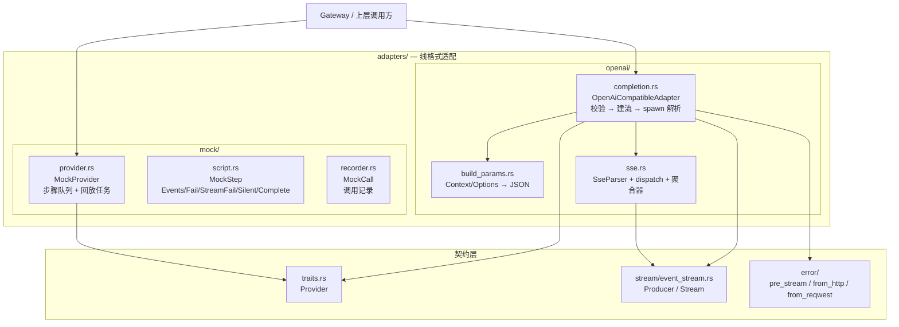
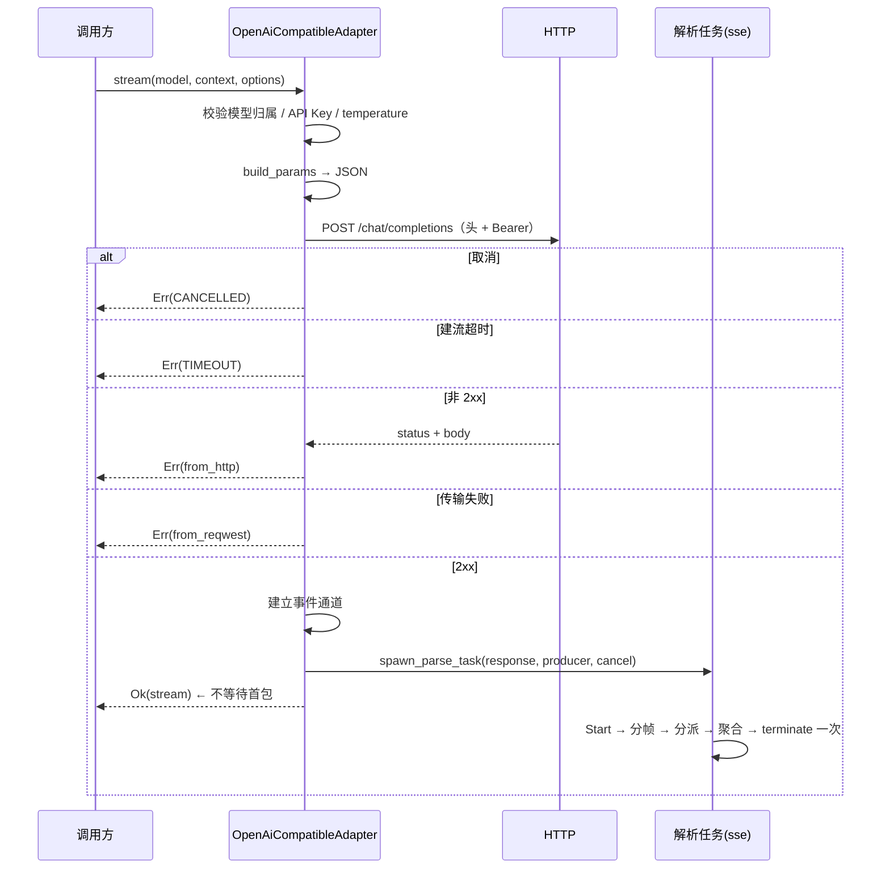
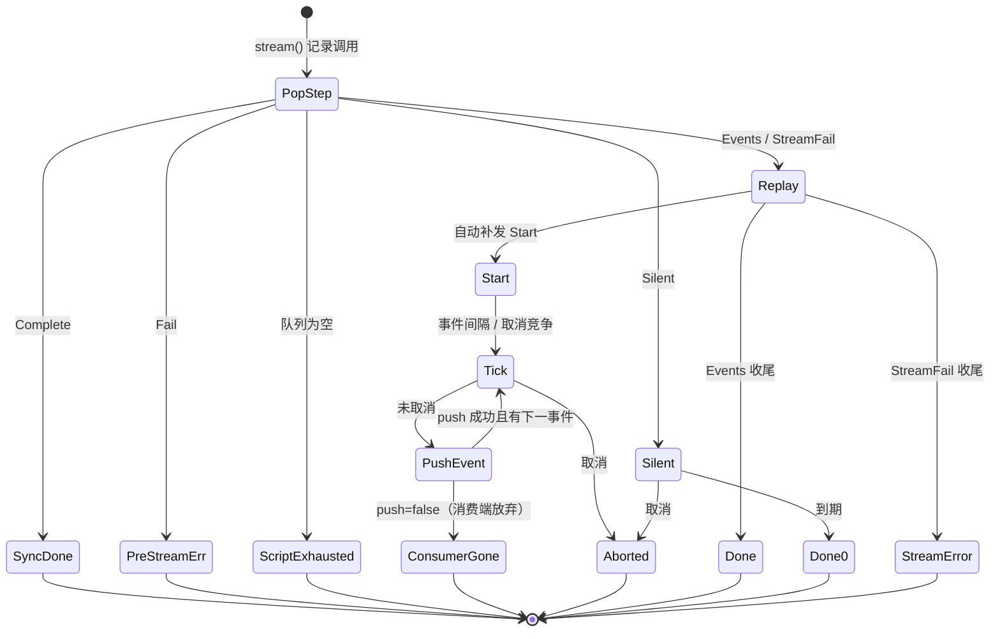
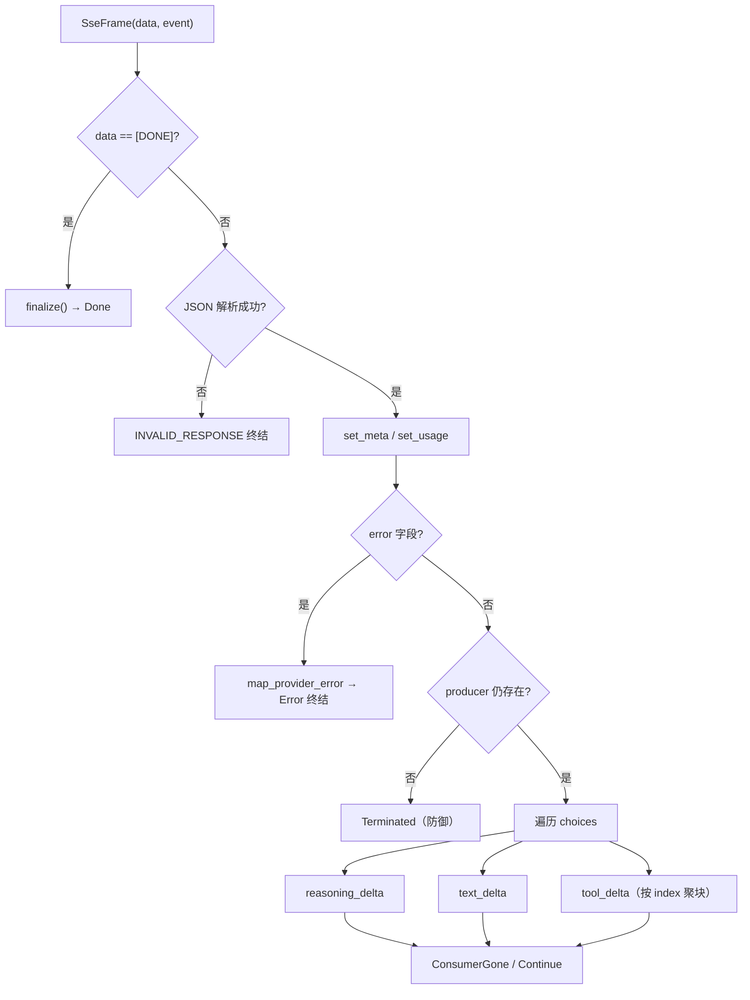

# 🔍 代码审查与总结报告 — `ra-provider` 适配器（mock / OpenAI）

> 2026年10月28日

## 1. High-Level Summary (TL;DR)

> **Impact: 🟠 Medium-High**
> 本次更新新增了 `adapters/` 模块：一个回放式 **mock 适配器**（脚本化步骤 + 调用记录）和一个 **OpenAI 兼容适配器**（请求体构造 → HTTP 建流 → SSE 解析 → 事件聚合）。同时修复了上一轮审查中的 R2 / R8 / R9，并把工作区行覆盖率从 85.56% 提升到 **99.57%**、函数覆盖率提升到 **100%**。

**审查范围**：未提交变更 = 新增 `crates/provider/src/adapters/`（10 个文件，含测试）＋ `lib.rs` 导出＋ `Cargo.toml` 的 `reqwest` `json` 特性＋若干注释；`gateway` / `retry` / `stream` 的缺陷修复已在 HEAD 中。

**质量门禁结果**

| 门禁 | 命令 | 结果 |
|---|---|---|
| 格式化 | `cargo fmt --all -- --check` | ✅ 通过 |
| 静态检查 | `cargo clippy --workspace --all-targets -- -D warnings` | ✅ 0 告警 |
| 编译 | `cargo check --workspace` | ✅ 通过 |
| 测试 | `cargo test --workspace` | ✅ `ra-core` 21、`ra-provider` 193、其它 29（1 ignored） |
| 覆盖率 | `cargo llvm-cov --workspace --summary-only` | ✅ 行 99.57% / 函数 100% / 区域 99.01% |

**Key Changes（5 项）**

| # | 变更 | 位置 | 性质 |
|---|------|------|------|
| 1 | 🆕 OpenAI 兼容适配器（`Provider` 薄壳 + 建流超时/取消/错误映射） | `adapters/openai/completion.rs` | **核心新增** |
| 2 | 🆕 SSE 解析：分帧 → 分派 → 聚合 → 终结（约 1.3k 行） | `adapters/openai/sse.rs` | **核心新增** |
| 3 | 🆕 请求体构造（Context/Options → Chat Completions JSON） | `adapters/openai/build_params.rs` | **核心新增** |
| 4 | 🆕 回放式 mock（步骤脚本、调用记录、限速/取消/静默） | `adapters/mock/*` | 测试基础设施 |
| 5 | 🔧 修复 R2/R8/R9 + 覆盖率达到 99.57% | `gateway/circuit.rs`、`error/mod.rs`、测试 | **缺陷修复** |

**核心结论（按优先级）**

1. 🔴 **`result()` 拿不到工具调用参数**：`sse` 聚合器只把解析后的 `ToolCall` 放进 `ToolCallEnd` 事件，最终 `AssistantMessage` 中仍是占位 `{}`（注释“finalize 时回填”与实现不符）。
2. 🟠 **截断流被当作成功**：EOF 且没有 `[DONE]`/`finish_reason` 时，`finalize` 以 `Stop` 收敛，调用方无法区分“正常结束”和“连接中途断开”。
3. 🟠 **模型信任边界**：适配器只用 `Model.id` 做归属校验，`base_url`、附加 header 全部取自调用方传入的 `Model`；直接调用者可把请求指向任意地址。
4. 🟠 **工具片段累积策略**：`id` / `name` 使用 `push_str` 累加，若提供方在每帧重复下发完整名称，会产生重复拼接。
5. 🟡 **宽松兜底较多**：非法工具参数回退 `{}`、多模态块只保留文本，均静默降级。

---

## 2. Visual Overview（代码与逻辑地图）

### 2.1 模块职责与依赖关系

### 2.2 OpenAI 适配器建流时序

### 2.3 mock 回放状态机

### 2.4 SSE 帧分派决策树

---

## 3. Detailed Change Analysis（详细审查）

### 3.1 🌐 OpenAI 适配器入口 `adapters/openai/completion.rs`

**职责**：把 `Provider::stream` 拆成“本地校验（PreStream）→ 建请求 → 等响应头（受 timeout/cancel 约束）→ 建通道 → spawn 解析（InStream）”。

**做得对的地方**

- 阶段门清晰：模型未暴露 / 缺 Key / 温度非法 / 非 2xx / 传输失败全部在 PreStream 返回，流内错误只在解析任务里产生。
- 超时只包住 `req.send()` 到响应头到达，避免把整个 body 读取期算入建流超时（注释明确）。
- `biased select!` 让取消优先于超时。
- 密钥只进 `bearer_auth`，不写日志与 context。

**问题**

- 🟠 **模型字段信任**：`supports(&model.id)` 只校验 ID，但 `base_url`、`header` 全部来自调用方传入的 `Model`。直接调用方可以保持 ID 合法而替换 `base_url`，把请求发到任意地址（网关场景下由目录解析约束，但公共 API 没有约束）。
- 🟡 只校验 `temperature`（0..2），未校验 `top_p`、`max_tokens`、`stop`。
- 🟡 `resp.text().await` 会先把整个错误体读入内存，之后才由 `from_http` 截断到 512 字节；超大错误页会先占用内存。
- 🟡 未显式发送 `Accept: text/event-stream`（多数兼容服务不强制，但少数网关会据此选择编码）。

### 3.2 📡 SSE 解析 `adapters/openai/sse.rs`

**职责**：`SseParser` 分帧 → `dispatch_frame` 分派 → `StreamAggregator` 聚合 → `spawn_parse_task` 驱动全部终结路径。

**做得对的地方**

- 阶段门完整：JSON 非法 / 工具片段缺 id → `INVALID_RESPONSE`；业务 `error` → 结构化映射；读失败 → `TRANSPORT`；取消 → `Aborted`。
- 解析宽松：多行 `data`、CRLF、注释、无冒号行、未知字段、`reasoning` 别名都能处理；`finish` 会冲刷无空行的末帧。
- `push == false` 的所有路径都静默退出，不会误判为上游故障。
- 终结恰好一次：`finished` 标志 + `producer.take()`。
- 错误映射结构化优先、关键词兜底，且内容安全优先。

**问题**

- 🔴 **最终消息的工具参数丢失**（R1）：开块时写入占位 `arguments: {}`（`sse.rs#L769-L775`），`finalize` 只把解析后的 `ToolCall` 放进 `ToolCallEnd` 事件（`#L887-L918`），随后 `message = self.output.clone()`（`#L927`）——占位从未回填。消费端用 `result()` 拿到的 `ToolCall.arguments` 永远是 `{}`。
- 🟠 **截断流误判成功**（R2）：`Ok(None)` 时冲刷末帧并 `finalize`；`map_stop_reason(None)` 返回 `Stop`。如果连接在正文中途断开且没有 `[DONE]`/`finish_reason`，调用方收到的是“正常结束”。
- 🟠 **id / name 重复拼接**（R4）：`state.id.push_str(id)` / `state.name.push_str(name)`（`#L797-L802`）。OpenAI 只在首片下发，但兼容实现若每片都带完整名称，会得到 `lookuplookup`。
- 🟡 **参数解析失败静默兜底**（R5）：`from_str(...).unwrap_or_else(|_| {})`（`#L895-L903`），截断的参数会被当成空对象，且只在日志里可见。
- 🟡 **单块纪律**：`content_index` / `reasoning_index` 只记录一个下标；同一响应里若文本块关闭后再次出现文本增量，会复用旧下标而不是新开块（当前 OpenAI 流不会这样，但兼容端可能）。
- 🟡 **消费端竞态分支不可测**：Start 前放弃、分帧中放弃、逻辑缺陷兜底等路径依赖调度时机，是覆盖率剩余的 21 行。

### 3.3 🧱 请求体构造 `adapters/openai/build_params.rs`

**做得对的地方**

- 可选字段只在显式提供时写入，避免用默认值覆盖提供方默认。
- 空系统提示不写入；助手仅有工具调用时 `content` 正确置 `null`；`arguments` 输出为 JSON 字符串。
- 工具声明与四种 `tool_choice` 映射完整。

**问题**

- 🟠 **多模态内容被静默丢弃**（R6）：`join_text` 只收集 `Content::Text`（`#L154-L165`），`UserContent::Blocks` 中的图片/思考块直接消失，用户无感知。
- 🟡 `max_tokens` 对部分新模型已弃用（应使用 `max_completion_tokens`），且 `stream_options.include_usage` 并非所有兼容网关都接受。
- 🟡 `stop` 固定发送数组；部分兼容实现只接受字符串（OpenAI 本身两者都支持）。
- 🟡 `tool_choice` 只在 `tools` 非空时写入；只指定 `Named` 而不传工具时会被忽略。

### 3.4 🎭 mock 适配器 `adapters/mock/*`

**做得对的地方**

- 与真实适配器共享同一契约：`Start` 自动补发、终结恰好一次、`push=false` 静默退出。
- 步骤类型覆盖 PreStream 失败、同步完成、事件回放、流内失败、静默（TTFT 测试）。
- `record()` 记录模型、序号与标签，可断言重试/降级次数与顺序。
- 脚本耗尽不 panic，而是以 `INVALID_REQUEST` 终结，保证测试可预测。

**问题**

- 🟡 **并发调用不确定**：步骤队列是全局 FIFO（`Mutex<VecDeque>`），多个并发 `stream` 调用谁拿到哪个步骤取决于锁竞争顺序。作为测试工具可接受，但不应在并发测试中依赖顺序。
- 🟡 `Mutex::lock().unwrap()`：一旦某测试在持锁时 panic，后续调用会因中毒再次 panic（测试环境可接受）。
- 🟡 `MockStep::Events` 若携带终结事件，行为未定义（文档已声明，但未在调试构建中校验）。
- 🟡 `Silent` 的 `duration` 为 0 时退化为“立即 Done”，与 `Complete` 语义重叠（无害）。

### 3.5 🔁 相对 `ai_0007` 的缺陷修复

| 原风险 | 修复 |
|---|---|
| R2 半开探测取消后 `probe_in_flight` 泄漏 | 新增 `CircuitBreaker::abort_probe()`，取消路径（首次尝试前、退避中）归还探测资格 |
| R8 错误构造器缺少 provider/model 元信息 | `pre_stream` / `in_stream` 注入空串槽位，适配器可用真实值覆盖 |
| R9 迟到失败延长熔断冷却 | `record_failure` 仅在 Closed→Open 或 HalfOpen 失败时重设截止点 |
| 测试覆盖失衡 | `gateway` / `stream` / `adapters` 全部补测；行覆盖 99.57%、函数 100% |

---

## 4. Impact & Risk Assessment（影响与风险评估）

### 4.1 高危问题（建议合并前处理）

| ID | 问题 | 位置 | 影响 |
|---|---|---|---|
| R1 | `result()` 丢失工具调用参数 | `sse.rs#L769-L775`、`#L887-L927` | 上层基于最终消息执行工具时会拿到 `{}`，任务失败/参数校验错误 |
| R2 | 截断流被当作 `Stop` 成功 | `sse.rs#L997-L1010`、`#L404-L413` | 内容不完整却无错误信号，重试/降级不会触发 |
| R3 | `base_url` / header 来自调用方模型 | `completion.rs#L95-L144` | 直接调用方可将请求指向任意地址（SSRF/密钥外发风险） |

### 4.2 风险与待办清单

| ID | 级别 | 问题 | 建议 |
|---|---|---|---|
| R4 | 🟠 | 工具 `id`/`name` 重复片段被拼接 | 首片赋值、后续片仅在为空时写入，或检测重复后忽略 |
| R5 | 🟠 | 非法/截断参数静默回退 `{}` | 保留兜底，但在 `AssistantMessage` 标记参数不完整，或直接以 `INVALID_RESPONSE` 终结 |
| R6 | 🟠 | 多模态块被丢弃 | 至少检测到非文本块时返回 `INVALID_REQUEST`，避免静默降级 |
| R7 | 🟡 | 仅校验 temperature | 对 `top_p`、`max_tokens` 增加本地校验 |
| R8 | 🟡 | `resp.text()` 无上限 | 读取前检查 `Content-Length`，或流式截断 |
| R9 | 🟡 | mock 并发 FIFO 不确定 | 文档标注“仅用于串行测试”，或按调用序号路由步骤 |
| R10 | 🟡 | mock 锁中毒 panic | 使用 `unwrap_or_else(PoisonError::into_inner)` 或测试专用 `expect` |
| R11 | 🟡 | `ids` 反序列化绕过 `parse` 校验 | 仍为 ai_0007 R17；在边界入口统一重新校验 |
| R12 | 🟡 | 剩余 28 行防御/竞态分支 | 文档记录；不建议为覆盖率删除安全兜底 |

### 4.3 🧪 测试建议（Reviewer 应覆盖的场景）

1. **工具参数端到端**：分片聚合后断言 `result()` 中的 `ToolCall.arguments`（当前会暴露 R1）。
2. **截断流**：发一半正文后直接 FIN，且无 `[DONE]`/`finish_reason`，断言应以错误/中断收敛（当前暴露 R2）。
3. **重复 id/name 分片**：同一 `index` 连续下发完整名称，防止 `lookuplookup`。
4. **多模态输入**：`UserContent::Blocks` 含图片时，断言明确拒绝或正确编码。
5. **超大错误体**：非 2xx 返回 >512 字节，验证截断与内存占用。
6. **并发 mock**：两个并发 `stream`，确认步骤消费顺序有文档化语义。
7. **header 优先级**：`Model.header` 与 `options.extra_headers` 同名时的覆盖/追加行为。
8. **默认取消令牌**：`cancel = None` 时流停滞只能依赖网关看门狗，需在文档中明确。

### 4.4 ✅ 做得好的地方

- 适配器内部零重试，严格遵守“重试归上层”的单向依赖。
- 建流与流内阶段门分离清晰；错误映射结构化优先。
- SSE 解析对真实世界噪声（CRLF、注释、多行 data、别名、无空行末帧）容错充分。
- mock 与真实适配器共享终结纪律，测试代码可直接迁移到生产适配器。
- 测试规模与覆盖率达到工作区最高水平（函数 100%）。

---

## 5. 变更文件清单速览

| 文件 | 行数（含测试） | 说明 |
|---|---:|---|
| `adapters/mod.rs` | 7 | 适配器模块入口 |
| `adapters/mock/mod.rs` | 45 | mock 再导出 + 契约说明与示例 |
| `adapters/mock/provider.rs` | 804 | `MockProvider` + 回放/静默任务 + 测试 |
| `adapters/mock/script.rs` | 55 | `MockStep` 五种步骤 |
| `adapters/mock/recorder.rs` | 16 | `MockCall` 调用记录 |
| `adapters/openai/mod.rs` | 8 | OpenAI 模块入口 |
| `adapters/openai/completion.rs` | 673 | `Provider` 实现 + 本地 HTTP 测试 |
| `adapters/openai/build_params.rs` | 415 | 请求体构造 + 测试 |
| `adapters/openai/sse.rs` | 1733 | 分帧/分派/聚合/解析任务 + 测试 |
| `Cargo.toml` | - | `reqwest` 增加 `json` 特性 |
| `crates/provider/src/lib.rs` | - | 导出 `adapters` |

---

## 6. 结论与建议优先级

1. **P0（合并前）**：修复 R1（回填最终消息的工具参数）与 R2（截断流不得按成功收敛）。
2. **P1（紧随其后）**：收紧 R3 的模型信任边界（校验 `model.provider == self.id`，或强制从目录解析模型）。
3. **P2**：处理 R4/R5/R6 的静默降级问题；补充对应测试。
4. **P3**：完善文档（cancel 默认语义、mock 并发限制、`max_tokens` 兼容性）。
5. **覆盖率**：维持行 ≥99.5%、函数 100%；剩余防御/竞态分支以注释与文档说明，不建议为数字删除安全兜底。
