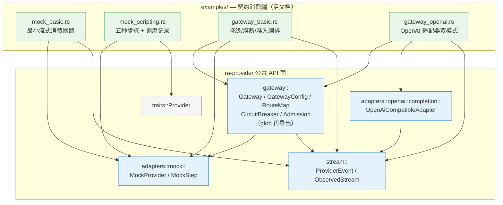
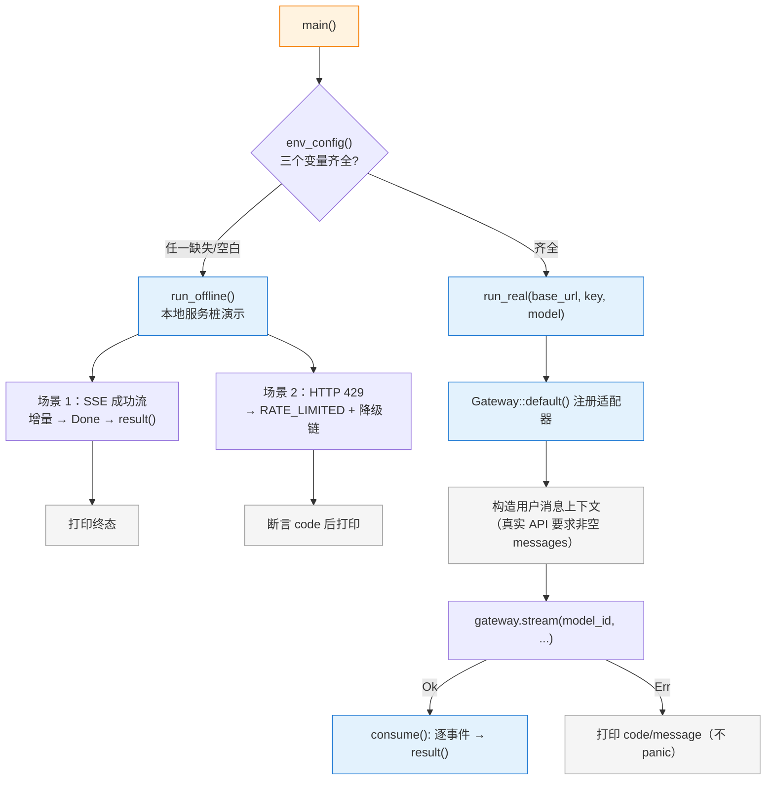
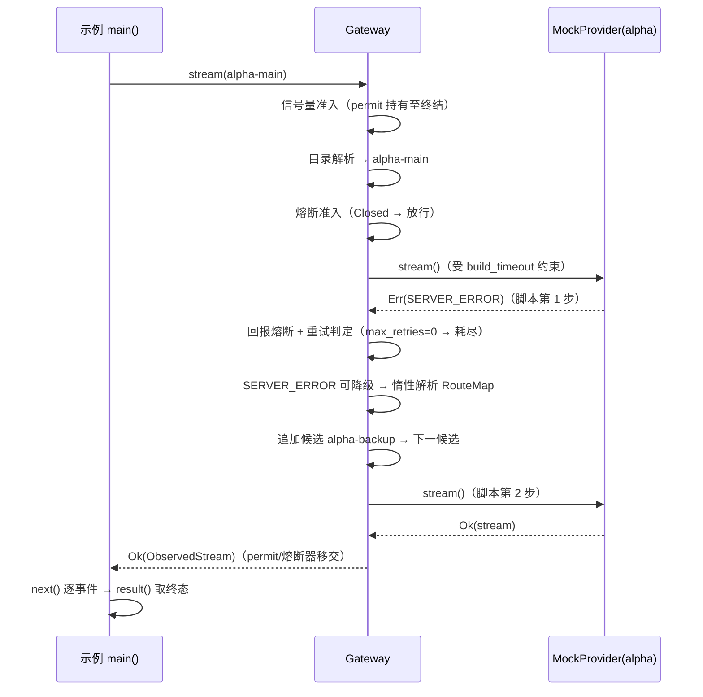
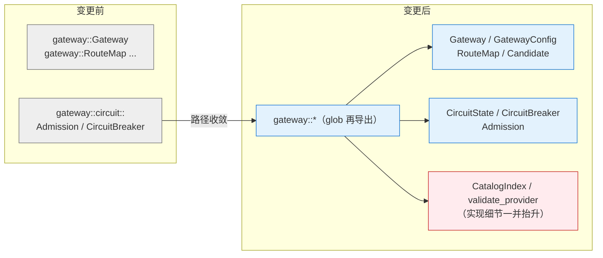

# 🔍 代码审查与总结报告 — `ra-provider` 示例体系与网关 API 面

> 2026-10-29

## 1. High-Level Summary (TL;DR)

> **Impact: 🟢 Low-Medium**
> 本次更新是**文档性新增为主**的一轮：新增 `examples/` 目录（4 个可运行示例，约 900 行），覆盖「mock 直连 → mock 脚本 → 网关编排 → OpenAI 兼容适配器经网关请求真实端点」的完整演示链路；同时把网关的公共 API 面从「子模块路径 + 具名导入」统一为 `gateway::` 单一命名空间的 glob 再导出。无生产逻辑变更，无缺陷修复。

**审查范围**：未提交变更 = 新增 `crates/provider/examples/`（4 个文件，目录整体未被 git 跟踪）＋ `gateway/mod.rs` 的再导出调整（+4/−10）＋ `stream/observed_stream.rs` 的两处 import 路径同步（+2/−2）。`adapters/` 模块及其测试已在 `f93092b` 提交（见 `ai_0008`）。

**质量门禁结果**

| 门禁 | 命令 | 结果 |
|---|---|---|
| 格式化 | `cargo fmt --all -- --check` | ✅ 通过 |
| 静态检查 | `cargo clippy --workspace --all-targets -- -D warnings` | ✅ 0 告警 |
| 编译 | `cargo check --workspace`（含 `--examples`） | ✅ 通过 |
| 测试 | `cargo test --workspace` | ✅ `ra-core` 21、`ra-provider` 193、其它 32（1 ignored） |
| 覆盖率 | 本轮未重跑（无生产逻辑变更） | 维持行 99.57% / 函数 100%（`ai_0008` 基线） |

**Key Changes（3 项）**

| # | 变更 | 位置 | 性质 |
|---|------|------|------|
| 1 | 🆕 4 个可运行示例（mock 直连 / mock 脚本 / 网关编排 / OpenAI 双模式） | `examples/*.rs` | **文档性新增** |
| 2 | 🔧 网关公共 API 面统一：`pub mod circuit` → 私有子模块 + glob 再导出 | `gateway/mod.rs` | **API 面调整** |
| 3 | 🔧 `observed_stream` 经公共再导出取熔断类型（import 路径同步） | `stream/observed_stream.rs` | 随动修改 |

**核心结论（按优先级）**

1. 🟠 **glob 再导出抬升实现细节为公共 API**：`gateway::*` 现在导出 `CatalogIndex`、`validate_provider`、`Candidate`、`CircuitBreaker`（含 `new` / `record_*` / `abort_probe` 全套方法），这些原属内部实现，未来演进将受 SemVer 兼容性约束。
2. 🟠 **分层方向**：`stream::ObservedStream` 现在依赖 `gateway` 的公共再导出获取 `CircuitBreaker` / `Admission`（此前经私有子模块路径）。熔断器被两个模块共享，长期应下沉独立模块或经 trait 解耦。
3. 🟢 **示例即验收**：离线模式完全自包含（本地 HTTP 服务桩），可入 CI 作冒烟检查；`gateway_openai` 双模式设计兼顾真实链路与无密钥环境。
4. 🟡 **`ai_0008` 的 P0 仍未处理**：R1（`result()` 丢失工具参数）与 R2（截断流按 `Stop` 收敛）继续挂起，本轮未触及。

---

## 2. Visual Overview（代码与逻辑地图）

### 2.1 示例体系与依赖关系

### 2.2 `gateway_openai` 双模式决策流

### 2.3 `gateway_basic` 场景 1：同提供方降级时序

### 2.4 网关公共 API 面变化

---

## 3. Detailed Change Analysis（详细审查）

### 3.1 🔀 网关 API 面统一 `gateway/mod.rs`

**变更**：`pub mod circuit` → `mod circuit`（子模块全部私有化）；具名 `use self::{circuit::{Admission, CircuitBreaker}, ...}` → `pub use self::{circuit::*, fallback::*, option::*, router::*, utils::*}`。

**做得对的地方**

- 调用方视角收敛到 `gateway::` 单一命名空间：示例中 `gateway::{Gateway, GatewayConfig, RouteMap}` 直接可用，无需知道子模块组织。
- 与 `adapters::mock` 的再导出风格一致，crate 内部约定统一。
- `observed_stream` 的 import 同步修改，全工作区编译与 clippy 零告警——说明没有其它调用点残留旧路径。

**问题**

- 🟠 **glob 再导出无法圈定边界**（R1）：现在 `gateway::CatalogIndex`、`gateway::validate_provider`、`gateway::Candidate`、`gateway::CircuitBreaker`（连同 `new` / `admit` / `record_success` / `record_failure` / `abort_probe` 全套方法）都是公共 API。这些类型原属实现细节：`CatalogIndex` 是目录的内部索引结构，`validate_provider` 是注册前置校验，直接暴露 `CircuitBreaker::new` 意味着调用方可绕过网关自建熔断器。后续若调整这些类型的签名，按 SemVer 都算破坏性变更。
- 🟡 **未来命名冲突**：`circuit::*` 等五个 glob 合并进同一命名空间，新增子模块若出现同名项会静默遮蔽或编译冲突。

**建议**：把 glob 改为显式列举再导出（只保留 `Gateway` / `GatewayConfig` / `RouteMap` / `Admission` / `CircuitBreaker` / `CircuitState`），或对实现细节类型加 `#[doc(hidden)]`。改动成本低，宜在提交前完成。

### 3.2 🧭 分层方向 `stream/observed_stream.rs`

**变更**：两处 import 路径——`gateway::circuit::{Admission, CircuitBreaker}` → `gateway::{Admission, CircuitBreaker}`；测试中 `gateway::circuit::CircuitState` → `gateway::CircuitState`。纯随动修改，无逻辑变化。

**问题**

- 🟠 **`stream` → `gateway` 反向依赖被固化为公共 API 依赖**（R2）：`ObservedStream` 持有 `Arc<CircuitBreaker>` 在流终结时回报熔断。变更前它借道 `gateway::circuit`（当时的 pub 模块）；变更后 `circuit` 私有化，唯一路径就是网关的公共再导出——即 `stream` 模块在依赖 `gateway` 的**公共 API 面**。依赖方向本身（观察流回报熔断）是设计意图，但类型归属值得记录决策：`CircuitBreaker` / `Admission` 同时被 `gateway` 与 `stream` 消费，长期更合理的归属是独立的基础模块（如顶层 `circuit`），或让 `ObservedStream` 依赖一个窄 trait（只需 `record_success` / `record_failure` / `abort_probe`），网关注入实现。当前规模下可接受，属于 P3 架构债。

### 3.3 📚 示例体系 `examples/*`（4 个文件，约 900 行）

**`mock_basic.rs`（133 行）**：最小消费回路——组装 `MockProvider` → 建流 → `next()` 逐事件 → `result()` 取终态。强调两点契约：每个事件携带 `partial` 半成品快照（消费方无须自行聚合）；`result()` 与逐事件路径共享同一终态（oneshot 通道独立兑现）。

**`mock_scripting.rs`（198 行）**：依次演示五种 `MockStep`（`Complete` / `Events` / `StreamFail` / `Fail` / `Silent`）的行为差异，覆盖 PreStream 失败（经 `pre_stream` 阶段门构造）、流内错误码传递、静默期间取消（`Aborted` + `CANCELLED`）、脚本耗尽的 `INVALID_REQUEST` 终结，收尾用 `record()` 打印调用记录。文档头用表格说明五步骤语义。

**`gateway_basic.rs`（275 行）**：网关编排全景——重复注册拒绝（`DUPLICATE_PROVIDER`）、同提供方降级（`SERVER_ERROR` → `alpha-backup`）、跨提供方降级（`RATE_LIMITED` → `gamma-model`，"主链 ∩ 目标目录"求值）、`MODEL_NOT_FOUND`、熔断（threshold=1 首败即开 → `CIRCUIT_OPEN`）、并发准入（`max_in_flight=1`，permit 持有至终结 → `OVERLOADED` → 消费后恢复）。全部场景用零退避零重试配置保证确定性输出。

**`gateway_openai.rs`（298 行）**：网关 + OpenAI 兼容适配器，**双模式设计**：
- **真实模式**（`OPENAI_BASE_URL` / `OPENAI_API_KEY` / `OPENAI_MODEL` 三变量齐全）：注册适配器经网关请求任意兼容端点；适配器在 base_url 后拼接 `/chat/completions`（尾 `/` 剥离）；自动构造一条用户消息——真实 API 要求非空 `messages`，这是与离线模式的关键差异；建流失败打印 `code` / `message` 而非 panic，便于对照错误码排障。
- **离线回退**（任一变量缺失/空白）：本地起一次性 HTTP 服务桩（先读请求再写响应，规避 Windows 未读数据导致的 RST——经验已沉淀为注释），演示 SSE 成功流与 HTTP 429 → `RATE_LIMITED` 映射 + 降级链摘要，并对错误码做 `assert_eq!` 把行为契约显式化。

**做得对的地方**

- 四个示例与设计文档 §11.6 呼应，构成"直连 → 脚本 → 编排 → 真实链路"的渐进式活文档。
- 双模式让示例在无密钥/离线环境仍可运行，`cargo run` 即验收，可入 CI 作文档活性冒烟。
- 事件消费逻辑抽取为共享 `consume()` 辅助（`gateway_openai` 内），真实模式与离线模式复用同一消费路径。
- `serve_once` 的先读后写规避、零重试配置的目的，都以中文注释沉淀。

**问题**

- 🟡 **`serve_once` 只接受一个连接**（R3）：注释只说"一次性"，未明示"第二个连接会挂到 accept 永久等待"。当前靠零重试配置 + 单请求规避；若示例将来打开重试或发起第二次请求，会静默挂起直到网关 600s 超时。
- 🟡 **真实模式继承网关默认策略**（R4）：`GatewayConfig::default()` 的重试基线是 `max_retries=3`、初始退避 500ms、jitter 0.25、建流超时 600s——示例失败时会有真实退避等待（0.5s+1s+2s 级）。可接受，但文档头值得提示"可用 `StreamOptions.retry` / `timeout` 覆盖"。
- 🟡 **辅助函数跨示例重复**（R5）：`first_text` 出现 3 次、`text_partial` 2 次、`zero_retry_config` 2 次。示例自包含原则下可接受；若示例继续增长，可引入 `examples/common` 模块。
- 🟡 **目录未提交**（R6）：`examples/` 整体未被 git 跟踪，报告发布后应随本轮变更一并提交。

### 3.4 🔁 相对 `ai_0008` 的结论衔接

| `ai_0008` 结论 | 本轮状态 |
|---|---|
| R1 🔴 `result()` 丢失工具调用参数 | **未处理**，继续挂起（P0） |
| R2 🟠 截断流被当作 `Stop` 成功 | **未处理**，继续挂起（P0） |
| R3 🟠 `base_url` 信任边界 | **未处理**；`gateway_openai` 真实模式恰好依赖"调用方传入 `Model` 的 `base_url`"这一行为（环境变量注入端点），修复 R3 时需保留环境变量驱动端点的能力 |
| R4–R12 | 未处理 |

> 注意：R3 的修复方向（强制目录解析 / 校验归属）与本轮示例的"环境变量 → `Model.base_url`"模式并不冲突——示例仍在适配器构造时传入目录快照，只是快照内容来自环境变量。但若未来收紧为"仅信任注册目录"，需要同步审视该示例的构造方式是否仍是受支持路径。

---

## 4. Impact & Risk Assessment（影响与风险评估）

### 4.1 高危问题（无 P0）

本轮无生产逻辑变更，无新增缺陷。以下两项属"提交前宜处理"的 API 卫生问题：

| ID | 问题 | 位置 | 影响 |
|---|---|---|---|
| R1 | glob 再导出抬升实现细节为公共 API | `gateway/mod.rs#L43` | 未来内部重构受 SemVer 约束；`CircuitBreaker::new` 可被绕过网关直接调用 |
| R2 | `stream` → `gateway` 反向依赖经公共 API 固化 | `stream/observed_stream.rs#L27` | 模块分层决策未记录；熔断器类型归属悬置 |

### 4.2 风险与待办清单

| ID | 级别 | 问题 | 建议 |
|---|---|---|---|
| R1 | 🟠 | glob 再导出面过宽 | 显式列举 `pub use`，仅导出 `Gateway` / `GatewayConfig` / `RouteMap` / `Admission` / `CircuitBreaker` / `CircuitState` |
| R2 | 🟠 | 熔断类型被 `gateway` 与 `stream` 双方消费 | 记录归属决策；长期下沉独立模块或经窄 trait 解耦 |
| R3 | 🟡 | `serve_once` 单连接假设未明示挂起风险 | 注释补充"第二个连接将挂起"；示例保持零重试 |
| R4 | 🟡 | 真实模式继承默认重试/超时的真实等待 | 文档头提示可用 `StreamOptions` 覆盖 |
| R5 | 🟡 | 辅助函数跨示例重复 | 维持自包含；增长后考虑 `examples/common` |
| R6 | 🟡 | `examples/` 未提交 | 随本轮变更提交 |
| R7 | 🔴（沿用） | `ai_0008` R1/R2 未修复 | 维持 P0 待办；R3 修复时注意保留环境变量注入端点的能力 |

### 4.3 🧪 测试建议（Reviewer 应覆盖的场景）

1. **`serve_once` 多连接行为**：向同一服务桩发第二个请求，明确"挂起"语义并有注释背书（当前是隐式行为）。
2. **环境变量回退矩阵**：三变量分别缺失、为空白串 → 均应回退离线模式（`env_config` 的 `filter` 分支目前只在示例层验证）。
3. **真实模式错误路径冒烟**（人工/带密钥环境）：错误 Key → 应打印 `AUTH_FAILED` 而非 panic；限流端点 → `RATE_LIMITED`。
4. **`gateway_basic` 补流内错误演示**：`MockStep::StreamFail` 触发的 InStream 失败不重试、不降级（契约层 P2），当前示例只覆盖 PreStream 失败。
5. **CI 冒烟**：把 `cargo run -p ra-provider --example gateway_openai`（离线模式）纳入 CI，防止示例随 API 演进腐化。
6. **再导出面回归**：R1 修复后，补一个"旧路径 `gateway::circuit::Admission` 不再可达"的编译期断言（或依赖 clippy/编译失败确认）。

### 4.4 ✅ 做得好的地方

- 示例即活文档：四个示例渐进覆盖 provider 契约的四个消费视角，且全部可离线运行、输出确定性。
- 双模式设计的取舍清晰：真实模式保留完整网关行为（重试/熔断/准入），离线模式保留行为断言（`assert_eq!` 错误码）。
- Windows RST 规避、零重试确定性等工程经验都以注释沉淀在示例中，可直接被后续示例复用。
- API 面统一的动机正确（调用方只看 `gateway::`），只是收敛手段（glob）需要收紧。

---

## 5. 变更文件清单速览

| 文件 | 行数 | 说明 |
|---|---:|---|
| `examples/mock_basic.rs` | 133 | 最小流式消费回路（partial 快照 + result 终态） |
| `examples/mock_scripting.rs` | 198 | 五种 `MockStep` 行为差异 + 调用记录 |
| `examples/gateway_basic.rs` | 275 | 网关降级 / 熔断 / 并发准入编排（5 场景） |
| `examples/gateway_openai.rs` | 298 | 网关 + OpenAI 适配器双模式（env 驱动 / 离线桩） |
| `gateway/mod.rs` | 净 −6 | 子模块私有化 + glob 再导出 |
| `stream/observed_stream.rs` | 净 0 | import 路径同步（含测试） |

---

## 6. 结论与建议优先级

1. **P1（提交前）**：R1——把 `gateway/mod.rs` 的 glob 再导出改为显式列举，收缩公共 API 面；同时提交 `examples/` 目录（R6）。
2. **P2**：R3/R4——补充 `serve_once` 挂起语义与真实模式默认策略的文档提示；按 4.3.5 把离线示例纳入 CI 冒烟。
3. **P3（架构债）**：R2——记录熔断类型归属决策；示例辅助函数重复（R5）维持现状。
4. **P0 沿用**：`ai_0008` 的 R1（工具参数回填）与 R2（截断流收敛语义）仍是全库最高优先缺陷，本轮未触及；处理 R3（信任边界）时注意与本轮示例的环境变量注入模式兼容。
5. **覆盖率**：本轮无生产逻辑变更，维持 `ai_0008` 基线（行 99.57% / 函数 100%）；示例代码不计入覆盖率目标。
