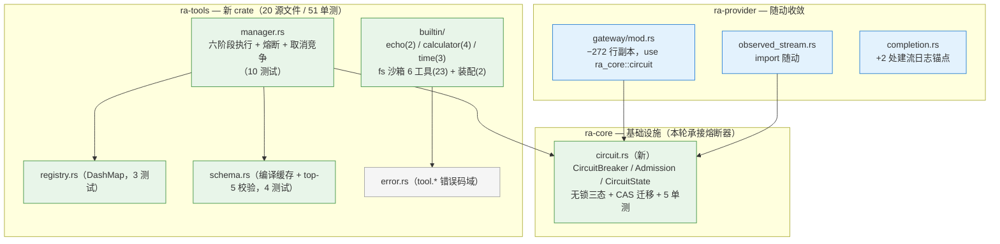
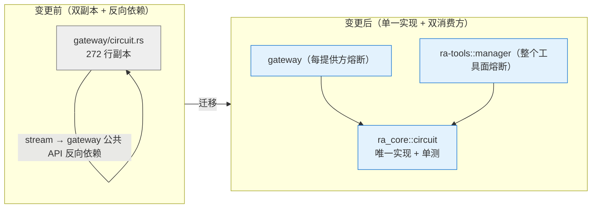
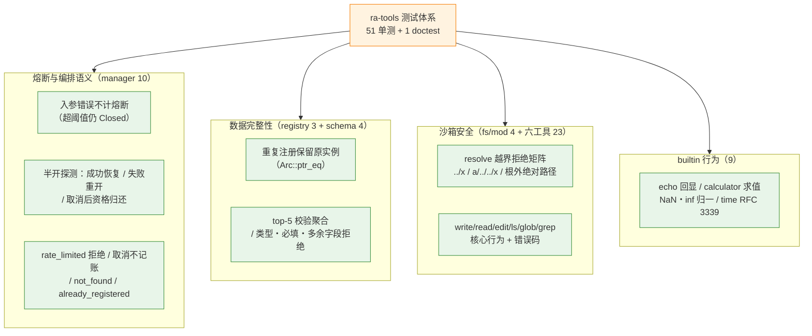

# 🔍 代码审查与总结报告 — 熔断器下沉、`ra-tools` 落地与测试体系

> 2026-11-02

## 1. High-Level Summary (TL;DR)

> **Impact: 🟡 Medium**
> 本轮是**结构性收敛 + 新 crate 落地 + 测试体系建立**的一轮：熔断器从 `ra-provider::gateway` 下沉到 `ra-core::circuit`（消除 272 行双副本，落地 `ai_0009` R2）；新增完整实现的 `ra-tools` crate（20 个源文件，约 1,900 行生产代码），补齐全量中文文档注释并建立公共 API 面（用户确认后公开化）；按日志规范补 5 处关键位置日志；随后为其建立 51 个单元测试（14 个文件，零生产代码改动），核心并发语义（熔断记账边界、半开探测取消归还）与沙箱安全（越界拒绝矩阵）全部获得回归保护。

**审查范围**：未提交变更 = 新增 `crates/core/src/circuit.rs`（272 行，含单测）＋ 新增 `crates/tools/`（整体未跟踪：20 源文件，其中 14 个含测试）＋ 删除 `provider/gateway/circuit.rs`（−272 行）＋ `gateway/mod.rs` / `observed_stream.rs` import 随动 ＋ `completion.rs` 2 处日志锚点 ＋ 5 个 `Cargo.toml`。已提交的 `f802da3`（glob→显式再导出，`ai_0009` R1 落地）一并核对。

**质量门禁结果**

| 门禁 | 命令 | 结果 |
|---|---|---|
| 格式化 | `cargo fmt --all -- --check` | ✅ 通过 |
| 静态检查 | `cargo clippy --workspace --all-targets -- -D warnings` | ✅ 0 告警（仅 nom v1.2.4 第三方 future-incompat 提示） |
| 编译 | `cargo check --workspace` | ✅ 通过 |
| 测试 | `cargo test --workspace` | ✅ `ra-core` 26、`ra-provider` 188、**`ra-tools` 51**、doctests 34 ＝ **299 passed + 1 ignored** |

**Key Changes（6 项）**

| # | 变更 | 位置 | 性质 |
|---|------|------|------|
| 1 | 🔀 熔断器唯一实现下沉 `ra-core::circuit`，provider 双副本消除 | `core/src/circuit.rs`（新）＋ `provider/gateway/circuit.rs`（删） | **结构收敛**（`ai_0009` R2 落地） |
| 2 | 🆕 `ra-tools` crate 完整落地：AgentTool → Registry → Manager → builtin 工具族 | `crates/tools/` | **功能新增** |
| 3 | 🔧 `ra-tools` 公开化：`pub mod` ×8、工厂函数与 `FsRoot` 再导出、`ToolManager` 补 `Default` 与 `# Panics`、lib.rs 可编译 doctest | `crates/tools/src/*` | API 面建立 |
| 4 | 🔧 24 处 `&format!` 借用修复（clippy 门禁）＋ 4 个 crate description | `tools/*`、`Cargo.toml` ×4 | 卫生修复 |
| 5 | 📝 日志补齐 5 处：建流成功链路 2 处 debug 锚点、工具预处理/校验失败 2 处 warn、重复注册拒绝 1 处 warn | `completion.rs`、`manager.rs`、`registry.rs` | 可观测性补齐 |
| 6 | 🧪 51 个单元测试落地（14 文件），零生产代码改动 | `crates/tools/src/*` | **测试体系建立** |

**核心结论（按优先级）**

1. 🟢 **`ai_0009` 的 R1/R2 双双落地**：`f802da3` 把 glob 再导出改为显式列举（且选择不导出熔断类型，比建议更收敛）；熔断器下沉后 `stream → gateway` 反向依赖彻底消除，网关（每提供方）与工具管理器（整个工具面）共用 `ra_core::circuit` 单一实现。
2. 🟢 **`ai_0009` 遗留的最大缺口（`ra-tools` 零单测）已闭合**：51 个测试覆盖熔断记账边界（入参错误超阈值仍 Closed）、半开探测取消后资格归还、`FsRoot` 越界拒绝矩阵、校验 top-5 聚合等此前仅有注释背书的语义；全程零生产代码改动，说明 API 设计本身可测。
3. 🟡 **迁移与测试暴露两处文档级发现**：① `schema::validate_arguments` 的 top-5 聚合**无截断提示文案**（仅取前 5 条拼接），入参错误多于 5 条时调用方无从得知有截断；② calculator 除零走 meval IEEE 语义（`1/0` → 文本 `inf`），与直觉的"除零报错"不同——已有测试按真实行为固化。
4. 🟡 **提交动作悬置**：`crates/tools/` 与 `crates/core/src/circuit.rs` 仍未被 git 跟踪，测试与实现都在工作区裸奔。
5. 🟡 **`ai_0008` 的 P0 仍未处理**：R1（`result()` 丢失工具参数）与 R2（截断流按 `Stop` 收敛）连续四轮挂起——工具调用链已落地并有测试，该缺陷的影响面正在扩大。

---

## 2. Visual Overview（代码与逻辑地图）

### 2.1 本轮变更全景

### 2.2 熔断器归属变化（`ai_0009` R2 → 落地）

### 2.3 测试体系覆盖地图（51 个测试 × 语义分组）

---

## 3. Detailed Change Analysis（详细审查）

### 3.1 🔀 熔断器下沉 `core/src/circuit.rs`（新）＋ `provider/gateway/circuit.rs`（删）

**变更**：`ra_core::circuit` 成为唯一实现（Closed/Open/HalfOpen 原子三态、CAS 迁移、`Admission::{Allow, AllowProbe, Reject}`、`abort_probe()` 探测资格归还）；`gateway/mod.rs` 删除副本改 `use ra_core::circuit::{Admission, CircuitBreaker}`；`observed_stream.rs` 同步；`ra-tools::manager` 同样复用。

**做得对的地方**

- **`ai_0009` R2 的教科书式落地**：未引入窄 trait 之类的过度设计，直接下沉共享模块——当前规模的最简正确解。
- 迁移零语义漂移：实现逐行一致，仅补文档注释（泛化措辞列出网关与工具管理器两类调用方）与 1 个可编译 doc example。
- 测试随实现迁移：provider 193→188、core 21→26，总覆盖不变。
- `f802da3` 的再导出比 `ai_0009` 建议更收敛（不导出熔断类型，`gateway::circuit` 路径随副本一并消失）。

**问题**：🟢 无实质问题。

### 3.2 🆕 `ra-tools` crate 落地与公开化 `crates/tools/`

**变更**：架构为 `AgentTool` trait（schema/label/execution_mode/prepare_arguments/execute）→ `ToolRegistry`（DashMap）→ `ToolManager`（Schema 编译缓存 + 整体熔断 + 取消竞争 `select! biased`）→ `ToolContext`（取消信号 + emit 回调）→ builtin（echo/calculator/time + fs 沙箱 6 工具）。错误域 `tool.*` 前缀 6 个错误码。

**做得对的地方**

- **公开化执行完整且自洽**：`pub mod` ×8；`builtin` 统一再导出 10 个工厂函数 + `FsRoot`；`FsRoot::new` / `root` / `resolve` 一并公开（否则工厂函数对外不可构造）；`check_cancel` / `detect_image_mime` / `constants` 保持 crate 私有——公开面经审查无实现细节泄露。
- `ToolManager` 补 `Default`（`new_without_default`）与三处 `# Panics`（锁中毒路径）；lib.rs doctest 从 `ignore` 升级为可编译运行示例。
- 24 处 `&format!` → `format!` 为 clippy `-D warnings` 门禁下的机械修复，无语义影响；未走 `#[allow]` 捷径。
- 文档注释全量中文 + 规范章节（`# Errors` / `# Panics` / `# Examples`），并发要点（biased 语义、探测资格归还、读锁缩小临界区）均有内联说明。

**问题**

- 🟡 **公开面为"全量可用"而非"最小 API"**（R2）：10 个工厂函数 + `FsRoot` 全量导出，后续内部重组将受 SemVer 约束。当前阶段可接受，首个外部消费方出现前应审视。

### 3.3 📝 日志规范落地 `completion.rs` / `manager.rs` / `registry.rs`

全工作区日志合规审查（76 处 / 20 文件）基础上补 5 处缺口：

| 位置 | 级别 | 内容 | 动机 |
|---|---|---|---|
| `completion.rs` 建流前 | debug | `sending chat completion request`（provider/model/endpoint） | 「外部调用」起点锚点——此前只有失败路径有日志 |
| `completion.rs` 响应头后 | debug | `response headers received`（status） | 外部调用成功终点锚点 |
| `manager.rs` 阶段 3/4 | warn ×2 | `prepare_arguments failed` / `schema validation`（tool/code） | 错误分支对称化；`inspect_err` 记录后原样返回，不计熔断 |
| `registry.rs` Occupied 分支 | warn | `duplicate tool registration refused` | 与成功注册 info 对称 |

审查确认既有日志**零规范违规**：全部完全限定路径、英文消息、结构化字段、无敏感信息（API key 仅记 not configured，endpoint 不含鉴权）。未过度补日志的判断正确（echo/calculator/time 入参错误由 manager 统一 error! 覆盖）。

### 3.4 🧪 测试体系 `crates/tools/src/*`（51 测试 / 14 文件，本轮重点）

**变更**：在 14 个源文件追加 `#[cfg(test)] mod tests`（fs/mod.rs 另有 `test_support` 临时目录辅助，Drop 递归清理）。**零生产代码改动**——全部测试经公共 API 黑盒完成。

**语义覆盖核对（对照 `ai_0009` §4.3 与上轮报告测试建议）**

| 建议场景 | 状态 |
|---|---|
| 熔断记账边界：入参错误不计失败 | ✅ `manager.rs`：prepare 失败 + 类型错误连续超阈值仍 Closed |
| 半开探测取消 → `abort_probe()` 归还资格 | ✅ `manager.rs`：取消后下一请求仍可探测成功 |
| `FsRoot` 越界矩阵 | ✅ `fs/mod.rs`：`../x` / `a/../../x` / 根外绝对路径全部拒绝 |
| 校验 top-5 聚合 | ✅ `schema.rs`：6 个错误恰好报 5 条（**无截断提示**，见下） |
| 重复注册不覆盖 | ✅ `registry.rs`：`Arc::ptr_eq` 断言原实例保留 |
| 建流日志锚点（tracing 捕获） | ⬜ 未做（provider 层，P3） |

**测试驱动的两个行为发现**

- 🟡 **calculator 除零为 IEEE 语义**（R3）：`1/0` 归一为文本 `inf`、`0/0` 为 `NaN`，仅解析错误走 `exec_failed`——与"除零报错"的直觉不同，现已被测试固化为契约。若上游（模型）依赖报错语义，需要重新评估。
- 🟡 **`validate_arguments` top-5 无截断提示**（R4）：仅 `take(5)` 后 `"; "` 连接。入参错误超过 5 条时，模型看到的错误列表是静默截断的。建议在消息尾追加 `… and N more` 类提示（一行改动 + 断言更新），或至少在文档注释中明示。

**做得对的地方**

- 黑盒可测性：51 个测试零生产代码改动，说明 crate 公开 API 设计天然可测（`ToolManagerConfig` 支持小阈值配置是关键）。
- 时间依赖处理务实：半开恢复用真实极短 cooldown + sleep，而非 `time pause`，不引入 `test-util` 依赖（代价见 R5）。
- 临时目录生命周期用 Drop 保证，测试不残留文件系统状态。
- 每个测试带「场景 / 预期」文档注释，与工作区惯例一致。

### 3.5 🔁 相对 `ai_0009` 的结论衔接

| `ai_0009` 结论 | 本轮状态 |
|---|---|
| R1 🟠 glob 再导出抬升实现细节 | **已落地**（`f802da3` 显式具名再导出，未导出熔断类型） |
| R2 🟠 `stream` → `gateway` 反向依赖 | **已落地**（熔断器下沉 `ra_core::circuit`） |
| R3 🟡 `serve_once` 单连接挂起语义未注释 | 未处理（示例层，P3） |
| R4–R6 | 未处理（P2/P3） |
| R7（沿用 `ai_0008` R1/R2 P0） | **仍未处理**：`result()` 丢失工具参数、截断流按 `Stop` 收敛 |

---

## 4. Impact & Risk Assessment（影响与风险评估）

### 4.1 高危问题（无 P0）

本轮无行为语义变更（测试仅固化既有行为）。风险集中在"未提交"与两个文档级发现：

| ID | 问题 | 位置 | 影响 |
|---|---|---|---|
| R1 | `crates/tools/` 与 `core/src/circuit.rs` 未被 git 跟踪 | 工作区 | 实现 + 测试均无版本保护，误操作即丢失 |
| R4 | `validate_arguments` top-5 静默截断 | `tools/src/schema.rs` | 入参错误多时模型收到不完整诊断信息 |
| R5 | 半开恢复测试依赖真实 sleep | `tools/src/manager.rs` tests | 慢 CI 上极小概率抖动（cooldown 毫秒级，风险低） |

### 4.2 风险与待办清单

| ID | 级别 | 问题 | 建议 |
|---|---|---|---|
| R1 | 🟠 | 新 crate 与新文件未提交 | 随本轮变更提交（`crates/tools/`、`crates/core/src/circuit.rs`、删除的 provider 副本） |
| R2 | 🟡 | 公开面"全量可用" | 维持现状；首个外部消费方出现前审视最小导出 |
| R3 | 🟡 | calculator 除零 IEEE 语义 | 已被测试固化为契约；若需报错语义再评估（含文档注释更新） |
| R4 | 🟡 | top-5 校验聚合静默截断 | 消息尾追加截断提示 + 更新 `schema.rs` 测试断言 |
| R5 | 🟡 | 半开恢复测试的真实 sleep | 观察一次 CI 稳定性后再决定是否引入 `test-util` + `time pause` |
| R6 | 🔴（沿用） | `ai_0008` R1/R2 未修复 | 维持全库最高优先：`result()` 工具参数回填、截断流收敛语义 |

### 4.3 🧪 测试建议（Reviewer 应覆盖的剩余场景）

1. **建流日志锚点**：debug 级别运行 gateway_openai 离线模式，捕获 tracing 断言 request sent / headers received 成对出现（provider 层）。
2. **并发注册压力**：多线程同时 `registry()` 不同名工具 + 同名工具，断言无 panic 且无重复插入（DashMap entry 原子性）。
3. **fs 六工具边界补强**：edit 在 CRLF 文件上的字节精确匹配行为（文档声称无换行归一化）、grep 对非 UTF-8 文件的跳过路径。
4. **`register_builtin` 部分失败语义**：预占一个工具名后调用 `register_builtin`，断言后续工具未被注册且无回滚（与文档注释声明一致）。

### 4.4 ✅ 做得好的地方

- `ai_0009` 两项 🟠 结论一次落地且无遗留，双副本与反向依赖同时消除。
- 51 个测试**零生产代码改动**——公开 API 的可测性本身就是设计质量的证据。
- 测试固化了两个此前只在注释里的语义（入参错误不计熔断、探测资格归还），注释-测试形成双保险。
- 日志、注释、description、clippy 修复全部正面完成，未走 `#[allow]` 或放宽门禁的捷径。

---

## 5. 变更文件清单速览

| 文件 | 规模 | 说明 |
|---|---:|---|
| `crates/core/src/circuit.rs` | 272 行（新） | 熔断器唯一实现（含 5 单测 + doc example） |
| `crates/core/src/lib.rs` / `Cargo.toml` | +4 | 模块文档三类化；+tokio / tracing |
| `crates/provider/src/gateway/circuit.rs` | −272（删） | 双副本移除 |
| `crates/provider/src/gateway/mod.rs` | ±18 | import 切换 + 模块文档更新 |
| `crates/provider/src/stream/observed_stream.rs` | ±4 | import 随动（含测试） |
| `crates/provider/src/adapters/openai/completion.rs` | +14 | 建流起止 2 处 debug 锚点 |
| `crates/tools/**`（20 源文件，14 个含测试） | ~1,900 生产 + 51 测试 | 完整工具 crate + 文档 + 测试体系 |
| `Cargo.toml` ×5 | +6 | workspace 成员、description ×4 |

---

## 6. 结论与建议优先级

1. **P1（提交前）**：R1——提交全部新文件与删除；同时处理 R4（top-5 截断提示，一行改动 + 断言更新，趁测试热改）。
2. **P2**：按 §4.3 补并发注册压力与 `register_builtin` 部分失败语义测试；R3（除零语义）作为契约记录即可。
3. **P3（架构债）**：`ai_0009` R3/R4（示例层）；R5 观察一次 CI 后决策；R2 公开面待首个消费方出现再收敛。
4. **P0 沿用**：`ai_0008` 的 R1（工具参数回填）与 R2（截断流收敛语义）连续四轮未触及——`ra-tools` 已落地并有测试背书，下一轮应专项处理该缺陷，否则工具结果回灌链路将持续带着已知缺陷演进。
5. **覆盖率**：provider −5 / core +5 为同组测试迁移，总覆盖不变；`ra-tools` 51 测试已建立基线，后续新功能（如 execution_mode 调度）应同步带测试。
