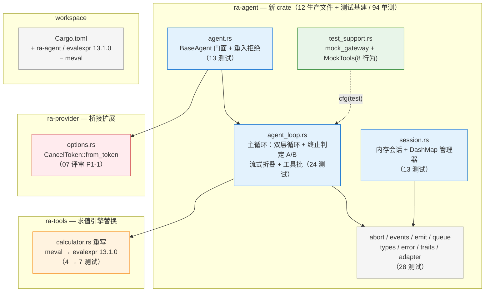
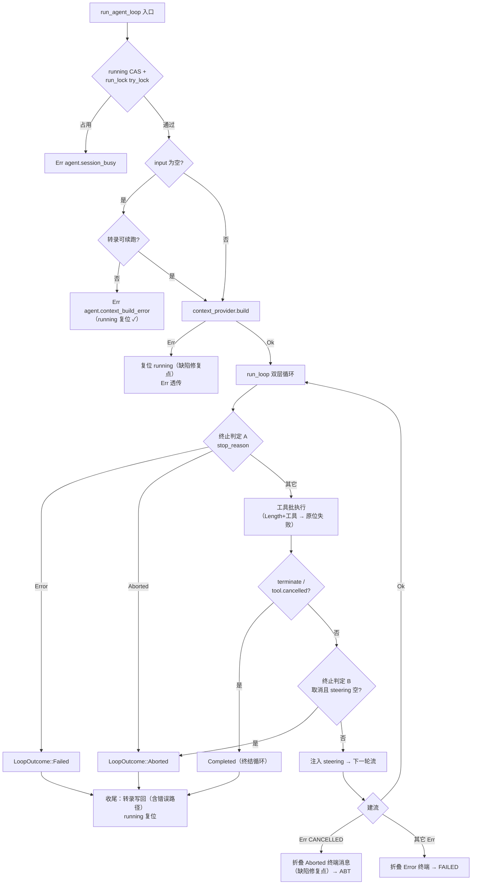

# 🔍 代码审查与总结报告 — `ra-agent` 落地、07 评审闭环与 `evalexpr` 替换

> 2026-11-05

## 1. High-Level Summary (TL;DR)

> **Impact: 🟠 Medium-High**
> 本轮是**阶段 2 核心 crate 落地 + 设计评审闭环 + 行为语义变更**的一轮：新增完整实现的 `ra-agent` crate（12 个生产源文件 + 测试基建，约 2,700 行生产代码），实现「事件驱动主循环 + steering/follow-up 队列 + 取消树 + 会话隔离」；评审 `07_阶段2_Agent核心循环概要设计.md` 后，其全部 P1/P2 建议在实现中落地（`CancelToken::from_token` 桥接、`terminate` 终结语义、`AbortHandle::token()` 访问器、`Default` 配对、CAS/try_lock 双检查分工）；测试过程暴露并修复 **2 处真缺陷**（`running` 标志泄漏导致会话永久卡死、取消路径误报 `Failed`）；随后建立 94 个单元测试（覆盖率 98.51% 行 / 99.70% 函数）；最后以 `evalexpr 13.1.0` 替换 `meval`，calculator 数值语义发生**破坏性变更**（整数运算、除零报错）。

**审查范围**：未提交变更 = 新增 `crates/agent/`（整体未跟踪：12 生产文件 + `test_support.rs`）＋ `crates/provider/src/options.rs`（`CancelToken::from_token` + 2 测试 + doctest）＋ `crates/tools/src/builtin/calculator.rs` 重写（+196/−39）＋ `crates/tools/Cargo.toml`（meval → evalexpr）＋ 根 `Cargo.toml`（workspace deps 增 `ra-agent`）。上一轮的 `crates/tools/` 与 `crates/core/src/circuit.rs` 已提交，悬置状态解除。

**质量门禁结果**

| 门禁 | 命令 | 结果 |
|---|---|---|
| 格式化 | `cargo fmt --all -- --check` | ✅ 通过 |
| 静态检查 | `cargo clippy --workspace --all-targets -- -D warnings` | ✅ 0 告警 |
| 编译 | `cargo check --workspace` | ✅ 通过 |
| 测试 | `cargo test --workspace` | ✅ `ra-agent` **94**、`ra-core` 26、`ra-provider` 190、`ra-tools` **54**、doctests 36 ＝ **400 passed + 1 ignored** |
| 覆盖率 | `cargo llvm-cov -p ra-agent` | 行 **98.51%** / 函数 **99.70%** / 区域 98.24%（7 个文件 100%） |

**Key Changes（6 项）**

| # | 变更 | 位置 | 性质 |
|---|------|------|------|
| 1 | 🆕 `ra-agent` crate 完整落地（阶段 2）：主循环 / 事件 / 队列 / 取消树 / 会话 / 适配器 / 门面 | `crates/agent/` | **功能新增** |
| 2 | 📝 全量中文文档注释（`//!` ×12 + 全部 pub 项 `///` + `# Errors`/`# Panics`）+ `mod` → `pub mod` 公开化（消除 67 个 dead_code） | `crates/agent/src/*` | API 面建立 |
| 3 | 🔧 `CancelToken::from_token` 桥接：abort 树子令牌可注入 `StreamOptions.cancel` | `provider/src/options.rs` | **07 评审 P1-1 落地** |
| 4 | 🔧 两处缺陷修复：`context_provider.build` 错误路径 `running` 泄漏；建流 `CANCELLED` 误折叠为 `Error`（改为 `Aborted`） | `agent_loop.rs` | **缺陷修复**（均有回归测试） |
| 5 | 🧪 94 个测试 + 测试基建（`mock_gateway` + 可编程 `MockTools` 8 种行为），覆盖率 98.51% | `crates/agent/src/*` | **测试体系建立** |
| 6 | 🔄 `meval` → `evalexpr 13.1.0`：calculator 重写，数值语义破坏性变更 | `tools/builtin/calculator.rs`、`Cargo.toml` ×2 | **依赖替换 + 行为变更** |

**核心结论（按优先级）**

1. 🟢 **07 设计评审的建议全部落地**：P1-1（`CancelToken` 桥接）、P1-2（前置依赖声明由实现侧绕开——agent 主循环经 `next()` → `Done` 折叠消费，不走 `result()`）、P2-1（`terminate` 消费）、P2-2（`token()` 访问器 + `Default` 配对）、P2-3（CAS 快速拒绝 + `try_lock` 兜底的双检查分工）——评审→实现的闭环在同轮内完成。
2. 🟢 **测试暴露的 2 处真缺陷均已修复并有回归保护**：`running` 泄漏（`?` 直通跳过收尾段，会话永久卡死）；取消语义（工具批后触发 `stop` 时下一轮流建流被网关 `CANCELLED` 拒绝，原折叠为 `Error` → `Failed`，违背 07 §5.6「取消不是错误路径」——现折叠为 `Aborted` 终端消息）。
3. 🟡 **`evalexpr` 替换是破坏性语义变更**：整数字面量按 i64 运算（`7/2` = 3 截断）、整数除零报错（`1/0` → `exec_failed`）、函数名带 `math::` 前缀、非数值结果拒绝。浮点侧保留 IEEE（`1.0/0.0` → inf）。schema 描述已同步，但下游模型若依赖旧语义需调整表达式。
4. 🟢 **覆盖率策略明确**：98.51% 行覆盖，剩余未覆盖行全部定性——2 处不可达防御分支（流早夭折叠、`JoinSet` Err 看护）+ `tracing!` 宏 region 统计噪音 + 测试自身 panic 防御行；生产代码真实覆盖接近 100%。
5. 🟡 **提交动作悬置**：`crates/agent/` 整体未被 git 跟踪，`options.rs` / `calculator.rs` / `Cargo.toml` ×2 的修改在工作区裸奔。
6. 🟢 **`ai_0008` P0 影响面收敛但仍未修复**：R1（`result()` 丢失工具参数）对 agent 链路的影响被绕开（主循环不消费 `result()`），R2（截断流按 `Stop` 收敛）在真实 provider 链路上仍使「Length 截断失败不变式」失效——mock 层测试为绿，真实链路语义依赖该缺陷修复。

---

## 2. Visual Overview（代码与逻辑地图）

### 2.1 本轮变更全景

### 2.2 主循环终止判定（修复后语义）

### 2.3 calculator 数值语义变化（meval → evalexpr）

---

## 3. Detailed Change Analysis（详细审查）

### 3.1 🆕 `ra-agent` 落地与文档注释体系

**实现要点**（对齐 07 设计文档 §3–§5）：

- **主循环**（`agent_loop.rs`，约 745 行）：双层循环（外层 follow-up 续跑 / 内层工具续轮）、重入双检查（`running` CAS 快速拒绝 + `run_lock.try_lock` 兜底竞态窗口）、截断失败不变式（`Length` + 工具调用 → 原位失败不执行）、事件序解耦（并行批 `ToolExecutionEnd` 完成序 vs 回灌源序）、工具 panic 经双层 spawn 看护折叠。
- **会话**（`session.rs`）：内存转录 + `DashMap` 分片锁 + 两段式过期清理（快照收集后逐个移除）。
- **取消树**（`abort.rs`）：`CancellationToken` 包装，`Session.cancel` → `LoopConfig.signal` → LLM 流 / 工具批各派生子令牌。
- **适配方向**（`adapter.rs`）：ra-agent 定义 `ToolProvider` trait，`ToolManagerAdapter` 包装 ra-tools `ToolManager`（ra-tools 零反向依赖，07 决策 4）。

**做得对的地方**

- 注释体系一次到位：12 个文件全部 `//!` 模块文档 + 全部 pub 项 `///`，返回 `Result` 的方法补 `# Errors`、含 `expect` 的方法补 `# Panics`，长函数按阶段分段注释——全部满足 AGENTS.md。
- `LoopDeps` 手工实现 `Debug`（trait 对象字段不可打印），日志与 `tracing` 完全限定路径合规（英文、结构化字段、无敏感信息）。
- 错误路径写回转录（含 `max_iterations` 失败），已产出消息不丢失——07 §5.2 的语义在收尾段统一执行。

**问题（均在同轮内修复）**

- 🔴 **`running` 标志泄漏**（已修复）：`context_provider.build(...).await?` 的 `?` 直通发生在统一收尾之前，构建失败时 `running` 永久为 `true`，会话卡死（后续全部 `session_busy`）。修复为错误分支手动 `drop(run_guard)` + 复位（[agent_loop.rs#L127-L138](file:///c:/workspace/project/self/AI/ribo-agent/crates/agent/src/agent_loop.rs#L127-L138)），并有回归测试 `context_build_failure_resets_running`。
- 🟡 67 个 dead_code 警告：lib.rs 全私有模块导致，`-D warnings` 门禁必挂。沿用 ra-tools 先例 `pub mod` ×11 公开化解决。
- 🟡 两处拼写（`OnAtATime` → `OneAtATime`、`emmiter` → `emitter`）与 3 处 clippy（`map_or` → `is_some_and` ×2、`&format!` → `format!`）随注释任务修正。

### 3.2 🔧 两处行为缺陷修复

**修复 1：取消路径误报失败**（[agent_loop.rs#L411-L446](file:///c:/workspace/project/self/AI/ribo-agent/crates/agent/src/agent_loop.rs#L411-L446)）

工具批后触发 `stop` 时，若 steering 非空循环会进入下一轮流；此时子令牌已取消，网关在每次尝试前检查取消并返回 `pre_stream(CANCELLED)`。原实现把该建流失败与一般失败同样折叠为 `StopReason::Error` 终端消息 → `LoopOutcome::Failed`，违背 07 §5.6「取消不是错误路径：循环返回 `Ok(LoopReport { outcome: Aborted })`」。修复：建流 `Err` 按错误码分流——`CANCELLED` 折叠为 `Aborted` 终端消息（`info` 日志），其余维持 `Error`（`warn` 日志）；`terminal_error_message` 增加 `stop_reason` 参数。回归测试 `cancel_with_pending_steering_converges_aborted_not_failed` 断言 outcome、终端消息 stop_reason、steering 先于建流入转录、网关层拒绝不触达提供方（record == 1）。

**修复 2：`terminal_error_message` 硬编码**：函数签名增加 `stop_reason` 后，函数体内部原硬编码的 `StopReason::Error` 同步改为消费参数（实施过程中发现并即时修正）。

### 3.3 🔧 `CancelToken::from_token` 桥接（07 评审 P1-1）

`StreamOptions.cancel` 的字段私有且无 `CancellationToken` 互转 API——上一轮评审确认这是 D5 取消传播的硬缺口（若不覆盖 `cancel` 字段，`StreamOptions::default()` 自带的无关令牌使外部取消**静默失效**且编译期无报错）。本轮在 [options.rs#L125-L145](file:///c:/workspace/project/self/AI/ribo-agent/crates/provider/src/options.rs#L125-L145) 落地：

- `pub fn from_token(token: CancellationToken) -> Self`，文档注明「共享同一取消状态」，附可编译 doctest（根令牌取消 → 桥接令牌立即观测）；
- 2 个单测覆盖「取消状态共享」与「令牌独立」语义。

`agent_loop.rs` 的 `stream_assistant_response` 每轮以 `config.signal.child_token()` 派生子令牌后经 `from_token` 注入，粒度化取消成立。

### 3.4 🧪 测试体系与覆盖率

**基建**（`test_support.rs`，`#[cfg(test)]` 门控）：

- `mock_gateway`：`Gateway::default()` + `MockProvider` 注册（注意 `Model::new` 默认 window/max_tokens 为 0 会被注册校验拒绝，基建内已带修正）；
- `MockTools`：可编程 `ToolProvider` 测试替身，8 种行为（`Ok` / `Err(code)` / `Cancel` / `Terminate` / `Panic` / `Steer` / `CancelRoot` / `Hang`）+ 按调用 id 覆盖行为 + 调用记录。

**覆盖分布**（94 测试 / 12 文件）：

| 文件 | 测试数 | 覆盖要点 |
|---|---|---|
| agent_loop.rs | 27 | 双重入拒绝、构建失败复位、max_iterations 写回、截断不变式、Err/Cancel/Terminate/Panic 回灌、并行完成序 vs 回灌源序、steering 注入、先排水再取消、取消建流折叠 Aborted、九类内容事件转发、终止判定四变体、follow-up 续跑 |
| agent.rs | 13 | prompt 全链路、subscribe 事件序、continue 三错误路径 + 成功续跑、steer 三分支、挂起工具下重入拒绝 + stop 收敛、trait 委托 |
| session.rs | 13 | 转录增删查、双队列、cleanup_expired 三分支、Manager 幂等 |
| abort / types / emit / error | 4+6+6+7 | abort 树级联、for_session 队列与信号共享、广播满载 Lagged、全部错误码构造 |
| events / queue / traits / adapter | 2+5+5+5 | type_tag 全变体、排水语义、try_emit 默认实现、真实 ToolManager 桥接 |

**覆盖率**：行 98.51% / 函数 99.70%。剩余未覆盖行全部定性：

1. **不可达防御分支**（真实未覆盖，合理豁免）：流早夭折叠（`MockStep` 无「断流不终结」形态）、`JoinSet` Err 防御（看护层保证不 panic）；
2. **`tracing!` 宏 region 噪音**（llvm-cov 已知问题）：分支体其余行均已覆盖，证明路径实际执行；
3. **测试自身 panic 防御行**（9 行）。

### 3.5 🔄 `meval` → `evalexpr 13.1.0`

**动机与实施**：用户替换依赖，代码侧重写 [calculator.rs](file:///c:/workspace/project/self/AI/ribo-agent/crates/tools/src/builtin/calculator.rs)（+196/−39）。实施前从 registry 源码核实了 evalexpr 关键行为：`Div` 对 Int/Int 走 `checked_div`（除零报错）、Float 保留原生 `/`（IEEE inf）、`^` 为幂、函数带 `math::` 前缀、无内置 `abs`/`pi`/`e`。

**做得对的地方**

- 上下文构造期固化（`context_map!` 注入 `pi`/`e`/`tau`/`abs`），与 schema 一样「注册后不变」；`math::*` 与 `floor`/`round`/`ceil` 经 Context 默认回落机制可用，不重复注册。
- 结果归一按 `Value` 双轨处理：`Int` 直接展示与 JSON Number；`Float` 保留原 NaN / ±inf 文本归一与 `from_f64` 退化逻辑。
- schema 描述如实更新（`math::` 前缀、整数除法语义、示例改为 `math::sin`），模型侧可见契约与实现一致。

**问题**

- 🟡 **破坏性语义变更未版本化通告**：`7/2` 从 3.5 变 3、`1/0` 从 `inf` 变报错——旧对话转录中的表达式在新代码下语义漂移。schema 描述已说明，但无 CHANGELOG 机制。建议随 ra-tools 提交信息中显式标注 BREAKING。
- 🟡 `1.0/0.0` 的 `inf` 依赖 evalexpr 内部使用原生 f64 除法这一实现细节，已在测试中固化；若上游改为 `checked` 语义该测试会及时报警。

### 3.6 🔁 相对 `ai_0010` 的结论衔接

| `ai_0010` 结论 | 本轮状态 |
|---|---|
| 发现②：calculator meval IEEE 语义已固化（`1/0` → inf） | **被推翻**：evalexpr 替换后 `1/0` → `exec_failed`，`7/2` → 3；新语义已由 7 个测试固化 |
| 发现①：`validate_arguments` top-5 聚合无截断提示 | **未处理**，继续挂起（P1） |
| P0：`ai_0008` R1（`result()` 丢失工具参数） | **影响面收敛**：agent 主循环经 `next()` → `Done` 折叠消费，不经 `result()`；缺陷本身仍未修复 |
| P0：`ai_0008` R2（截断流按 `Stop` 收敛） | **未处理**：真实链路上「Length 截断失败不变式」仍失效；mock 层测试为绿（假绿风险） |
| 提交悬置：`crates/tools/`、`circuit.rs` | **已解除**（已提交）；新悬置：`crates/agent/` |
| 07 评审 P1-1 / P2-1 / P2-2 / P2-3 | **全部落地**（见 §3.1/§3.3） |

---

## 4. Impact & Risk Assessment（影响与风险评估）

### 4.1 高危问题（无 P0）

本轮无未修复的 P0。两处缺陷（`running` 泄漏、取消误报）均在测试阶段暴露并于同轮修复，且有回归测试守护。

### 4.2 风险与待办清单

| ID | 级别 | 问题 | 建议 |
|---|---|---|---|
| R1 | 🟠 | `crates/agent/` 整体未跟踪 + `options.rs` / `calculator.rs` / `Cargo.toml` ×2 未提交 | 随本轮变更一并提交；提交信息标注 evalexpr 为 BREAKING |
| R2 | 🟠 | `ai_0008` R2（截断流按 `Stop` 收敛）连续五轮未处理 | agent 的「Length 截断失败不变式」在真实链路失效，mock 测试假绿；阶段 2 验收前必须修复 provider 层 |
| R3 | 🟡 | `ai_0010` 发现①：schema 校验 top-5 聚合无截断提示文案 | 一行改动 + 断言更新，宜趁 ra-tools 热度处理 |
| R4 | 🟡 | evalexpr 整数运算语义对下游模型的预期管理 | schema 描述已同步；观察真实调用中除法表达式失败率，必要时在 description 中强化示例 |
| R5 | 🟡 | `run_lock.try_lock` 兜底分支的测试为人工构造竞态（强制复位 `running`） | 可接受；真实并发下 CAS 快速路径主导，注释已说明双检查分工 |
| R6 | 🟡 | 广播出口满载语义为「覆盖最旧 + 订阅方 Lagged」，07 文档表述为「warn + 丢弃」 | 实现优于文档（broadcast 原生语义），08 定稿时回写文档措辞 |

---

> **文档版本**：ai_0011（2026-11-05）
> **审查对象**：未提交变更（`crates/agent/` 新增、`options.rs`、`calculator.rs`、`Cargo.toml` ×2）
> **衔接文档**：ai_0010（ra-tools 与熔断下沉）、07_阶段2_Agent核心循环概要设计.md（评审输入与语义依据）、ai_0008（P0 遗留）
