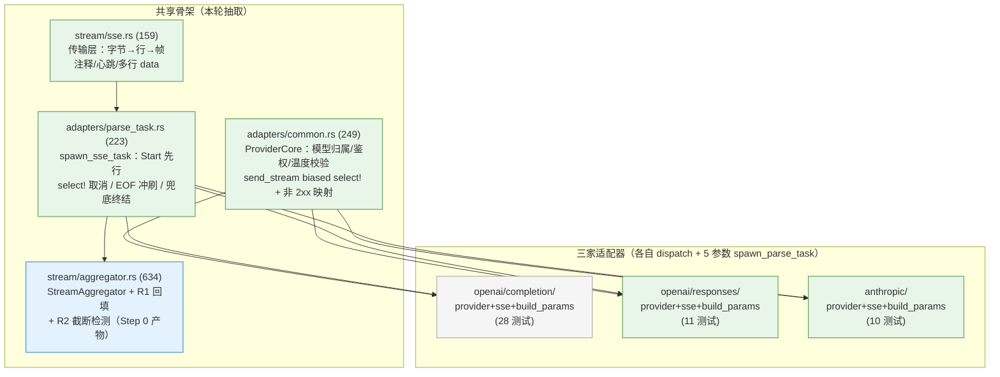
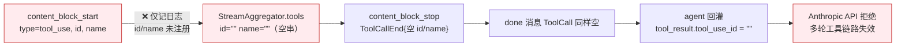

# 🔍 代码审查与总结报告 — 阶段 3 实施：Anthropic/Responses 适配器落地与 SSE 骨架通用化

> 2026-11-05

## 1. High-Level Summary (TL;DR)

> **Impact: 🟠 Medium-High**
> 本轮是**阶段 3 大规模实施**的一轮：Step 0（P0-1～P0-4）之后直接完成了 Step 1 全部 + 一个设计外适配器——新增 `adapters/anthropic/`（Anthropic Messages 适配器）与 `adapters/openai/responses/`（Responses API 适配器），并把原 1,794 行的 `openai/sse.rs` 大重构为四层共享骨架（通用 SSE 传输 / 通用解析任务 / ProviderCore / 各家 dispatch）；`gateway/router.rs` 修复目录迭代顺序不稳定性；新增 TOML 驱动的跨提供方降级示例。`ra-provider` 单测 195→**219**（+29），全工作区 **430 passed + 1 ignored**，四门禁全绿。**但 Anthropic 适配器存在 1 个 P0 功能缺陷**（tool_use 的 id/name 在 `content_block_start` 从未注册，多轮工具链路必然失效，且被违规 `#[allow(dead_code)]` 掩盖），另有 Responses 适配器无设计文档依据等 7 项风险。
>
> **✅ 修复跟进（v1.1，2026-11-06）**：R1/R2 已关闭——`content_block_start` 注册 tool_use id/name + 删除 2 处违规 `#[allow(dead_code)]`；**顺带发现并修复第二个隐藏缺陷**（`Delta` 字段名误用 `input_json_delta`，真实线格式携带字段是 `partial_json`，导致真实流参数片段全部丢失）；补 Mapper-02 工具流 fixture。R4/R5/R6 已关闭——thinking 预算注入（最高档 → `budget_tokens`）+ 单测、示例 TOML 模板纳入加载候选、intra-doc 链接修正。`ra-provider` 219→**221**，全工作区 **431 passed + 1 ignored**，四门禁全绿。

**审查范围**：未提交变更 = 新增 `adapters/anthropic/`（4 文件 806 行）、`adapters/openai/responses/`（3 文件 1,564 行）、`adapters/openai/completion/`（目录化拆分 2,188 行）、`adapters/{common,parse_task}.rs`（472 行）、`stream/{aggregator,sse}.rs`（793 行）、`test_support.rs`、示例 ×3（含 2 个 TOML 模板）；删除 `openai/{build_params,completion}.rs`；修改 `gateway/{mod,router}.rs`、`lib.rs` 等。净增约 +3,700 / −3,065 行。**全部未提交**。

**质量门禁结果**

| 门禁 | 命令 | 结果 |
|---|---|---|
| 格式化 | `cargo fmt --all -- --check` | ✅ 通过 |
| 静态检查 | `cargo clippy --workspace --all-targets -- -D warnings` | ✅ 0 告警 |
| 编译 | `cargo check --workspace` | ✅ 通过 |
| 测试 | `cargo test --workspace` | ✅ `ra-provider` **219**、`ra-agent` 94、`ra-core` 26、`ra-tools` 54、doctests 37 ＝ **430 passed + 1 ignored** |

**Key Changes（6 项）**

| # | 变更 | 位置 | 性质 |
|---|------|------|------|
| 1 | 🔀 SSE 骨架四层通用化：原 1,794 行 `openai/sse.rs` 拆为 `stream/sse.rs`（传输层 159）+ `adapters/parse_task.rs`（解析任务 223）+ `adapters/common.rs`（ProviderCore 249）+ 各家 dispatch | `stream/`、`adapters/` | **结构重构** |
| 2 | 🆕 Anthropic 适配器（provider/sse/build_params/mod，806 行，10 单测） | `adapters/anthropic/` | **功能新增（Step 1）** |
| 3 | 🆕 OpenAI Responses 适配器（provider/sse/build_params/mod，1,564 行，11 单测） | `adapters/openai/responses/` | **设计范围外新增**（10 v1.1 无此章节） |
| 4 | 🔀 `openai/completion.rs`(748) + `build_params.rs`(449) 目录化拆分为 `completion/{mod,provider,sse,build_params}` | `adapters/openai/completion/` | 结构调整 |
| 5 | 🔧 `gateway/router.rs`：CatalogIndex 增注册顺序 `order: Vec<ProviderId>`，同名模型先注册者胜出 | `gateway/{mod,router}.rs` | **确定性修复** |
| 6 | 🆕 `examples/gateway_fallback.rs`（687 行，TOML 驱动三家适配器跨提供方降级演示 + 离线桩） | `examples/` | 示例新增 |

**核心结论（按优先级）**

1. ~~🔴 **Anthropic 多轮工具链路 P0 缺陷**~~ ✅ **已关闭（v1.1 修复）**：~~`content_block_start` 分支不注册 tool_use 的 id/name~~——已注册并补 Mapper-02 fixture；修复中顺带发现第二个隐藏缺陷（`Delta` 字段名 `input_json_delta` ≠ 真实线格式 `partial_json`，参数片段全丢）一并修复。
2. ~~🟠 **违规 `#[allow(dead_code)]` ×2**~~ ✅ **已删除**。
3. 🟠 **Responses 适配器设计范围外**：10 v1.1 无对应章节（原 P2 规划仅一句话），1,564 行实现无设计文档背书，其中的错误处理与鉴权模式未经评审。
4. 🟢 **重构质量高**：四层骨架职责清晰（传输/解析任务/ProviderCore/dispatch），三家适配器（OpenAI completions / Responses / Anthropic）共享 `spawn_sse_task`（Start 先行、select! 取消、EOF 冲刷、兜底终结），R2 截断检测与 R1 回填在共享 finalize 中对三家**同时生效**——Step 0 的设计意图（跨适配器复用）完全兑现。
5. 🟢 **Gateway 确定性修复**：HashMap 迭代顺序不稳定导致同名模型主候选不确定——`CatalogIndex.order` 按注册序遍历，跨提供方降级链可预期。
6. 🟡 **Anthropic 对设计缩水**：mapper.rs / models.rs 未独立成文件、thinking_budgets 注入未实现、build_params fixture 6→3、Mapper fixture 4→1、真实 API `#[ignore]` 测试改为 examples 路径。

---

## 2. Visual Overview（代码与逻辑地图）

### 2.1 SSE 骨架四层重构（原 1,794 行 → 共享骨架 + 三家 dispatch）

### 2.2 Anthropic tool_use 断链（P0 缺陷）

---

## 3. Detailed Change Analysis（详细审查）

### 3.1 🔀 SSE 骨架四层通用化

**做得对的地方**

- 职责切分干净：`stream/sse.rs` 只管字节→帧（协议无关），`parse_task.rs` 只管任务生命周期（Start 先行 / `select!` 取消 / EOF 冲刷 / 兜底终结），`common.rs` 的 `ProviderCore` 收敛三家重复的「模型归属 → 鉴权 → 温度校验 → `select!` 建流 → 非 2xx 映射」——**ai_0009 R2 提出的「共享骨架」方向以超出预期的幅度兑现**。
- R2 截断检测与 R1 回填位于共享 `StreamAggregator.finalize`，三家适配器零成本继承——Step 0「跨适配器同时受益」的设计意图完全兑现。
- `gateway/router.rs` 的 `CatalogIndex.order`：修复 HashMap 迭代顺序不稳定导致同名模型主候选不确定——这是跨提供方降级可预期性的前置条件，且有新单测覆盖。

**问题**

- 🟡 拆分后 `openai/sse.rs` 仅剩 91 行 `map_provider_error`，文件名与内容不再匹配（实为错误码表模块）。
- 🟡 `#[allow(dead_code)]` ×2 在 anthropic/sse.rs——见 §3.2。

### 3.2 🔴 Anthropic 适配器：P0 功能缺陷 + 设计缩水

**符合设计的部分**：鉴权（构造持有 `Option<api_key>`、`AUTH_FAILED` PreStream 拒绝、`x-api-key` + `anthropic-version: 2023-06-01`）；build_params 块数组格式、tool_use/tool_result 往返、`Required → type:"any"`、system Text 拼接；mapper 的 `message_delta` 写 usage/finish_reason、`message_stop` 置哨兵 + finalize；截断流经共享 finalize 收敛 `Error + STREAM_INTERRUPTED`；provider 四阶段建流 + 5 参数 spawn_parse_task。

**P0 缺陷**：~~`content_block_start`（tool_use 块）的 `id`/`name` 未传入聚合器注册~~ ✅ **已修复（v1.1）**——`content_block_start` 对 tool_use 块调用 `tool_delta(id, name, None)` 立即注册；修复过程中 fixture 暴露**第二个缺陷**（`Delta.input_json_delta` 字段名错误 → 参数片段全丢），已改为 `partial_json`。回归测试 `tool_use_stream_aggregates_id_name_and_arguments` 断言 ToolCallEnd 与 done 消息的 id/name/arguments 三者一致。

**设计缩水清单**（vs 10 §7-§10）：

| 设计项 | 实际 |
|--------|------|
| mapper.rs 独立文件 | 映射内联进 sse.rs 的 dispatch_frame |
| models.rs 模型目录 | 取消（目录构造注入） |
| thinking_budgets → `body["thinking"]` | ✅ **已实现（v1.1）**：四档取最高已配置档为 `budget_tokens`，附单测 |
| build_params fixture 6 条 | 3 条（+1 thinking 注入测试） |
| Mapper fixture 4 条（文本流/工具流/message_stop/截断） | 2 条（error 映射 + **工具流 Mapper-02 已补**）；Mapper-01/03 待补 |
| 鉴权缺失 warn 文案 | 实现 error 级（合理偏差，建议回写设计） |

**增强（设计未列）**：流内 `error` SSE 事件 → 结构化错误映射表。

### 3.3 🟠 OpenAI Responses 适配器（设计范围外）

1,564 行 / 11 测试 / 含 1 条 TcpListener 端到端 SSE 测试。实现质量与 completion 同构（ProviderCore 复用），**但 10 v1.1 无对应设计章节**——鉴权模式、事件映射、错误处理均未经评审。09 §6.1 仅一句「P2 方向，不展开」。建议：补设计章节（或最小化设计附录）后再合入；至少明确 Responses 的事件名映射表与鉴权决策已评审。

### 3.4 示例与配置

`gateway_fallback.rs`（687 行）：组装三家真实适配器注册同名模型，TOML 驱动（providers + routing.cross_provider），配置缺失自动回退离线桩（三桩依次 429/402/401 触发降级至 200 成功流）——跨提供方降级的完整演示，`gateway_openai.rs` 同步 TOML 化。`Cargo.toml` dev-deps 增 `toml 0.8`。

**问题**：代码加载 `gateway_fallback.toml` / `gateway_openai.toml`，仓库模板却叫 `*_example.toml`——**运行示例必须手动改名**，与「示例即验收」的目标冲突。

### 3.5 测试分布（ra-provider 190→219，+29）

| 位置 | 新增 | 说明 |
|------|------|------|
| adapters/anthropic/ | 10 | provider 3 + build_params 3 + sse 1（error 映射）等 |
| adapters/openai/responses/ | 11 | provider 4 + sse 3 + build_params 4（含端到端 TcpListener） |
| stream/aggregator.rs | 5 | R1 ×1 + R2 ×3 + 哨兵 ×1（Step 0 产物） |
| stream/sse.rs | 2 | 传输层 |
| gateway/router.rs | 1 | 同名模型注册序 |
| completion/ 目录迁移 | 46 条不变 | 原测试一一对应迁移 |

**缺口**：Anthropic 的 Mapper-01~04（完整文本流 / 工具流 / message_stop / 截断 dispatch 级 fixture）未落地——恰好是能暴露 P0 缺陷的测试；真实 API `#[ignore]` 测试改为 examples 路径（INT-01/INT-02 无对应物）。

### 3.6 合规抽查

pub 项中文 `///`（抽查 anthropic/provider.rs、stream/sse.rs）✅；日志 `tracing` 完全限定路径、英文、无敏感信息 ✅；无 TODO/todo! ✅。**违规**：`#[allow(dead_code)]` ×2（无理由注释）。

### 3.7 🔁 相对 `ai_0011` 的结论衔接

| `ai_0011` 结论 | 本轮状态 |
|---|---|
| P0-1～P0-4（aggregator 抽取 + R1/R2） | ✅ 已交付并经评审确认；本轮进一步固化为三家共享骨架 |
| ai_0008 R1/R2 关闭 | ✅ 维持关闭（R1/R2 语义在三家适配器共享 finalize 中统一生效） |
| 09 v1.4 / 10 v1.1 设计 | 09 §9 Step 0/1 基本完成；Step 2（INT-VAL-01）、Step 3（真实 API）未做；Responses 属范围外先行 |
| 04 v1.8 阶段 3 任务表 | anthropic 行大部分落地（缩水项见 §3.2）；openai_responses 行**提前完成**（未在设计中）；gateway_anthropic 示例 → gateway_fallback 变体 |

---

## 4. Impact & Risk Assessment（影响与风险评估）

### 4.1 高危问题

| ID | 级别 | 问题 | 影响 |
|---|---|---|---|
| ~~R1~~ | ~~🔴~~ | ~~Anthropic `tool_use` id/name 未注册~~ ✅ **已关闭（v1.1）** + 顺带修复 `partial_json` 字段名缺陷 | 多轮工具链路恢复可用，431 passed |
| ~~R2~~ | ~~🟠~~ | ~~违规 `#[allow(dead_code)]` ×2~~ ✅ **已删除** | — |
| R3 | 🟠 | Responses 适配器 1,564 行无设计文档依据 | 未评审的错误处理/鉴权决策进入主干路径 |

### 4.2 风险与待办清单

| ID | 级别 | 问题 | 建议 |
|---|---|---|---|
| ~~R1~~ | ~~🔴~~ | ~~tool_use id/name 断链~~ ✅ **已关闭**：注册 + 删 `#[allow]` + Mapper-02 fixture + 顺带修复 `partial_json` 字段名 | — |
| ~~R2~~ | ~~🟠~~ | ~~`#[allow(dead_code)]` ×2~~ ✅ **已删除** | — |
| R3 | 🟠 | Responses 无设计背书 | 10 详细设计补 Responses 章节（事件映射表 + 鉴权 + fixture 清单），或拆为独立设计文档 |
| ~~R4~~ | ~~🟡~~ | ~~thinking 注入缺失~~ ✅ **部分关闭**：注入已实现（最高档 → budget_tokens）+ 单测；剩余：mapper/models 独立化、build_params fixture 3→6、Mapper-01/03 | 按 10 设计补齐 |
| ~~R5~~ | ~~🟡~~ | ~~TOML 命名不一致~~ ✅ **已关闭**：`*_example.toml` 纳入加载候选（命中占位配置自动回退离线桩） | — |
| ~~R6~~ | ~~🟡~~ | ~~intra-doc 链接失效~~ ✅ **已修正**（→ `parse_task::spawn_sse_task`） | — |
| R7 | 🟡 | 真实 API `#[ignore]` 测试未落地（INT-01/INT-02） | Step 3 按 10 §12 交付 |
| R8 | 🟡 | 未提交变更体量巨大（+3,700/−3,065，11 文件改 + 12 新增） | 按 Step 0 / Step 1 / 重构拆分提交，便于回溯 |
| R9 | 🟢 | thinking 块在 build_params 中丢弃（决策 6 已声明） | 启用 extended thinking 模型的多轮链路需回传 thinking 块——记录边界即可 |

---

> **文档版本**：ai_0012 v1.1（2026-11-06：修复跟进回写——R1/R2/R4/R5/R6 关闭；v1.1 修复内容：① `content_block_start` 注册 tool_use id/name；② 顺带发现并修复 `Delta` 字段名缺陷（`input_json_delta` → 真实线格式 `partial_json`）；③ 删除 2 处违规 `#[allow(dead_code)]`；④ Mapper-02 工具流 fixture；⑤ thinking 预算注入（最高档 → budget_tokens）+ 单测；⑥ 示例 TOML 模板纳入加载候选；⑦ intra-doc 链接修正。`ra-provider` 219→221，全工作区 431 passed + 1 ignored。v1.0（2026-11-05：初稿——阶段 3 实施审查）
> **审查对象**：未提交变更（anthropic/ + responses/ + completion/ 目录化 + SSE 四层骨架 + gateway 顺序修复 + 示例 ×3）
> **衔接文档**：ai_0011（ra-agent 与 07 评审闭环）、09 v1.4 / 10 v1.1（阶段 3 设计）、ai_0008（R1/R2 关闭来源）
