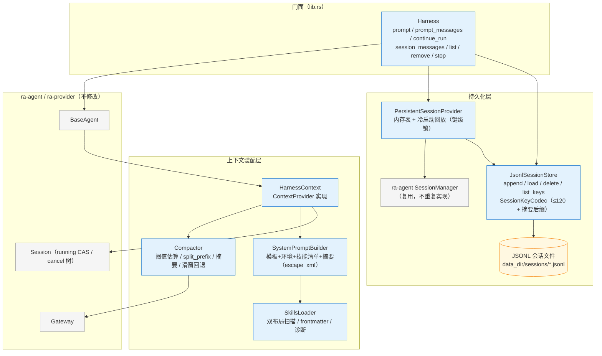
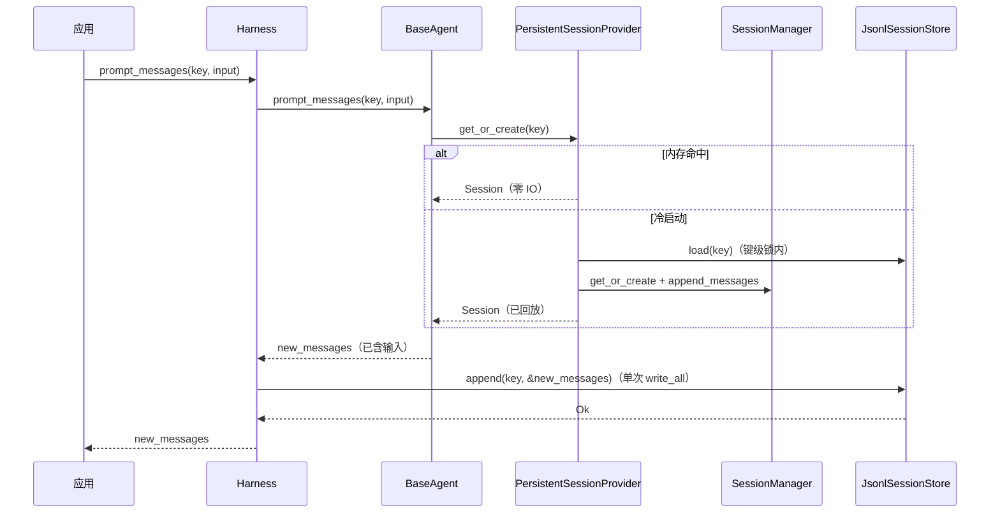
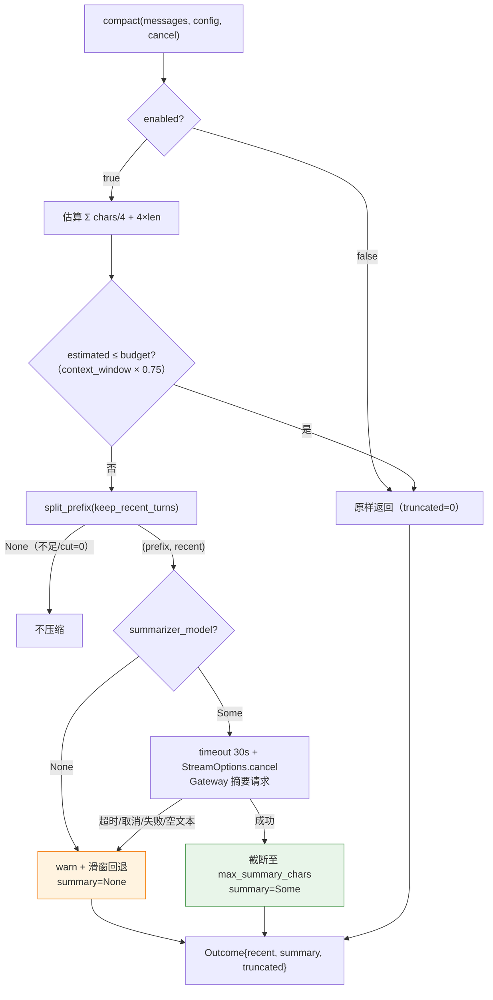

# 🔍 代码审查与总结报告 — `ra-harness` 会话容器全量实施（阶段 4）

> 2026年11月09日

## 1. High-Level Summary (TL;DR)

> **Impact: 🟢 Low-Medium**
> 本轮是**阶段 4 全量实施**：新增 `crates/harness`（`ra-harness`，`Cargo.toml` + `src/` 9 文件 + `tests/integration.rs`），按 12 详细设计 §13 的 Step 0..4 一次性落地——JSONL 会话持久化、持久化 `SessionProvider`、`Harness` 门面、上下文压缩、系统提示组装、技能加载与断点续会话集成验收。`ra-harness` **25 单测 + 1 集成测试全绿**，全工作区 **471 passed**，四门禁全绿。实施与 12 v1.1 设计**零语义漂移**（历轮评审修订全部体现在注释与断言中），仅 1 处 `.gitignore` 缺口（P2）与 2 处合理实施偏差需回写设计。

**审查范围**：未提交变更 = 新增 `crates/harness/` ＋ 根 `Cargo.toml`（`[workspace.dependencies]` 增 `tempfile = "3"` 与 `ra-harness` path 依赖）。**`tmp/` 测试产物目录残留未被忽略（R1）**。

**质量门禁结果**

| 门禁 | 命令 | 结果 |
|---|---|---|
| 格式化 | `cargo fmt --all -- --check` | ✅ 通过 |
| 静态检查 | `cargo clippy --workspace --all-targets -- -D warnings` | ✅ 0 告警 |
| 编译 | `cargo check --workspace` | ✅ 通过 |
| 测试 | `cargo test --workspace` | ✅ **471 passed**（`ra-harness` 25 单测 + 1 集成） |

**Key Changes（3 项）**

| # | 变更 | 位置 | 性质 |
|---|------|------|------|
| 1 | 🆕 `ra-harness` 全量实施（Step 0..4） | `crates/harness/` | **功能新增（阶段 4）** |
| 2 | 🔧 workspace 依赖注册（`tempfile`、`ra-harness`） | 根 `Cargo.toml` | 配套 |
| 3 | 🆕 集成验收（INT-HARNESS-01：两轮对话 → 重建 → `continue_run` 续跑无重复） | `crates/harness/tests/integration.rs` | 集成验收 |

**核心结论（按优先级）**

1. 🟢 **设计即规范**：12 v1.1 全部评审修订（`write_all` 原子性表述、`CorruptLine` 自愈、`Default` 配对、摘要段落顺序）在代码注释与测试断言中如实体现；此前经四轮实测核实的设计伪代码，实施零返工。
2. 🟠 **`tmp/` 测试产物目录未被 `.gitignore` 覆盖**——`test_util.rs` 刻意不自动清理（注释声明「手动删 tmp/ 即可清空」），策略明确但仓库状态被污染，需一行 `.gitignore` 条目。
3. 🟡 **2 处实施偏差合理但未回写设计**：`HarnessContext` 不持 `model`（由 `Compactor` 持有）；摘要取消经 `StreamOptions.cancel` 消费而非显式 `select!`。
4. 🟢 集成测试直击 double-write 与重复回放两个历史缺陷；`lib.rs` 主动补齐设计未列的诊断码再导出；压缩默认关闭的保守语义。

---

## 2. Visual Overview（代码与逻辑地图）

### 2.1 ra-harness 模块结构（与 12 §2.3 对照）

### 2.2 回合落盘与冷启动回放时序

### 2.3 压缩决策流

---

## 3. Detailed Change Analysis（详细审查）

### 3.1 🗄️ `session_store.rs`（JSONL 存储与键编码）

**与设计逐点吻合**：

- `SessionKeyCodec`：`MAX_ENCODED_LEN = 120`；保留字符集外字节 `%XX` 编码；超长键「截断 + 64 位摘要后缀」且**多次编码稳定**（测试 `key_codec_roundtrip_and_length_cap` 断言长度上限与确定性）；
- `append`：单批组装一个 `String` 后单次 `write_all`，注释如实记录 v1.1 修订——「尽量压低『写入一半』的窗口，**不承诺单次系统调用**（`write_all` 内部可能多次 `write`）」，并发 `load` 读到跨批半行由 `CorruptLine` 兜底、重新 `load` 可自愈；
- `load` 行为矩阵四诊断码（`TornTail` / `CorruptLine` / `UnknownRecordType` / `UnsupportedVersion`）与设计 §4.5 一致：末行损坏 → `TornTail`、非末行 → `CorruptLine`、未知 type 跳过、高版本按 v1 尽力回放；空行/`\r\n` 无诊断；
- `delete` 幂等、`list_keys` 以首行 `meta.key` 为准回退 `decode`；
- 补充测试齐备：`load_missing_file_returns_empty`、`append_empty_batch_creates_no_file`、`append_uses_single_meta_line`（多批 append 后 meta 仅一行）。

**日志**：追加成功 INFO（`session_key`/`messages`/`created`）、回放含诊断 WARN（条数）——无消息正文 ✅。

### 3.2 🔁 `session_provider.rs` + `lib.rs`（持久化 Provider 与门面）

- **冷启动单次回放**：快速路径内存命中零 IO → `init_locks` 键级锁 → 锁内二次检查 → `store.load` + `get_or_create` + `append_messages`——与 12 §5.2 时序逐段对应；SP-02 并发 8 路单次回放测试守护；
- **锁回收落地**：`init_locks.remove(key)` 在 `remove`（L121）与 `cleanup_expired` 差集（L165）两处调用——概设 P3 修订（防长期运行泄漏）如实实施；
- **`get` 纯读语义**：不触发回放（补充测试 `get_does_not_replay`）；
- **门面落盘语义**：`prompt_messages` 只写 `agent.prompt_messages` 返回的 `new_messages`，注释明确「`LoopReport.new_messages` 已包含本轮输入，落盘绝不再次拼接入参，否则冷启动回放会重复 user 轮」——概设 P1-1 的实施陷阱在代码注释中固化；`continue_run` 先 `provider.get_or_create` 物化再续跑（12 §1.2 闭口项 2）；
- **`Harness` API**：prompt / prompt_messages / continue_run / session_messages / list_sessions / remove_session / stop——与 12 §6.1 一致；`list_sessions`/`remove_session` 无多余内联 `use`（设计示意瑕疵已自然规避）。

### 3.3 🗜️ `compaction.rs` + `context.rs`（压缩与上下文装配）

- `SUMMARY_TIMEOUT = 30s` 模块常量（12 §14 关注点 4 的取舍落地，未扩 `CompactionConfig` 字段）；
- 触发判定链：`enabled` → 估算（`Σ chars/4 + 4×len`，图片 base64 不计）→ `context_window × trigger_ratio` 预算 → `split_prefix`（`keep_recent_turns` 个 User 消息切分；`keep=0`/不足/cut=0 三重防御，均有测试）；
- 无摘要模型 → `warn` + 滑窗回退（不报错）；摘要失败/超时/空文本 → 同一回退路径；`truncated` 两条路径语义一致；
- **实施偏差 2**：取消令牌经 `StreamOptions.cancel` 由网关/共享骨架在建流与流内消费，设计伪代码的显式 `select!` 层被省略——行为等价且更简（合理，建议回写 12 §7.4）；
- `HarnessContext`：skills 第五字段落地（`SkillsLoader` 装配期一次加载）；`config.include_environment` 构造时覆盖 builder 开关（唯一真值）；压缩注入 `CancelToken::from_token(session.cancel.token().clone())`——会话取消树直达摘要流；
- **实施偏差 1**：未引入 `HarnessContext.model` 字段（概设 P1-2 方案），主模型由 `Compactor` 持有——消除重复持有，`context_window` 单一来源；模块文档已注明取舍（合理，建议回写 11/12 字段表）；
- 系统提示为空 → `agent.context_build_error`（唯一结构化失败路径）；CT-01..06 覆盖顺序/摘要注入/环境段/技能清单——比设计矩阵（CT-01/02）多两条。

### 3.4 🧩 `skills.rs` + `system_prompt.rs`（技能与系统提示）

- `SkillsLoader::load()` 返回元组 `(Vec<Skill>, Vec<SkillDiagnostic>)`（12 形态），**永不返回错误**，问题全落诊断；`duplicate skill name: {name}` 等诊断消息具体可定位；双布局扫描（`<dir>/SKILL.md` + 扁平 `*.md`）；
- `parse_frontmatter` 手写实现（不引入 `serde_yaml`，概设决策 4）；
- `SystemPromptBuilder`：**`impl Default` 已实现**（12 v1.1 P2-1 修订落地，clippy 门禁预防御）；组装顺序「模板 → 环境 → 技能清单 → 自定义 → **摘要**」（12 v1.1 P3-1 定稿顺序，且概设 11 v1.2 已同步）；
- 双格式化路径分离：`escape_xml` 用于清单与环境段；`format_skill_invocation` 正文不转义——pi-harness invariant 如实移植；
- 段落标签 `<available-skills>` / `<conversation-summary>` 与 CT-05/CT-06、SY 测试断言闭环。

### 3.5 🧪 测试基建与集成验收

- `test_util.rs`：产物固定落 `<workspace>/tmp/<caller>-<pid>-<seq>`，**刻意不自动清理**（注释声明「手动删 tmp/ 即可清空」）——策略明确；**但 `tmp/` 未进 `.gitignore`（R1，唯一 P2）**；
- `tests/integration.rs`（INT-HARNESS-01）：两轮 prompt → 重建 Provider/Agent → `continue_run` 续跑无重复 → 再落盘 → 再冷启动——一条用例覆盖 double-write、重复回放、meta 唯一性三个历史缺陷场景。

### 3.6 合规抽查

| 项 | 结果 |
|---|---|
| `pub` 项中文 `///` 文档（抽查 lib/compaction/context/skills） | ✅ |
| 日志：`tracing` 完全限定路径、英文、结构化字段（`session_key`/`messages`/`truncated`/`reason`） | ✅ |
| 禁止记录消息正文 / 技能正文 / 摘要内容 | ✅ |
| 无 `#[allow(...)]`、无 TODO/todo! | ✅ |
| clippy 预防御（`Default` 配对、`DashMap` Ref 不跨 await） | ✅ |

### 3.7 🔁 相对 `ai_0012` 的结论衔接

| `ai_0012` 结论 | 本轮状态 |
|---|---|
| R1/R2/R4/R5/R6（Anthropic P0 修复 + thinking 注入 + TOML 候选 + 链接） | ✅ 已随前轮提交关闭 |
| R3（Responses 设计背书） | 🟠 仍待办（10 详细设计补章节） |
| 12 v1.1「示例代码照抄风险低」预判 | ✅ 验证成立——实施零返工 |

---

## 4. Impact & Risk Assessment（影响与风险评估）

| ID | 级别 | 问题 | 建议 |
|---|---|---|---|
| R1 | 🟠 | `tmp/` 测试产物目录未被 `.gitignore` 覆盖（`git status` 持续显示未跟踪残留） | 根 `.gitignore` 追加 `tmp/`（一行） |
| R2 | 🟡 | 两处实施偏差未回写 11/12（§3.3 偏差 1/2） | 回写概设字段表与 12 §7.4，保持设计-代码零漂移 |
| R3 | 🟡 | `ra-harness` 未跑 llvm-cov 覆盖率（ra-agent 同口径基线缺失） | 择机补测覆盖率分析 |
| R4 | 🟡 | 本轮体量约 +2,000 行，建议 harness 单独一次提交 | 提交信息注明对应 12 §13 Step 0..4 |

**做对与亮点**：设计评审闭环 → 实施零漂移（本工作区首例）；集成测试对准历史缺陷；压缩/技能的「不致命 + 诊断」降级语义与日志合规全部到位。

> **文档版本**：ai_0013（2026-11-09：ra-harness 全量实施审查，完整版）
> **审查对象**：未提交变更（crates/harness/ + 根 Cargo.toml）
> **衔接文档**：ai_0012（provider 修复闭环）、11 v1.2 / 12 v1.1（阶段 4 设计）、04 v1.9
