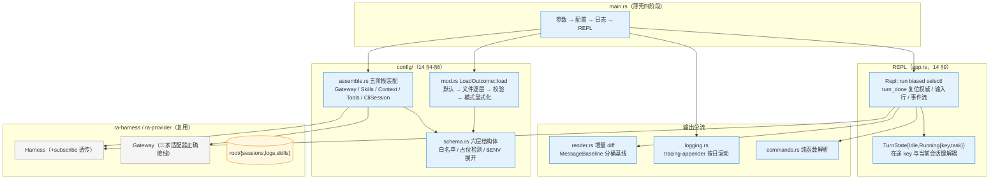
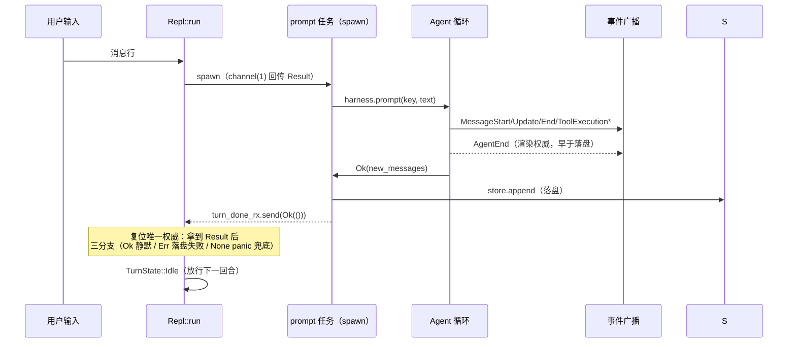
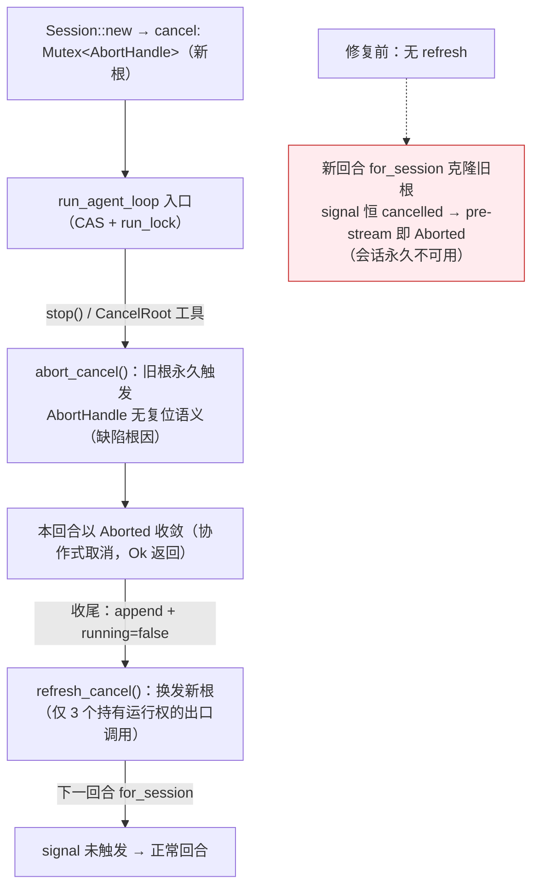

# 🔍 代码审查与总结报告 — `ra-cli` 交互层全量实施（阶段 5）+ 跨 crate 修复

> 2026-11-11

## 1. High-Level Summary (TL;DR)

> **Impact: 🟢 Medium**
> 本轮是**阶段 5 全量实施**：新增 `crates/cli`（11 文件 ≈ 2,240 行）按 14 详细设计 Step 0..3 + 收尾一次性落地——REPL 主循环（biased 三方 select + turn_done 复位权威）、行命令、分桶基线流式渲染、六层 TOML 配置（占位检测 / `$ENV` 展开 / 模式显式化）、tracing-appender 日志落文件与 E2E（APP-01..04）。**最重要的跨范围产出是发现并修复了 ra-agent 的取消根永久闩锁缺陷**（`stop()` 后会话所有后续回合在 pre-stream 即夭折——REPL「停止后继续对话」完全不可用）。同时交付阶段 3 收尾：INT-VAL-01（ra-agent 95 单测）+ `real_api.rs` 三条 `#[ignore]`（10 v1.3 Step 2/3，ai_0012 R3 同轮关闭）。四门禁全绿，全工作区 **483 passed + 3 ignored**。

**审查范围**：未提交变更 = 修改 12 文件（agent×5、harness×3、provider×1 Cargo、根 Cargo.toml、.gitignore、AGENTS.md）+ 新增 `crates/cli/`、`crates/provider/tests/`、`ribo_example.toml`。设计文档（todo/）经 `todo/.gitignore` 自忽略不入库，回写记录见各文档头部注记。

**质量门禁结果**

| 门禁 | 命令 | 结果 |
|---|---|---|
| 格式化 | `cargo fmt --all -- --check` | ✅ 通过 |
| 静态检查 | `cargo clippy --workspace --all-targets -- -D warnings` | ✅ 0 告警 |
| 编译 | `cargo check --workspace` | ✅ 通过 |
| 测试 | `cargo test --workspace` | ✅ **483 passed + 3 ignored**（agent 95 / cli lib 7 + E2E 4 / core 26 / harness 38+1 / provider 221 / tools 54 等） |

**Key Changes（5 项）**

| # | 变更 | 位置 | 性质 |
|---|------|------|------|
| 1 | 🆕 `ra-cli` 全量实施（Step 0..3 + 收尾） | `crates/cli/`（11 文件） | **功能新增（阶段 5）** |
| 2 | 🐛→🔧 **ra-agent 取消根永久闩锁缺陷修复**（`refresh_cancel`） | `agent/{session,agent_loop,agent,types,test_support}.rs` + `harness/context.rs` | **缺陷修复（超出阶段 5 范围声明）** |
| 3 | 🔧 `Harness::subscribe()` 事件订阅透传 | `harness/lib.rs`（+17 行） | 阶段 5 前置 |
| 4 | 🆕 INT-VAL-01 + `real_api.rs` 三条 `#[ignore]`（10 v1.3 Step 2/3，含 §16 Responses 设计背书） | `agent_loop.rs` + `provider/tests/` | 阶段 3 收尾 |
| 5 | 🔧 workspace 注册 `toml`/`clap`/`tracing-appender`；`.gitignore` +`/ribo.toml`；AGENTS.md 增 tempfile 约束 | 根 `Cargo.toml` 等 | 配套 |

**核心结论（按优先级）**

1. 🟠 **R1（本轮唯一新发现的功能风险）**：provider/model/summarizer_model 等用户配置值在装配期直接 `ModelId::parse(..).expect(..)`——`load` 层仅校验非空，**非法模型名会让 REPL 启动即 panic**（mock 模式不受影响，真实模式配置一处手误即崩）。
2. 🟠 **取消根缺陷是本轮最有价值的发现**：触发路径极隐蔽（单测只覆盖「stop 后首回合收敛」，无人验证第三回合）；修复以 `Mutex<AbortHandle>` + 三个「持有运行权」的收尾路径 `refresh_cancel()` 完成，APP-02/03 守护 `/stop` 后继续对话语义。
3. 🟢 **E2E 时序确定性三机制**（`MessageStart` 计数消 pre-stream 取消竞态、`settle()` 消复位窗口、终止渲染先行于 `/exit`）——三处竞态被逐一识别并以机制化方式消除，全部 4 条 E2E 无真实时间依赖（`start_paused`）。
4. 🟢 **实施偏差全部回写**：14 v1.4 头部 9 条注记（tracing-appender 取代自实现滚动、`LineSource` RPITIT、`CliSession` 字段、`/new` 串行拒绝、fs_root 沙箱不变式等）+ 13 v2.6 / 10 v1.3 / 04 同步——设计-代码零漂移惯例延续。
5. 🟡 2 处合理实施变体：真实 API 测试以 `tests/real_api.rs` 取代原设计的两个 examples（手动验收路径由既有 `gateway_fallback` 示例覆盖）。

---

## 2. Visual Overview（代码与逻辑地图）

### 2.1 ra-cli 模块结构（与 14 §1 覆盖关系对照）

### 2.2 回合复位时序（复位权威 = turn_done 分支，概设 v2.4 §4.1）

### 2.3 取消根生命周期（本轮缺陷修复核心）

---

## 3. Detailed Change Analysis（详细审查）

### 3.1 ⚙️ `config/`（六层 schema + 聚合加载 + 装配）

- **provider 层根级解析特殊性**：`query_model`/`[[providers]]`/`[routing]` 均为根级键，`ProviderSchema` 直接从根 Table 整体反序列化（其余五层走 `[layer]` 子表）——CFG-01/02 首版失败的根因，实施注记已固化；`unknown_top_level` 依赖 serde 默认忽略语义（CFG-01 显式断言）；
- **校验链完整**：五字段非空 → adapter 白名单（`unreachable!` 兜底二分派）→ 占位检测（`your-*`/`example.com` → 整体回退 Mock）→ `$ENV` 展开（`retain_mut` 原地改写）→ query_model 悬空 → 整体 Mock；路由链引用被跳过 provider 时剔除（CFG-02 覆盖）；
- **fs_root 沙箱不变式**（实施中途按需求演进）：`tools.fs_root` 相对 `harness.root` 解析（`root.join`），加载期拒绝绝对路径 / `..` 组件（warning + 回退 root，`load_rejects_escaping_fs_root` 三分支断言）——工具读写边界恒位于工作空间之下；
- **Option 字段的模板陷阱被正确处理**：`summarizer_model`/`fs_root` 在 `ribo_example.toml` 保持注释态并标注「注释掉即 None」——写空串会导致 `Some("")`（summarizer_model 空串会在装配期 panic，见 R1 同源）；
- 测试覆盖 8 条（CFG-01/02 + 校验 + 逃逸），占位模板冒烟实测通过（显式全层解析零 warning）。

### 3.2 🔌 `assemble.rs`（装配链与适配器接线）

- 五阶段顺序与 14 §6 装配映射表一致：Gateway → 持久化/技能 → ContextConfig（**compression 层唯一真值**，双真值裁决落地）→ 内置工具 → BaseAgent/Harness/CliSession；
- **三家适配器正确接线**：`openai-chat`/`openai-responses`/`anthropic` 各走各自适配器（构造签名一致、协议完全不同）——审查中指出原实现将 responses 复用 chat 适配器（配置字段形同虚设）后已修正，10 v1.3 §16 同步；
- `build_real_gateway` 的 retry 层映射（initial_backoff_ms → Duration）、RouteMap 跨提供方降级链、primary 模型经 query_model 精确查找（`expect` 有 load 期不变式背书）；
- **R1 根因**：`mid()`/`pid()` 为 `expect` 包装——`entry.model`/`summarizer_model` 是用户自由文本，load 仅查非空；`ModelId::parse` 规则不满足即 panic。mock 模式零风险（模型名恒 mock-model），真实模式配置手误即崩。

### 3.3 🔁 `app.rs`（REPL 主循环）

- **复位权威实现**：select 三个分支中 turn_done 有 `if matches!(Running)` 守卫 + biased 最高优先级；`reset_turn` 三分支（Ok 静默 / Err 落盘失败 / None 任务异常终止）与概设 v2.4 一致；`recv()` 用裸 `result` 模式（设计稿的 `Some(result)` 模式会让 panic 路径分支失效——实施修正正确）；
- **`/stop` 双阶段**：重试触发取消（spawn 任务可能尚未注册运行标志，`yield_now` 自旋 + `try_recv` 探测自然收尾/异常终止）→ 阻塞至复位（终止渲染先于提示符）——既修注册竞态又保 UX 确定性；
- **Send 约束的系统性处理**：`LineSource` 用 RPITIT（`impl Future + Send`，免 async-trait 依赖）；async 方法统一 `&mut self`（`&self` 跨 await 要求 `Repl: Sync`，`Box<dyn Renderer + Send>` 非 Sync 会杀死 run future 的 Send——E2E 需 spawn）；`request_stop_if_running` 以 `mem::replace` 取走 JoinHandle 并等待，EOF 退出态干净；
- **biased 顺序的已知代价**：line 分支先于 events 分支——事件密集时后续输入行可能先于事件渲染被处理；E2E 以「终止渲染断言先行」机制抵消（§3.7），交互场景无感知。

### 3.4 🖥️ `render.rs` + `logging.rs`（输出分流）

- 分桶基线（`MessageBaseline { blocks }`）逐块 diff：Text/Thinking 参与字符计数，ToolCall/Image 跳过（由 ToolExecutionStart/End 状态行表达）；Lagged 丢弃基线等 MessageStart 重同步；无配对 MessageEnd 渲染 `error_message`（REN-01/02 覆盖）；
- `emit` 以自由函数 + `print!` 宏写入，规避 stdout 可变借用与基线借用冲突；
- 日志从自实现 8MiB 截断滚动**迁移到 tracing-appender**（按日滚动 + 非阻塞 WorkerGuard，main 持有至进程结束）——14 注记 ⑤ 明确「tracing-appender 无按大小维度」为接受的设计偏差；原 rotate 测试随之删除（lib 7→6）。

### 3.5 🧬 ra-agent 取消根修复（缺陷细节）

- **缺陷**：`Session.cancel: AbortHandle` 一旦 `abort()` 永久触发且无复位语义；`LoopConfig::for_session` 克隆同一根令牌 → stop 后**该会话所有后续回合**在 `gateway.stream` 前被 CANCELLED 折叠为 Aborted（provider=gateway 的终端消息证实）。ai_0012/ai_0013 的测试均只到「stop 后首回合收敛」为止，无人验证后续回合——典型的「取消语义测试覆盖不足」；
- **修复形态**：字段改 `Mutex<AbortHandle>`（`abort_cancel`/`cancel_token`/`cancel_is_aborted`/`refresh_cancel` 四方法封装）；`run_agent_loop` 的三个**持有运行权**的出口（续跑前置失败 / 上下文构建失败 / 主收尾）调用 `refresh_cancel`——重入拒绝路径**不**刷新（避免 clobber 活动运行的取消根），并发安全性在 doc 注释中论证；
- **波及面**：`harness/context.rs` 压缩取消令牌改走 `cancel_token()`；test_support CancelRoot 同步。ra-agent 94→95 全绿（含 for_session 信号联动、CancelRoot 收敛三个既有测试无回归）；
- APP-02（stop 后新回合成功 + `/new work` 生效）与 APP-03（键轮换）成为该修复的守护测试。

### 3.6 🧪 测试与验收

- **E2E（APP-01..04，`start_paused` 虚拟时钟）**：三机制详见 TL;DR 结论 3——均由真实竞态驱动（pre-stream CANCELLED 折叠不消费脚本步骤、AgentEnd 渲染早于 append→send→复位、biased line 先于 events），不是为测而测；
- **INT-VAL-01**：真实 `ToolManagerAdapter` + `create_echo_tool`（非 MockTools 桩），非法 arguments → `tool.invalid_arguments` → `fold_tool_error` → `ToolResultMessage(is_error=true)` 回灌，循环不中断（两轮 LLM 调用断言）；与设计稿的差异（回灌为独立 `Message::ToolResult` 而非并入 assistant content）已在 10 §11.3 注记；
- **real_api.rs**：三条 `#[ignore]`（anthropic/openai-chat/openai-responses），`*_API_KEY` 驱动、`*_BASE_URL`/`*_MODEL` 可覆盖、缺密钥打印跳过——AGENTS.md 外部服务测试约束合规；
- 首次冒烟一次通过：模板复制 → 占位回退 Mock（无 parse warning）→ `/help` 渲染 → 空脚本 INVALID_REQUEST 终结渲染 → 日志全落 `logs/cli.log.<日期>`、stdout 零 tracing 行。

### 3.7 合规抽查

| 项 | 结果 |
|---|---|
| `pub` 项中文 `///` 文档（抽查 app/config/render/logging） | ✅ |
| 日志：`tracing` 完全限定路径、英文、结构化字段 | ✅ |
| 禁止记录消息正文 / 密钥（$ENV 仅 warn 键名不warn值） | ✅ |
| 无 `#[allow(...)]`（unsafe env 两处除外，均带安全性论证注释且仅限测试） | ✅ |
| 非 `#[cfg(test)]`/tests/ 无 tempfile（AGENTS.md 新增约束，声明隔离验证） | ✅ |
| clippy 预防御（Default 配对、unreachable! 兜底二分派） | ✅ |

### 3.8 🔁 相对 `ai_0012` / `ai_0013` 的结论衔接

| 前轮结论 | 本轮状态 |
|---|---|
| ai_0012 R3（Responses 设计背书） | ✅ 已关闭（10 v1.3 §16 + CLI 正确接线 `OpenAiResponsesAdapter`） |
| ai_0012 R1/R2/R4-R6 | ✅ 已随前轮提交关闭 |
| ai_0013 R1（`tmp/` 未忽略） | ✅ 已闭合（`tmp/.gitignore` 自忽略 + 根 `.gitignore` 增 `/ribo.toml`） |
| ai_0013 R2（实施偏差回写） | ✅ 惯例延续——本轮 14 v1.4 九条注记 |
| ai_0013 R3（覆盖率） | 🟡 仍开放（ra-agent/ra-harness/ra-cli 均未跑 llvm-cov） |
| 12 v1.1「设计即规范」预判 | ✅ 继续成立——14 Step 0..2 零语义漂移；Step 3 竞态为设计未预见的真实问题，以机制化方式解决并回写 |

---

## 4. Impact & Risk Assessment（影响与风险评估）

| ID | 级别 | 问题 | 建议 |
|---|---|---|---|
| R1 | 🟠 | 用户自由文本配置（`entry.model` / `summarizer_model`）在装配期 `ModelId::parse(..).expect(..)`——`load` 仅查非空，非法值 → REPL 启动 panic | load 期补 ModelId 合法性校验（失败 warning + 回退 Mock），或装配期降级；至少覆盖 `summarizer_model` |
| R2 | 🟠 | 取消根修复修改 ra-agent——超出 14 头部原「不修改 ra-agent」声明 | 已在 14 v1.4 注记 ② 回写；建议**取消根修复与 ra-cli 分两次提交**，提交信息注明缺陷机理 |
| R3 | 🟡 | E2E `starts` 计数断言依赖 `MockStep` 语义（Silent 立即推 Start）；mock 脚本行为变更会波及 | 已在 e2e.rs 头注记声明依赖；mock 契约测试（provider.rs 11 条）作为上游防线 |
| R4 | 🟡 | `/history`、`/skills`、`/sessions` 输出走 `println!` 不可进程内断言 | APP-02/03 已用转录/会话真相间接覆盖行为；如需 UI 级测试待 TUI 阶段统一（Renderer 扩展输出接口） |
| R5 | 🟡 | 本轮体量约 +2,400 行（cli 2,240 + agent/harness 修复与测试） | 建议 ra-cli 单独一次提交；取消根修复单独提交（同 R2） |
| R6 | 🟡 | 覆盖率基线缺失（承接 ai_0013 R3） | 择机 llvm-cov（ra-agent / ra-harness / ra-cli 三 crate） |

**做对与亮点**：取消根缺陷的发现-定位-修复-守护全链路（单测盲区 → 真实 REPL 场景暴露 → 语义级修复 → APP-02/03 长效守护）；三处竞态的机制化消除而非 sleep 凑合；实施偏差即做即回写的纪律（14 v1.4 九条注记与代码同步演进）；AGENTS.md 约束（tempfile）与模板（ribo_example.toml 全量配置项）随实施固化。

> **文档版本**：ai_0014（2026-11-11：ra-cli 阶段 5 全量实施审查，完整版）
> **审查对象**：未提交变更（crates/cli/ + agent/harness/provider 修复与测试 + 根 Cargo.toml/.gitignore/AGENTS.md + ribo_example.toml）
> **衔接文档**：ai_0013（ra-harness 审查）、14 v1.4 / 13 v2.6 / 10 v1.3（本轮设计回写）、04 v1.10
