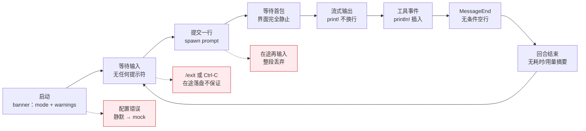

# ra-cli 用户体验优化建议（基于当前磁盘代码的实测分析）

> 2026-11-11

> **性质**：分析与建议（非缺陷审查）；**未修改任何代码**
> **分析范围**：`crates/cli/` 全部 10 个 `.rs`（2,480 行）、`crates/tui/` 入口与依赖、`Cargo.toml`、`ribo_example.toml`、`README.md`；关联设计 `todo/13` v2.7、`14` v1.5、`15` v1.3、`16` v1.2 与 `ai_0014`
> **一句话结论**：CLI 的**功能链路是完整的**（阶段 5 E2E 已守护），但**用户可感知层几乎没有打磨**——首次启动必然得到一次红色失败、配置文件写错与文件不存在表现完全相同、终端转义码不复位、无输入提示符。这些几乎都是零依赖、低风险的输出层改动，收益/成本比极高。

---

## 1. TL;DR

> **Impact: 🟠 High（体验） / 🟢 Low（改动风险）**

| 维度 | 结论 |
|---|---|
| 发现 | 19 项 UX 问题：**P0 6 项**（显示正确性与首次体验）、**P1 6 项**（反馈/配置生效/数据完整性）、**P2 7 项**（可发现性与长期一致性） |
| 最高价值 | **U-01**（mock 首条消息必失败）、**U-02**（配置错误静默降级）、**U-04**（`\x1b[2m` 不复位污染整屏） |
| 改动成本 | 17/19 项**不需要新增依赖**，且集中在 `app.rs` / `render.rs` / `commands.rs` 三个文件的输出与文案层 |
| 契约影响 | 不改 `Harness` / `AgentEvent` / `Renderer` trait 语义，不改 13 §7 已拍板决策；仅 U-17 为结构性重构建议，需单独评审 |
| 杠杆点 | `LoadOutcome::load` 与 `assemble()` 被 **`ribo` 与 `ribo-tui` 两个 bin 共用**，配置与装配层的 UX 修复一次生效、两处受益 |

**建议顺序**：先清 P0 的 6 项（约一个批次，纯输出层 + 单测），再按 P1 分两批补行为与反馈，P2 择机。**不要**把"提升体验"理解成给 CLI 加行编辑库或全屏 UI——那是 `ra-tui` 的职责，且 13 §1 已明确不做。

---

## 2. 分析前提：当前工作区状态（重要）

本轮结论**以磁盘代码为准，不以设计文档为准**。当前存在未提交改动，且设计文档滞后于代码：

| 事实 | 证据 | 对本文的影响 |
|---|---|---|
| `crates/tui/` 已实施（17 个 `.rs`，未跟踪） | `git status --short` → `?? crates/tui/` | TUI 不再是"规划中"，CLI 的 UX 建议须与 TUI 分工，不重复造轮子 |
| 6 个文件有未提交改动（+191 / −14） | `git diff --stat` | 涉及 `app.rs`、`commands.rs`、`assemble.rs`、`harness/{compaction,lib}.rs`、根 `Cargo.toml` |
| 这些改动正是 16 §13 的**跨 crate 接口已落地** | `commands.rs` 新增 `COMMANDS` 元数据表与 `Command::Status`；`assemble.rs` 新增 `spawn_turn` / `TurnHandle`；`harness/compaction.rs` 公开 `estimate_context_tokens` | 16 文档仍写"§13 是唯一代码改动、尚未实施"，**文档滞后**；本文按"已实施"处理 |
| 两个 bin 共用配置与装配 | `crates/tui/src/main.rs:11-12` 引 `ra_cli::config::{LoadOutcome, assemble}`，并复用 `ra_cli::logging` | `LoadOutcome::load` / `assemble()` 的 UX 修复同时惠及 `ribo` 与 `ribo-tui` |
| `crates/tui/src/lib.rs` 仍是模板（`add` 函数） | 文件内容 | TUI 尚未收尾，CLI 仍是长期可用入口，CLI 体验不是"临时过渡" |

> ⚠️ 本文**未触碰上述任何未提交改动**。所有建议以"在现有改动之上继续改"为前提描述。

---

## 3. 用户旅程现状地图



| 阶段 | 用户看到什么 | 代码路径 | 主要问题 |
|---|---|---|---|
| 启动 | `ribo v0.0.1（mock 模式）` + 英文 warnings | `app.rs:333-343` | U-01 / U-02 / U-16 |
| 等待输入 | 光标停在空行，无提示 | `app.rs:90-136`、`406-430` | U-07 |
| 提交 | 无确认、无进行中提示 | `app.rs:139-158` | U-10 / U-09 |
| 流式输出 | 连续文本，无角色标识 | `render.rs:60-101` | U-04 / U-05 / U-10 |
| 工具调用 | `[tool xxx …]` 插在半行文本后 | `render.rs:111-123` | U-05 |
| 出错 | 同一错误最多 3 条红线 | `render.rs:104-134` | U-06 |
| 查命令 | `/help(/?)` 等拼接怪异、别名不可用 | `app.rs:346-366` | U-03 / U-13 |
| 查历史 | 整段全文刷屏、配置条数不生效 | `app.rs:308-329` | U-08 / U-14 |
| 退出 | `/exit` 与 Ctrl-D 行为不一致 | `app.rs:104-113` | U-11 / U-12 |

---

## 4. 问题清单

> 格式：**现象**（用户视角）→ **证据**（文件:行）→ **建议**（具体改法）→ **验收**（可测口径）。

### 4.1 P0 — 首次体验与显示正确性（建议立即修）

#### U-01 🟠 mock 模式「克隆即跑」实为「首条消息必失败」

- **现象**：无配置启动，banner 显示「mock 模式」并邀请输入；用户发出第一条消息后得到红色 `回合失败：INVALID_REQUEST …`。用户无法判断是程序坏了、配置错了，还是 mock 本就如此。`ribo-tui` 因共用 `assemble()` 同样受影响。
- **证据**：`config/assemble.rs:222-224`（`assemble()` 向 mock 网关传 `Vec::new()`）；`assemble.rs:146-148` 注释已明确「空脚本——回合以 INVALID_REQUEST 终结属预期」；`app.rs:333-343` banner 未解释该语义。
- **建议**（不改 mock 契约）：① **必做**：banner 增加一行明确语义与配置指引，例如「演示模式：不调用真实模型，回复为固定脚本。配置：复制 `ribo_example.toml` 为 `ribo.toml`，用 `$ENV_NAME` 填密钥」；② **可选**：生产 `assemble()` 改用一段可交互的演示脚本（固定欢迎语 / 回显），空脚本仅保留给 E2E 的 `assemble_with_steps`。注意 `MockStep::Complete` 闭包入参为 `&Context`（`agent/src/test_support.rs:124`），**需先确认上下文能否取到用户文本**，不可行则只做 ①。
- **验收**：mock 启动后首条消息不出现红色失败；banner 含配置指引；E2E 脚本注入路径不受影响（`assemble_with_steps` 行为不变）。

#### U-02 🟠 配置文件错误被静默吞掉，降级原因不可诊断

- **现象**：`ribo.toml` 有一个 TOML 语法错误、权限不可读、`--config` 指向目录，与「文件根本不存在」表现完全一致：进入 mock，warning 只有 `no providers configured`。用户不知道该修哪个文件。
- **证据**：`config/mod.rs:87-88` 两处 `.ok()` 吞掉 `read_to_string` 与 `toml::from_str` 的全部错误；`mod.rs:134-145` 仅 push `no providers configured`；warnings 全英文（`mod.rs:50/75/97/135/185/207`、`schema.rs:187/191/201/225`），而 UI 其余提示为中文。
- **边界**：13 §5 已拍板「配置缺失/占位/解析失败 → 回退 mock + 横幅」，**不建议改变降级行为**，只补诊断信息。
- **建议**：`load` 区分三种文件级失败并产出结构化原因（`FileMissing` / `ReadFailed` / `ParseFailed{line,col}`，与既有 `NoProviders` / `Placeholder` / `EnvMissing` 并列）；banner 用**中文**逐条展示并附修复建议；`tracing` 日志保持英文（AGENTS.md 规范，两者不冲突——UI 文案 ≠ 日志）。
- **验收**：CFG 新增三条用例，断言三类文件级失败的 warning 文案**互不相同**且含修复建议；UI warning 全中文。

#### U-03 🟠 `/?` 别名在 `/help` 展示但解析不支持（本轮未提交改动引入）

- **现象**：`/help` 打印 `/help(/?)`，用户照着输入 `/?` → 「未知命令 /?」。同时 `/new [name] ` 尾部多一个空格、`/history [n] ` 亦然。
- **证据**：`commands.rs:44-50` 中 `/help` 声明 `aliases: &["/?"]`；`commands.rs:123-138` 的 `parse_line` 无 `/?` 分支；`app.rs:359-363` 用 `format!("{}{alias}{args}", meta.name)` 直接拼接。
- **建议**：① `parse_line` 补 `"/?" => Ok(Command::Help)`；② `print_help` 改为可读形式（如 `/help, /?`，参数不留尾空格）；③ 加**穷尽性单测**：遍历 `COMMANDS` 的全部 `aliases`，断言每个都能被 `parse_line` 解析，杜绝元数据表与解析器再次漂移。
- **验收**：CMD-01 增 `/?` 断言；新增穷尽性测试通过。

#### U-04 🟠 thinking 的 ANSI dim 未复位，污染后续全部输出

- **现象**：模型输出 thinking 块后，终端整屏（后续回答、命令输出、提示符）持续变暗，直到某条红色错误附带的 `\x1b[0m` 才恢复；输出重定向到文件或管道时残留转义码乱码。
- **证据**：`render.rs:92` `emit(rendered, "\x1b[2m", &t.content)` 只加前缀、从不 reset；`\x1b[0m` 仅出现在 `render.rs:107/127/132` 的错误分支；全仓 Grep 无 `IsTerminal` / `NO_COLOR` / `CLICOLOR` 处理。
- **建议**：① 每段 thinking 输出自闭合为 `"\x1b[2m{tail}\x1b[0m"`；② 引入**零依赖**颜色策略：`std::io::IsTerminal` + `NO_COLOR` / `CLICOLOR_FORCE` 决定开关，非 TTY 时所有转义码退化为空串；③ 策略集中在 `render.rs` 的小模块，别散落到各 `println!`。
- **验收**：REN 单测断言 thinking 输出含配对 reset；模拟非 TTY 时输出零 `\x1b`。

#### U-05 🟠 工具状态行撕裂流式文本；Lagged 后半截回答永久丢失

- **现象**：助手正在输出（尚未换行）时工具事件插入，`[tool xxx …]` 直接接在半句话后面；`MessageEnd` 又无条件空行。另在广播拥塞后，当前助手消息的剩余增量被全部忽略，用户看到半截回答且无任何"内容不完整"提示。
- **证据**：`render.rs:60-69` `emit` 用 `print!` 不换行，`render.rs:111-123` 工具事件用 `println!`，`render.rs:104-110` `MessageEnd` 无条件 `println!()`；`render.rs:139-144` `on_lagged` 丢弃基线，`82-85` 后续 `MessageUpdate` 被忽略直至下一个 `MessageStart`。
- **建议**：`TerminalRenderer` 增 `line_open: bool`（`emit` 置 `true`，任何换行处清 `false`）；所有 `println!` 型输出前若 `line_open` 先补一个换行，状态行统一为「换行 → 输出 → 换行」。Lagged 提示改为「事件拥塞，本轮显示可能不完整；完整内容见 `/history`」，明确 `/history` 是真相来源。
- **验收**：REN 新增「流式半行 + 工具事件」用例，断言状态行独占整行；新增 Lagged 提示文案断言。

#### U-06 🟠 同一错误最多重复打印三次

- **现象**：一次失败回合可能连续输出三条几乎相同的红色 `回合失败：…`，掩盖真正原因。
- **证据**：`render.rs:104-110`（`MessageEnd`）、`125-129`（`TurnEnd`）、`130-134`（`AgentEnd`）三处各自调用 `error_message_of` 并打印；`tests/e2e.rs:46-49` 的 `Record.errors` 正是按三处累加设计，可作为基线对照。
- **建议**：在 Renderer 内按回合去重——借 `AgentStart` / `TurnStart`（`agent/src/agent_loop.rs:147-148` 已发射）重置标记，记录已输出的 reason；`MessageEnd` 优先打印，`TurnEnd` / `AgentEnd` 仅在未见 `MessageEnd` 时兜底。
- **验收**：REN 断言一条失败序列只产生 1 条错误文本；E2E 录制口径相应调整。

---

### 4.2 P1 — 交互反馈、配置生效与数据完整性

#### U-07 🟡 无输入提示符，用户不知道程序在等待

- **现象**：横幅后光标停在空行；一轮流式输出结束也没有分隔，分不清「还在输出」与「轮到我输入」；管道/非 TTY 场景完全静默。
- **证据**：`app.rs:90-136` 主循环无提示符输出；`app.rs:406-430` `StdinLineSource` 仅 `lines().next_line()`。
- **边界**：13 §1 明确不做 **raw mode / 行编辑库**（crossterm、rustyline 等），**不引入任何新依赖**。
- **建议**：零依赖方案——`Repl` 每轮读取前输出 `ribo> ` 并 `flush()`；用 `std::io::IsTerminal` 判断，非 TTY（管道/重定向）时不输出以保持脚本友好；回合结束输出稳定分隔（空行或细分隔线）。
- **验收**：E2E 断言提示符出现次数与回合数匹配；管道场景输出中无提示符。

#### U-08 🟡 `session.history_lines` 配置完全未接线

- **现象**：`ribo_example.toml:61` 明确承诺「`/history` 未带参数时的条数」，改成 3 后 `/history` 仍固定输出 10 条。
- **证据**：`commands.rs:131-135` 缺省硬编码 `History(10)`；`config/assemble.rs:48` 的 `CliSession.history_lines` 已装配，但 `app.rs` 全文零引用（Grep 确认）；`ribo_example.toml:61` 文案承诺。
- **建议**：把「缺省条数」从纯解析层上移到主循环——`parse_line` 返回 `Command::History(Option<usize>)` 或新增 `HistoryDefault` 变体，由 `dispatch` 用 `session.history_lines` 填值；**保持 `parse_line` 不依赖 session 的纯函数性质**。
- **验收**：CMD/CFG 单测 + APP E2E 断言 `history_lines = 3` 时 `/history` 只出 3 条。

#### U-09 🟡 在途输入被静默丢弃

- **现象**：回合进行中输入的整段消息直接消失，仅回一句「回合进行中：/stop 取消后可继续。」
- **证据**：`app.rs:139-143`。
- **边界**：13 §7 决策 6 已定「在途拒绝」（`/steer` 留后续迭代），**不改拒绝语义**。
- **建议**：拒绝时回显原文并标注未发送（「未发送（可复制重发）：…」），或暂存一条 pending 输入、复位后提示「上次输入未发送，回车重发」。核心是**不让用户重打**。
- **验收**：扩展 APP-02，断言拒绝提示包含原始文本。

#### U-10 🟡 等待首包无任何反馈；长回答流式性能 O(n²)

- **现象**：真实 provider 首包慢时界面完全静止，用户以为卡死；长回答越到后面越卡。
- **证据**：`app.rs:139-158` spawn 后无任何「进行中」输出；`render.rs:60-68` 的 `emit` 每次执行 `text.chars().count()` 与 `chars().skip(rendered).collect()`，而 `MessageUpdate.partial` 是**聚合快照**（13 §2.2 事实 2），每个增量都重扫全文 → 累计 O(n²)。
- **建议**：① 零依赖进度反馈：`Repl` 记 `Instant`，在 `AgentStart`/`TurnStart` 输出一次「…」、`AgentEnd` 输出耗时摘要（非 TTY 禁用装饰）；② `emit` 缓存**字节偏移** `last_byte_offset`，用 `text.get(offset..)` 直接取新增尾部（UTF-8 安全），快照前缀不变由聚合语义保证，若前缀变化则回退全量重算；复杂度降为 O(新增字符)。
- **验收**：REN 新增长文本（如 100 次增量、10k 字符）断言拼接结果与全量一致；可选 bench 记录退化。

#### U-11 🟡 `/exit` 不等在途回合落盘，与 EOF 行为不一致

- **现象**：回合进行中敲 `/exit` → 直接 `break`，runtime 结束会 abort 在途任务，该回合可能未落盘；而 Ctrl-D（EOF）会先取消并等待任务收尾。
- **证据**：`app.rs:113` `Ok(Command::Exit) => break`；`app.rs:104-106` EOF → `request_stop_if_running()`；`app.rs:230-243` 该方法的实现。
- **建议**：`/exit` 分支复用 `request_stop_if_running().await` 后再 `break`，两条退出路径同源；若产品上选择"退出即放弃在途"，则需在提示中明确说明。
- **验收**：APP 新增「在途 `/exit`」用例，断言会话落盘包含该回合或明确标记 Aborted。

#### U-12 🟡 Ctrl-C 无优雅退出（13 v2.7 已列为后续迭代）

- **现象**：Ctrl-C 走终端默认终止，在途回合不保证先 `stop` / 落盘，也无退出提示。
- **证据**：`crates/cli` 全仓 Grep 无 `tokio::signal`；`todo/13` §5 与 §7（v2.7 注记）明确标注未实现。
- **建议**：用 `tokio::signal::ctrl_c()` 增加一路 `select!` 分支（根 `Cargo.toml` 的 tokio 为 `features = "full"`，**零新依赖**）：首次 Ctrl-C 请求取消在途并提示「再次 Ctrl-C 强制退出」，与 TUI 的 Ctrl-C = 退出程序（16 §8）在**用户预期上保持一致**。canonical mode 下 Ctrl-C 产生 SIGINT，**不需要 raw mode，不违反 13 §1**。
- **验收**：以可注入信号源做 E2E，断言首次先 stop、二次才退出。

---

### 4.3 P2 — 可发现性与长期一致性

| # | 现象 | 证据 | 建议 |
|---|---|---|---|
| **U-13** | 命令平铺 8 行；`/HELP`、`/histroy` 只报未知命令；`/help new` 静默显示总表（`rest` 被忽略） | `commands.rs:116-139`、`app.rs:346-366` | `CommandMeta` 增 `group` 分组展示；支持 `/help <cmd>` 详情；未知命令用编辑距离给 1–3 个候选；命令名统一 `to_ascii_lowercase()`（13 §6 CMD-01 本就要求覆盖大小写）。**不新增命令**，保持 `parse_line` 纯函数 |
| **U-14** | `/sessions` 输出 `key1, key2`，无当前标记、顺序不稳定；`/history` 每条整段全文刷屏，`/history 9999` 无上限，`/history 0` 静默无输出；`tool_result` 只显示 id | `app.rs:298-305`、`308-329`、`369-403` | `/sessions` 排序 + 当前键加 `*` + 提示「用 `/new <key>` 切回」；`/history` 单行按显示宽度截断加 `…`、`n` 设上限并提示；`tool_result` 显示内容摘要 |
| **U-15** | `/status` 三方口径不一致：`Command::Status` 注释称「token 累计/上下文占比」，`COMMANDS` 描述称「会话/模式/在途」，实现只输出 `warnings: {数量}`——用户看到计数却看不到内容 | `commands.rs:23-24` vs `76-80` vs `app.rs:264-275` | 统一文案；`/status` 展开 warnings 明细（复用 banner 内容）；token/占比本期不做就从注释与帮助中**删除承诺**（与 16 §5「CLI 不累计」一致） |
| **U-16** | UI 提示中文、配置 warnings 全英文；banner 硬编码 `v0.0.1`；根 `README.md` 为空文件，克隆后无启动/配置指引 | `app.rs:338`、`config/mod.rs` warnings、`README.md` | UI 文案统一中文（tracing 日志保持英文）；banner 改 `env!("CARGO_PKG_VERSION")`；补最小 README（两个 bin、`ribo_example.toml` 用法、mock 语义、日志位置） |
| **U-17** | 回合发起逻辑双份：`CliSession::spawn_turn`（本轮为 TUI 新增）与 `Repl::handle_chat` 各自 `tokio::spawn` + channel，语义相同 | `config/assemble.rs:199-211` vs `app.rs:139-158`；`app.rs:56` 自有 `turn_done_rx` | CLI 收敛到 `spawn_turn`、`Repl` 持 `TurnHandle`，使取消/退出/落盘等待只有一处语义。**结构性改动，会动复位权威实现与 E2E 时序断言，需单独评审** |
| **U-18** | 粘贴多行代码 → 每行一次 Chat，第一行发起回合，其余因在途被拒绝并丢弃（与 U-09 叠加） | `app.rs:102-117`、`139-143` | 非 TTY 或同一 tick 连续到达的多行合并为一条消息（`\n` 连接）；或明确提示「多行请压缩为单行/走文件」。**不做真正的多行编辑器**（属 TUI） |
| **U-19** | `MessageStart` 对四类消息都建桶，但两个 match 分支返回值完全相同（冗余）；广播 `Lagged` 后本轮剩余输出永久丢失且提示不告知后果 | `render.rs:76-81`、`139-144`、`82-85` | 合并冗余分支；Lagged 提示补「可用 `/history` 查看完整转录」（已并入 U-05） |

---

## 5. 优先级矩阵（影响 × 成本）

| | 低成本（≤ 半天，纯输出/文案） | 中成本（需补测） | 高成本（结构性/需评审） |
|---|---|---|---|
| **高影响** | **U-01 U-02 U-03 U-04**（首批全清） | **U-05 U-06 U-08 U-09 U-11** | — |
| **中影响** | **U-13 U-14 U-15 U-16 U-19** | **U-07 U-10 U-12 U-18** | U-17 |
| **低影响** | 文案细节 | — | — |

> 17/19 项无需新增依赖；唯一可能引入依赖的是 U-14 的显示宽度截断，但 `unicode-width = "0.2"` 已在根 `Cargo.toml`（TUI 依赖）注册，直接 `workspace = true` 引用即可，仍不算新依赖。

---

## 6. 分阶段落地建议

| 批次 | 内容 | 涉及文件 | 风险 | 建议提交粒度 |
|---|---|---|---|---|
| **批次 1 · 显示正确性** | U-01 / U-02 / U-03 / U-04 / U-05 / U-06 | `config/mod.rs`、`commands.rs`、`app.rs`（banner/help）、`render.rs` | 🟢 低：只改输出与文案；REN/CFG/CMD 单测可全覆盖 | 独立一次提交，与当前未提交的 TUI 配套改动**分开** |
| **批次 2 · 反馈与配置生效** | U-07 / U-08 / U-09 / U-10 / U-14 | `app.rs`、`commands.rs`、`render.rs` | 🟡 中：U-10 触碰 `emit` 的 diff 基线，须靠 REN 长文本用例守住；U-08 改 `Command::History` 形态 | 一次提交 |
| **批次 3 · 生命周期** | U-11 / U-12 / U-18 | `app.rs`、`main.rs` | 🟡 中：改退出路径与 `select!` 分支，需扩 APP E2E 时序断言 | 一次提交 |
| **批次 4 · 一致性** | U-13 / U-15 / U-16 / U-19 / README | `commands.rs`、`app.rs`、`README.md` | 🟢 低 | 可并入任一批次 |
| **待评审** | U-17 | `app.rs`、`config/assemble.rs`、`tests/e2e.rs` | 🟠 高：复位权威重构 | 单独设计与评审，勿搭车 |

> **纪律**：`cargo fmt --all` 自动跑；提交前四门禁串行全绿（AGENTS.md）。日志仍须完全限定路径 `tracing::info!`、英文正文、无消息正文/密钥。新增 `pub` 项补中文文档与示例。

---

## 7. 边界核对：明确**不建议**的事项

以下均属既有决策或 TUI 职责，写在此处防止范围蔓延：

| 不建议 | 依据 |
|---|---|
| 给 CLI 引入 raw mode / crossterm / rustyline / 行编辑与历史 | `todo/13` §1「显式不做」；且 `crates/tui` 已承担 |
| 在 CLI 做五区布局、Tab 补全、粘底滚动、状态行 | `todo/15` v1.3 / `16` v1.2 已规划于 `ra-tui`，且代码已实施 |
| 改「在途回合拒绝后续输入」为排队 / `/steer` | `todo/13` §7 决策 6（明确 `/steer` 留后续迭代） |
| 改「配置失败回退 mock」的降级语义 | `todo/13` §5（只补诊断，不改行为） |
| 改 `Harness` / `AgentEvent` / `Renderer` trait 的契约语义 | 阶段 5 E2E 与 TUI 均依赖；成本与回归面过大 |
| 大幅扩张命令集（`/model` `/config` `/undo` `/retry` 等） | 命令集提案已评估：`LoopDeps.model` 装配期固定、JSONL 回合级原子 append 无回滚，均需架构改动 |
| 修改 `DEFAULT_CLI_TEMPLATE` 或增加系统提示配置入口 | `14` §6 明确「v1 不提供配置入口」 |

---

## 8. 验收口径

```bash
cargo fmt --all -- --check
cargo clippy --workspace --all-targets -- -D warnings
cargo check --workspace
cargo test --workspace
```

**新增测试建议**（沿用现有编号体系）：

| 编号 | 覆盖 |
|---|---|
| CMD-02 | `COMMANDS` 全部 aliases 可被 `parse_line` 解析（U-03 防漂移）；命令大小写；`/help <cmd>` |
| CFG-03 | 文件不存在 / 读取失败 / TOML 解析失败三类 warning 可区分且含修复建议（U-02） |
| REN-03 | thinking 输出配对 reset、非 TTY 零转义码（U-04） |
| REN-04 | 流式半行 + 工具事件 → 状态行独占整行（U-05） |
| REN-05 | 失败序列只输出 1 条错误文本（U-06） |
| REN-06 | 长文本 100 次增量拼接 = 全量文本（U-10 的 byte-offset 优化） |
| APP-05 | `history_lines = 3` 时 `/history` 输出 3 条（U-08） |
| APP-06 | 在途 `/exit` 与 EOF 落盘行为一致（U-11） |
| APP-07 | 首次 Ctrl-C 先 stop、二次才退出（U-12，需可注入信号源） |

**人工冒烟清单**：① 无配置启动 → 首条消息不报错且有配置指引；② 故意写坏 TOML → 提示能定位到行；③ `echo "hi" | ribo` → 输出无 ANSI、无提示符；④ 一轮含 thinking + 工具调用的回答 → 无变暗残留、状态行不撕裂；⑤ `/help` 全部列出的别名逐个可执行。

---

## 附录 A · 行号证据索引

| 文件 | 行 | 事实 |
|---|---|---|
| `crates/cli/src/config/mod.rs` | 87-88 | `read_to_string(...).ok()` / `toml::from_str(...).ok()` 静默吞错 |
| 同上 | 134-145 | 无 provider → `no providers configured` → mock |
| 同上 | 50/75/97/135/185/207 | warnings 全英文 |
| `crates/cli/src/config/assemble.rs` | 222-224 / 146-148 | `assemble()` 空脚本，注释承认 INVALID_REQUEST 属预期 |
| 同上 | 48 | `CliSession.history_lines` 已装配但无人使用 |
| 同上 | 199-211 | `spawn_turn` / `TurnHandle` 已落地（本轮未提交改动） |
| 同上 | 58-65 | `mid()` / `pid()` 用 `expect`（ai_0014 R1 已记录，本文未重复立项） |
| `crates/cli/src/commands.rs` | 44-93 | `COMMANDS` 元数据表；`/help` 声明 `/?` 别名 |
| 同上 | 116-139 | `parse_line`：无 `/?`、`/help` 忽略 rest、`/history` 硬编码 10 |
| 同上 | 23-24 / 76-80 | `Status` 注释与元数据描述口径不一致 |
| `crates/cli/src/render.rs` | 60-69 | `emit`：`print!` + 每次全量 `chars()` 扫描 |
| 同上 | 92 | thinking 加 `\x1b[2m` 不复位 |
| 同上 | 104-134 | 三处各自打印 `error_message_of`；`MessageEnd` 无条件空行 |
| 同上 | 111-123 | 工具事件 `println!` 打断未换行文本 |
| 同上 | 139-144 / 82-85 | Lagged 丢弃基线、后续增量被忽略 |
| `crates/cli/src/app.rs` | 90-136 | 主循环：无提示符；`/exit` 直接 break；EOF 走 stop |
| 同上 | 139-143 / 139-158 | 在途输入丢弃；spawn 后无进度反馈 |
| 同上 | 264-275 / 298-329 / 369-403 | `/status` 只报 warnings 数量；`/sessions` 无标记；`/history` 全文单行 |
| 同上 | 333-343 / 346-366 | banner 硬编码版本；`print_help` 拼接怪异 |
| 同上 | 406-430 | `StdinLineSource` 按行读取，无提示符 |
| `crates/agent/src/agent_loop.rs` | 147-148 | `AgentStart` / `TurnStart` 已发射（U-06 / U-10 可用） |
| `ribo_example.toml` | 61 | `history_lines` 文案承诺（U-08） |
| `todo/13` | §1 / §5 / §7 决策 6 | 显式不做清单、降级映射、在途拒绝 |
| `todo/13` v2.7 | §5 / §7 | Ctrl-C 未实现，列为后续迭代 |
| `internals/docs/reviews/ai_0014.md` | R1 | `ModelId::parse(..).expect(..)` 启动 panic（已记录） |

---

> **文档版本**：ai_0015（2026-11-11：ra-cli 用户体验优化建议，基于当前磁盘代码实测）
> **衔接**：ai_0014（阶段 5 实施审查）、13 v2.7 / 14 v1.5 / 15 v1.3 / 16 v1.2
> **说明**：本文只提出建议与验收口径，**未修改任何代码**；文中行号对应 2026-11-11 磁盘状态（含 6 个文件的未提交改动）。
