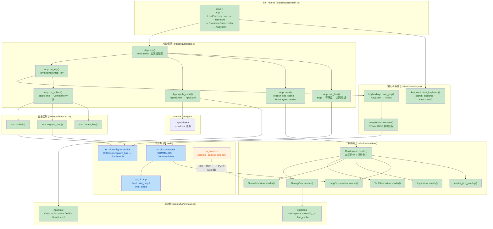
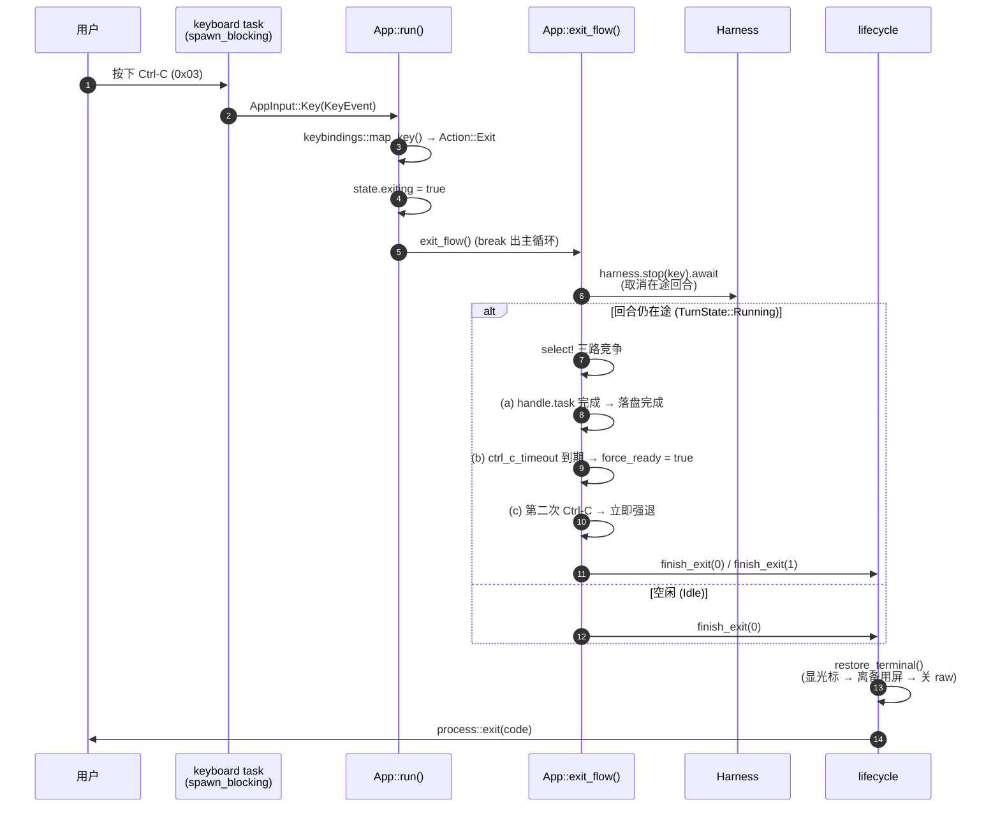
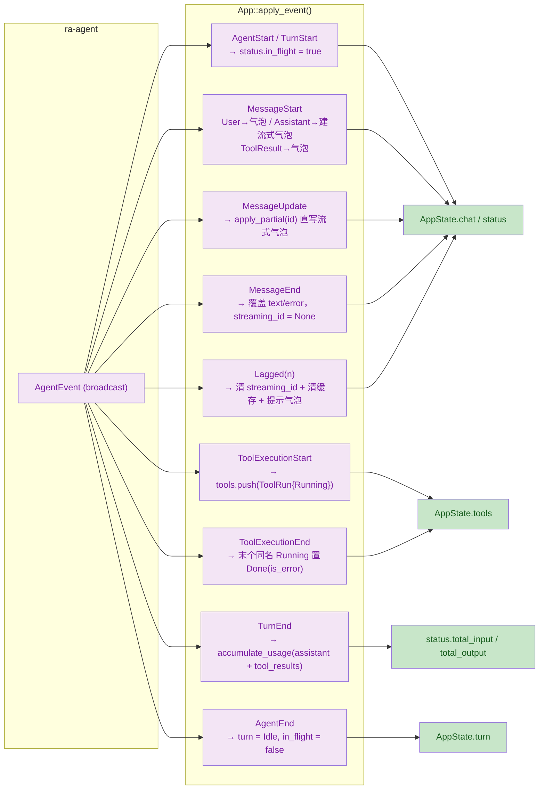

# 📋 Code Review Summary — `ra-tui` 全屏终端 TUI

> **日期**：2026-11-11
> **变更范围**：新增 `ra-tui` crate（17 个 `.rs`，约 2,700 行）+ `ra-cli` / `ra-harness` 跨 crate 接口扩展 + 1 份 UX 评审文档

---

## 1. High-Level Summary (TL;DR)

**Impact:** 🟠 **High** — 新增一个完整的终端 TUI crate（`ra-tui`），并把回合发起、命令元数据、token 估算三项能力提升为 `ra-cli` / `ra-harness` 的公共 API，供 CLI 与 TUI 双端复用。

**Key Changes:**

- ✨ **新增 `crates/tui` crate（`ra-tui` / bin `ribo-tui`）**：五区全屏布局（对话 / 工具 / 状态行 / 输入 + 帮助浮层），基于 `ratatui 0.29` + `crossterm 0.28` + `tui-textarea 0.7`。
- ✨ **`ra-cli` 新增命令元数据表 `COMMANDS` + `CommandMeta`**：CLI `/help` 与 TUI Tab 补全**同源**，消除两处命令清单漂移。
- ✨ **`ra-cli` 新增 `CliSession::spawn_turn()` / `TurnHandle`**：把「发起回合」抽成 CLI/TUI 共用逻辑，TUI 复用 CLI 装配与 harness 门面。
- ✨ **`ra-harness` 公开 `estimate_context_tokens()`**：供状态行上下文占比估算（**当前尚未接线**，见风险章节）。
- 🐛 **`/status` 命令新增**：CLI 与 TUI 双端支持；CLI 侧新增 `print_status()`。
- 📄 **新增 `internals/docs/reviews/ai_0015.md`**：19 项 CLI UX 问题清单（P0×6 / P1×6 / P2×7），含证据行号与分批落地建议——**该文档同时暴露了本次改动引入的 2 处不一致（U-03 / U-15）**。

---

## 2. Visual Overview (Code & Logic Map)

### 2.1 架构总览：五区 TUI 与共享层



### 2.2 Ctrl-C 退出流程（本次改动的风险最高路径）



> ⚠️ 关键约束：`std::process::exit` **不执行 `Drop`**，因此所有退出路径必须显式调用 `lifecycle::restore_terminal()`（由 `finish_exit()` 统一承载）。

### 2.3 事件管线：`AgentEvent` → `AppState` 映射



---

## 3. Detailed Change Analysis

### 3.1 📦 依赖与工作区配置（`Cargo.toml`, `crates/tui/Cargo.toml`）

**What Changed:**
- 根 `Cargo.toml` `[workspace.dependencies]` 新增 TUI 依赖组，并**显式锁定 crossterm 版本三角**（注释说明 `tui-textarea 0.7` 依赖 `ratatui 0.29` + `crossterm 0.28`，升 0.30 会导致 `Widget` trait 不兼容）。
- 新增 `ra-cli = { path = "./crates/cli" }` 到 workspace 依赖，供 `ra-tui` 反向复用配置/装配层。

| Package | Old Ver | New Ver | 说明 |
|---|---|---|---|
| `ratatui` | — | `0.29` | TUI 渲染框架（与 `tui-textarea 0.7` 对齐） |
| `crossterm` | — | `0.28` | 终端事件 / raw mode（**版本锁定**，勿升 0.30） |
| `tui-textarea` | — | `0.7` | 多行输入编辑器 |
| `anyhow` | — | `1` | TUI 错误传播 |
| `once_cell` | — | `1` | ⚠️ 声明后**全 crate 未使用** |
| `unicode-width` | — | `0.2` | CJK 宽字符折行行数估算 |
| `portable-pty` | — | `0.9` | E2E 伪终端（dev-dep） |

**`crates/tui/Cargo.toml` 新增 crate：**

| 项 | 值 |
|---|---|
| package name | `ra-tui` |
| bin name | `ribo-tui` (`src/main.rs`) |
| 运行时依赖 | `ra-core`, `ra-agent`, `ra-harness`, `ra-cli`, `anyhow`, `clap`, `crossterm`, `once_cell`, `ratatui`, `tui-textarea`, `tokio`, `toml`, `tracing`, `tracing-appender`, `unicode-width` |
| dev-dependencies | `tempfile`, `portable-pty`, `serde_json`, `ra-tools` |

> ⚠️ **依赖卫生**：以下声明项在本次 diff 中**无任何引用点** —— `once_cell`、`tracing-appender`（日志实际走 `ra_cli::logging::init_file_logging`）、`ra-harness`（`estimate_context_tokens` 未被 TUI 调用）。`cargo udeps` / 供应链审计会点名，建议清理或接线。

---

### 3.2 🖥️ TUI 入口与启动编排（`crates/tui/src/main.rs`）

**What Changed:** 新增 `TuiArgs`（`--config` 默认 `ribo.toml`、`--root` 覆盖工作空间根）与 `#[tokio::main(flavor = "multi_thread")]` 入口。

**关键设计（Source: `crates/tui/src/main.rs`）：**
- **五阶段启动**：`参数/配置加载` → `文件日志` → `解析 [tui] ctrl_c_timeout_ms` → `assemble()` → `raw mode + panic hook + 主循环`。
- **失败前置于 raw mode**：配置/装配/终端初始化失败一律 `eprintln!` + `ExitCode::FAILURE` 返回，**保证终端未被污染**（15 §4.4）。
- **Tokio 上下文约束**：`spawn_blocking` 依赖 `Handle::current()`，注释明确警告「若改回手工构建 `Runtime`，必须把构建与 `enter()` 提前到启动键盘 task 之前」。
- **渲染路径禁 `println!`**：stdout 被全屏占用，tracing 走文件通道。

---

### 3.3 🔁 核心循环与事件映射（`crates/tui/src/app.rs`）

**What Changed:** 新增 `App` 结构体（状态树 + 会话门面 + 输入通道 + 视图根布局 + `draws` 计数）与全部事件处理逻辑。

| 方法 | 职责 | 关键语义 |
|---|---|---|
| `App::run()` | 主循环 | `tokio::select!` 双源（键盘 / 事件），**批处理**：一次 `recv()` 后 `try_recv()` 排空队列 → **一轮至多一次 draw** |
| `App::draw()` | 绘制 | 先按当前宽度 `refresh_line_cache()`，再 `layout.render(frame, state)`，累加 `draws` |
| `App::on_key()` | 键盘分派 | **先查键位表，未命中交给编辑器**（`tui_textarea::Input::from(key)`） |
| `App::on_submit()` | 提交分派 | `parse_line()` → 9 类 `Command` 分别处理，输出走 `overlay_text` |
| `App::on_complete()` | Tab 补全 | 整体重建编辑器内容 + `End` 键移光标；多候选时浮层列候选 |
| `App::on_resize()` | 尺寸变化 | **不立即重算**，交由下次 `draw` 的 `refresh_line_cache` 按新宽度重算（避免 O(n) 全量重排） |
| `App::on_lagged()` | 广播拥塞 | 清 `streaming_id` + 清行数缓存 + 追加「已跳过 N 条事件」提示气泡，等待 `MessageStart` 重同步 |
| `App::apply_event()` | 事件映射 | 见下方映射表 |
| `App::exit_flow()` | 退出编排 | 见 §2.2 时序图 |

**`AgentEvent` → `AppState` 映射表：**

| `AgentEvent` | 状态落点 | 行为 |
|---|---|---|
| `AgentStart` / `TurnStart` | `status.in_flight` | 置 `true` |
| `MessageStart(User)` | `chat.messages` | 追加 `ChatBubbleBody::User` |
| `MessageStart(Assistant)` | `chat.streaming_id` | 建空助手气泡并记 id |
| `MessageStart(ToolResult)` | `chat.messages` | 追加工具结果气泡（`is_error` 着色） |
| `MessageUpdate` | 流式气泡 | `apply_partial()` **全量聚合** Text/Thinking 直写 + `invalidate_cache(id)` |
| `MessageEnd` | 流式气泡 | 覆盖 `text` / `error`，清 `streaming_id` |
| `ToolExecutionStart` | `tools` | 追加 `ToolRun { phase: Running }` |
| `ToolExecutionEnd` | `tools` | **逆序查找最后一个同名 `Running`** 置 `Done(is_error)`（并行批按完成序发射） |
| `TurnEnd` | `status.total_*` | 累加 assistant + 全部 tool_result 的 `Usage` |
| `AgentEnd` | `turn` / `status` | 复位 `Idle` / `in_flight = false` |
| `ToolExecutionUpdate` | — | **本期不发射**，无状态更新 |

> 💡 `apply_partial` / `apply_event` 使用 **let-chains** 合并双重判断（注释标注为「AGENTS.md 工程惯例」），要求较新的 Rust 版本（edition 2024 / 1.88+）。

---

### 3.4 🗃️ 状态树与渲染辅助（`crates/tui/src/state.rs`, `render_helpers.rs`）

**What Changed:** 新增集中式状态树 `AppState`（所有按键与事件的最终落点）与纯函数渲染辅助。

**`AppState` 字段：**

| 字段 | 类型 | 职责 |
|---|---|---|
| `chat` | `ChatState` | 气泡队列 + 流式指针 + 行数缓存键 |
| `tools` | `Vec<ToolRun>` | 当前会话全部工具调用（按发生序） |
| `status` | `StatusLine` | mode / session_key / token 累计 / in_flight / context_pct / warnings |
| `editor` | `RefCell<TextArea<'static>>` | **唯一可变渲染点**（R-B3） |
| `help_open` / `overlay_text` | `bool` / `Option<String>` | 浮层开关与通用浮层正文 |
| `turn` | `TurnState` | `Idle` / `Running { key, handle }` |
| `scroll` | `ChatScrollState` | 粘底滚动状态机 + `line_cache: HashMap<u64, (u16, usize)>` |
| `ctrl_c_timeout` / `exiting` / `force_ready` | — | Ctrl-C 生命周期三态 |

**渲染辅助（`render_helpers.rs`）：**

| 函数 | 作用 | 关键口径 |
|---|---|---|
| `bubble_line_count()` | 单气泡视觉行数 | 按**显示宽度**（`UnicodeWidthStr`）折行，CJK 宽字符计 2 列；极窄区按 4 列兜底 |
| `wrapped_lines()` / `wrapped_text_lines()` | 文本折行行数 | `\n` 切逻辑行 + `w.div_ceil(width)` |
| `refresh_line_cache()` | 刷新行数缓存 | **仅宽度变化或显式失效**的气泡重算（R-R5） |
| `join_text()` | Text 块聚合 | 忽略非 Text 块 |
| `history_line()` | `/history` 单行摘要 | 与 CLI `summarize_message` 同口径 |
| `ensure_closed_fence()` | Markdown 栅栏补闭合 | **仅用于渲染**，不污染 `AppState`（R-H2） |
| `split_markdown_fences()` | 栅栏切分 | 返回 `(语言, 文本, 是否代码)`；语言标记限 `alphanumeric/-/+` |

> 💡 **流式渲染缓存失效链路**：`apply_partial()` → `chat.invalidate_cache(id)` → `take_invalidated()` → `refresh_line_cache()` 移除对应 `line_cache` 条目 → 下帧重算。这是流式气泡高度不抖动的关键。

---

### 3.5 🎨 五区视图层（`crates/tui/src/view/`）

**What Changed:** 新增 `View` trait（即时模式、只读渲染）+ `RootLayout` 四区切分 + 两个浮层。

| 区域 | 视图 | 约束 | 渲染要点 |
|---|---|---|---|
| 对话区 | `DialogView` | `Constraint::Min(0)` | 气泡 → `Line` 序列；角色前缀着色（`you`=Cyan / `assistant`=Green / `think`=DarkGray / `error`=Red / `tool`=Yellow）；粘底滚动 `scroll_offset()` |
| 工具区 | `ToolStatusView` | 动态 `Length(min(len,8)+2)` | `…` 运行中 / `✓` 成功 / `✗` 失败 |
| 状态行 | `StatusLineView` | `Length(1)` | `[mode]` + 会话键 + `tok in/out` + `ctx:%` + 空闲/回合中 + `⚠ warnings` |
| 输入区 | `InputView` | 动态 `Length(min(rows,6)+2)` | 包裹 `RefCell<TextArea>`，标题提示 `Enter 发送 · Tab 补全 · Ctrl-C 退出` |
| 帮助浮层 | `HelpOverlayView` | 全屏叠加 | 遍历 `COMMANDS` 生成命令表 + 别名 |
| 文本浮层 | `render_text_overlay()` | 居中 `Length(min(72, width))` | `Clear` 清底 + 按内宽预折行算高度 |

**Markdown 一期口径（`markdown_lines()`）：** 代码栅栏体着黄色、语言标记与栅栏线着暗色；**非代码区不做任何 Markdown 解析**（标题/列表/行内代码均按纯文本）。

> 💡 `View::constraints()` 签名不含状态，工具区/输入区的动态高度因此**在 `RootLayout::render()` 内就地计算**，两个视图自身返回 `Length(0)` 作为兜底（注释已说明根布局不调用该条目）。

---

### 3.6 ⌨️ 输入子系统（`crates/tui/src/input/`）

**What Changed:** 新增键盘 task、键位表、Tab 补全与 `AppInput` 事件枚举。

**键位表（`keybindings::map_key()`）：**

| 按键 | `Action` | 说明 |
|---|---|---|
| `Enter` | `Submit` | 提交输入 |
| `Tab` | `Complete` | 命令补全 |
| `Esc` | `Cancel` | 关闭浮层 → 否则清空编辑器 |
| `Up` / `Down` | `ScrollUp` / `ScrollDown` | ⚠️ **方向键不用于移动光标**，全部让位滚动 |
| `PageUp` / `PageDown` | `PageUp` / `PageDown` | 翻页（页高 10 行） |
| `Ctrl-V` | `PageUp` | 翻页快捷键 |
| `Ctrl-C` | `Exit` | 退出程序（不交给默认 SIGINT） |
| 其他 | `None` | 交给 `tui-textarea` 编辑器 |

**Windows conPTY 双发防护（重要）：** `map_key()` 与 `is_ctrl_c()` 均校验 `key.kind == KeyEventKind::Press`。注释说明：conPTY 对同一次按键同时产出 `Press` / `Release`，若不排除 `Release`，退出流程会把 Release 误判为「第二次 Ctrl-C」而直接强退（退出码 1），**使优雅退出失效**。

**Tab 补全（`completion::complete()`）：**

| 输入 | 结果 |
|---|---|
| `/se` | 唯一命中 → `/sessions ` |
| `/s` | 多候选 → 最长公共前缀 + 浮层候选列表 |
| `/ca` | 别名命中 → `/cancel `（补全名取**别名形式**） |
| `/` | 列出全部 `COMMANDS` |
| `/new work`（含空格） / `hello` / `/zzz` | `None`（不补全） |

> 💡 模糊匹配语义：前缀命中**优先且独占**（`if !prefixed.is_empty() { prefixed } else { fuzzy }`），避免低质量子序列候选污染公共前缀。

---

### 3.7 ⏻ 生命周期与 Ctrl-C 退出（`crates/tui/src/lifecycle.rs`）

**What Changed:** 新增 raw mode RAII guard、终端恢复单一入口、panic hook 与配置超时解析。

| 函数 | 作用 | 要点 |
|---|---|---|
| `RawModeGuard::enter()` | 进入 raw mode + 备用屏 + 隐藏光标 | 任一步失败即返回错误（**guard 构造之前**退出） |
| `RawModeGuard::drop()` | 兜底恢复 | 幂等（正常退出已显式恢复） |
| `restore_terminal()` | **单一清理入口** | 逆序：显光标 → 离备用屏 → 关 raw mode |
| `finish_exit(code)` | 退出同源出口 | `restore_terminal()` → `process::exit(code)`；`code=0` 优雅 / `code=1` 强退 |
| `install_panic_hook()` | panic 路径恢复 | 链式调用原 hook |
| `parse_ctrl_c_timeout()` | 解析 `[tui] ctrl_c_timeout_ms` | 缺失 / TOML 损坏 / `<=0` → 保守回退 `2s` |

> ⚠️ **配置层设计说明（注释明示）**：`[tui]` 表**不在六层 schema 内**（16 §13 未列为受控新增），由 `ra-tui` 自行读取同一配置文件的该表，单字段、失败保守回退。

---

### 3.8 🔗 跨 crate 接口扩展（`ra-cli` / `ra-harness`）

#### 3.8.1 `ra_cli::commands` — 命令元数据表（单一事实源）

**What Changed:** 新增 `CommandMeta` 结构体与 `COMMANDS` 常量表；新增 `Command::Status` 变体与 `"/status"` 解析分支。

```mermaid
graph LR
    TBL["ra_cli::commands::COMMANDS<br/>(CommandMeta[])"]
    H1["ra_cli::app::print_help()<br/>遍历 COMMANDS 生成帮助"]
    H2["tui::view::help_overlay<br/>遍历 COMMANDS 生成浮层"]
    H3["tui::input::completion::complete()<br/>遍历 COMMANDS 生成补全候选"]
    P["ra_cli::commands::parse_line()<br/>→ Command 枚举"]
    TBL --> H1
    TBL --> H2
    TBL --> H3
    P -.-> "⚠️ 手工维护，与 TBL 存在漂移风险" .-> TBL

    classDef src fill:#bbdefb,color:#0d47a1
    classDef drv fill:#c8e6c9,color:#1a5e20
    classDef risk fill:#ffebee,color:#b71c1c
    class TBL,P src
    class H1,H2,H3 drv
    class P risk
```

**`COMMANDS` 元数据表：**

| 主名 | 别名 | 参数 | 说明 |
|---|---|---|---|
| `/help` | `/?` | — | 显示本清单 |
| `/new` | — | `[name]` | 轮换会话键（缺省自动轮换） |
| `/stop` | `/cancel` | — | 取消在途回合 |
| `/skills` | — | — | 列出技能与诊断 |
| `/sessions` | — | — | 列出会话键 |
| `/status` | — | — | 状态摘要（会话/模式/在途） |
| `/history` | — | `[n]` | 最近 n 条转录（默认 10） |
| `/exit` | `/quit` | — | 退出 |

> ⚠️ **元数据表与解析器仍存在漂移**：`/?` 在元数据表中声明为 `/help` 的别名，但 `parse_line()` **没有 `"/?"` 分支** → 用户照着 `/help` 输出输入 `/?` 会得到「未知命令」。`ai_0015.md` 已将该项登记为 **U-03** 并建议补**穷尽性单测**（遍历 `COMMANDS` 全部 `aliases` 断言均可解析）。

#### 3.8.2 `ra_cli::config::assemble` — 回合句柄

**What Changed:** 新增 `TurnHandle` 结构体与 `CliSession::spawn_turn()`。

```rust
pub struct TurnHandle {
    pub task: tokio::task::JoinHandle<()>,                      // 任务结束 = 落盘完成
    pub done: tokio::sync::mpsc::Receiver<RiboResult<()>>,       // 容量 1；结果观察（可选）
}
```

**语义要点（Source: `crates/cli/src/config/assemble.rs`）：**
- `done` 类型为 `RiboResult<()>`，**不是** `Result<(), RiboResult<()>>`（避免嵌套 Result）。
- `prompt` 返回后**先投递结果再结束任务**；`done` 容量 1，缓冲即返回，不阻塞任务结束。
- **Ctrl-C 退出流程直接 `await handle.task`，不消费 `done`** —— 任务本身在 `prompt` 返回后才结束，任务结束即等于「一轮对话落盘完成」。
- **Send 边界说明**：`tokio::spawn` 要求闭包 Future 为 `Send`；`harness` 为 `Arc<Harness>` 且 await 链均为 `Send`；若未来引入非 `Send` 局部须改用 `spawn_local` / `LocalSet`。

#### 3.8.3 `ra_cli::app` — `/help` 与 `/status`

**What Changed:**
- `print_help()` 由**硬编码字符串**改为**遍历 `COMMANDS` 动态生成**（别名以 `(alias)` 形式、参数以 `args` 形式拼接，宽度 `{:<16}`）。
- 新增 `print_status()`：输出 `session | mode | in_flight | warnings:N`。注释明确「token 累计与上下文占比为 TUI 状态行专属（CLI 事件流不做累计）」。

#### 3.8.4 `ra_harness::estimate_context_tokens()`

**What Changed:** 将私有 `estimate_tokens()` 包一层公开 API 并从 crate 根 re-export。

- 口径与压缩触发估算**完全一致**：`chars / 4 + 4 * messages.len()`（内联图片 base64 不计）。
- 注释明确「估算值偏保守，仅作展示与阈值参考，**不承诺与真实 tokenizer 对齐**」。

> ⚠️ **该 API 目前无消费者**：TUI 状态行的 `status.context_pct` 恒为 `None`（渲染为 `—`），`estimate_context_tokens` 未被调用。这是「接口已落地、业务未接线」的悬空状态。

---

### 3.9 🧪 测试覆盖（单元测试 + PTY E2E）

**What Changed:** 新增 `crates/tui/tests/e2e.rs`（211 行，基于 `portable-pty` 真实伪终端），以及各模块内联单测。

**新增/更新的单测矩阵：**

| 模块 | 用例 | 覆盖点 |
|---|---|---|
| `commands.rs` | `parse_line_parses_all_commands` | 8 → **9** 命令，含 `/status` |
| `app.rs` | `events_build_app_state` | 完整事件序列 → 气泡快照 / 工具 `Done` / usage 累计 / `AgentEnd` 复位 |
| `app.rs` | `batch_applies_then_draws_once` | 一轮至多一次 draw |
| `app.rs` | `lagged_drops_streaming_baseline` | 清 `streaming_id` + 清缓存 + 提示气泡 |
| `app.rs` | `editor_handles_cjk_and_emoji` | 多字节字符 char boundary 安全 |
| `app.rs` | `submit_rejected_while_turn_running` | 在途拒绝提交且保留原文 |
| `turn.rs` | `rotate_key_*` | `default`→`default-1`→`default-2`；显式命名 |
| `lifecycle.rs` | `ctrl_c_timeout_falls_back_to_default` | 缺失 / 损坏 / `0` → 2s |
| `render_helpers.rs` | 5 个用例 | ASCII / CJK 宽字符 / 空正文 / 栅栏补闭合 / 栅栏切分 / 宽度缓存命中 |
| `keybindings.rs` | 4 个用例 | 核心键位 / Release 忽略 / Ctrl-C 判定 / 普通字符透传 |
| `completion.rs` | 5 个用例 | 前缀唯一 / 多候选 / 别名 / 带参不补全 / 裸 `/` 列全量 |
| `e2e.rs` | `pty_exit_restores_terminal` | 退出码 0 + 含 `\x1b[?1049h`（进备用屏）+ `\x1b[?1049l`（恢复终端）+ 出现「对话」标题 |
| `e2e.rs` | `pty_cjk_and_emoji_input` | 中文「你好 🌍」经编辑器进入对话气泡 |

**E2E 测试的三个工程亮点（值得保留的踩坑记录）：**
1. **DSR 代答**：conPTY 不响应光标位置查询（`ESC[6n`），harness 读到该序列后必须回写 `\x1b[1;1R`，否则进程会**同步阻塞在启动阶段，连备用屏都进不去**。
2. **不 `join()` 读取线程**：Windows conPTY 的 master 读句柄在子进程退出后**未必返回 EOF**，攒齐输出再 join 会导致 CI 永久挂死 → 改为 channel 转发 + 超时抽干 + `drop` 句柄 detach。
3. **超时兜底链**：`total_timeout` → 发 `0x03` → 10s 等待 → 仍存活则 `kill()` + `try_wait` 轮询（不用 `wait()`，避免 kill 失败时二次阻塞）。

---

### 3.10 📄 UX 评审文档（`internals/docs/reviews/ai_0015.md`）

**What Changed:** 新增 292 行分析文档，登记 **19 项 CLI UX 问题**（P0×6 / P1×6 / P2×7），每项含「现象 → 证据（文件:行）→ 建议 → 验收口径」四段式。

| 优先级 | 数量 | 代表项 |
|---|---|---|
| 🟠 P0 | 6 | U-01 mock 首条消息必失败、U-02 配置错误静默降级、U-03 `/?` 别名不可用、U-04 ANSI dim 不复位、U-05 工具状态行撕裂流式文本、U-06 同一错误重复打印三次 |
| 🟡 P1 | 6 | U-07 无输入提示符、U-08 `history_lines` 未接线、U-09 在途输入静默丢弃、U-10 无进度反馈 + O(n²)、U-11 `/exit` 不等落盘、U-12 Ctrl-C 无优雅退出 |
| ⚪ P2 | 7 | U-13 命令分组、U-14 `/sessions` 无当前标记、U-15 `/status` 三方口径不一致、U-16 文案与 README、U-17 回合发起逻辑双份、U-18 粘贴多行、U-19 冗余分支 |

> 💡 文档中的「杠杆点」判断准确：`LoadOutcome::load` 与 `assemble()` 被 **`ribo` 与 `ribo-tui` 两个 bin 共用**，配置/装配层 UX 修复一次生效、两处受益——这与本次改动中 `ra-tui` 复用 `ra-cli` 装配层的做法一致。

---

## 4. Impact & Risk Assessment

### 4.1 ⚠️ Breaking Changes

| 类型 | 影响 | 说明 |
|---|---|---|
| **CLI `/help` 输出格式变更** | 🟡 行为变更（低风险） | 由硬编码字符串改为遍历 `COMMANDS` 生成，输出格式/宽度/别名呈现方式均变。**任何断言 `/help` 精确文本的 E2E / 快照测试会失败** |
| **CLI 新增 `/status`** | 🟢 增量 | `parse_line` 返回值新增变体 → 任何对 `Command` 做**穷尽 `match`** 的下游代码需补分支（仓库内 `app.rs` 已补） |
| **`ra_cli::commands` 新增公开 API** | 🟢 增量 | `CommandMeta` / `COMMANDS` 为新增 `pub` 项，不改变既有签名 |
| **`CliSession::spawn_turn()` 新增** | 🟢 增量 | 纯新增方法，不改既有 `Repl` 路径 |
| **`ra_harness::estimate_context_tokens()` 新增** | 🟢 增量 | 纯新增 re-export |
| **数据库 Schema** | ➖ 无 | — |
| **`Cargo.toml` 版本锁定** | 🟡 约束 | `crossterm 0.28` / `ratatui 0.29` 被 `tui-textarea 0.7` 锁死，**升级需整体验证** |

### 4.2 🐛 本次改动引入/暴露的具体风险

| # | 风险 | 位置 | 影响 | 建议 |
|---|---|---|---|---|
| R1 | **元数据表与解析器漂移**：`/?` 声明为别名但 `parse_line` 不识别 | `commands.rs:47` vs `parse_line` | 用户照帮助输入 `/?` 报「未知命令」 | 补 `"/?" => Ok(Command::Help)`；新增**穷尽性单测**遍历 `COMMANDS.aliases` 断言均可解析（ai_0015 U-03 / CMD-02） |
| R2 | **`/status` 三方口径不一致**：`Command::Status` 文档注释称「token 累计/上下文占比」，`COMMANDS` 描述称「会话/模式/在途」，CLI 实现只输出 `warnings:N` | `commands.rs:23-24` / `76-80` / `app.rs:264-275` | 帮助文案与实际输出不符 | 统一文案；若本期不做 token/占比则**删除承诺**（与 16 §5「CLI 不累计」一致） |
| R3 | **`estimate_context_tokens` 无消费者**，`status.context_pct` 恒 `None` | `harness/compaction.rs` / `state.rs:180` | 状态行 `ctx:` 永远显示 `—`；公开 API 成为死代码 | 接线（按会话转录估算）或暂不公开该 API |
| R4 | **未使用依赖**：`once_cell`、`tracing-appender`、`ra-harness` 在 `crates/tui` 中无引用点 | `crates/tui/Cargo.toml` | 供应链审计 / `cargo udeps` 告警；增大编译面 | 清理依赖声明或补齐引用 |
| R5 | **方向键被滚动占用**，编辑器内无法移动光标 | `keybindings.rs:61-62` | 多行编辑体验受限（一期单行提交可接受） | 已注释说明；后续可加 `Alt+↑/↓` 或 `Shift+↑/↓` 变体 |
| R6 | **`TurnHandle.done` 通道无消费者** | `assemble.rs:176` | 回合失败原因在 TUI 中不可见（只能靠 `AgentEvent`） | 后续在 `on_submit` 轮询 `done` 并浮层展示失败原因 |
| R7 | **Ctrl-C 等待期可能无限挂起** | `app.rs` `exit_flow` | 超时后若用户不再按 Ctrl-C，进程等待 `handle.task` 完成；`harness.prompt` 卡死则 TUI 不退出 | 建议在超时后增加可见提示（当前无任何浮层反馈） |
| R8 | **`crates/tui/src/lib.rs` 仍为模板**（`add` 函数），未被 `Cargo.toml` 声明为 lib target | 仓库现状（ai_0015 §2 已记录） | 模板文件残留在 crate 根，易误导 | 删除模板文件或补齐 lib target |
| R9 | **`Cargo.toml` 注释中 `crossterm 0.28` 锁定依赖人工约定** | 根 `Cargo.toml:66-72` | 未来 `cargo update` 或他人升级 ratatui 会直接编译失败 | 考虑在注释外加 `cargo` 层面的约束或 CI 守卫 |

### 4.3 ✅ Testing Suggestions（评审者建议验证清单）

**功能回归：**
- `cargo fmt --all -- --check` → `cargo clippy --workspace --all-targets -- -D warnings` → `cargo check --workspace` → `cargo test --workspace`（AGENTS.md 四门禁串行全绿）。
- **CLI 侧**：新增 `/status` 的输出文案；`/help` 改为动态生成后**逐条比对别名/参数格式**（尤其 `/new [name]` 与 `/history [n]` 的尾随空格问题）。
- **CLI ↔ TUI 一致性**：同一命令在两端的别名、参数占位、描述是否一致（`COMMANDS` 保证，但需验证 `parse_line` 覆盖面）。

**TUI 行为：**
- **Ctrl-C 三路径**：① 空闲时 Ctrl-C → 退出码 0；② 在途时 Ctrl-C → 先 `stop` → 等落盘 → 退出码 0；③ 在途时 Ctrl-C 后**再按一次** → 退出码 1（强退）。
- **Windows conPTY**：验证 `Press`/`Release` 双发下优雅退出**不被误判为强退**（`is_ctrl_c` 的 `kind` 校验）。
- **终端恢复**：任意退出路径（含 panic）后终端必须回到正常模式（备用屏退出序列 `\x1b[?1049l` 出现）——已有 E2E 覆盖，需补充 **panic 路径**的验证。
- **流式渲染**：长回答 + 工具调用混合场景下，气泡行高缓存是否失效及时（`invalidate_cache` 链路），是否出现滚动抖动。
- **CJK / Emoji**：宽字符折行行数估算（`bubble_line_count`）与实际 `Paragraph::wrap` 渲染是否一致（估算口径是「行数正确」粒度，非像素级）。
- **Tab 补全边界**：`/` 全量列出、`/s` 多候选的公共前缀、别名 `/ca` → `/cancel`、带参文本不补全。
- **在途拒绝**：提交第二次消息时原文保留（已有单测覆盖），浮层提示可读。
- **广播 Lagged**：制造事件拥塞，确认提示气泡出现且后续 `MessageStart` 能重同步。

**配置：**
- `[tui] ctrl_c_timeout_ms` 的缺失 / 非法值 / 极小值（1ms）三种情况下的退出行为。
- **无配置文件启动**：`ribo.toml` 不存在时以 mock 模式启动（沿用 ra-cli 语义），确认 mock 首条消息 `INVALID_REQUEST` 的表现（ai_0015 U-01 已知问题）。

---

### 4.4 🎯 总体评价

本次改动在**架构方向上是清晰且正确的**：

- ✅ **单一事实源**：`COMMANDS` 表消除了 CLI `/help` 与 TUI 补全的重复维护。
- ✅ **能力复用而非复制**：`spawn_turn` / `TurnHandle` 让 TUI 复用 CLI 装配层，避免「回合发起逻辑双份」（ai_0015 U-17 指出 CLI `Repl` 侧尚未收敛，是自然的后续项）。
- ✅ **状态树收敛**：所有可变状态集中在 `AppState`，组件视图只读渲染（`View` trait），符合 15 §3.2 拍板。
- ✅ **终端安全意识强**：`restore_terminal` 单一入口 + panic hook + `finish_exit` 统一出口，直面「`process::exit` 不执行 `Drop`」这一经典陷阱。
- ✅ **测试证据充分**：单元测试覆盖事件映射、缓存失效、CJK、退出超时；PTY E2E 覆盖真实终端恢复，并留下了 DSR 代答 / 线程 detach 等宝贵踩坑记录。

**主要待办（建议在合入前或紧邻 PR 处理）：**
1. 🔧 修复 `/?` 别名不可用（R1）——用户可见的直接缺陷。
2. 🔧 统一 `/status` 文案口径（R2）——文档注释、`COMMANDS` 描述、实现三者对齐。
3. 🔧 清理或接线未使用依赖（R3/R4）——`once_cell`、`tracing-appender`、`ra-harness`。
4. 🔧 考虑在超时后给出「再按一次 Ctrl-C 强制退出」的可见提示（R7）。
5. 🔧 补充**元数据表 ↔ 解析器穷尽性单测**，防止同类漂移复发（ai_0015 CMD-02）。