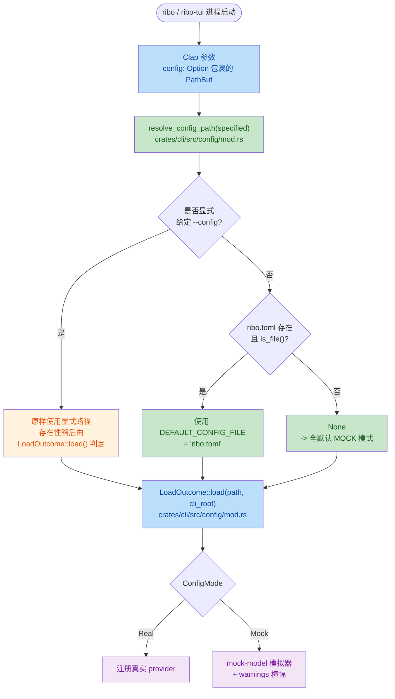
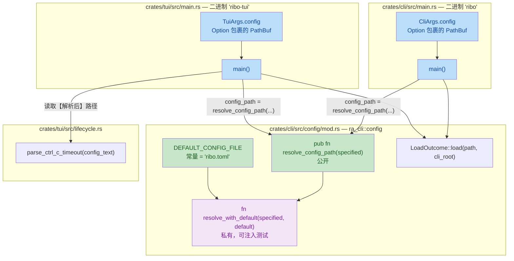
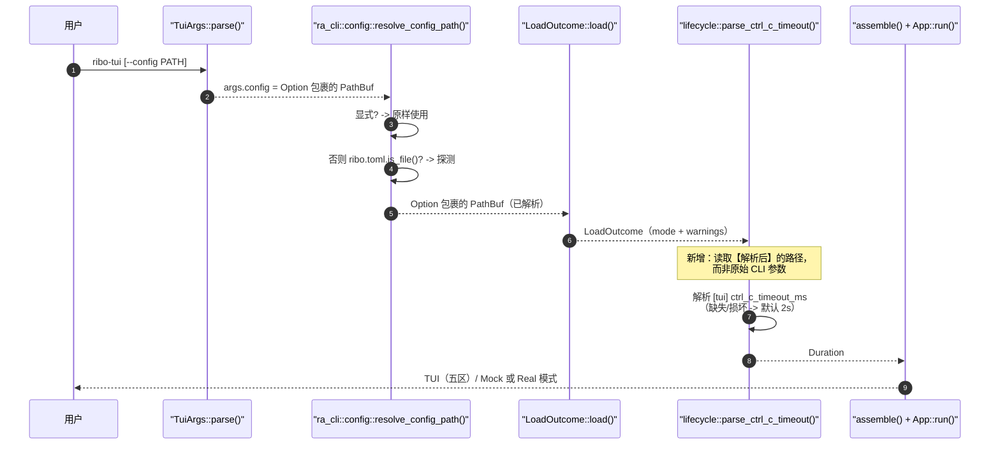
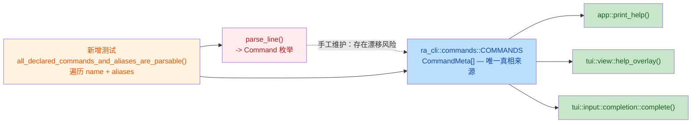

# 📋 变更集评审摘要 — `ribo` / `ribo-tui` 配置解析与 `/?` 修复 + 双语 README

> **日期**：2026-11-11
> **变更范围**：关闭内部评审标记的两处长期缺陷（`ai_0016.md` 风险 **R1** 与 **`ai_0015` U-03**），为两个二进制引入**共享配置路径解析 API**，并为项目新增完整**双语 README**（中文 + 英文）。

---

## 1. 高层摘要（TL;DR）

- **影响等级：中** —— 本变更集关闭了内部评审中标记的两处长期缺陷（`ai_0016.md` 风险 **R1** 与 **`ai_0015` U-03**），引入了一个**共享的配置路径解析 API**（供两个二进制复用），并新增了项目的完整**双语 README**（中文 + 英文）。
- **关键变更：**
  - ✨ **`/?` 现在是真正可用的命令** —— `parse_line("/?")` 返回 `Command::Help`，而不再是 `UnknownCommand`（来源：`crates/cli/src/commands.rs`）。
  - 🛡️ **防漂移护栏** —— 新增一条穷尽性单元测试，遍历 `COMMANDS` 元数据表，断言每一个 `name` **以及**每一个 `alias` 都可被解析。
  - ✨ **新增公共 API `resolve_config_path()`** —— `ra_cli::config` 现在拥有「究竟使用哪个配置文件？」这一决策，并带 `DEFAULT_CONFIG_FILE = "ribo.toml"` 的自动探测（来源：`crates/cli/src/config/mod.rs`）。
  - 🔧 **两个二进制统一** —— `--config` 由 `PathBuf`（`default_value = "ribo.toml"`）改为 `Option<PathBuf>`；`ribo` 与 `ribo-tui` 现在共用完全一致的解析规则。
  - 🐛 **TUI Ctrl-C 超时修复** —— `ribo-tui` 现在读取**解析后**的配置路径，因此自动探测到的 `ribo.toml` 中 `[tui] ctrl_c_timeout_ms` 会被正确生效（来源：`crates/tui/src/main.rs`）。
  - 📖 **文档** —— 新增 `README.md`（中文）与 `README.en.md`（英文）；`AGENTS.md` 新增「需求不清时必须立即询问用户」规则；`ai_0016.md` 的 Mermaid 边标签语法已修正。

---

## 2. 可视化概览（代码与逻辑地图）

### 2.1 🆕 配置路径解析 —— 新的唯一真相来源



> 🔑 **设计意图：** *显式* 路径**不做存在性检查**就直接透传 —— 「文件缺失 → 回退 Mock」的语义仍由 `LoadOutcome::load()` 独占，以保留既有的行为。相比之下，自动探测仅在文件确为**普通文件**（`is_file()`）时才触发，因此一个名为 `ribo.toml` 的*目录*会被正确忽略。

### 2.2 🧩 文件级组件地图



### 2.3 🚀 启动序列 —— `ribo-tui`（更敏感的路径）



### 2.4 🛡️ 命令元数据 ↔ 解析器 防漂移护栏



> 🩹 那条虚线的「漂移风险」边现已**被消除**：新测试让 `COMMANDS` 表与 `parse_line()` **在机制上**保持同步。未来只要往表里加了别名却没在 `parse_line` 补对应分支，构建就会失败。

---

## 3. 变更详细分析

### 3.1 🐛 组件：`ra_cli::commands` —— 命令解析

**变更内容**
- 在 `parse_line()` 中补上了缺失的 `"/?"` 匹配分支，将该别名映射到 `Command::Help`（来源：`crates/cli/src/commands.rs`）。
- 新增一条**穷尽性不变量测试**，遍历 `COMMANDS` 元数据表，断言每一个声明的 `name` 与 `aliases` 条目都可解析（防御 R1/U-03 这一类漂移）。

**命令别名面（变更后）**

| 主名 | 别名 | 参数 | 映射到 | 状态 |
| :--- | :--- | :--- | :--- | :--- |
| `/help` | `/?` | — | `Command::Help` | 🆕 **别名现已生效** |
| `/new` | — | `[name]` | `Command::New(Option<String>)` | 不变 |
| `/stop` | `/cancel` | — | `Command::Stop` / `Command::Cancel` | 不变 |
| `/skills` | — | — | `Command::Skills` | 不变 |
| `/sessions` | — | — | `Command::Sessions` | 不变 |
| `/status` | — | — | `Command::Status` | 不变 |
| `/history` | — | `[n]` | `Command::History(usize)` | 不变 |
| `/exit` | `/quit` | — | `Command::Exit` | 不变 |

**关键片段**（来源：`crates/cli/src/commands.rs`）

```rust
match head {
    // `/?` 为 COMMANDS 中声明的 `/help` 别名
    "/help" | "/?" => Ok(Command::Help),
    ...
}
```

```rust
#[test]
fn all_declared_commands_and_aliases_are_parsable() {
    for meta in COMMANDS {
        assert!(!matches!(parse_line(meta.name), Err(ParseError::UnknownCommand(_))),
                "主名 {} 未在 parse_line 中实现", meta.name);
        for alias in meta.aliases {
            assert!(!matches!(parse_line(alias), Err(ParseError::UnknownCommand(_))),
                    "别名 {alias} 未在 parse_line 中实现");
        }
    }
    assert_eq!(parse_line("/?"), Ok(Command::Help));
}
```

> 💡 该测试断言的是**不存在** `UnknownCommand`，而非某个具体变体 —— 这是刻意为之，以便未来某个带必填参数的命令即便产生 `BadArgs` 也不会造成误失败。

---

### 3.2 ✨ 组件：`ra_cli::config` —— 配置路径解析（新增公共 API）

**变更内容**
- 引入 `pub const DEFAULT_CONFIG_FILE: &str = "ribo.toml"` —— 默认配置文件名的单一字面量（来源：`crates/cli/src/config/mod.rs`）。
- 引入 `pub fn resolve_config_path(specified: Option<&Path>) -> Option<PathBuf>` —— 为一个进程启动解析**生效**的配置路径。
- 引入私有 `fn resolve_with_default(specified, default)` —— 一个纯函数、**可依赖注入**的变体，使单元测试能在不改动进程 CWD 的前提下探测任意默认路径。

**解析优先级**

| 条件 | 输入 | 结果 | 理由 |
| :--- | :--- | :--- | :--- |
| 显式 `--config <PATH>` | `Some(p)` | `Some(p)` —— **原样透传** | 存在性/缺失文件的降级仍由 `LoadOutcome::load()` 独占 |
| 未给 `--config`，默认文件存在 | `None` + `ribo.toml` 是普通文件 | `Some("ribo.toml")` | 零配置快乐路径；自动加载项目配置 |
| 未给 `--config`，默认文件缺失 | `None` + 无该文件 | `None` | → 全默认 **Mock 模式**（既有遗留行为不变） |
| 未给 `--config`，默认文件是**目录** | `None` + `ribo.toml` 是目录 | `None` | `is_file()` 守卫阻止加载一个虚假路径 |

**新增测试覆盖** —— `resolve_config_path_probes_default_only_when_unspecified()` 覆盖了上面全部四行，并额外断言解析出的路径**确实被** `LoadOutcome::load()` 生效（`outcome.harness.root == "probe-root"`），打通了「解析」与「消费」之间的闭环。

> ✅ 该测试在 `#[cfg(test)]` 模块内使用 `tempfile::tempdir()`，且 `tempfile` 仅声明在 `[dev-dependencies]` 中 —— 符合 `AGENTS.md` 的规则 *"禁止在非测试代码中使用 `tempfile` crate"*。

---

### 3.3 🔧 组件：二进制入口（`ribo` 与 `ribo-tui`）

**变更内容**

| 方面 | 变更前 | 变更后 | 文件 |
| :--- | :--- | :--- | :--- |
| CLI 参数类型 | `pub config: PathBuf` | `pub config: Option<PathBuf>` | `crates/cli/src/main.rs`、`crates/tui/src/main.rs` |
| Clap 声明 | `#[arg(short, long, value_name = "PATH", default_value = "ribo.toml")]` | `#[arg(short, long, value_name = "PATH")]`（无默认） | 两者 |
| 加载调用 | `LoadOutcome::load(Some(&args.config), args.root.as_deref())` | `resolve_config_path(args.config.as_deref())` → `LoadOutcome::load(config_path.as_deref(), ...)` | 两者 |
| TUI Ctrl-C 配置读取 | `std::fs::read_to_string(&args.config)` | `config_path.as_deref().and_then(|p| std::fs::read_to_string(p).ok())` | `crates/tui/src/main.rs` |

**为什么 TUI 的改动很重要（bug 修复）：** 一旦 `--config` 变成 `Option`，旧写法会去读取*原始* CLI 参数。而生效路径现在可能来自**自动探测**，因此 `ribo-tui` 必须读取**解析后**的路径 —— 否则自动探测到的 `ribo.toml` 里 `[tui] ctrl_c_timeout_ms` 会被静默忽略，Ctrl-C 超时永远回退到 `2s`。

**对用户可见的有效 CLI 面（不变）：**

| 参数 | 说明 |
| :--- | :--- |
| `-c, --config <PATH>` | 配置文件路径。省略时自动探测当前目录的 `ribo.toml`；若不存在则进入 Mock 模式。 |
| `--root <PATH>` | 覆盖工作空间根目录（`harness` 层 `root`，默认进程 cwd）。 |

> ℹ️ **向后兼容的 UX：** 此前 `--config` *总是* 解析到字面量 `ribo.toml`；接着 `LoadOutcome::load()` 读取失败并回退 Mock。现在同样的回退提前一步发生在 `resolve_config_path()` 中。`ribo` 的**净运行时行为与之前完全一致** —— 本次变更是*职责归属的澄清*，而非行为变更。

---

### 3.4 📚 组件：文档与项目元数据

| 文件 | 变更 | 目的 |
| :--- | :--- | :--- |
| `README.md` | 🆕 **新增**，216 行（中文） | 完整项目概览：特性、crate 架构表、快速开始、CLI 参数、交互命令表、六层配置 schema、provider 适配器、9 个内置工具、技能系统、质量门禁、许可证 |
| `README.en.md` | 🆕 **新增**，217 行（英文） | 上述内容的 1:1 英文镜像 |
| `ribo_example.toml` | ✏️ 仅注释 | 记录新的选择规则：*「显式 `--config` 优先；未指定时仅当 `ribo.toml` 存在才加载，否则走全默认 Mock（ribo 与 ribo-tui 同规则）」* |
| `AGENTS.md` | ✏️ +1 条规则 | *「如果没有理解用户需求，必须立即询问用户。」* —— 强制要求澄清式提问，而非自行猜测 |
| `internals/docs/reviews/ai_0016.md` | 🐛 1 行修复 | 修正 Mermaid 边标签语法：`-.-> "text" .->` → `-.->|"text"|`（旧写法是非法的 Mermaid 语法，会导致图渲染失败） |

**文档覆盖矩阵**

| 主题 | `README.md` | `README.en.md` | `ribo_example.toml` |
| :--- | :--- | :--- | :--- |
| 自动探测 `ribo.toml` | ✅ | ✅ | ✅ |
| Mock 模式降级语义 | ✅ | ✅ | ✅ |
| `/?` 别名 | ✅ | ✅ | — |
| 六层配置 schema + 默认值 | ✅ | ✅ | — |
| 9 个内置工具 + `fs_root` 沙箱 | ✅ | ✅ | — |
| 质量门禁（`fmt`/`clippy -D warnings`/`test`） | ✅ | ✅ | — |

---

## 4. 影响与风险评估

### ⚠️ 破坏性变更

| # | 变更 | 严重度 | 说明 |
| :--- | :--- | :--- | :--- |
| B1 | `CliArgs.config` / `TuiArgs.config` 类型由 `PathBuf` 改为 `Option<PathBuf>` | 🟡 低–中 | 这是二进制 crate 参数结构体上的 `pub` 字段。任何下游代码若构造或读取 `args.config` 都必须补上 `.as_deref()` / `Option` 处理。全仓 grep 显示**只有**两个 `main.rs` 文件触碰这些字段 —— 均已更新。 |
| B2 | 新增公共符号 `ra_cli::config::resolve_config_path` + `ra_cli::config::DEFAULT_CONFIG_FILE` | 🟢 纯新增 | 纯增量；未删除或改签名任何既有项。 |
| B3 | `parse_line("/?")` 现在返回 `Ok(Command::Help)`，而非 `Err(UnknownCommand)` | 🟢 行为修复 | 符合预期。任何此前针对「`/?` 未知」分支的调用方都需重新检查（仓内未找到此类调用）。 |

- ❌ **无数据库 schema 变更。**
- ❌ **无网络协议 / provider API 变更。**
- ❌ **无新依赖** —— 新测试复用了既有的 `tempfile` dev 依赖。

### 🧪 测试建议

**命令解析**
- [ ] CLI REPL 中输入 `/?` 打印命令清单（此前为「未知命令」）。
- [ ] TUI 中输入 `/?` 打开帮助浮层。
- [ ] `all_declared_commands_and_aliases_are_parsable` 通过 —— 并确认当往 `COMMANDS` 新增别名却没补 `parse_line` 分支时测试**失败**（变异测试）。
- [ ] `/help`、`/quit`、`/cancel` 行为仍与之前一致（不因 `|` 模式分支而回归）。

**配置解析**
- [ ] 在**存在** `ribo.toml` 的目录中运行 `ribo` → 加载真实 provider（`ConfigMode::Real`）；横幅显示基于文件的模式。
- [ ] 在**不存在** `ribo.toml` 的目录中运行 `ribo` → 全默认 Mock，横幅显示 `mode = mock` + warnings。
- [ ] `ribo --config /nonexistent/path.toml` → 仍降级为 Mock（解析阶段**不**校验显式路径）。
- [ ] 在**同时**存在 `ribo.toml` 的目录中用 `ribo --config custom.toml` → **显式优先**（这是价值最高的回归检查）。
- [ ] 一个名为 `ribo.toml` 的**目录** → 被忽略（`is_file()` 守卫），回退 Mock。
- [ ] `--config` 指向一个 TOML **损坏**的层 → 该层保留默认 + warning（既有的 CFG-01 语义必须不变）。

**TUI 专属**
- [ ] 用自动探测到的 `ribo.toml`（含 `[tui] ctrl_c_timeout_ms = 500`）运行 `ribo-tui` → Ctrl-C 退出使用 **500ms**，而非默认的 2s。*（这是 `config_path` 重构的关键回归目标。）*
- [ ] `ribo-tui` 中 `[tui] ctrl_c_timeout_ms = 0` 或 TOML 格式错误 → 保守回退 2s。

**门禁（依据 `AGENTS.md`）**
```bash
cargo fmt --all -- --check
cargo clippy --workspace --all-targets -- -D warnings
cargo check --workspace
cargo test --workspace
```

### 🔎 评审者关注点

1. ⚠️ **`resolve_with_default` 是私有的** —— 请确认团队接受把默认路径（`ribo.toml`）**硬编码为相对进程 CWD**。若配置搜索应向上遍历父目录或尊重 `RIBO_CONFIG`，这里就是扩展点。
2. ⚠️ **`ribo-tui` 中读取文件两次** —— 配置文件现在被读两次（一次由 `LoadOutcome::load`，一次为 Ctrl-C 超时）。这一行为在变更前就已存在，但解析后的路径让它更显眼。若文件可能在两次读取之间发生变化，可考虑把已读取的文本直接传下去。
3. ℹ️ **`ai_0016.md` 的风险表现已过时** —— §4.2 的 **R1**（`/?` 别名漂移）以及第 409 行「元数据表与解析器仍存在漂移」的警告**已被本 diff 解决**，但尚未标注为已修复。建议更新该评审文档的风险登记。
4. ℹ️ **R2（`/status` 文案不一致）与 R3–R7 仍然开放** —— 它们不在本次范围内，但仍被跟踪。
5. ℹ️ **`README.md` / `README.en.md` 内容对等性** —— 英文版引用了 `todo/04_开发计划.md`，而中文版没有；值得快速交叉核对两个链接目标在仓库中都存在。

---

### 📌 变更文件汇总

| 文件 | 类型 | 变更摘要 |
| :--- | :--- | :--- |
| `crates/cli/src/commands.rs` | 🔧 逻辑 + 🧪 测试 | `/?` → `Command::Help`；穷尽性元数据/别名可解析性测试 |
| `crates/cli/src/config/mod.rs` | ✨ 特性 + 🧪 测试 | `DEFAULT_CONFIG_FILE`、`resolve_config_path()`、`resolve_with_default()`、解析测试 |
| `crates/cli/src/main.rs` | 🔧 重构 | `--config` → `Option<PathBuf>`；使用 `resolve_config_path()` |
| `crates/tui/src/main.rs` | 🔧 重构 + 🐛 修复 | `--config` → `Option<PathBuf>`；使用 `resolve_config_path()`；Ctrl-C 超时读取解析后路径 |
| `README.md` | 📖 新增 | 完整中文项目文档（216 行） |
| `README.en.md` | 📖 新增 | 完整英文项目文档（217 行） |
| `ribo_example.toml` | 📝 文档 | 注释更新，描述新的配置选择规则 |
| `AGENTS.md` | 📝 文档 | 新增规则：需求不清时必须询问用户 |
| `internals/docs/reviews/ai_0016.md` | 🐛 文档修复 | 修正 Mermaid 点线边标签语法 |

---

> **译者注（2026-11-11）：** 评审者关注点第 5 条所述「英文版引用了 `todo/04_开发计划.md` 而中文版没有」的情况，已在后续轮次被修正 —— 两份 README 均在「参考项目 / Reference Projects」小节引用了 `todo/04_开发计划.md` §1.2 / §2.7，内容现已对等。另：`README.md` 实际行数因后续补充「参考项目」小节已略多于 216 行，本表数字为原始变更集统计。
