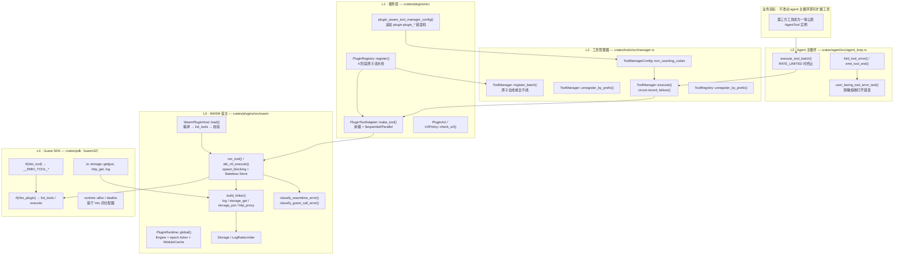
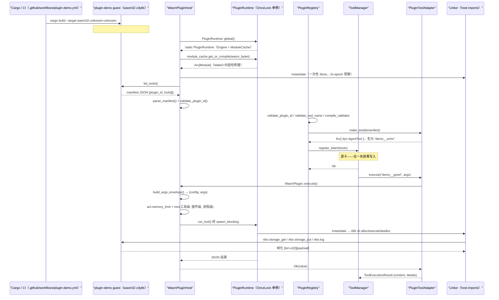
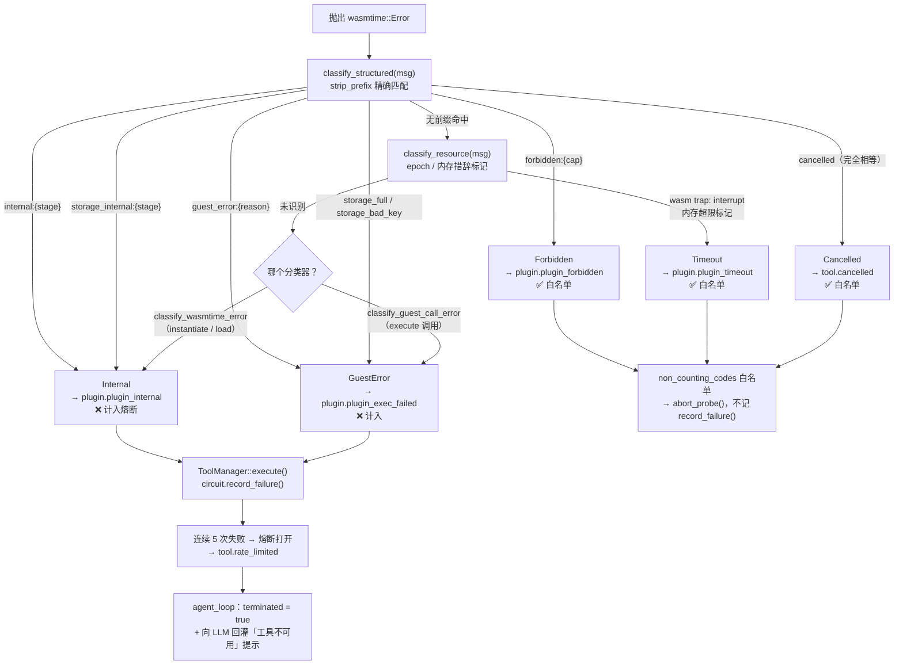

# 🔌 变更集评审摘要 — 阶段 6：Ribo Agent 的 WASM 插件系统

> **日期**：2026-11-13
> **变更范围**：引入完整的 WASM 插件子系统（3 个新 crate、25 个新文件、约 4,500 行），外科手术式扩展既有工具层；触及 **agent 主循环**、**工具熔断器**与**工作空间依赖图**。

---

## 1. 高层摘要（TL;DR）

- **影响等级：🔴 高** —— 本变更集引入了一个完整的 **WASM 插件子系统**（3 个新 crate、25 个新文件、约 4,500 行），同时外科手术式地扩展既有工具层。触及 **agent 主循环**、**工具熔断器**与**工作空间依赖图**。

- **关键变更：**
  - ✨ **新 crate `ra-plugins`** —— 语言无关的插件声明层（`Plugin` trait、`ToolManifest`）、原子插件注册表、带 `{plugin_id}__{tool}` 命名空间的 `AgentTool` 适配器、URL/ACL 能力门禁，以及完整的 WASM 宿主运行时（引擎、基于 epoch 的超时、host functions、插件级 storage）。
  - ✨ **新 crate `ra-plug-pdk`** —— guest 侧 Rust SDK。暴露 `#[ribo_tool]` / `#[ribo_plugin]` 过程宏、基于 `Vec` 的线性内存分配器、args 信封（`config`/`args`）协议与帧化 host-import 封装。
  - ✨ **新示例 crate `plugin-demo`** —— 独立 workspace 的 `wasm32-unknown-unknown` `cdylib` guest，附 3 个端到端集成测试（加载 → 注册 → 执行、epoch 超时、ACL 拒绝）。
  - ⚙️ **`ra-tools` 扩展** —— `ToolManagerConfig::non_counting_codes` 白名单、原子 `ToolManager::register_batch()`，以及 `ToolManager` 与 `ToolRegistry` 上的按前缀 `unregister_by_prefix()`。
  - 🐛 **Agent 主循环加固** —— `tool.rate_limited`（熔断打开）现在**终止 agent 循环**，并折叠为脱敏后的「工具不可用」提示回灌，而非把原始错误栈泄露给 LLM。

---

## 2. 可视化概览（代码与逻辑地图）

### 2.1 分层架构 —— 业务目标 ↔ 模块 ↔ 关键方法

### 2.2 插件加载与执行 —— 时序图

### 2.3 错误分类 → 熔断记账

---

## 3. 变更明细分析

### 3.1 🆕 `crates/plugins` —— 插件声明与注册层（新 crate）

#### `traits.rs` —— 语言无关契约

| 条目 | 说明 |
| :-- | :-- |
| `Plugin::id()` | 插件唯一 ID；兼作工具名的命名空间前缀 |
| `Plugin::tools()` | 返回 `Vec<ToolManifest>`；注册期**仅调用一次**，必须无副作用 |
| `Plugin::execute()` | `async fn` → `RiboResult<Value>`；接收**剥离前缀后的短名** |
| `Plugin::on_event()` | 可选事件钩子——**Step B 不调用**（为 Step C 预留） |
| `ToolManifest` 字段 | `name`、`description`、`parameters`（JSON Schema）、`timeout_hint: Option<Duration>`、`idempotent: bool`、`memory_limit_bytes: Option<usize>` |

- ⚠️ **`#[async_trait]` 是强制的。** 该 trait 要求 dyn 兼容，因此 `RPITIT` / 原生 `async fn in trait` 不可用。`impl` 漏标该属性是**编译错误**——由测试 `plugin_trait_object_is_send()` 强制保障。

#### `adapter.rs` —— 命名空间与调度策略

- **工具命名（方案 A）：** `PluginToolAdapter::prefixed()` 产出 `{plugin_id}__{tool_name}`（双下划线）。两个插件暴露同名工具可共存（`a__echo` / `b__echo`）。
- **关键不变量：** `ToolSchema.name` = 带前缀名（LLM 视角）；`PluginAgentTool.tool_name` = 短名（派发视角）。
- **调度：** `sequential = !m.idempotent` → 非幂等工具强制进入 `ToolExecutionMode::Sequential`，避免并行批中副作用交错。
- **命名校验**（`validate_plugin_id` / `validate_tool_name`）采用**逐字节守卫**（无正则依赖）：

| 字段 | 模式 | 最大长度 |
| :-- | :-- | :-- |
| `plugin_id` | `^[a-z][a-z0-9_]*$` | 32 字节 |
| `tool_name` | `^[a-z][a-z0-9_]*$` | 64 字节 |

> 32/64 的拆分是刻意的：预算为 `32 + 2 + 64 = 98` 字节，即展示给 LLM 的完整工具名上界。

#### `registry.rs` —— 原子注册流水线

`PluginRegistry::register()` 运行**4 阶段、零部分写入**的流水线：

| 阶段 | 动作 | 失败 → 错误码 |
| :-- | :-- | :-- |
| 1. 校验 | `validate_plugin_id` + 去重检查 + `validate_tool_name` + `compile_validator(parameters)` | `plugin.plugin_invalid_name` / `plugin.plugin_duplicate_id` / `plugin.plugin_schema_invalid` |
| 2. 物化 | 为每个 manifest 调 `PluginToolAdapter::make_tool()`（仍零写入） | — |
| 3. 注入 | `ToolManager::register_batch()` —— 全成或全不成 | `plugin.plugin_batch_failed` |
| 4. 登记 | 插入 `DashMap<String, Arc<dyn Plugin>>` | — |

- ✅ **插件自述绝不被信任** —— JSON Schema 在注册期由 `ra-tools` 编译并校验。
- `plugin_aware_tool_manager_config()` —— **唯一装配点**，把 `plugin.plugin_timeout` 与 `plugin.plugin_forbidden` 追加进熔断白名单。`ra-tools` 刻意**不**硬编码 `plugin.*` 错误码（避免反向依赖）。

#### `acl.rs` —— 能力与 SSRF 门禁

`UrlPolicy::check_url()` 按**严格顺序**执行 3 层检查：

| 顺序 | 规则 | 拒绝类型 |
| :-- | :-- | :-- |
| 1 | scheme 白名单（仅 `http` / `https`） | `UnsupportedScheme` |
| 2 | 字面 IP 保留段拦截（**先于**白名单——白名单内的私网 IP 依旧拦截） | `PrivateAddress` |
| 3 | 精确、大小写不敏感的 host 白名单（无后缀通配——防 `evil-allow.com` 绕过） | `HostNotAllowed` |

拦截的地址段：IPv4 `10/8`、`172.16/12`、`192.168/16`、`127/8`、`169.254/16`（含 `169.254.169.254` 元数据端点）、`100.64/10`、`0/8`、`240/4`；IPv6 `::1`、`::`、`fc00::/7`、`fe80::/10`。

`PluginAcl` **默认最小权限**（全部能力 `false`、无配额覆写），且**由宿主注入、绝不由 guest 自述**。

#### `error.rs` —— 新错误域 `plugin`

| 错误码 | Severity | 语义 | 计入熔断？ |
| :-- | :-- | :-- | :-- |
| `plugin.plugin_exec_failed` | Error | guest 业务失败 / ABI 违约 / guest trap | ✅ 是（可回灌 LLM） |
| `plugin.plugin_timeout` | Error | epoch 到期 / 内存超限 | ❌ 否（白名单） |
| `plugin.plugin_forbidden` | **Warning** | 使用未声明的能力 | ❌ 否（白名单） |
| `plugin.plugin_internal` | **Critical** | 引擎 / Linker / 线程故障 | ✅ 是 |
| `plugin.plugin_invalid_arguments` | Error | guest 传入非法 ptr/len/key | ✅ 是（按 `exec_failed`） |
| `plugin.plugin_duplicate_id` | Warning | 插件 ID 重复（注册期） | 不适用——注入前被拒 |
| `plugin.plugin_invalid_name` | Error | ID / 工具名非法（注册期） | 不适用 |
| `plugin.plugin_schema_invalid` | Error | 参数 Schema 非法（注册期） | 不适用 |
| `plugin.plugin_batch_failed` | Error | `register_batch` 拒绝整批 | 不适用 |

- `truncate_error(s, max_bytes)` —— UTF-8 **字符边界安全**截断（默认 4 KB），防止 guest 超长错误字符串撑爆 token 预算，同时保持中文 / emoji 完整。

#### `config.rs` —— 进程级默认值（唯一真相来源）

| 键 | 默认值 | 覆写规则 |
| :-- | :-- | :-- |
| `memory_limit_bytes` | 32 MB | `min(tool, plugin, process)` —— **只能收紧** |
| `storage_quota_bytes` | 1 MB | `min(plugin, process)` —— **只能收紧** |
| `log_burst` | 200 / 窗口 | — |
| `log_rate_per_sec` | 50 / 秒 | — |
| `enable_fuel` | `false` | Step B 永不启用；启用需**重启进程**（`Engine` 在 `new()` 时冻结，`PluginRuntime` 是 `OnceLock`） |

---

### 3.2 🆕 `crates/plugins/src/wasm` —— WASM 宿主运行时

#### `runtime.rs` —— 引擎、epoch 超时与错误分类

| 关注点 | 实现 |
| :-- | :-- |
| 引擎 | `epoch_interruption(true)`、`consume_fuel(cfg.enable_fuel)` —— 仅构建一次 |
| epoch ticker | **一个**专用 OS 线程（`ra-plugins-epoch-ticker`），`EPOCH_TICK = 10 ms`；`engine.increment_epoch()` **只**在此处调用（硬性禁令覆盖所有其它调用点） |
| 超时换算 | `epoch_ticks_for()` 使用 `div_ceil`（向上取整）——向下取整会**提前**触发（15 ms → 1 tick = 10 ms），破坏超时断言 |
| Store 模型 | **Stateless**：每次 `execute` 全新 `Store + Instance` → 并发隔离、无状态串台 |
| 线程模型 | `Store: !Send` → `Store::new` + `instantiate` + 调用全部在一个 `spawn_blocking` 闭包内完成（闭包边界即 `Send` 边界） |
| 模块缓存 | `DashMap<[u8;32], Arc<Module>`，以 **blake3 内容哈希**为键（非路径）——不同路径的相同字节命中同一缓存条目 |
| 配置注入 | 每次 execute 传 `{"config": cfg, "args": args}` 信封（与 Stateless 一致；`init_config` 已**删除**，因 globals 会被重置） |

**三层错误分类**（熔断记账契约的核心）：

1. `classify_structured()` —— 对 `internal:` / `forbidden:` / `guest_error:` / `cancelled`（完全相等）/ `storage_full` / `storage_bad_key` / `storage_internal:` 做**精确 `strip_prefix` 匹配**。同时适用于裸 host function 错误**与** `"wasm trap: <payload>"` 包裹形态（`trap_payload()` 用 `find` 而非 `rfind`）。
2. `classify_resource()` —— wasmtime epoch / 内存超限的措辞候选集合。
3. **兜底随上下文不同** —— 这是最微妙之处：
   - `classify_wasmtime_error()`（instantiate / load）→ **`Internal`**（保守：宿主故障，计入熔断）。
   - `classify_guest_call_error()`（guest 调用）→ **`GuestError`**（guest 自身的 `unreachable` / 除零属*业务*失败，必须可回灌 LLM）。

> 🛡️ `is_memory_limit_message()` 使用 **4 个标记的候选集合**，绝不裸用 `contains("memory")`——否则宿主自己的 `"guest memory export missing"` 会被误判为 `Timeout`，被熔断静默跳过。

#### `abi.rs` —— ABI v0 manifest 与 `list_tools`

| Guest 导出 | 签名 | 说明 |
| :-- | :-- | :-- |
| `memory` | `(export "memory" (memory 0))` | **必须**显式导出 |
| `alloc` | `(size: i32) -> ptr: i32` | `0` = 失败 |
| `dealloc` | `(ptr: i32, size: i32)` | 可选，用于清理 |
| `list_tools` | `() -> (ptr, len)` **或** `() -> packed_ptr` | 仅加载期调用，结果缓存 |
| `execute` | `(name_ptr, name_len, args_ptr, args_len) -> (ptr, len)` **或** `-> packed_ptr` | 运行期 |

- **双返回形态支持** —— 宿主同时接受多值 `(ptr, len)` ABI（手写 WAT guest）与单 `i32` **打包指针**（Rust PDK guest，因 `rustc` 不支持多值 `extern "C"` 返回）。打包块为 8 字节：`{ptr: i32 LE, len: i32 LE}`。
- `RawToolManifest → ToolManifest` 转换把 `timeout_hint_ms` **钳制到 60 s** —— guest 不能自述 10 小时超时。
- `list_tools` 有**固定 2 s** 的 epoch + 内存预算，防止恶意 guest 在加载期挂死或打爆宿主。

#### `hostfns.rs` —— 4 个 host import，按能力门禁

| Import | 签名 | 返回 | 长度上限 |
| :-- | :-- | :-- | :-- |
| `ribo.log` | `(ptr, len) -> i32` | `0` = 成功无载荷 | 16 KB |
| `ribo.storage_get` | `(key_ptr, key_len) -> i32` | 指向帧化缓冲的 `ptr`；**`0` = key 不存在** | key 256 B |
| `ribo.storage_put` | `(key_ptr, key_len, val_ptr, val_len) -> i32` | `0` = 成功 | key 256 B / value 256 KB |
| `ribo.http_proxy` | `(ptr, len) -> i32` | 指向帧化缓冲的 `ptr` | 请求 64 KB / 响应 **4 MB** |

- 🎯 **帧化返回协议：** 宿主写 `[len: u32 LE][payload]`；guest 读 4 字节头再读载荷，用完 `dealloc` 整块 `4 + len`。单 `i32` import 借此携带长度。
- 🛡️ **DoS 纪律——「先判后分配」：** 每个 guest 可控长度都在**读取点**校验（`read_guest_bytes_limited`），先于宿主堆上的 `vec![0u8; len]`。`StoreLimits` 只约束 guest 线性内存——管不到宿主堆。
- 🛡️ **`ribo_to_error()` 绝不产 `forbidden:`** —— ACL 拒绝直接以规范能力名构造 `WasmError::msg("forbidden:{capability}")`；若经 `ribo_to_error` 路由会降级为 `guest_error:`，丢失正确错误码。
- **SSRF 纵深防御：** ACL 检查 → `UrlPolicy::check_url()` → **禁用重定向**的 HTTP 客户端 → `tokio::select!` 对取消令牌竞争 → 分块读响应体并**累计 4 MB 上限**（`Content-Length` 不可信、可能撒谎）。
- 🐛 **`LogRateLimiter` 窗口滚动修复：** 窗口滚动（经 `try_update` 的 CAS）时 `count` **必须清零**。旧代码只推进 `window_start`，第二窗口起 `count` 永远 `>= burst`，限流彻底失效。回归测试：`rate_limiter_resets_count_on_window_roll()`。
- `now_ms()` 使用**单调** `Instant` 基准——刻意**不用** `ra_core::utils::time::now_ms()`，因 wall-clock 在 NTP 校时下可能回拨，会破坏限流窗口。

#### `storage.rs` —— 插件级、进程内、非持久化 KV

| 方面 | 行为 |
| :-- | :-- |
| 作用域 | 每插件一个 `Storage` 实例，由 `Arc<PluginShared>` 持有 → 跨 Stateless Store 重置存活 |
| ACL 门禁 | `acl.storage == false` → `StorageError::Denied` → `forbidden:storage` trap |
| 三态契约 | `get` → `Ok(None)` = key 不存在（**正常态**，非错误） |
| 配额 | `min(插件覆写, 进程默认)`；覆写计数按**净差值**——缩小 value 会释放配额 |
| 条目上限 | key ≤ 256 B（`BadKey`）、value ≤ 256 KB（`Full`） |

#### `host.rs` —— 加载流水线与信封

`WasmPluginHost::load()` = 编译（缓存）→ 构建 `PluginShared` → `list_tools`（一次）→ `parse_manifest` → `validate_plugin_id` → `Arc<dyn Plugin>`。

`WasmPlugin::execute()` = `build_args_envelope()` → 查 manifest 条目（超时默认 **2 s**，未知工具 → `plugin.plugin_invalid_arguments`）→ 合并内存上限的**两阶段 `min`** → `run_tool()`。

---

### 3.3 🆕 `crates/pdk` —— Guest 侧 Rust SDK（PDK）

#### `macro/src/lib.rs` —— `#[ribo_tool]` 与 `#[ribo_plugin]`

| 属性 | 参数 | 生成物 |
| :-- | :-- | :-- |
| `#[ribo_tool]` | `name`、`description`、`parameters`（JSON 字符串）、`idempotent`、`timeout_hint_ms`、`memory_limit_bytes` | `__RIBO_TOOL_{NAME}` 常量、`__ribo_call_{NAME}`、`__ribo_params_{NAME}` |
| `#[ribo_plugin]` | `id` | `__RIBO_PLUGIN_ID`、`__RIBO_TOOLS`，以及 `list_tools` / `execute` 导出 |

- 🐛 **宏展开顺序修复：** 属性宏自外向内展开，`#[ribo_plugin]` 先于内层 `#[ribo_tool]` 生成 `__RIBO_TOOL_*` 常量执行。因此宏会**预解析**任意 `#[ribo_tool]` 标注函数的 `name = "..."` 参数并生成前向引用——名字解析在全部展开完成后可解析。
- `alloc` / `dealloc` 的 `#[unsafe(no_mangle)]` **仅**由 `ra_plug_pdk::runtime` 提供——宏侧再生成一次会产生重复符号链接错误。

#### `runtime.rs` —— 分配器缺陷修复（⚠️ 本文件影响最大的变更）

> **旧方案（固定 1 MB 起点的自管理 bump 分配器）存在真实缺陷：** 在 `rustc` 的 wasm 目标上，静态数据之后紧跟 dlmalloc 堆。堆增长越过 1 MB 边界后两个区域**互相踩踏**（宿主写入的 ABI 缓冲覆盖 guest 堆数据，反向亦然）。已在 plugin-demo e2e 中**复现**：`Value` 索引返回 `null`、`bool::to_string()` 输出乱码。

**修复：** `alloc`/`dealloc` 改用 guest 的**标准 `Vec`/dlmalloc 堆**（`Vec::with_capacity` + `mem::forget`，经 `Vec::from_raw_parts` 释放），ABI 缓冲与 `serde_json`/`String` 共用同一分配器——**无区域重叠**。

#### `lib.rs` —— 信封、manifest、派发

| 函数 | 用途 |
| :-- | :-- |
| `config()` | 从 `thread_local` 读取当前调用的插件配置 |
| `with_config(cfg, f)` | RAII 风格的作用域设置/恢复——防止同一实例连续 `execute` 间的**配置串味** |
| `unwrap_envelope(raw)` | 拆分 `{"config":…, "args":…}`；否则原样透传 args |
| `build_manifest(plugin_id, tools)` | 产出 §8.1 的 manifest 形状 |
| `dispatch(tools, name, cfg, args)` | 按短名派发；未知工具 → `"unknown tool \`{name}\`"` |
| `truncate_error(s, max)` | UTF-8 安全截断，与宿主侧同语义 |

#### `io.rs` —— host import 封装（guest 侧）

`storage::get` / `storage::put` / `http_get` / `log` —— 各自先对**与宿主同值**的上限做**本地预检**（协作式），宿主侧检查仍是对恶意 guest 的**权威兜底**。宿主侧拒绝以 **trap** 形式到达；guest 侧 `Err(String)` 只覆盖本地预检失败。

---

### 3.4 ⚙️ `crates/tools` —— 熔断器与批量注册

| 变更 | 说明 |
| :-- | :-- |
| `ToolManagerConfig::non_counting_codes: Vec<&'static str>` | 新字段。默认 = `["tool.cancelled", "tool.invalid_arguments"]` —— 保持既有行为 |
| `ToolManagerConfig` 现派生 `Clone` | 把配置复制进 `ToolManager` 所需 |
| 匹配语义 | **精确字符串相等**，**无前缀通配** —— 防止未来新增错误码意外继承「不计数」语义 |
| `ToolManager::register_batch()` | 两阶段：**阶段 1** 预检（Schema 编译 + 批内重名 + 与既有注册表冲突）→ 任一失败**零写入**；**阶段 2** 提交注册表 + validator 缓存 |
| 锁中毒 | `register_batch` 使用 `PoisonError::into_inner`（`HashMap` 完好——中止整批反而**扩大**影响面）；`unregister_by_prefix` 中毒则 **panic**（状态完整性已无法保证） |
| `ToolRegistry::unregister_by_prefix()` | 先快照匹配键再删除——避免迭代期间变更导致 **DashMap 分片死锁** |
| `ToolManager::unregister_by_prefix()` | 同时移除工具**与**缓存的 validator；仅在实际移除了内容时才取写锁 |
| `ToolManager::execute()` 白名单分支 | 命中白名单失败码：`circuit.abort_probe()`（归还半开探测资格，避免被永久消耗）+ `warn!` 日志 + 错误原样透传 |

---

### 3.5 🐛 `crates/agent/src/agent_loop.rs` —— 熔断打开处理

| 变更 | 说明 |
| :-- | :-- |
| `execute_tool_batch()` | 新增分支：`Err(err) if err.code() == RATE_LIMITED` → `terminated = true` —— **整个循环**在熔断打开的那一轮结束 |
| `user_facing_tool_error_text()` | 新辅助函数，由 `emit_tool_end()` 与 `fold_tool_error()` 共用。把 `tool.rate_limited` 映射为脱敏的「该工具当前不可用：连续失败已触发保护熔断…」提示；**其余错误原样透传**（D8——模型需要细节来自我修正） |
| 可观测性保留 | 完整原始错误仍经 `tracing` 记录——信息不丢，只是不回灌给 LLM |

> **为什么重要：** 把 `"circuit open..."` 回灌给 LLM 会诱导**无限重试循环**。重试上界现在 = 熔断打开的那一轮。

---

### 3.6 📦 依赖与工作空间变更

| 包 | 旧 | 新 | 用途 |
| :-- | :-- | :-- | :-- |
| `wasmtime` | — | `50`、`default-features = false`、features `["cranelift","runtime"]` | 仅 JIT + 实例运行时；去掉 `anyhow`/`wat`/`cache`/`pooling-allocator` 以控制编译时间与二进制体积 |
| `blake3` | — | `1` | `ModuleCache` 的内容哈希键 |
| `wat` | — | `1`（dev-dep） | 内联 WAT 测试 guest |
| `proc-macro2` / `quote` / `syn` | — | `1` / `1` / `2`（full） | `ra-plug-pdk-macro` |
| `url` | — | `2` | `UrlPolicy` 宿主解析 |
| `ra-plugins` | — | path `./crates/plugins` | 新工作空间成员 |
| `ra-plug-pdk` | — | path `./crates/pdk` | 新工作空间成员 |
| `ra-plug-pdk-macro` | — | path `./crates/pdk/macro` | 新工作空间成员 |

- `ra-plugins` 暴露 **`wasm` feature（默认开启）**，`wasmtime` 为*可选*依赖 → 轻量构建用 `--no-default-features`。
- `ra-plugins` 设置 **`autoexamples = false`**，确保 `examples/plugin-demo`（独立 workspace）不会被当作示例目标编译。
- `plugin-demo` 声明自己的 **`[workspace]`** 表 —— 根的 `members = ["crates/*"]` 通配不深入两层，显式声明是防御性保障，且让该 crate 拥有自己的 `target/` 目录（wasm 产物路径可预期）。

### 3.7 🤖 CI —— `.github/workflows/plugin-demo.yml`（新增）

| 方面 | 配置 |
| :-- | :-- |
| 触发 | `pull_request` 于 `crates/plugins/**`、`crates/pdk/**`、`crates/tools/src/**`、`crates/core/src/message/tool.rs` + 每晚 `cron: "0 2 * * *"`（防破窗） |
| 工具链 | `dtolnay/rust-toolchain@stable`，带 `wasm32-unknown-unknown` target |
| 缓存 | `~/.cargo/registry`、`~/.cargo/git`、`crates/plugins/examples/plugin-demo/target` |
| 运行 | `cargo test --manifest-path crates/plugins/examples/plugin-demo/Cargo.toml`（显式 manifest——demo **不是** workspace 成员，保持在 `cargo test --workspace` 之外） |

---

## 4. 影响与风险评估

### 4.1 ⚠️ 破坏性变更

| # | 变更 | 影响 | 缓解 |
| :-- | :-- | :-- | :-- |
| 1 | `ToolManagerConfig` 新增**必填**字段 `non_counting_codes` | 任何遗漏 `..Default::default()` 的结构体字面量构造**编译失败** | 本变更集已修补仓库内测试辅助代码，补上 `..ToolManagerConfig::default()`。外部消费者须同样处理 |
| 2 | 新错误域 `plugin.*` | 依赖 `domain == "tool"` 分支的上层无法识别插件错误 | 已声明为有意为之（避免 `ToolManager` 在 `domain` 轴上误判） |
| 3 | `tool.rate_limited` 现在**终止 agent 循环** | 行为变更：此前可恢复的工具失败现在结束整轮 | 有意为之（重试上界保证）。需验证 UX：回合现在以「不可用」提示结束，而非再发起一轮 LLM |
| 4 | `wasmtime` 固定在 `50` | trap 错误**措辞**对版本敏感 | 代码已维护措辞候选集合；根 `Cargo.toml` 注释要求升级时重跑 §13.1 trap 分类回归测试 |
| 5 | `ra-plugins` 依赖 `ra-agent` | 任何依赖 `ra-plugins` 的组件都会连带拉入整个 agent crate | 仅用到 `ra_agent::events::AgentEvent`（供未启用的 `on_event` 钩子）。建议把 `AgentEvent` 移至 `ra-core`，或用 feature 门控 `on_event`，以切断该耦合 |

### 4.2 🔴 关键验证项

> **`crates/pdk/macro` 不是根 workspace 成员。**
>
> 根 manifest 声明 `members = ["crates/*", "internals/git-hook"]` 且**无 `exclude`**。`crates/*` 通配只匹配一层，因此 `crates/pdk/macro` **未被包含**——然而 `crates/pdk/macro/Cargo.toml` 使用了 `version.workspace = true`、`authors.workspace = true`、`edition.workspace = true`、`publish.workspace = true`、`repository.workspace = true`、`readme.workspace = true`、`license.workspace = true`。
>
> **行动项：** 要么把 `"crates/pdk/macro"` 加入 `workspace.members`，要么加入 `workspace.exclude` **并**给它独立的 `[workspace]` 表、显式写死 `version`/`authors`/`edition`/… 各值（非成员无法使用 workspace 继承）。请运行 `cargo metadata` / `cargo build --workspace` 确认 manifest 可解析。

### 4.3 🧪 测试建议

**工具层（`ra-tools`）**
- `register_batch` —— 批中夹带 Schema 非法工具 ⇒ **零**工具写入；批内重名 ⇒ 拒绝；与既有工具冲突 ⇒ 拒绝。
- `unregister_by_prefix` —— 仅移除带前缀工具；validator 缓存保持同步；不匹配前缀返回 `0`。
- 白名单 —— `plugin.plugin_timeout` / `plugin.plugin_forbidden` 连续**超过阈值** ⇒ 熔断保持闭合；**非**白名单的 `plugin.plugin_internal` ⇒ 熔断**打开**。
- 半开探测 —— 探测期间的白名单失败必须**归还**探测资格（不得永久消耗）。

**Agent 主循环**
- 熔断打开路径 —— 恰好 `threshold + 1` 次 LLM 调用；回灌消息含「不可用」但**不含**原始错误栈与 `"circuit open"`；最后一个 `ToolExecutionEnd` 事件同样脱敏，而此前的真实失败仍原样透传（D8）。

**插件层（`ra-plugins`）**
- 两个插件同名工具 → 以 `a__echo` / `b__echo` 注册且均可执行。
- 非法 `plugin_id` / 工具名 / Schema ⇒ 拒绝且向 `ToolManager` **零写入**。
- 非幂等工具 ⇒ `execution_mode() == Sequential`。
- `PluginAcl::default()` ⇒ 全部能力关闭。

**WASM 宿主**
- epoch 超时 —— 死循环 guest 在 `[timeout, timeout + EPOCH_TICK]` 内被打断 ⇒ `plugin.plugin_timeout`。
- 内存大胃王（64 MiB vs 32 MiB 上限）⇒ `plugin.plugin_timeout`（**而非** `plugin_internal`）。
- guest `unreachable` trap ⇒ `plugin.plugin_exec_failed`（**而非** `plugin_internal`）。
- 缺失 `memory` 导出 ⇒ `plugin.plugin_internal`。
- DoS 边界 —— 超大 key / 日志 / http 请求在**读取点**被拒（消息含 `"exceeds limit"`），且永不触达 storage / 网络层。
- ACL 拒绝 —— `storage` ⇒ `plugin.plugin_forbidden` 且 capability 恰为 `"storage"`；`http` ⇒ `"http"`；URL 策略拒绝 ⇒ `"url_policy"`。
- 缺失 key 的 `storage_get` ⇒ `0` 哨兵（**非**错误）；宿主侧 `storage_put` 后 `storage_get` 返回已写值。
- 并发 —— 同一 guest 的 8 个并行 `execute` 不互相污染。
- 内存安全 —— `execute` **中途** trap 不得泄漏 guest 缓冲区（`GuestBufs` RAII 守卫）。

**PDK / guest**
- `with_config` 调用后恢复原值（连续 execute 间无配置串味）。
- `truncate_error` 不切断多字节字符（emoji / 中文）。
- **基于 `Vec`** 分配器的 `alloc`/`dealloc` 往返——特别复验历史上的 **bump 与 dlmalloc 重叠**场景（大量 guest 堆增长 + 宿主缓冲写入）确已修复。
- `#[ribo_plugin]` 在宏展开顺序隐患下仍能正确收集多个 `#[ribo_tool]`。

**CI**
- `plugin-demo` e2e —— `demo__echo` / `demo__greet` / `demo__fetch` / `demo__spin` 在 `ToolManager` 可见；`greet` 先 `seen=0` 后 `seen=1`（config 信封 + 跨 execute storage 持久）；连续 7 次 `spin` 全部返回 `plugin.plugin_timeout`（绝不出现 `tool.rate_limited`）；无 `http` ACL 的 `fetch` 返回 `plugin.plugin_forbidden` 且**未发出任何网络请求**。

### 4.4 🔎 设计评审备注（非阻塞）

- **guest 超时钳制是单边的。** `RawToolManifest → ToolManifest` 把 `timeout_hint_ms` 钳到 **≤ 60 s**，但**没有下界**——guest 可声明 `timeout_hint_ms = 0`，经 `epoch_ticks_for()` 向上取整为 1 tick（10 ms）后实际上会立即杀死该工具。建议钳制到合理最小值。
- **`ToolManifest.timeout_hint` 目前是建议性的。** 宿主经 `run_tool(..., timeout)` 遵循每工具提示，但 `PluginAcl` 没有*超时*上限覆写——插件因此可请求每次调用最长 60 s 的宿主阻塞时间。宿主侧加一个上限会更收紧。
- **`PluginAcl` 没有 `timeout` 能力**却有 `memory_limit_bytes` —— 与 `ToolManifest.timeout_hint` 旋钮不对称。值得在后续阶段对齐。
- **`PluginRuntime::global()` 会永久缓存失败**（`OnceLock` 语义）——有意为之且有文档，但意味着引擎初始化的瞬时失败会毒化整个进程。调用方应把启动期的 `plugin.plugin_internal` 当作致命错误。
- **`Plugin::on_event` 在 Step B 是死代码** —— 它是 `ra-plugins` 依赖 `ra-agent` 的唯一原因。移除或 feature 门控它可甩掉这个重量级依赖。
- **`StorageError::Internal` 当前无触发路径**（已正确标注 `#[allow(dead_code)]`）——纯粹为 Step C 持久化前的 trap 前缀契约完备性而保留。
