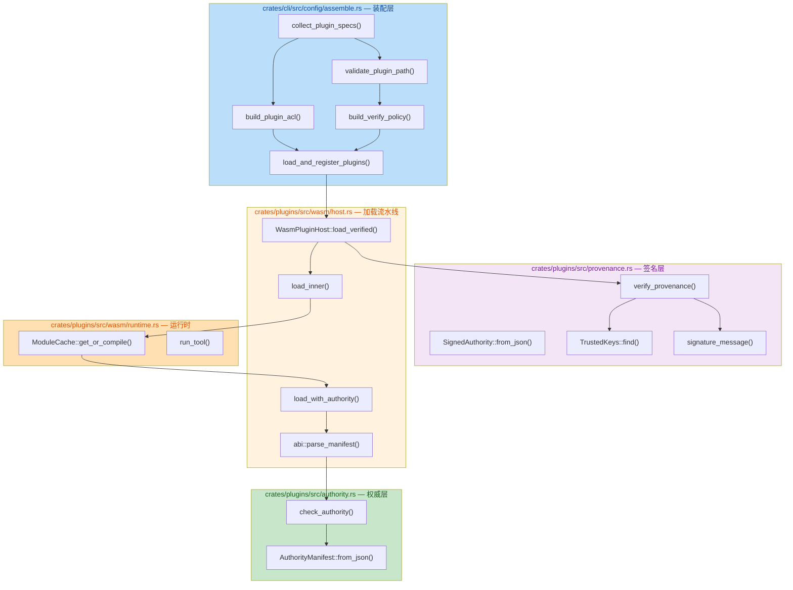
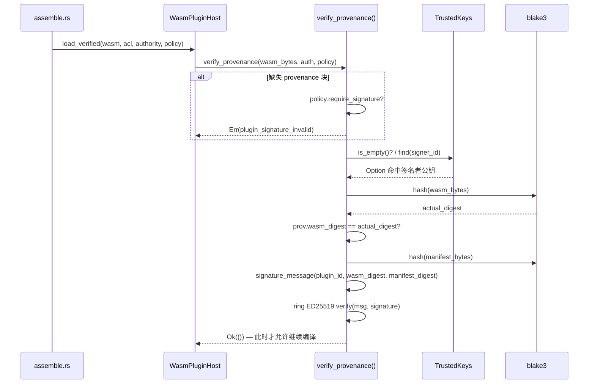
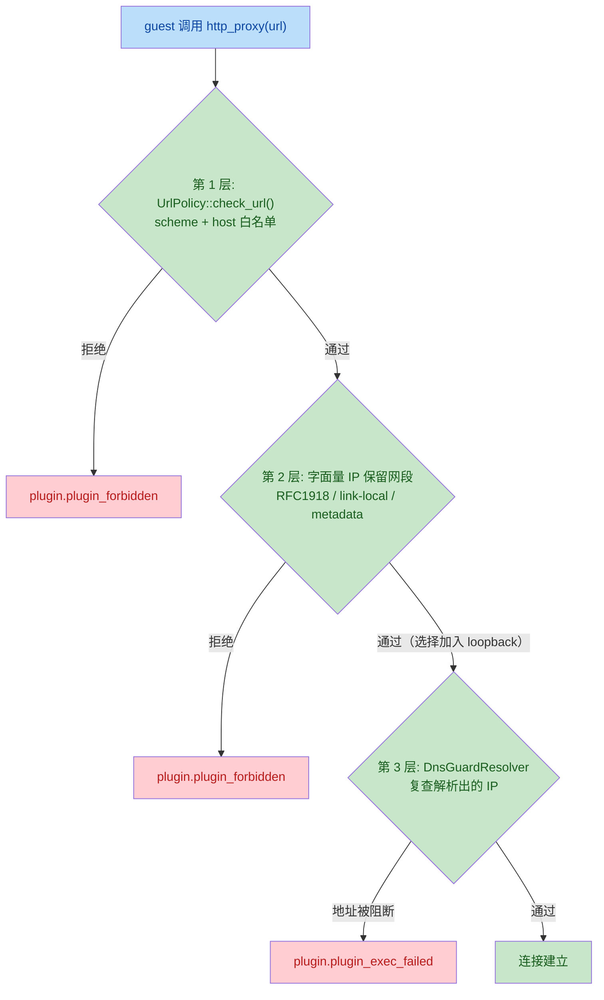
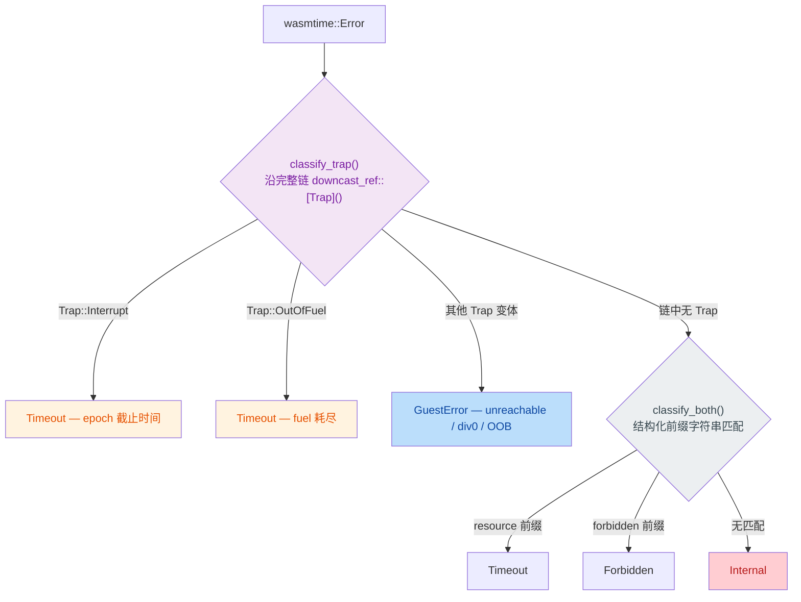
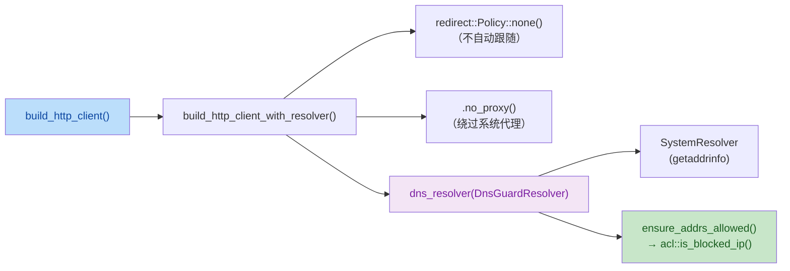

# 🔐 变更集评审摘要 — WASM 插件信任链加固与 SSRF 防护（Step C）

> **日期**：2026-11-16
> **变更范围**：`ra-plugins` WASM 沙箱的安全加固版本。闭合插件**信任链**（宿主侧权威清单 + Ed25519 来源签名）、新增**第三层 SSRF 防护**（DNS 解析 IP 复查）、将模块缓存改为**有界 LRU**，并把整个 `[plugins]` 配置层接入 CLI 装配流水线。约 **2,700 行**新增代码，涉及 **28 个文件**，含 3 个新模块与 2 个新 CI 工作流。

---

## 1. 高层摘要（TL;DR）

- **影响等级：🔴 高** —— 这是 `ra-plugins` WASM 沙箱的一次安全加固发布。它闭合了插件**信任链**（宿主侧权威清单 + Ed25519 来源签名），新增**第三层 SSRF 防护**（DNS 解析 IP 复查），把模块缓存转换为**有界 LRU**，并将整个 `[plugins]` 配置层接入 CLI 装配流水线。约 **2,700 行**新增代码，涉及 **28 个文件**，含 3 个新模块与 2 个新 CI 工作流。

- **关键变更：**
  - 🆕 **新模块 `crates/plugins/src/provenance.rs`** —— Ed25519 签名校验。对绑定 `plugin_id` + `blake3(wasm)` + `blake3(manifest.json)` 的**域分隔**载荷签名。校验在 `wasmtime::Module::new` **之前**执行，不可信字节永远到不了 JIT 编译器。
  - 🆕 **新模块 `crates/plugins/src/authority.rs`** —— `AuthorityManifest`（宿主侧加载的真值来源）。guest 自述的 `list_tools()` 从*信任来源*降级为*交叉核对样本*；任何不一致都拒绝加载。
  - 🆕 **CLI 新增 `[plugins]` 配置层** —— `PluginsSchema` / `PluginEntrySchema` / `PluginAclSchema` / `PluginVerifySchema`，以及带两层沙箱纪律（词法逃逸检查 + 规范化后归属检查）的装配逻辑。
  - 🛡️ **SSRF 第三层** —— `DnsGuardResolver` 对解析出的 IP 复查保留网段列表；配合 `.no_proxy()` 防止代理绕过该防护。
  - 📦 **有界 `ModuleCache`** —— `DashMap` → `Mutex<LruCache>`，容量可配置，poison 安全（返回 `Err`，绝不 panic），插入前双重检查。
  - ⚙️ **运行时旋钮** —— `PluginRuntimeConfig` 上的 `tool_timeout_ceiling`、`fuel_limit`、`module_cache_capacity`，支持 `from_env()` 覆盖。

---

## 2. 可视化概览（代码与逻辑地图）

### 2.1 插件信任链 —— 加载期流水线

核心业务目标 —— *恶意插件既不能对自己的行为撒谎，未经可信发布者签名也根本不能被加载* —— 映射到 `crates/plugins/src/wasm/host.rs` 中一条严格有序的流水线。



**关键顺序保证：** `verify_provenance()`（签名）在*阶段 0* 执行 —— **早于** `ModuleCache::get_or_compile()`（JIT 编译）。被篡改的 `.wasm` 永远不会进入编译器。

### 2.2 签名验证时序（来源校验）



**签名载荷格式**（域分隔，以 NUL 分隔以防字段拼接歧义）：

```text
"ribo-plugin-provenance-v1\0" || plugin_id || "\0" ||
hex(blake3(wasm)) || "\0" || hex(blake3(manifest.json))
```

### 2.3 SSRF —— 三层防护



> **注意这里刻意的不对称：** 第三层拒绝产生 `plugin_exec_failed`（传输路径），而第 1–2 层产生 `plugin_forbidden`（ACL 路径）。这一区别在 `crates/plugins/src/wasm/tests.rs::dns_rebinding_to_private_ip_is_blocked` 中被显式断言，用以证明拦截发生在解析器层。

### 2.4 错误分类 —— 三级级联

`classify_trap()` 作为**第 0 层**加入，优先于既有的字符串前缀匹配，因为 wasmtime 50 会把 trap 包装在 context 里。



---

## 3. 变更明细分析

### 3.1 🆕 `crates/plugins/src/provenance.rs` —— Ed25519 来源校验（新增，485 行）

**变更内容：** 引入插件信任链的最后一环。`AuthorityManifest`（§3.2）保证*清单与 guest 自述一致*，但攻击者若同时控制 wasm **和**清单即可绕过它。本模块把信任锚定在**宿主侧加载的 Ed25519 公钥白名单**上，并把签名绑定到两个摘要。

**关键实体：**

| 实体 | 用途 |
| :-- | :-- |
| `TrustedKey` | `{ id: String, public_key: [u8; 32] }` —— 一个允许的签名者 |
| `TrustedKeys` | `from_json()` / `is_empty()` / `find(id)` —— 信任锚 |
| `VerificationPolicy` | `development()`（不要求签名）与 `production(keys)`（要求签名） |
| `Provenance` | 侧载的 `{ signer_id, signature: [u8;64], wasm_digest: [u8;32] }` |
| `SignedAuthority` | `{ manifest, manifest_bytes, provenance: Option<Provenance> }` |
| `signature_message()` | 构造域分隔的签名载荷 |
| `verify_provenance()` | 4 步加载期门禁 |

**校验顺序**（任一步失败 ⇒ `plugin.plugin_signature_invalid`）：

1. 生产策略要求必须有 provenance 块 —— 缺失 ⇒ 拒绝。
2. `signer_id` 必须出现在 `TrustedKeys` 白名单中 —— 不可信 ⇒ 拒绝。
3. `prov.wasm_digest` 必须等于现场计算的 `blake3(wasm_bytes)` —— 不一致 ⇒ 拒绝。
4. `signature_message(...)` 的 Ed25519 校验必须通过。

**值得强调的设计决策：**
- 🛡️ **签名放在*独立的*侧载文件**（`provenance.json`）中，而非清单内部 —— 避免「签名覆盖自身」的自引用悖论。
- 🛡️ 侧载文件只含 `{signer_id, signature, wasm_digest}` —— **不含**清单摘要，该摘要由宿主根据原始清单字节现场计算，从而阻止攻击者替换清单。
- 🛡️ `manifest_bytes` 以原始形式保留并**明确禁止重新序列化** —— 重新序列化会改变摘要、破坏签名。
- 🛡️ 错误文本永不包含密钥材料或签名载荷。
- 🛡️ 自定义 `hex_encode`/`hex_decode` 辅助函数，避免为 32/64 字节的值引入 hex crate。

### 3.2 🆕 `crates/plugins/src/authority.rs` —— 宿主侧权威清单（新增，226 行）

**变更内容：** guest 自述的工具 Schema 不再是真值来源。宿主加载一份 `manifest.json`（结构与 guest ABI 清单一致）并对每个字段交叉核对。

**`check_authority()` 比较规则** —— *任何*不一致 ⇒ `plugin.plugin_exec_failed`，并带 `authority manifest mismatch:` 前缀：

| 字段 | 规则 |
| :-- | :-- |
| `plugin_id` | 必须完全相同 |
| 工具名集合 | 必须**完全相等**（guest 多出 ⇒ 拒绝；权威清单多出 ⇒ 拒绝） |
| `parameters`（JSON Schema） | 必须逐字节相等 |
| `timeout_hint` | 必须相等（钳制后比较，双方语义相同） |
| `idempotent` | 必须相等 |
| `memory_limit_bytes` | 必须相等 |

> **复用洞察：** `AuthorityManifest::from_json()` 复用 `abi::parse_manifest()`，因此超时钳制逻辑是共享的 —— 权威清单与 guest 清单保证在相同语义下可比较。

### 3.3 🛡️ `crates/plugins/src/acl.rs` —— SSRF 漏洞闭合

**变更内容：**

| 变更 | 细节 |
| :-- | :-- |
| `UrlPolicy::allowing_loopback()` | **新增**的选择加入构造器。仅对 `127/8` 与 `::1` 豁免字面量 IP 阻断。RFC1918 / link-local / `169.254.169.254` 仍然**无条件拒绝** —— 它们没有任何豁免通道。 |
| `is_blocked_ip(ip: IpAddr)` | **新增** `pub(crate)` 统一入口（IPv4 + IPv6），使 URL 层与 DNS 解析层共用同一份保留网段列表，不会漂移。 |
| `PluginAcl.timeout_ceiling_ms` | **新增** `Option<u64>` 字段 —— 逐插件的工具执行超时覆写（只收紧），与既有的内存 / 存储覆写对称。 |

`allowing_loopback` 这个逃生口存在的**唯一**理由，是让 CI 能启动绑定在 `127.0.0.1` 的本地 mock HTTP 服务。它刻意保持狭窄，并有正反两方面的显式测试。

### 3.4 📦 `crates/plugins/src/wasm/runtime.rs` —— 有界模块缓存与结构化 trap

**变更内容：**

**a) `ModuleCache`：`DashMap` → `Mutex<LruCache<[u8;32], Arc<Module>>>`**

- 容量由 `PluginRuntimeConfig::module_cache_capacity` 注入（默认 `64`）。
- `NonZeroUsize::new(capacity.max(1))` 防止零容量。
- **poison 处理：** `lock_entries()` 返回 `wasmtime::Result` 而非 panic。mutex 被 poison 意味着先前持锁者在临界区内 panic 过，缓存内部结构可能不一致 —— 用 `into_inner()` 恢复会有操作损坏状态的风险。错误作为 `plugin_internal` 向上传播。
- **编译发生在锁外**（模块编译很慢；持锁会串行化所有插件加载），并配合**双重检查插入**避免重复编译竞争。
- `Debug` 实现现在是 poison 安全的 —— 打印被 poison 的缓存会得到 `{ poisoned: true }` 而不是 panic。（展开期间的 `Debug` panic 会二次 panic → `abort`。）
- `ModuleCache::len()` 仅限 `#[cfg(test)]`。

**b) `classify_trap()` —— 第 0 层结构化 trap 分类**

遍历**整个 anyhow 错误链**（`e.chain()`），用 `downcast_ref` 寻找 `wasmtime::Trap`，以处理 `Func::call` 把 trap 包装在 context 错误里的情况。

| Trap | 分类 | 理由 |
| :-- | :-- | :-- |
| `Trap::Interrupt` | `Timeout` | epoch 截止时间 —— 资源限制，计入熔断器，**不是** guest 过错 |
| `Trap::OutOfFuel` | `Timeout` | fuel 耗尽 —— 与 epoch 中断语义相同 |
| 其他所有 trap | `GuestError` | guest 自身的业务失败，可以回灌给 LLM |

> 由 `WasmError::msg("forbidden:...")` 创建的 host function 错误**不是** trap —— 它们会正确落入既有的字符串前缀层。

**c) Fuel 注入：** 当 `enable_fuel` 为真时，`run_tool()` 现在调用 `store.set_fuel(shared.config.fuel_limit)`，与 epoch 截止时间并行。

**d) 进程级 HTTP 客户端：** `PluginRuntime` 现在持有一个 `Arc<reqwest::Client>` 单例，由所有插件共享 —— 一个连接池，而非每插件一个。`HostState.client` / `HostStateSnapshot.client` / `PluginShared.client` 都从 `reqwest::Client` 改为 `Arc<reqwest::Client>`。

### 3.5 🌐 `crates/plugins/src/wasm/hostfns.rs` —— SSRF 第三层

**变更内容：**



- 🛡️ **`.no_proxy()` 是安全要求，不是偏好。** 一旦走代理，DNS 解析就发生在*代理侧*，会完全绕过 DNS 守卫与保留网段拦截。插件的出站策略完全由宿主白名单掌控，**刻意不**继承进程级代理设置。
- `SystemResolver` 包装 `getaddrinfo`，使 `DnsGuardResolver` 能持有统一的 `Arc<dyn Resolve>`。
- `ensure_addrs_allowed()` 是一个**纯函数**（易于单测），拒绝任何命中保留网段列表的解析地址，错误文本含 `blocked address` 与违规 IP。
- `build_http_client_with_resolver()` 是 `pub(crate)` —— 允许测试注入静态解析表，在不依赖真实 DNS 的情况下复现 DNS rebinding。

### 3.6 ⏱️ `crates/plugins/src/wasm/abi.rs` —— 超时钳制

**变更内容：** `timeout_hint_ms` 现在**两端**都钳制，而非只钳上界：

| 边界 | 值 | 理由 |
| :-- | :-- | :-- |
| `MIN_TIMEOUT_HINT_MS` | `100` | guest 提示 `0` 会被向上取整为 1 个 epoch tick（10 ms），导致工具立即被杀 |
| `MAX_TIMEOUT_HINT_MS` | `60_000` | guest 自述超时不可信 —— 防止 guest 声称 10 小时超时 |

此外：`call_list_tools()` 现在也会在自己的 store 上设置 fuel。否则，以 `consume_fuel` 构建的 Engine 会在加载期 store 的第一条指令就抛 `OutOfFuel`（该 store 没有分配 fuel 预算）。

### 3.7 🖥️ `crates/plugins/src/wasm/host.rs` —— 加载流水线重构

**变更内容：** 单一的 `load()` 入口被拆分为分层 API：

| 方法 | 权威清单 | 签名校验 | 语义 |
| :-- | :-- | :-- | :-- |
| `load()` | ❌ | ❌ | Step B 遗留 —— 信任 guest 自述（开发 / CI） |
| `load_with_authority()` | ✅ | ❌ | Step C B3.2 —— 宿主清单为真值来源 |
| `load_verified()` | ✅ | ✅ | Step C 完整形态 —— 签名 + 权威清单 |
| `load_inner()` | — | — | 共享主体（编译 → 共享状态 → 解析 → **阶段 3.5 权威校验** → plugin_id 校验） |

**超时上限组合**（`WasmPlugin::execute` 中的阶段 3.5）：

```rust
timeout = min(guest_hint_or_default, acl.timeout_ceiling_ms, process.tool_timeout_ceiling)
```

三者全部取 `min` —— **只收紧，绝不放宽**。这闭合了一个此前不对称的缺口：`PluginAcl` 可以覆写内存与存储配额，却完全没有超时能力。

### 3.8 🧩 `crates/cli/src/config/` —— 新增 `[plugins]` 配置层

#### 3.8.1 Schema（`crates/cli/src/config/schema.rs`）

| 键 | 类型 | 默认值 | 说明 |
| :-- | :-- | :-- | :-- |
| `[plugins] enabled` | `bool` | `false` | 总开关。为 `false` 时：不扫描、不加载，**wasmtime 永不初始化** —— 现有配置与 TUI 测试零行为变化。 |
| `[plugins] roots` | `Vec<PathBuf>` | `[]` | 扫描 `*.wasm` 的目录（相对 `harness.root`）。扫描得到的插件取**最小权限**（ACL 全关、无注入 config）。 |
| `[plugins.verify] require_signature` | `bool` | `false` | 生产环境必须启用。 |
| `[plugins.verify] trusted_keys` | `Option<PathBuf>` | `None` | 公钥白名单 JSON，相对 `harness.root`。`require_signature = true` 时**必填**。 |
| `[[plugins.entries]] path` | `PathBuf` | — | 插件 wasm 路径，相对 `harness.root`。 |
| `[[plugins.entries]] manifest` | `Option<PathBuf>` | `None` | 权威清单（B3.2）。 |
| `[[plugins.entries]] provenance` | `Option<PathBuf>` | `None` | 侧载签名块。 |
| `[[plugins.entries]] config` | `Option<Value>` | `None` | 经 args 信封注入 guest 的 config。 |
| `[plugins.entries.acl] log` | `bool` | `false` | 允许 `log` host function。 |
| `[plugins.entries.acl] storage` | `bool` | `false` | 允许 `storage_get` / `storage_put`。 |
| `[plugins.entries.acl] http` | `bool` | `false` | 允许 `http_proxy`。 |
| `[plugins.entries.acl] http_hosts` | `Vec<String>` | `[]` | 出站 host 白名单。空 ⇒ 无法出站。 |
| `[plugins.entries.acl] memory_limit_bytes` | `Option<usize>` | `None` | 线性内存覆写（只能收紧默认 32 MB）。 |
| `[plugins.entries.acl] storage_quota_bytes` | `Option<usize>` | `None` | 存储配额覆写（只能收紧默认 1 MB）。 |
| `[plugins.entries.acl] timeout_ceiling_ms` | `Option<u64>` | `None` | 工具超时上限覆写（只能收紧默认 60 s）。 |

> **层间零交叉纪律：** schema 层只做*描述*；到运行时 `PluginAcl` 的转换 exclusively 发生在装配层的 `build_plugin_acl()`。

#### 3.8.2 装配（`crates/cli/src/config/assemble.rs`，约 +410 行）

**沙箱纪律 —— 两道独立防线：**

| 层 | 检查 | 函数 | 拦截对象 |
| :-- | :-- | :-- | :-- |
| 1. 词法 | 绝对路径或 `..` 组件 | `escapes_root()` | 配置中逃逸 `harness.root` 的路径 —— 在**任何**文件系统访问**之前**拦截 |
| 2. 归属 | `canonicalize()` 结果必须 `starts_with(canonical_root)` | `validate_plugin_path()` | 指向沙箱外的符号链接与 Windows 目录联接 |

两者同时施加于 `roots`、`entries.path`、`entries.manifest`、`entries.provenance` 与 `trusted_keys`。

**关键装配函数：**

| 函数 | 职责 |
| :-- | :-- |
| `collect_plugin_specs()` | 扫描 roots + 读取 entries，按规范化路径去重 |
| `validate_plugin_path()` | canonicalize + 归属检查（同时做存在性检查） |
| `build_verify_policy()` | 加载公钥文件；缺失 / 不可读 / 为空一律**报错**，而非静默降级为空白名单 |
| `build_plugin_acl()` | schema → 运行时 `PluginAcl` 的唯一转换点 |
| `load_and_register_plugins()` | 读 wasm → `load_verified()` → `PluginRegistry::register()` |

**致命即设计（Fatal-by-design）语义：** 任何加载 / 注册失败都终止启动。`PluginRuntime::global()` 是 `OnceLock` 单例 —— 初始化失败会毒化整个进程，半装配状态只会把问题推迟到首次工具调用。

> ⚠️ **行为变更：** `ToolManager` 现在用 `plugin_aware_tool_manager_config()` 构建，而非 `ToolManager::new()`，因此插件错误感知的熔断器白名单也作用于内置工具（无害 —— 内置工具不会产生 `plugin.plugin_*` 错误码）。

#### 3.8.3 配置加载器重构（`crates/cli/src/config/mod.rs`）

`mock_outcome()` 辅助函数被**移除**，改为先构造 `Real` 模式的 `outcome`，再在每个降级分支里就地设置 `outcome.mode = ConfigMode::Mock`。原因是 `LoadOutcome` 新增了 `plugins` 字段 —— 为每个 mock 分支向辅助函数传入八个参数已变得不可维护。

一个借用检查器的细节被显式处理：`outcome.provider.providers.retain_mut(...)` 持有对 `outcome.provider` 的可变借用，因此 warning 先收集到局部 `prune_warnings` 向量再合并（在闭包内直接写 `outcome.warnings` 会触发 **E0502**）。

### 3.9 ⚙️ `crates/plugins/src/config.rs` —— 运行时配置

| 字段 | 类型 | 默认值 | 来源 |
| :-- | :-- | :-- | :-- |
| `tool_timeout_ceiling` | `Duration` | `60s` | 进程级工具超时上限 |
| `enable_fuel` | `bool` | `false` | Fuel（指令计数）中断 —— **需要重启进程** |
| `fuel_limit` | `u64` | `1_000_000_000` | 每次工具执行的 fuel 预算 |
| `module_cache_capacity` | `usize` | `64` | `ModuleCache` LRU 容量 |

**新增环境变量**（在 `PluginRuntime::start` 时**读取一次**，此后因 `OnceLock` 不可变）：

| 变量 | 取值 | 效果 |
| :-- | :-- | :-- |
| `RIBO_PLUGINS_ENABLE_FUEL` | `1` / `true` / `TRUE` / `True` | 启用 fuel 计量 |
| `RIBO_PLUGINS_FUEL_LIMIT` | 正整数 | fuel 预算 |
| `RIBO_PLUGINS_MODULE_CACHE_CAPACITY` | 正整数 | ModuleCache 容量 |

> **设计说明：** 非法值被静默忽略并保留默认值 —— 进程级基础设施不能因为一个拼写错误而无法启动。启动致命错误保留给插件 wasm / ACL / 权威清单问题。

### 3.10 🧪 测试覆盖 —— 大幅扩充

| 测试文件 | 类型 | 覆盖范围 |
| :-- | :-- | :-- |
| `crates/plugins/tests/fuel.rs` | **新增**集成二进制 | 经环境变量启用 fuel → 死循环 guest 被打断 → `plugin.plugin_timeout` 且 `trap_reason` 含 "fuel"。因 `PluginRuntime` 是 `OnceLock` 单例且 `consume_fuel` 在引擎初始化时冻结，该测试在**独立进程**运行。 |
| `crates/cli/tests/plugins.rs` | **新增**（639 行） | 配置解析、默认关闭契约、缺失文件、`..` 逃逸、绝对路径、来自 roots 与 entries 的符号链接 / 目录联接逃逸、绝对 `harness.root`（**不得**误判）、manifest / provenance 字段解析，以及完整签名矩阵。 |
| `crates/plugins/src/wasm/tests.rs` | +411 行 | `GuestBufs` RAII 释放、超长值拒绝、边界值（≤ 上限通过、> 上限拒绝）、日志洪泛限流、清单缓存稳定性、DNS rebinding（单测 + guest 层）、权威清单门禁。 |
| `crates/plugins/examples/plugin-demo/tests/e2e.rs` | +422 行 | 场景 4–12：完整 Agent 循环调用插件工具、loopback 白名单成功、未选择加入时 loopback 被阻断、302 不跟随、超大响应（content-length + chunked）、并发取消隔离、512 KB 载荷往返、权威清单不一致拒绝。 |
| `crates/plugins/src/wasm/runtime.rs`（内联） | 约 +200 行 | 结构化 trap 分类、fuel 耗尽分类、LRU 淘汰顺序、被 poison 缓存的错误传播。 |

**`crates/cli/tests/plugins.rs` 中的签名技巧：** 测试套件**独立重新实现**了 `signature_message()`，而不是从生产 API 暴露签名辅助函数 —— 生产 crate 刻意只提供*校验*签名的能力，不提供*生成*有效签名的方法。

### 3.11 🏗️ 依赖与 CI

**新增 workspace 依赖**（两者此前已作为传递依赖存在于 lockfile）：

| 包 | 版本 | 用途 | 在 `crates/plugins` | 在 `crates/cli` |
| :-- | :-- | :-- | :-- | :-- |
| `ring` | `0.17` | Ed25519 签名校验 | ✅ 依赖 | ✅ dev-dependency |
| `lru` | `0.12` | `ModuleCache` LRU 淘汰 | ✅ 依赖 | — |
| `ra-plugins` | workspace | CLI 插件集成 | — | ✅ **新增**依赖 |

**新增 CI 工作流：**

| 工作流 | 触发 | 门禁 |
| :-- | :-- | :-- |
| `.github/workflows/ci.yml` | PR + push 到 `main`/`dev` | `cargo fmt --check` → `cargo clippy --workspace --all-targets -- -D warnings` → `cargo check --workspace` → `cargo test --workspace` |
| `.github/workflows/security-audit.yml` | 每周（周一 03:00 UTC）+ 手动 | `cargo audit` 检查 wasmtime 及其他依赖 CVE |

两者都通过 `dtolnay/rust-toolchain@master` 把 Rust 工具链固定到 `1.99.1`。

### 3.12 🔧 附带修复

- **Provider 代理陷阱**（`crates/provider/src/error/mod.rs`、`.../openai/completion/provider.rs`）：两个测试断言 `connect` 错误，但在启用代理的环境中代理会返回 `502`，掩盖了连接失败。两处现在都用 `.no_proxy()` 构建客户端。
- **`crates/plugins/src/error.rs`**：新增 `PLUGIN_SIGNATURE_INVALID` 常量（`plugin.plugin_signature_invalid`）与 `plugin_signature_invalid(reason)` 构造器，严重级别为 `Severity::Error`。
- **`AGENTS.md`**：新增规则 *「必须使用中文思考或回答问题，不能使用英文」*。

---

## 4. 影响与风险评估

### 4.1 ⚠️ 破坏性变更

| 变更 | 影响 | 迁移 |
| :-- | :-- | :-- |
| `PluginAcl` 新增 `timeout_ceiling_ms: Option<u64>` | 对所有结构体字面量构造点构成**源码级破坏**（public struct） | 每处字面量补充 `timeout_ceiling_ms: None` |
| `PluginShared.client`、`HostState.client`、`HostStateSnapshot.client` → `Arc<reqwest::Client>` | **源码级破坏**的类型变更 | 用 `Arc::new(...)` / `Arc::clone(...)` 包装 |
| `PluginRuntimeConfig` 新增 3 个字段 | 对结构体字面量构成**源码级破坏** | 使用 `..Default::default()` 或显式设置新字段 |
| `ModuleCache::new()` 现接收 `capacity`；`ModuleCache` 不再实现 `Default` | **源码级破坏**（近似私有，`pub(crate)`） | 传入 `cfg.module_cache_capacity` |
| `LoadOutcome` 新增 `plugins: PluginsSchema` | 对结构体字面量（含既有测试）构成**源码级破坏** | 补充 `plugins: PluginsSchema::default()` |
| `mock_outcome()` 辅助函数被移除 | 仅内部使用 | 就地改写 mode —— 见 §3.8.3 |
| `build_http_client()` 语义变更 | **运行时行为**变更 | 插件出站不再遵循 `HTTP_PROXY`/`HTTPS_PROXY` 环境变量；同时施加 DNS 守卫 |
| `ToolManager::new()` → `ToolManager::with_config(plugin_aware_tool_manager_config())` | 对内置工具构成**运行时行为**变更 | 熔断器白名单现在感知插件（无害） |
| `WasmPluginHost::load()` | ✅ **不破坏** | 签名不变；新方法均为增量添加（`load_with_authority`、`load_verified`） |

### 4.2 🔴 安全风险评估

| 风险 | 严重级别 | 缓解 / 说明 |
| :-- | :-- | :-- |
| `allowing_loopback` 削弱了针对 `127/8` + `::1` 的第 2 层 SSRF 防护 | 🟡 中 | 刻意保持狭窄 —— **仅** loopback 被豁免；RFC1918 / link-local / `169.254.169.254` **没有**任何豁免路径。仅选择加入，从非默认。 |
| `.no_proxy()` 破坏企业代理环境下的插件出站 | 🟡 中 | **有意为之** —— 代理会把 DNS 解析移到代理侧，绕过整个守卫。需要经代理出站的组织需要未来的代理感知设计。 |
| `production()` 策略下公钥列表为空 | 🟢 低 | `verify_provenance()` 显式以 `no trusted public keys configured` 拒绝；`build_verify_policy()` 也拒绝构建空的生成环境白名单。 |
| 签名覆盖的是**清单摘要**而非清单内容 | 🟢 低（设计使然） | 防止清单替换。清单仍通过 `check_authority()` 与 guest 自述交叉核对。 |
| `Manifest` 字段比较是对 JSON 值的精确相等 | 🟡 中 | JSON 对象的键**顺序**差异可能导致误拒绝。`serde_json::Value` 对对象的相等比较与顺序无关，但这一点应确认。 |
| `fuel_limit` 为 1e9 对短超时可能过于宽松 | 🟢 低 | fuel 与 epoch 并行运行；epoch 仍是主要的墙钟时间守卫。 |
| `ModuleCache` 容量 `64` 在插件很多时可能抖动 | 🟢 低 | LRU 实现正确，且容量可通过环境变量配置。 |

### 4.3 🧪 测试建议（供评审者）

**签名 / 信任链：**
- ✅ 验证**被篡改的清单**（不只是被篡改的 wasm）会被拒绝 —— 已由 `provenance.rs::tampered_manifest_is_rejected` 覆盖。
- ✅ 验证**跨插件重放**：用插件 B 的 `plugin_id` 签署插件 A 的 wasm ⇒ 必须拒绝（载荷绑定了 `plugin_id`）。
- 🔍 验证以不同键顺序**重新序列化 `manifest.json`** 后签名被拒绝 —— 宿主哈希的是原始字节，因此应当失败。确认这是*期望*行为（意味着发布者必须对精确字节签名）。
- 🔍 验证 `require_signature = true` 下 `roots` 扫描的插件**一律**被拒绝 —— 已由 `plugins_unsigned_root_scan_is_rejected_in_production` 覆盖。

**SSRF：**
- 🔍 测试 DNS rebinding：第一次解析返回公网 IP，**第二次**解析（连接重试）返回私网 IP。守卫是逐次解析检查的，两次都会被检查 —— 但需验证重试路径同样经过 `DnsGuardResolver`。
- 🔍 测试 IPv6 变体：`::1`、`fc00::/7`（ULA）、`fe80::/10`（link-local），以及 IPv4 映射 IPv6（`::ffff:127.0.0.1`）。IPv4 映射地址上的 `is_loopback()` 与 `is_blocked_ipv6` 行为值得显式验证。
- 🔍 确认 `169.254.169.254`（云元数据地址）在**全部三层**都被拒绝。

**缓存 / 并发：**
- 🔍 验证**并发** `get_or_compile` 下的 LRU 淘汰 —— 双重检查插入存在很窄的竞争窗口；确认没有重复编译泄漏。
- 🔍 验证被 poison 的缓存路径返回 `plugin_internal`（而非 `plugin_exec_failed`），且 `PluginRuntime` 仍可用。

**超时：**
- 🔍 验证 `min(hint, acl_ceiling, process_ceiling)` —— 尤其是 guest 提示 `0` 被下限钳到 100 ms，不能变成立即杀死。
- 🔍 验证 `timeout_ceiling_ms = 5000` 的插件确实在约 5 s 时被杀。

**CLI 装配：**
- 🔍 验证**目录联接逃逸**测试在 Windows 上真实运行（链接创建不被允许时会自跳过 —— 这可能让 CI 上的覆盖率被静默削弱）。
- 🔍 验证 `harness.root` 为绝对路径且带 `roots` 条目时**不得**误判 —— 已由 `plugins_accept_absolute_harness_root` 覆盖。
- 🔍 验证同一 wasm 同时被 `roots` 扫描与 `entries` 条目引用时的**去重** —— 条目的 ACL/config 应当胜出。*（diff 中未显式覆盖，值得补测。）*

### 4.4 🧹 整理观察（非阻塞）

- **`dashmap`** 仍是 `crates/plugins/Cargo.toml` 的依赖，尽管 `ModuleCache` 已不再使用它。确认其他地方（如 `registry.rs`）是否仍需要；否则移除以避免 unused-dependency 警告。
- **`tool_timeout_ceiling`** **没有**环境变量入口，而 `fuel_limit` 与 `module_cache_capacity` 有。考虑为一致性新增 `RIBO_PLUGINS_TOOL_TIMEOUT_CEILING`。
- `TrustedKeys`/`Provenance` 的 JSON 格式记录在 `ribo_example.toml` 中，但**没有** schema 文件或 JSON Schema —— 发布者工具会从中受益。
- `AGENTS.md` 现在强制要求中文推理 / 回答 —— 值得确认这与外部贡献者的项目贡献指南一致。

---

**总体评价：** 这是一次结构良好、纵深防御的安全加固。分层设计刻意且测试充分：签名校验先于编译；权威清单把 guest 自述降级；DNS 复查捕获 rebinding；每一个收紧旋钮都只通过 `min` 组合。主要风险是刻意引入但具破坏性的 `.no_proxy()` 行为变更，以及新增的 public 结构体字段 —— 它们需要整个工作空间的源码更新。
