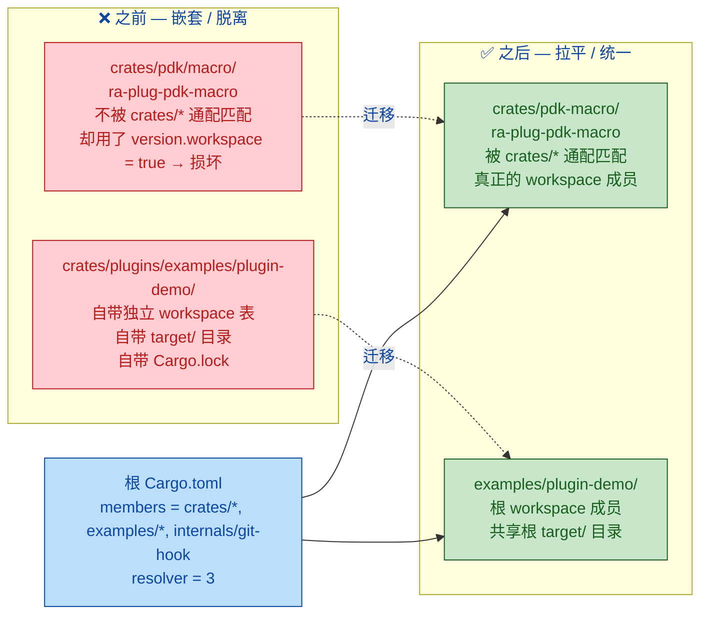
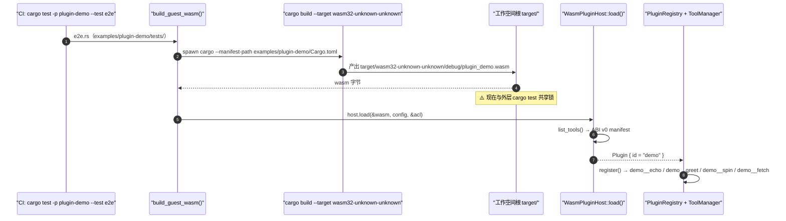
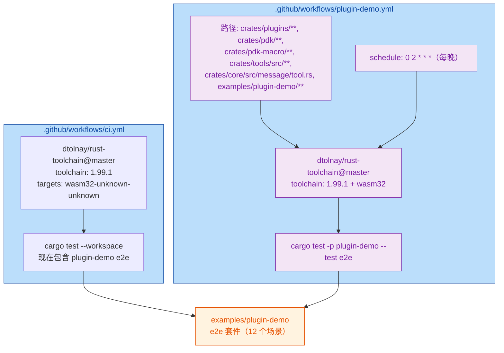

# 🔧 变更集评审摘要 — Ribo Agent 工作空间重构与 plugin-demo 集成

> 2026-11-17

> **变更范围**：Cargo 工作空间的**布局/结构重构**加 **CI 重定向**。插件宿主 / guest 的运行时业务逻辑未改动，PDK 宏源码**逐字节相同**地迁移。核心意图是**修复损坏的 Cargo manifest**（某 crate 使用了 `version.workspace = true` 却并非 workspace 成员），并把插件 e2e 套件**纳入主 `cargo test --workspace` 门禁**。

---

## 1. 高层摘要（TL;DR）

- **影响等级：🟡 中** —— 这是对 Cargo 工作空间的一次**布局/结构重构**，并伴随 **CI 重定向**。插件宿主 / guest 的运行时业务逻辑没有任何改动；PDK 宏源码是**逐字节相同**的迁移。

- 核心意图有二：**修复一个损坏的 Cargo manifest**（某 crate 使用 `version.workspace = true` 却不是 workspace 成员），以及**把插件 e2e 套件拉进主 `cargo test --workspace` 门禁**。

- **关键变更：**
  1. **📦 `crates/pdk/macro` → `crates/pdk-macro`** —— `crates/*` 通配只匹配**一层**，嵌套的宏 crate 从来都不是 workspace 成员，却继承了 `version.workspace = true` 等字段。拉平后通配即可匹配到它（根 path 依赖同步更新为 `./crates/pdk-macro`）。
  2. **🚀 `crates/plugins/examples/plugin-demo` → `examples/plugin-demo`** —— 从**脱离的嵌套 workspace**（自带 `[workspace]` 表与 `target/`）提升为**根 workspace 成员**，靠新增的 `"examples/*"` 成员通配实现。
  3. **🧹 Manifest 现代化** —— `plugin-demo` 现在全面使用 `workspace = true` 继承依赖，并**把 `ra-plug-pdk` 限制到 `cfg(target_arch = "wasm32")`**，宿主构建不再编译 PDK。
  4. **🔧 e2e 产物路径修复** —— `build_guest_wasm()` 现在从**工作空间根的 `target/`**（上溯两级）解析 `.wasm`，而非 crate 本地的 `target/`。
  5. **⚙️ CI 改造** —— 两个工作流都把工具链钉到 `1.99.1`，`ci.yml` 新增 `wasm32-unknown-unknown` target，新增路径触发器，缓存键改为 `hashFiles('Cargo.lock')`，测试命令改为 `cargo test -p plugin-demo --test e2e`。
  6. **🧹 依赖清理** —— 注释掉未使用的 `futures`（根 + provider）与 `serde`（pdk）依赖。

---

## 2. 可视化概览（代码与逻辑地图）

### 2.1 工作空间布局 —— 前后对比



### 2.2 e2e 测试 —— guest 构建与宿主往返



### 2.3 CI 触发拓扑



---

## 3. 变更明细分析

### 3.1 🗂️ 组件：Workspace 成员重构

**变更内容：**
- 根 workspace 成员列表新增 `"examples/*"`，`ra-plug-pdk-macro` 的 path 依赖由 `./crates/pdk/macro` 改指 `./crates/pdk-macro`。
- `crates/pdk/macro/{Cargo.toml,src/lib.rs}` 被**删除**，并在 `crates/pdk-macro/{Cargo.toml,src/lib.rs}` 原样重建（306 → 307 行，仅末尾换行符不同）。**宏逻辑没有任何改动。**

**原因**（已由 `internals/docs/reviews/ai_0018.md` 确认）：
> `crates/*` 通配只匹配一层，因此 `crates/pdk/macro` **未被包含**——然而其 manifest 使用了 `version.workspace = true` … **行动项：** 要么把 `"crates/pdk/macro"` 加入 `workspace.members`，要么加入 `workspace.exclude` …

| 方面 | 之前 | 之后 | 原因 |
| :-- | :-- | :-- | :-- |
| 宏 crate 位置 | `crates/pdk/macro/`（嵌套两层） | `crates/pdk-macro/`（拉平） | `crates/*` 通配**只匹配一层** → 嵌套 crate 从来不是成员却用了 `*.workspace = true` → manifest 解析错误 |
| 根 path 依赖 | `ra-plug-pdk-macro = { path = "./crates/pdk/macro" }` | `{ path = "./crates/pdk-macro" }` | 跟随迁移 |
| Workspace 成员 | `["crates/*", "internals/git-hook"]` | `["crates/*", "examples/*", "internals/git-hook"]` | 纳入迁移后的 demo crate |
| 宏源码内容 | 306 行 | 307 行（内容相同 + 换行） | 纯移动 |

### 3.2 🚀 组件：`plugin-demo` crate —— 独立 → workspace 成员

**变更内容：** 该 crate 从 `crates/plugins/examples/plugin-demo/` **迁移**到 `examples/plugin-demo/`，其 manifest 从*显式*依赖改写为*workspace 继承*依赖。它自带的 `[workspace]` 表（"脱离"防御）被**移除**。

**来源：** `examples/plugin-demo/Cargo.toml`

| Manifest 方面 | 之前（`crates/plugins/examples/plugin-demo`） | 之后（`examples/plugin-demo`） | 效果 |
| :-- | :-- | :-- | :-- |
| Workspace 状态 | 脱离 —— 自带 `[workspace]` 表 | 经 `examples/*` 成为根 workspace 成员 | 现在被 `cargo test --workspace` 覆盖 |
| `version` | `"0.0.0"` | `version.workspace = true`（`0.0.1`） | 版本与 workspace 同步 |
| `edition` | `"2024"` | `edition.workspace = true` | 单一真值来源 |
| `publish` | `false` | `publish.workspace = true` → 继承 `false` | 语义不变 |
| `crate-type` | `["cdylib"]` | `["cdylib"]` | 不变（产出 wasm 二进制） |
| `ra-plug-pdk` | `{ path = "../../../pdk" }` —— **所有 target** | `workspace = true` 且**限制到 `cfg(target_arch = "wasm32")`** | 🟢 宿主构建不再编译 PDK |
| `serde_json` | `"1"` | `serde_json.workspace = true` | 去重 |
| 开发依赖 | 6 个显式 `path = ...` + `tempfile = "3"` + `tokio` + `tokio-util` | 全部 `workspace = true` | 去重，单一 lockfile |
| `tokio` | `{ version = "1", features = ["macros","rt-multi-thread"] }` | `{ workspace = true, features = [...] }` | workspace 的 tokio 已带 `"full"` |

> 💡 `serde_json` 保持**不加门控**，因为宏生成的代码（`::serde_json::from_str`）与宿主侧测试都需要它。

### 3.3 🔧 组件：e2e 测试 —— guest 产物解析

**变更内容：** `build_guest_wasm()` 以前从**crate 本地**的 `target/` 读取产物（仅对脱离式 workspace 成立），现在从 `CARGO_MANIFEST_DIR` **上溯两级**到达**工作空间根**——Cargo 现在把构建输出放在那里。

**来源：** `examples/plugin-demo/tests/e2e.rs`

```rust
// 之前（crate 本地 target —— 仅对脱离式 workspace 成立）
let wasm: PathBuf = Path::new(env!("CARGO_MANIFEST_DIR"))
    .join("target").join("wasm32-unknown-unknown").join("debug").join("plugin_demo.wasm");

// 之后（workspace 根 target）
let workspace_root = Path::new(env!("CARGO_MANIFEST_DIR"))
    .parent().and_then(Path::parent)
    .expect("examples/plugin-demo must live under workspace root");
let wasm: PathBuf = workspace_root
    .join("target").join("wasm32-unknown-unknown").join("debug").join("plugin_demo.wasm");
```

**场景覆盖 —— 未变（12 个场景全部保留）：**

| # | 测试函数 | 证明什么 |
| :-- | :-- | :-- |
| 1 | `demo_plugin_loads_registers_and_executes` | 加载 → 注册 → 全链路执行；`demo__*` 前缀；config 信封；storage 持久 |
| 2 | `spin_times_out_without_opening_circuit` | epoch 超时 → `plugin.plugin_timeout`；熔断器保持闭合（7 次） |
| 3 | `http_get_denied_without_http_acl` | 无 `http` ACL → `plugin.plugin_forbidden`（零网络出站） |
| 4 | `assemble_full_agent_loop_invokes_plugin_tool` | 完整 CLI `assemble` → AgentLoop → tool_call → 结果回灌 |
| 5 | `http_get_succeeds_with_loopback_whitelist` | 显式选择加入 loopback 的 http-proxy 成功路径 |
| 6 | `loopback_is_blocked_without_explicit_opt_in` | 默认 `UrlPolicy::new` 阻断 loopback |
| 7 | `redirect_is_not_followed` | 302 原样返回（`redirect::Policy::none`） |
| 8 | `oversized_response_first_block_is_rejected` | `Content-Length` 预检 → `plugin.plugin_exec_failed` |
| 9 | `oversized_response_chunked_accumulation_is_rejected` | 分块累计上限（5 MB） |
| 10 | `concurrent_cancel_does_not_kill_others` | 1 个取消 + 9 个 echo 成功（隔离性） |
| 11 | `large_payload_echo_roundtrip` | 512 KB 载荷往返（dlmalloc/bump 重叠回归） |
| 12 | `authority_manifest_mismatch_is_rejected` | 权威清单 ↔ guest 自述不一致 → 拒绝 |

### 3.4 ⚙️ 组件：CI 工作流

**变更内容：** 两个工作流都重新钉版本，plugin-demo 工作流从*manifest-path* 调用改为*package* 调用。

| 工作流 | 设置项 | 之前 | 之后 |
| :-- | :-- | :-- | :-- |
| `ci.yml` | 工具链来源 | 注释声称根 `rust-toolchain.toml` | **不存在 `rust-toolchain.toml`** → 在文件内联固定 `1.99.1` |
| `ci.yml` | `targets:` | *（无）* | **新增 `wasm32-unknown-unknown`**（e2e 要构建 wasm guest，必需） |
| `plugin-demo.yml` | 工具链 action | `dtolnay/rust-toolchain@stable` | `dtolnay/rust-toolchain@master` + `toolchain: "1.99.1"` |
| `plugin-demo.yml` | 路径触发器 | `crates/plugins/**`、`crates/pdk/**`、`crates/tools/src/**`、`crates/core/src/message/tool.rs` | **+ `crates/pdk-macro/**`**、**+ `examples/plugin-demo/**`** |
| `plugin-demo.yml` | 缓存路径 | `~/.cargo/registry`、`~/.cargo/git`、`crates/plugins/examples/plugin-demo/target` | `~/.cargo/registry`、`~/.cargo/git`、**`target`**（工作空间根） |
| `plugin-demo.yml` | 缓存键 | `hashFiles('crates/plugins/examples/plugin-demo/Cargo.toml', 'crates/pdk/**/Cargo.toml')` | **`hashFiles('Cargo.lock')`**（现在只有一个 lockfile） |
| `plugin-demo.yml` | 测试命令 | `cargo test --manifest-path crates/plugins/examples/plugin-demo/Cargo.toml` | **`cargo test -p plugin-demo --test e2e`** |

> ℹ️ `plugin-demo.yml` 工作流现在与 `ci.yml` 的 `cargo test --workspace` **功能重叠**——它保留下来是为了提供**快速、按路径过滤的反馈闭环**，以及每晚的 `cron: "0 2 * * *"` 防破窗检查。

### 3.5 🧹 组件：依赖清理

**变更内容：** 三个现已无用的依赖被**注释掉**（而非删除），以便一行即可恢复。

| Crate | 依赖 | 操作 | 使用情况核实 |
| :-- | :-- | :-- | :-- |
| 根 `Cargo.toml` | `futures = "0.3"` | → `# futures = "0.3"` | 无 `futures::` 引用 |
| `crates/provider/Cargo.toml` | `futures.workspace = true` | → 注释掉 | 对 `crates/provider` 全量 grep → **无匹配** ✅ |
| `crates/pdk/Cargo.toml` | `serde = { workspace = true }` | → 注释掉 | `crates/pdk/src/**` **只用 `serde_json`**（`Value`、`json!`）✅ |

---

## 4. 影响与风险评估

### 4.1 🔴 破坏性变更

| 变更 | 受影响方 | 缓解 |
| :-- | :-- | :-- |
| `ra-plug-pdk-macro` 路径迁至 `./crates/pdk-macro` | 任何引用 `crates/pdk/macro` 的 manifest / 脚本 | grep 显示 `internals/docs/reviews/*.md` 之外无残留引用 |
| `plugin-demo` 迁至 `examples/plugin-demo` | 任何使用 `--manifest-path crates/plugins/examples/plugin-demo/Cargo.toml` 的脚本 | CI 已更新；**本地 runbook / 文档仍然过时**（见下） |
| `plugin-demo` 现在进入 `cargo test --workspace` | 所有贡献者 / CI | 本地需要 `wasm32-unknown-unknown` target：`rustup target add wasm32-unknown-unknown` |

### 4.2 ⚠️ 风险与评审要点

1. **🔴 嵌套 `cargo` 调用 vs. 共享 target-dir 锁（最高风险）**
   `build_guest_wasm()` 在 `cargo test` 进程**内部**spawn `cargo build --target wasm32-unknown-unknown`。内层构建现在写入与外层测试**相同的 workspace `target/`**（此前脱离式 crate 有**自己的** `target/`，即独立锁）。Cargo 的 target-dir / 包缓存锁可能导致 **`Blocking waiting for file lock on build directory`** 或**挂起**。
   *建议修法：* 给内层构建指定专用 target 目录，例如 `Command::new(cargo).env("CARGO_TARGET_DIR", workspace_root.join("target/plugin-demo-wasm"))`，并从该路径读取产物。

2. **🟠 文档引用过时**（迁移时未同步更新）
   - `examples/plugin-demo/src/lib.rs` 的文档块仍写着：
     `cargo build --manifest-path crates/plugins/examples/plugin-demo/Cargo.toml` 与
     `cargo test --manifest-path crates/plugins/examples/plugin-demo/Cargo.toml` → 应为 `cargo test -p plugin-demo`。
   - `crates/plugins/Cargo.toml` 仍保留 `autoexamples = false` 及其注释「examples/plugin-demo 是独立子 crate … 有自己的 Cargo.toml 与 workspace」—— 目录 `crates/plugins/examples/` 已不存在，该标志与注释可移除。
   - `internals/docs/reviews/ai_0018.md` / `ai_0019.md` 仍引用旧路径以及现已解决的「不是成员」发现。

3. **🟠 `cargo test --workspace` 现在会运行构建 wasm 的 e2e 套件**
   主 CI 门禁变得**更慢**且**要求 wasm32 target**；`ci.yml` 的改动是正确的，但任何自托管 runner 或开发镜像都必须预装该 target。

4. **🟡 工具链钉版本是重复而非集中管理**
   `1.99.1` 现在硬编码在**两个**工作流文件中，而仓库**没有 `rust-toolchain.toml`**（已确认）。建议新增 `rust-toolchain.toml`，写入 `channel = "1.99.1"` + `targets = ["wasm32-unknown-unknown"]`，使本地与 CI 一致。

5. **🟡 注释掉的依赖是潜在陷阱**
   `futures` / `serde` 是注释而非删除；下一位贡献者在 `crates/pdk` 中添加 `serde::Serialize` derive 时会遇到难以理解的「找不到 crate」错误。更推荐真正删除（git 历史会保留）。

6. **🟢 打包收益待验证**
   宏 crate 移**出** `crates/pdk/` 后，发布 `ra-plug-pdk` 应不再嵌入嵌套的 `macro/` 源码。用 `cargo package -p ra-plug-pdk --list` 验证。

### 4.3 🧪 测试建议

| # | 检查项 | 命令 | 预期 |
| :-- | :-- | :-- | :-- |
| 1 | Manifest 可解析 | `cargo metadata --no-deps --format-version 1` | 所有成员（含 `ra-plug-pdk-macro`、`plugin-demo`）齐备；**无 workspace 继承错误** |
| 2 | 全 workspace 构建 | `cargo build --workspace` | 干净通过；`plugin-demo` 宿主 lib 为**空 cdylib**（guest 代码被 `cfg(wasm32)` 门控） |
| 3 | guest 产物 | `cargo build -p plugin-demo --target wasm32-unknown-unknown` | 产出 `target/wasm32-unknown-unknown/debug/plugin_demo.wasm` |
| 4 | **死锁检查** | `cargo test --workspace` | 能完成；**不出现 `Blocking waiting for file lock on build directory`** |
| 5 | e2e 套件 | `cargo test -p plugin-demo --test e2e` | **12/12** 场景全绿（含 `plugin.plugin_timeout`、`plugin.plugin_forbidden`、512 KB 载荷） |
| 6 | 清理后的依赖 | `cargo check -p ra-provider -p ra-plug-pdk` | 无未解析的 `futures` / `serde` 引用 |
| 7 | 打包 | `cargo package -p ra-plug-pdk --list` | 不嵌入 `macro/` 源码 |
| 8 | CI | `ci.yml` + `plugin-demo.yml` 在触及 `crates/pdk-macro/**` 的分支上 | 两个工作流都触发；安装 wasm32 target |

### 4.4 📋 变更文件（16 个）

| 文件 | 变更类型 |
| :-- | :-- |
| `Cargo.toml` | ✏️ 修改 —— 成员 `+examples/*`、`ra-plug-pdk-macro` 路径、`futures` 注释掉 |
| `crates/pdk/Cargo.toml` | ✏️ 修改 —— `serde` 注释掉 |
| `crates/provider/Cargo.toml` | ✏️ 修改 —— `futures` 注释掉 |
| `crates/pdk/macro/Cargo.toml` | 🗑️ 删除 → `crates/pdk-macro/Cargo.toml` |
| `crates/pdk/macro/src/lib.rs` | 🗑️ 删除 → `crates/pdk-macro/src/lib.rs`（内容相同） |
| `crates/pdk-macro/Cargo.toml` | 🆕 新增 |
| `crates/pdk-macro/src/lib.rs` | 🆕 新增 |
| `crates/plugins/examples/plugin-demo/Cargo.toml` | 🗑️ 删除 → `examples/plugin-demo/Cargo.toml` |
| `crates/plugins/examples/plugin-demo/src/lib.rs` | 🗑️ 删除 → `examples/plugin-demo/src/lib.rs`（内容相同） |
| `crates/plugins/examples/plugin-demo/tests/e2e.rs` | 🗑️ 删除 → `examples/plugin-demo/tests/e2e.rs`（路径逻辑已更新） |
| `examples/plugin-demo/Cargo.toml` | 🆕 新增 —— workspace 继承、PDK 按 wasm 门控 |
| `examples/plugin-demo/src/lib.rs` | 🆕 新增 |
| `examples/plugin-demo/tests/e2e.rs` | 🆕 新增 —— 670 行、12 个场景 |
| `.github/workflows/ci.yml` | ✏️ 修改 —— 内联工具链 + wasm32 target |
| `.github/workflows/plugin-demo.yml` | ✏️ 修改 —— 工具链钉版本、触发器、缓存键、`-p plugin-demo` |
