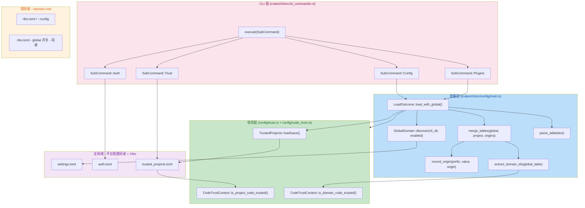
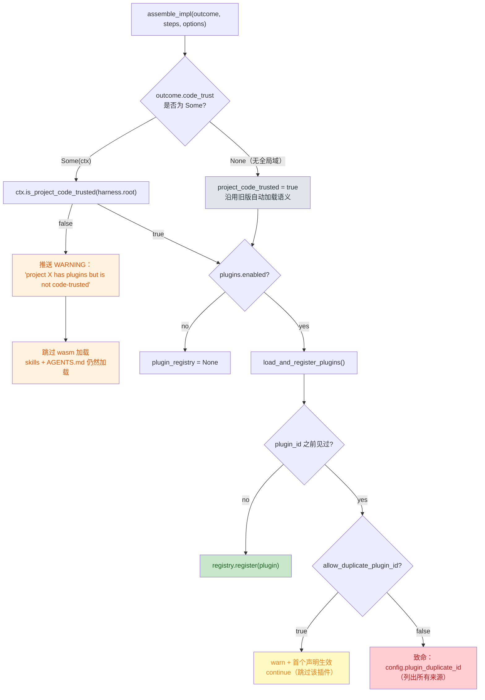
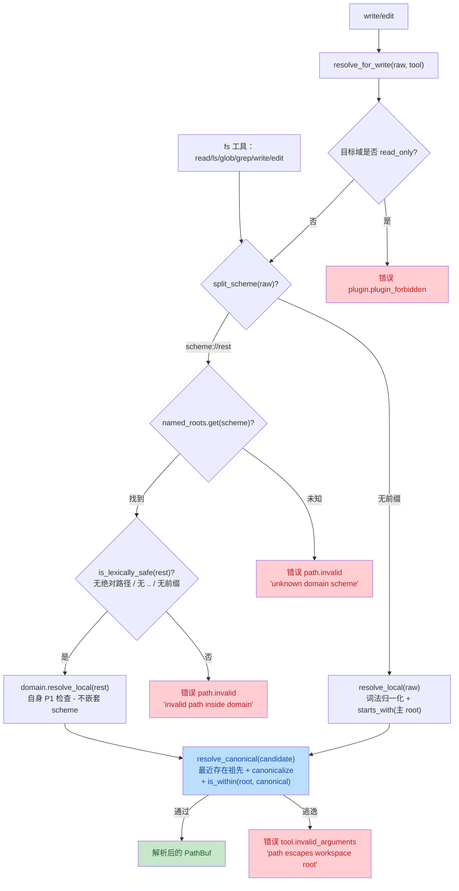
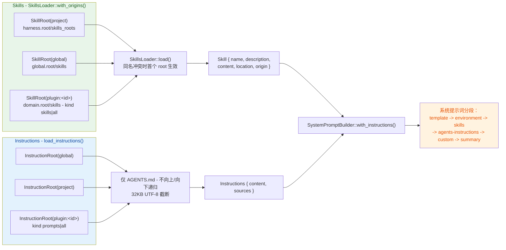

# 🔧 变更集评审摘要 — Ribo Agent "19_" 信任域实现

> 2026-11-19

> **变更范围**：对 Rust 工作空间（`ra-core`、`ra-cli`、`ra-harness`、`ra-tools`、`ra-plugins`、`ra-tui`）的一次**基础性架构变更**。引入**三层信任域模型**（项目域 / 全局域 / 插件域）与**两档信任等级**（文档级*配置信任* = 默认开启，可执行*代码信任* = 显式授予），外加带 `scheme://` 资源寻址的插件域、字段级配置来源追踪、凭证管理，以及一组一次性 CLI 子命令。

---

## 1. 高层摘要（TL;DR）

- **影响等级：🔴 高** —— 这是对 Rust 工作空间的一次**基础性架构变更**（`ra-core`、`ra-cli`、`ra-harness`、`ra-tools`、`ra-plugins`、`ra-tui`）。引入**三层信任域模型**（项目域 / 全局域 / 插件域）与**两档信任等级**（文档级*配置信任* = 默认开启，可执行*代码信任* = 显式授予），外加带 `scheme://` 资源寻址的插件域、字段级配置来源追踪、凭证管理，以及一组一次性 CLI 子命令。

- **关键变更：**
  1. ✨ **新增 `ra_core::path` 模块** —— 唯一权威的沙箱原语（`is_lexically_safe()`、`is_within()`、`resolve_in_domain()`）；CLI/tools 中所有此前的临时路径检查均重构为使用它。
  2. ✨ **新增信任门禁**（`crates/cli/src/config/trust.rs` + `code_trust.rs`）—— `trusted_projects.toml` 记录项目代码信任与插件域信任；项目**无法自签**信任（全局域声明 + 信任记录取 AND）。
  3. ✨ **新增全局域**（`GlobalDomain::discover()`、`LoadOutcome::load_with_global()`），支持递归字段级合并（`Global.settings.toml` ← `Project.ribo.toml` ← CLI）与逐字段来源追踪（`default/global/project/cli`）。
  4. ✨ **新增插件域**（`[[plugins.domains]]`）—— 绝对的、经验证的资源根目录，通过 `scheme://relative/path` 暴露给 fs 工具套件，并按域强制只读（`plugin.plugin_forbidden`）。
  5. ✨ **新增一次性子命令** —— `auth login|status|logout`、`trust add|remove|list`、`config --show-origin|--explain`、`plugins list`；在 REPL 组装**之前**执行。
  6. ✨ **新增 `AGENTS.md` 指令加载**（`ra_harness::instructions`）—— 仅精确文件名匹配、无递归（P2）、32 KB UTF-8 安全截断、全局 → 项目 → 插件顺序，注入为 `<agents-instructions>`。
  7. 🐛 **加固** —— fs 路径解析现在执行*物理*（基于 canonicalize）的包含性检查，封堵符号链接 / Windows junction 逃逸；跨来源重复 `plugin_id` 现在**默认致命**（逃生舱 `--allow-duplicate-plugin-id`）。
  8. 📦 新增依赖：`toml_edit = "0.23"`、`dirs = "6"`、`jiff`（CLI）、`toml`（plugins）。

---

## 2. 可视化概览（代码与逻辑地图）

### 2.1 三层配置合并与来源追踪

**优先级（最高者胜出）：** `CLI` → `Project`（`ribo.toml`）→ `Global`（`settings.toml`）→ 内置 `Default`。

### 2.2 代码信任门禁决策流程（Step 4 / §7.1）

### 2.3 插件域资源解析（`scheme://` 寻址）

### 2.4 三域资源聚合（Step 5）

---

## 3. 变更明细分析

### 3.1 `ra-core` —— 规范路径原语（新模块）

**组件：** `ra_core::path`（`crates/core/src/path.rs`）

**变更内容：**
- 新增域沙箱检查的**唯一权威实现**：词法拒绝 → `canonicalize` → `starts_with(canonical(domain_root))`。
- 词法谓词 `is_lexically_safe()` 额外拒绝 `Component::Prefix(_)` 与 `Component::RootDir` —— 这封堵了一个 **Windows 特有漏洞**：`/absolute/path` 的 `is_absolute()` 为 `false`，但其 `RootDir` 组件在 `join` 时会替换基路径。
- `is_within()` 是对 `starts_with` 的薄封装（有文档说明），要求两个操作数均已规范（canonicalized）。
- 新错误域 `path`，含三个稳定错误码。

| 错误码 | 严重级别 | 触发条件 |
| :--- | :--- | :--- |
| `path.invalid` | Error | 词法违规：空、绝对路径、`..`、Windows 前缀、根组件 |
| `path.escaped` | Error | `canonicalize` 结果落在规范域根之外（符号链接 / junction 逃逸） |
| `path.internal` | Critical | 域根不可读或候选路径无法规范（宿主 IO 失败） |

> 📌 **代码中记录的不变量：** 返回的路径已规范；调用方**不得**在其后追加 `..` 或相对片段。

**重构为使用它的调用方：** `config/mod.rs`（`tools.fs_root` 检查）、`config/assemble.rs`（`escapes_root()`、插件 manifest/来源路径、沙箱包含性）、`tools/builtin/fs/mod.rs`。

---

### 3.2 `ra-cli` 配置层 —— 全局域、合并、来源

**组件：** `crates/cli/src/config/mod.rs`、`config/origin.rs`（新增）

**变更内容：**

1. **`GlobalDomain::discover(cli_dir, enabled)`** —— 全局根解析顺序：`--global-dir` > 平台配置目录 + `/ribo`。**不做任何 IO 创建**；目录缺失则静默禁用该域（设计规则 R4 —— 非致命，不预先 mkdir）。

2. **`LoadOutcome::load_with_global(path, cli_root, global_dir)`** —— 新的 6 步管线：
   1. 读取**项目**表（`ribo.toml` / `--config`）。
   2. 从**项目**文件解析 `[global]`（global 开关*必须*放在项目配置里，因为此刻全局目录尚未确定）。
   3. 发现全局域（`None` ⇒ 禁用）。
   4. 读取 `Global/settings.toml`（文件缺失属正常；文件损坏 ⇒ 警告 + 忽略该层）。
   5. `merge_tables()` —— 递归逐字段合并 + `record_origin()`。
   6. 从 `Global/trusted_projects.toml` 构建 `CodeTrustContext`。

3. **`LoadOutcome::load()`** 保留为**兼容入口**（不做全局发现、`origins` 恒为空、`code_trust` 恒为 `None`），现有测试 / 嵌入方保持 v1 行为。

4. **合并语义**（`merge_tables`）：两侧均为子表 ⇒ **递归合并**（因此项目里只写 `max_retries` 的 `[retry]` 不会抹掉全局的 `initial_backoff_ms`）；否则项目整体覆盖；数组按整体值处理；TOML 没有 `null`，故"删除键 = 未设置 = 继承"。

| 合并场景 | 结果 | 记录的来源 |
| :--- | :--- | :--- |
| 键仅在全局 | 继承 | `global` |
| 键仅在项目 | 采用 | `project` |
| 两侧都有，同类型 | 项目胜出 | `project` |
| 两侧都有，子表 | **递归**逐叶子合并 | 按叶子 |
| `--root` CLI 覆盖 | CLI 胜出 | `cli` |
| 两侧都没有 | Schema `Default` | `default`（隐式） |

5. **`ConfigOrigin` / `ConfigOrigins`**（`config/origin.rs`）—— 以字段路径为键（`harness.root`、`retry.max_retries`）的并行元数据，刻意**不是**对 7 个 schema 结构体的包装类型（对下游零侵入）。未记录的字段隐式解析为 `Default`，因此零配置场景无需显式条目。`BTreeMap` ⇒ `--show-origin` 输出按序确定。

> ⚠️ **已注明的缺口：** `ribo config --explain` 被文档描述为 `--show-origin` 的*超集*（"带冲突解释"），但 `execute_config()` 对两个标志的实现完全一致（`*show_origin || *explain`）—— **实际上并未产出任何冲突解释**。

---

### 3.3 `ra-cli` 信任层 —— 代码信任与域信任

**组件：** `crates/cli/src/config/trust.rs`（新增）、`crates/cli/src/config/code_trust.rs`（新增）

**变更内容：**

- **`TrustedProjects`** 封装 `toml_edit::DocumentMut`，保证用户手写注释在每次 add/revoke/list 操作中**幸存**。写入为原子操作（临时文件 + `rename`）。
- 持久化两类信任记录。

| 文件 | 表 | 字段 | 类型 | 含义 |
| :--- | :--- | :--- | :--- | :--- |
| `trusted_projects.toml` | `[projects."<path>"]` | `code_trust` | bool | 项目可加载可执行（`.wasm`）插件 |
| | | `trusted_at` | RFC3339 字符串 | 授予时间戳 |
| | | `trusted_by` | 字符串 | `"user"` |
| | | `note` | 字符串 | 用户自由备注 |
| `trusted_projects.toml` | `[plugin_domains.<id>]` | `trusted` | bool | 域的插件可被信任 |
| | | `trusted_at` | RFC3339 字符串 | 授予时间戳 |

- **`CodeTrustContext`** 实现**合取**规则：
  - `is_project_code_trusted(project_root)` ⇒ 仅查信任记录。
  - `is_domain_code_trusted(domain_id)` ⇒ **全局域声明 AND 信任记录**。在自身 `ribo.toml` 中声明 `trusted = true` 的项目**永远不会**被信任（`is_domain_code_trusted` ⇒ `false`），并产生 `tracing::warn!`。
  - `is_global_domain(domain_id)` ⇒ 来源检查，用于自签警告。
- **回滚开关：** 当**不存在全局域**时，`code_trust` 为 `None`，组装层退化为旧版自动加载行为 —— 零配置部署不受影响。
- `normalize_project_key()` 使用 `Path::to_string_lossy()`（平台原生形式），**不做大小写折叠**，刻意把大小写敏感性留给文件系统。

> ⚠️ **观察：** `is_domain_code_trusted()` 目前**已定义并做单元测试，但组装层尚未消费** —— 按域的插件代码信任尚未端到端强制执行。同样，`add_plugin_domain()` / `revoke_plugin_domain()` / `remove_plugin_domain()` / `plugin_domains()` **没有任何 CLI 入口**（`trust` 子命令目前只管理项目）。

---

### 3.4 `ra-cli` Schema —— 插件域与全局层

**组件：** `crates/cli/src/config/schema.rs`

**变更内容：**

- 新增 `GlobalSchema { enabled: bool = true, dir: Option<PathBuf> }`。
- 新增 `PluginsSchema.domains: Vec<PluginDomainSchema>`（默认为空 —— 零配置兼容）。
- 新增 `PluginDomainKind` 枚举（`plugins | skills | prompts | data | all`），serde 名全小写。
- 新增 `PluginDomainSchema`，其 `is_read_only()` → 显式 `read_only` 优先，否则 `kind == Data`。
- 新增 `is_valid_domain_id()` —— 纯 std 实现 `^[a-z][a-z0-9_]{0,31}$`（未引入 regex 依赖）。

| `[[plugins.domains]]` 字段 | 类型 | 必填 | 默认 | 校验 |
| :--- | :--- | :--- | :--- | :--- |
| `id` | 字符串 | ✅ | — | `^[a-z][a-z0-9_]{0,31}$`，**在所有域间唯一** |
| `root` | 路径 | ✅ | — | **必须绝对**、必须存在、必须是目录 |
| `kind` | 枚举 | ✅ | — | `plugins`/`skills`/`prompts`/`data`/`all` |
| `read_only` | bool | ❌ | `data` 为 `true`，其余 `false` | 显式值覆盖 kind 默认 |
| `trusted` | bool | ❌ | `false` | **仅在全局域中声明时生效** |

**致命校验错误码**（在组装期抛出 —— P3"启动即致命"）：`config.domain_conflict`（无效/重复 id）、`config.plugin_domain_invalid`（root 非绝对 / 缺失 / 不是目录）。

---

### 3.5 `ra-cli` 组装层 —— 域、门禁、重复 ID

**组件：** `crates/cli/src/config/assemble.rs`

**变更内容：**

1. **新增 `AssembleOptions { allow_duplicate_plugin_id: bool }`**，三个入口共享同一实现（`assemble_impl`）：`assemble()`、`assemble_with_steps()`、`assemble_with_options()`。

2. **`validate_plugin_domains()`** —— 校验 id 合法性/唯一性、记录自签 `trusted` 警告、强制 root 绝对 + 存在 + 是目录。

3. **`build_named_roots()`** —— 创建主 `FsRoot`，并为每个域创建一个 `FsRoot::named(id, root, read_only)`；经新的 `register_builtin_with_root()` 注入 fs。

4. **代码信任门禁**（见图 2.2）—— 仅跳过 *wasm 插件加载*；skills 与 `AGENTS.md` 继续加载（设计规则 P4 —— 域故障隔离）。

5. **跨来源 `plugin_id` 冲突检测** —— `HashMap<plugin_id, source>` 记录首次出现来源。默认冲突为**致命**（`config.plugin_duplicate_id`），错误信息列出**每一个**冲突来源，并提示 `--allow-duplicate-plugin-id`。`PluginSpec` 新增 `source: String` 字段（`"plugin root '<path>'"` / `"plugin entry '<path>'"`），纯粹用于诊断。

6. **三域 skill 聚合** —— skill 根现为 `SkillRoot` 结构体，按**项目 → 全局 → 插件\***（声明顺序）排列，利用 `SkillsLoader` 的"同名冲突时首个 root 生效"规则。

7. **指令聚合** —— `InstructionRoot` 列表按**全局 → 项目 → 插件\***（声明顺序）排列；来自 `prompts`/`all` 域的 `AGENTS.md` 被纳入。截断通过 `eprintln!` 上报（不只是日志）。

8. **路径检查统一** —— `escapes_root()` 现委托给 `is_lexically_safe()`；沙箱包含性使用 `is_within()`。

---

### 3.6 `ra-harness` —— 指令、Skill 来源、系统提示词

**组件：** `crates/harness/src/instructions.rs`（新增）、`skills.rs`、`system_prompt.rs`

**变更内容：**

- **`load_instructions(&[InstructionRoot])`** —— 严格加载策略：
  - 只认**精确**文件名 `AGENTS.md`（不认 `agents.md`、`CLAUDE.md`、`AGENTS.txt`）。
  - **只读域根下的单文件** —— 不向上递归（`root/../AGENTS.md`），也不向下递归（`root/sub/AGENTS.md`）。这被标注为与 pi-agent 的*关键差异（P2）*。
  - 拼接顺序为全局 → 项目 → 插件\*，每段前缀 `<!-- source: <origin> (<path>) -->`；矛盾**不**自动消解。
  - 单文件 **32 KB** 上限，**UTF-8 字符边界安全**截断（`truncate_utf8`），且模型可见正文**不**注入 `... [truncated]` 标记。
  - 读取失败静默跳过（仅警告日志）—— 域故障隔离。
- **`AGENTS.md` 是文档级资源 ⇒ 默认加载，与代码信任无关。**
- **`Skill` 新增必填 `origin: String`** 字段（`project` / `global` / `plugin:<id>`）；`SkillsLoader::new()` 保留旧签名并将所有 root 标为 `project`；`SkillsLoader::with_origins()` 是多域构造器。
- **`SystemPromptBuilder::with_instructions()`** 注入 `<agents-instructions>` 分段（提示词第 3.5 段：template → environment → skills → **agents-instructions** → custom → summary）。skill 列表 XML 现携带 `origin="..."` 属性。

---

### 3.7 `ra-tools` —— 命名根、`scheme://`、只读强制

**组件：** `crates/tools/src/builtin/fs/mod.rs`、`write.rs`、`edit.rs`、`builtin/mod.rs`、`error.rs`

**变更内容：**

- **`FsRoot` 现携带 `named_roots: HashMap<String, FsRoot>`、`read_only: bool` 与 `domain_id: String`。** `FsRoot::named(domain_id, root, read_only)` 构造隔离根；每个命名根接受**完整的 P1 校验**，且**无法触及另一个域**（嵌套 scheme 不再派发）。
- **`resolve(raw)`** 按 `scheme://` 分派；未知 scheme 或域内不安全路径 ⇒ `path.invalid`。
- **`resolve_for_write(raw, tool_name)`** —— `write` 与 `edit` 使用的新门禁；只读域（`kind = "data"`）⇒ `plugin.plugin_forbidden`。
- **`resolve_canonical(candidate)`** —— 新增的**物理包含性**步骤。它用 `symlink_metadata` 向上走到**最近存在的祖先**（因此符号链接本身算作*存在*，这正是逃逸向量所在），规范该祖先，经 `is_within()` 验证包含性，再重新拼接缺失的尾部。这让 `write` 可以创建新文件（目标无需已存在），同时仍拒绝符号链接/junction 逃逸。
- **新增错误码** `plugin.plugin_forbidden`，属 `plugin` 错误域，在 `ra-tools` 中以字面量 `"plugin"` 域字符串定义，以**避免对 `ra-plugins` 的循环 crate 依赖**。
- **新增构造器** `builtin_tools_with_root(fs_root)` 与 `register_builtin_with_root(manager, fs_root)`；旧版 `builtin_tools(&Path)` 保留。

> ⚠️ **需要标注的行为变更：** `resolve()` 此前只做**词法**包含性检查。现在，穿越沙箱内符号链接的路径会被**拒绝**。这是有意的安全修复，但对工作区内合法存在内部符号链接的用户，可能表现为回归。

---

### 3.8 `ra-plugins` —— TOML 可信密钥白名单

**组件：** `crates/plugins/src/provenance.rs`

**变更内容：**

- 为可信公钥白名单新增**第二个入口**：`TrustedKeys::from_toml_str()` / `to_toml_string()`，供全局域的 `trusted_keys.toml` 使用，与既有的 JSON 入口（用于来源信任材料）并存。
- 新格式常量 `KEY_ALGO_ED25519 = "ed25519"`。`algo` 字段为**可选**；若存在则必须等于 `ed25519`（其他值在解析期以 `plugin.plugin_signature_invalid` 拒绝）；缺省时默认 `ed25519`，向前兼容。
- 签名验证本身**未改动**（C3 —— 基于 ring 的实现零变更）。
- 共享校验助手 `key_from_hex()` 现同时支撑 JSON 与 TOML 两个入口（非空 id、64 位十六进制公钥、恰好 32 字节）。

| `[[keys]]` 字段 | 类型 | 必填 | 默认 | 校验 |
| :--- | :--- | :--- | :--- | :--- |
| `id` | 字符串 | ✅ | — | 非空 |
| `algo` | 字符串 | ❌ | `ed25519` | 仅接受 `ed25519` |
| `public_key` | 十六进制字符串 | ✅ | — | 恰好 64 个十六进制字符（32 字节） |

---

### 3.9 CLI / TUI 入口 —— 标志、子命令、信任门禁

**组件：** `crates/cli/src/main.rs`、`crates/cli/src/cli_commands.rs`（新增）、`crates/tui/src/main.rs`、`crates/tui/src/trust_gate.rs`（新增）

**变更内容：**

- **新增全局标志**（两个二进制均有）：`--global-dir <PATH>`、`--allow-duplicate-plugin-id`。
- **新增一次性子命令** —— 在 REPL 组装*之前*分派，打印输出后退出。**不带子命令时行为完全不变**（直接启动 REPL）。

| 命令 | 动作 | 涉及文件 | 备注 |
| :--- | :--- | :--- | :--- |
| `ribo auth login <provider> [--api-key KEY]` | 设置 API key | `Global/auth.toml` | 省略标志时从 **stdin** 读取 key；空输入 ⇒ `config.auth_key_invalid` |
| `ribo auth status` | 列出已配置 provider | `Global/auth.toml` | **绝不打印 key 值** |
| `ribo auth logout <provider>` | 移除 provider | `Global/auth.toml` | 不存在时输出 no-op 提示 |
| `ribo trust add <path> [--note NOTE]` | 授予项目代码信任 | `Global/trusted_projects.toml` | |
| `ribo trust remove <path>` | 撤销代码信任（置 `false`，保留条目 + 注释） | `Global/trusted_projects.toml` | |
| `ribo trust list` | 列出所有信任记录 | `Global/trusted_projects.toml` | |
| `ribo config --show-origin` | 逐字段来源域报告 | 合并后配置 | 未列出的字段为 `default` |
| `ribo config --explain` | *文档声称的*超集 | 合并后配置 | ⚠️ 目前与 `--show-origin` 完全相同 |
| `ribo plugins list` | 两段式列表：插件条目 / 插件域 | 合并后配置 | 域按来源标注 `global` vs `project` |

- **`resolve_or_create_global_root()`** —— 与 `GlobalDomain::discover()` 不同，它会**创建**目录（`create_dir_all`），依据是显式用户子命令的"首次使用即创建"（设计规则 D1）。
- **`AuthConfig`**（`config/credentials.rs`）—— 基于 `toml_edit`、保留注释的凭证存储。Unix 上首次创建为 **`0600`**；重写时保留原文件模式；写入为原子操作（临时文件 + rename）。**日志中绝不出现 token 值** —— 只记录 provider id 与结果。provider 表中出现 `null`-类 / 不支持的值类型，在加载时以 `config.auth_invalid` 拒绝。
- **TUI 信任门禁**（`crates/tui/src/trust_gate.rs`）—— 在 ratatui 主循环*之前*执行的**裸模式单键** y/N 询问（刻意与键盘任务 / 覆盖层状态机解耦，后者服务于 REPL 会话而非启动门禁）。`y`/`Y` ⇒ 写入信任记录并**重载配置**使新信任生效；`n`/`N`/`Enter` ⇒ 拒绝，跳过插件，启动继续；裸模式或 IO 错误降级为"拒绝"，应用仍启动。

---

### 3.10 支撑 / 文档变更

| 文件 | 变更 |
| :--- | :--- |
| `Cargo.toml`（workspace） | `+ toml_edit = "0.23"`、`+ dirs = "6"` |
| `crates/cli/Cargo.toml` | `+ toml_edit`、`+ jiff`、`+ dirs`（均 workspace） |
| `crates/plugins/Cargo.toml` | `+ toml`（workspace） |
| `crates/core/src/lib.rs` | `+ pub mod path`（crate 文档：3 → 4 个基础设施模块） |
| `crates/harness/src/lib.rs` | `+ pub mod instructions`；re-export `InstructionRoot`、`Instructions`、`MAX_AGENTS_BYTES`、`load_instructions`、`SkillRoot` |
| `crates/cli/src/lib.rs` | `+ pub mod cli_commands` |
| `crates/cli/src/app.rs`、`crates/tui/src/app.rs` | `/skills` 输出现在显示来源：`skill: <name>（来自项目 / 来自全局 / 来自插件域 <id>）` |
| `ribo_example.toml` | 补充 `[global]` 块与 `[[plugins.domains]]` 块的文档 |
| `README.md` / `README.en.md` | 新章节"三层信任域与两档信任" / "Three Trust Domains and Two Trust Tiers"、新标志、子命令参考 |
| `AGENTS.md` | 新增"文档"章节（中文文档、Markdown 规范） |
| `internals/git-hook/build.rs` | ⚠️ `monk::init()` 与 workspace 根的 `set_current_dir` 被**注释掉** —— 与信任域工作无关；疑似本地调试遗留，应恢复或说明 |

---

## 4. 影响与风险评估

### 4.1 ⚠️ 破坏性变更 / API 断裂

| # | 变更 | 影响 | 缓解 |
| :--- | :--- | :--- | :--- |
| 1 | `LoadOutcome` 新增公开字段 `origins: ConfigOrigins` 与 `code_trust: Option<CodeTrustContext>` | 对任何下游结构体字面量构造是**编译断裂** | 仓库内所有调用点已更新；外部消费者必须补齐这两个字段 |
| 2 | `Skill` 新增**必填** `origin: String` 字段 | 对下游 `Skill { .. }` 字面量是**编译断裂** | 同上 |
| 3 | `PluginsSchema` 新增字面量必填的 `domains: Vec<PluginDomainSchema>` | 对下游字面量是**编译断裂** | 同上 |
| 4 | `SkillsLoader::roots` 由 `Vec<PathBuf>` 改为 `Vec<SkillRoot>` | 内部类型变更；`new()` 签名保留 | 多域场景用 `with_origins()` |
| 5 | `assemble()` 内部改为 `assemble_impl()`；新增 `assemble_with_options()` | 公开 API 新增，无移除 | — |
| 6 | `CliArgs` 现接受**位置子命令** | ⚠️ `ribo <意外的位置参数>` 现以 clap 错误失败，而不再被忽略 | 已文档化；`command` 为 `Option<SubCommand>` |
| 7 | 跨来源重复 `plugin_id` 现在启动时**致命** | ⚠️ 对插件 id 冲突的用户是运行时行为断裂 | `--allow-duplicate-plugin-id` 逃生舱（warn + 首个声明生效） |
| 8 | `FsRoot::resolve()` 现执行**物理** canonicalize 包含性检查 | ⚠️ 此前可用的穿越符号链接的路径现在以 `path escapes workspace root` 失败 | 有意的安全修复；错误信息保持稳定 |
| 9 | `read_only` 域以 `plugin.plugin_forbidden` 拒绝 `write`/`edit` | `tools` crate 向 `plugin` 域输出的新错误码 | 非 `data` kind 的域 `read_only` 默认 `false` |
| 10 | 新依赖 `toml_edit 0.23`、`dirs 6`、`jiff` | 供应链 / MSRV 面 | `jiff` 仅加入 CLI crate |

### 4.2 🔐 安全态势（净正向）

- ✅ **自签信任不可能** —— 项目无法给自己授予代码信任；`CodeTrustContext` 强制执行"全局域声明 ∧ 信任记录"。
- ✅ fs 工具套件中的**符号链接 / Windows junction 逃逸**已封堵（此前仅有词法检查）。
- ✅ **凭证文件加固** —— Unix 上 `0600`、原子写入、注释保留，且**日志无任何密钥值**。
- ✅ **Windows 特有绝对路径漏洞**（`/absolute/path` 的 `is_absolute() == false`）经 `RootDir` 组件检查封堵。
- ✅ **`AGENTS.md` 不向上/向下递归**，防止来自父目录的指令注入。
- ⚠️ **残余风险：** 插件域*代码*信任（`is_domain_code_trusted`）已实现但组装期**尚未强制** —— `kind = "plugins"` 的域尚未被门禁。

### 4.3 🧪 测试建议

**信任门禁（`crates/cli/tests/code_trust_gate.rs`）**
1. 未受信项目带插件 ⇒ `plugin_registry.is_none()`、`loaded_plugins` 为空、警告包含 `"not code-trusted"`，且**从不触碰缺失的 `.wasm`**。
2. 受信项目 ⇒ 尝试加载，缺失 wasm 仍为**致命**（`plugin_file_missing`）—— 门禁不得掩盖真实加载错误。
3. `code_trust == None`（无全局域）⇒ 旧版自动加载，缺失 wasm 仍致命。

**插件域（`crates/cli/tests/plugin_domains.rs`）**
4. 相对 root、root 缺失 ⇒ `config.plugin_domain_invalid`；重复 id ⇒ `config.domain_conflict`；合法域 ⇒ 干净组装。
5. `[[plugins.entries]]` 与 `[[plugins.domains]]` 在同一 TOML 中共存。

**fs 沙箱（`crates/tools/src/builtin/fs/mod.rs` 测试）**
6. `dataset://a.txt` 在域内解析；`ghost://a.txt` ⇒ `path.invalid`；`dataset://../etc/passwd`、`dataset:///absolute`、`dataset://`（空）均 ⇒ `path.invalid`。
7. 只读域写入 ⇒ `plugin.plugin_forbidden`；可写域与无前缀的主根路径仍成功。
8. 符号链接逃逸（Unix `symlink` / Windows `mklink /J`）⇒ `tool.invalid_arguments`，且带**稳定消息** `"path escapes workspace root"`。
9. 新文件创建（`write` 到不存在路径）仍经最近存在祖先解析。

**配置合并与来源（`crates/cli/src/config/mod.rs` 测试）**
10. 全局 `[retry] max_retries=9, initial_backoff_ms=123` + 项目 `[retry] max_retries=3` ⇒ 最终 `max_retries=3` **且** `initial_backoff_ms=123` 保留，逐字段来源为 `project` / `global`。
11. `--root` 覆盖 ⇒ 来源 `cli`。
12. 全局目录缺失 ⇒ 项目配置仍加载，无全局相关警告。

**指令（`crates/harness/src/instructions.rs`）**
13. 不向上递归、不向下递归、文件名变体拒绝（`CLAUDE.md`、`AGENTS.txt`）、全局先于项目的顺序与 `<!-- source: ... -->` 标注、CJK 字符串的 UTF-8 边界截断。

**子命令（`crates/cli/src/cli_commands.rs`）**
14. `trust add` → `trust list` → `trust remove` 往返；`auth login` → `status` → `logout`；`plugins list` 两段式输出；零配置下的 `config --show-origin`。

**建议补充的场景（当前未覆盖）**
- ⚠️ `ribo trust add ./relative/path` vs `ribo trust add /abs/path` —— **路径键未做规范（canonicalize）**，别名路径将无法匹配信任记录。请验证并考虑对信任键做规范化。
- ⚠️ `config --explain` 目前不产出任何冲突解释 —— 请确认是否有意为之。
- ⚠️ `internals/git-hook/build.rs` —— 确认被注释掉的 `monk::init()` 是有意的，而非本地调试遗留。
- ⚠️ Windows CI：在启用开发者模式的情况下运行 fs 符号链接/junction 测试（当前链接创建不可用时**静默跳过**）。

---

## 5. 评审人清单

- [ ] **无全局域回滚路径**（`code_trust == None` ⇒ 自动加载）对生产安全态势是否可接受？
- [ ] 是否应现在就把 `is_domain_code_trusted()` 接入组装路径，还是有意延后？
- [ ] 信任记录键是否应规范化（`fs::canonicalize`）以防路径别名绕过？
- [ ] `--explain` 标志文档声称的行为（冲突解释）是否为本变更所需，还是应修正文档以匹配实现？
- [ ] 确认 `internals/git-hook/build.rs` 的注释化是刻意的。
- [ ] 确认 `toml_edit 0.23` / `dirs 6` / `jiff` 满足 workspace MSRV 与许可政策。
