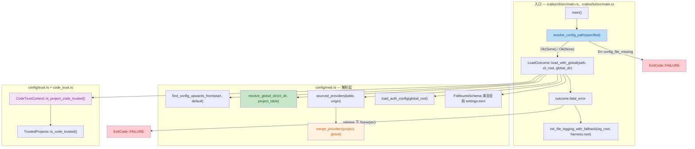
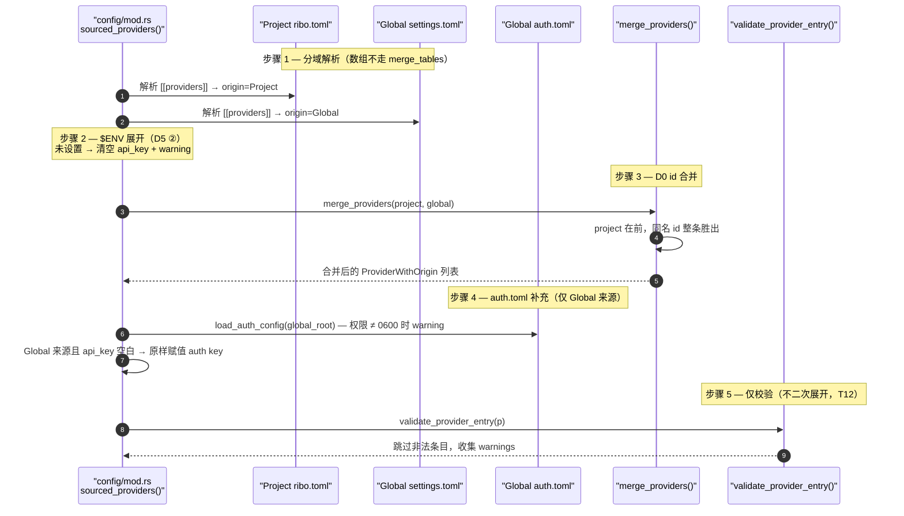
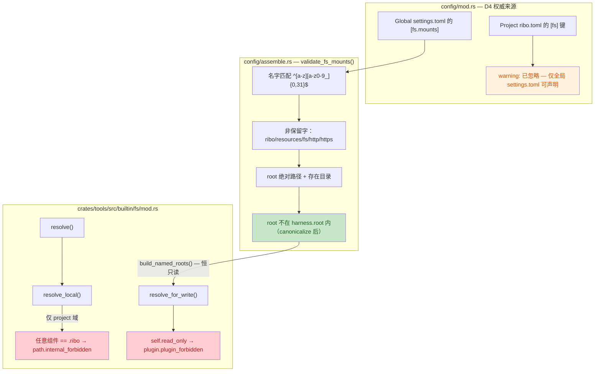
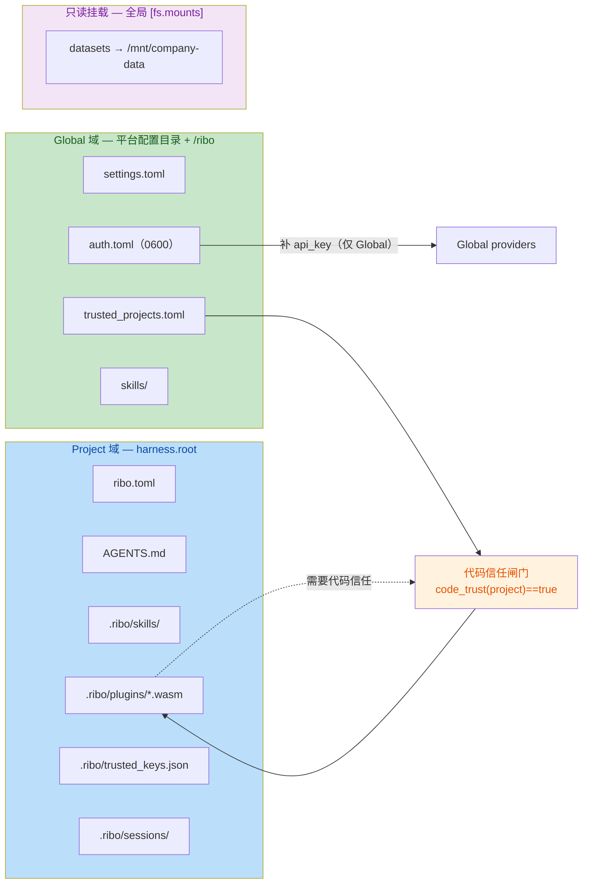

# 🔄 变更集评审摘要 — Ribo Agent v3 架构硬切换

> **日期**：2026-11-21
> **变更范围**：对 Rust 工作空间的一次**破坏性硬切换重构**——移除第三信任域（插件域），项目内部产物全部收敛到 `.ribo/`，重写配置解析与 provider 凭证取值链路，并引入 release 构建致命错误（D7）。

---

## 1. 高层摘要（TL;DR）

- **影响等级：🔴 高** —— 这是对 Rust 工作空间的一次**破坏性硬切换重构**：移除第三信任域（插件域），项目内部产物全部迁入 `.ribo/`，重写配置解析与 provider 凭证取值，并引入 release 构建致命错误。

- **关键变更：**
  1. 🗑️ **插件域移除** —— `[[plugins.domains]]`、`PluginDomainKind`、`PluginDomainSchema` 及全部插件域信任 API 删除。替代方案为**仅全局声明的只读 `[fs.mounts]`**。
  2. 📁 **`.ribo/` 内部目录** —— sessions → `.ribo/sessions/`、skills → `.ribo/skills/`、插件扫描 → `.ribo/plugins/`、信任公钥 → `.ribo/trusted_keys.json`。旧布局**不读取、不迁移**。
  3. 🔐 **Provider 凭证取值（Step 8）** —— `[[providers]]` 跨 Global/Project 按 `provider_id` 合并；Global 来源可从 `auth.toml` 补 key；**Project 来源永远不从 auth.toml 取值**。
  4. 🧭 **新配置解析（D2/D7）** —— 显式 `--config` 指向缺失文件 → 致命 `config.config_file_missing`；向上探测 `ribo.toml`；四档工作目录优先级；release 构建把 mock 模式降级改为**致命错误**。
  5. 🛡️ **沙箱加固** —— fs 工具禁止访问整个 `.ribo` 子树（`path.internal_forbidden`）；挂载根必须位于工作目录**之外**；挂载名受保留字保护。
  6. 📚 **新增 mdBook 文档** —— 新建 `docs/` 站点（11 章，中文）+ 重写 `README.md` / `README.en.md` / `ribo_example.toml`。

---

## 2. 可视化概览（代码与逻辑地图）

### 2.1 启动与配置解析

### 2.2 Provider 凭证取值链路（Step 8 / D0 / D5 / G2）

### 2.3 fs 沙箱与只读挂载（D3 / D4）

### 2.4 两级信任域（v3 之后）

---

## 3. 详细变更分析

### 3.1 🧭 配置解析 — `crates/cli/src/config/mod.rs`

**变更内容：**

- **`resolve_config_path()` 签名变更**：`Option<PathBuf>` → `RiboResult<Option<PathBuf>>`：
  - 显式 `--config <PATH>` 缺失 / 非普通文件 → **硬错误** `config.config_file_missing`（此前静默降级 mock 模式）。
  - 未指定 → 通过新的 `find_config_upwards_from(start, default)` **向上探测**：从 cwd 逐级向上，遇到含 `.git` 的目录即停，取第一个 `ribo.toml` 命中。
- **`resolve_global_dir(cli_dir, project_table)`** —— 全局目录的*唯一真值*，读端（`load_with_global`）与写端（`cli_commands::resolve_or_create_global_root`）共用。

| 优先级 | 来源 | 说明 |
| :-- | :--- | :--- |
| 1 | `--global-dir` CLI 参数 | 恒胜出 |
| 2 | 项目 `[global].dir` | 此前*写端*忽略该值——现已遵循 |
| 3 | 平台配置目录 + `/ribo` | `dirs::config_dir()` |

- **D2 —— 四档工作目录优先级**现在驱动 `harness.root`：

| 档位 | 来源 | origins 标记 |
| :-- | :--- | :--- |
| 1 | `--root` CLI 参数 | `Cli` |
| 2 | 配置文件中的 `[harness].root` | `Project` |
| 3 | 已解析配置文件的父目录（或向上探测命中目录） | `Project` |
| 4 | cwd（`.`） | `Default` |

- **D7 —— release 构建严格化。** 此前三类 mock 降级场景在 `#[cfg(not(debug_assertions))]` 构建下改为设置 `LoadOutcome::fatal_error`：

| 条件 | 错误码 |
| :--- | :--- |
| 未配置 provider | `no_providers_in_release` |
| 检测到占位配置 | `placeholder_in_release` |
| provider 跳过后 query_model 悬空 | `query_model_unavailable_in_release` |

> Debug 构建保留旧 mock 降级；`main.rs` / `tui/main.rs` 现检查 `outcome.fatal_error` 并以 `ExitCode::FAILURE` 退出。

### 3.2 🔐 Provider 凭证取值 — `config/mod.rs` + `schema.rs`

**变更内容：**

- `ProviderEntry.api_key` 改为 `#[serde(default)]` —— **允许为空**（Global 来源可从 `auth.toml` 补值）。
- 新增 `ProviderWithOrigin { entry, origin }`（pub(crate)），为每条 provider 打上 `ConfigOrigin::Project` / `Global` 标签。
- 新增 `schema::providers_from_table(table)` 按域解析 `[[providers]]`（单条非法条目静默跳过）。
- **`merge_providers()`（D0）** 取代 `merge_tables` 原先对数组的整体覆盖：

| 规则 | 行为 |
| :--- | :--- |
| 排序 | Project 在前（声明序），Global 追加在后 |
| 同 `provider_id` | **Project 条目整条胜出** —— 不从 Global 继承任何字段（`base_url`/key 不渗透） |
| 不同 `provider_id` | 两者共存 |
| `RIBO_PROVIDERS_MERGE_MODE=array_overwrite` | 旧语义逃生舱 —— Project 非空则整体替换 Global |
| 未知 mode 值 | warning，回退 id 合并 |

- **凭证优先级（D5 / G2）：**

| 来源 | `$ENV` 占位 | `auth.toml` | 结果 |
| :--- | :--- | :--- | :--- |
| **Global** | 解析期展开 | key 空白时使用 | Global 显式值胜过 auth.toml |
| **Project** | 解析期展开 | **永不读取** | Project 必须显式声明 key |

- `auth.toml` 的值**原样赋值**（字面 `"$FOO"` *不*展开 —— T12）。相应地 `validate_provider_entry()` 不再调用 `expand_api_key()`，杜绝二次展开。
- `load_auth_config()` 在 Unix 权限 ≠ `0600` 时 warning（不打印完整路径，避免泄露用户名）；文件损坏 → warning + 空集，非致命。
- `origins` 现按条目记录 `providers.<id>`，外加兼容键 `providers`（取第一条的来源）——仅在全局感知入口记录。

### 3.3 🛡️ fs 挂载与沙箱 — `config/assemble.rs` + `crates/tools/src/builtin/fs/mod.rs`

**变更内容：**

- `validate_plugin_domains()` → **`validate_fs_mounts()`**，返回 `Vec<(String, PathBuf)>`：

| 校验 | 失败码 |
| :--- | :--- |
| 名字匹配 `^[a-z][a-z0-9_]{0,31}$` | `config.mount_invalid` |
| 名字不在保留字清单（`ribo`、`resources`、`fs`、`http`、`https`） | `config.mount_invalid` |
| root 绝对路径**且**存在且是目录 | `config.mount_invalid` |
| root（canonicalize 后）**不在** `harness.root` 内 | `config.mount_invalid` |

> 「必须在工作目录外」规则的存在原因：否则 `internal://trusted_keys.json` 会绕过 `.ribo` 黑名单。

- **所有挂载无条件只读**（`FsRoot::named(name, root, true)`）。
- **`FsRoot::resolve_for_write()` 新增自守卫** —— `read_only` 根即使调用方跳过 scheme 分派也拒绝写入（纵深防御）。
- **`resolve_local()` 新增 `.ribo` 黑名单** —— 仅对 `project` 域生效，路径含 `.ribo` 组件即 `path.internal_forbidden`（挡住信任公钥、会话、插件的访问）。具名挂载域豁免（用户自己声明）。
- 挂载点**仅**从全局 `settings.toml` 解析；项目配置出现 `[fs]` 键 → warning *「declared in project config is ignored」*。

### 3.4 🗑️ 移除的概念 —— schema、信任、装配

| 移除项 | 位置 | 替代 |
| :--- | :--- | :--- |
| `PluginsSchema.roots` | `config/schema.rs` | 固定扫描目录 `.ribo/plugins`（目录缺失 = 软跳过，非致命） |
| `PluginsSchema.domains` | `config/schema.rs` | `FsMountsSchema.mounts`（仅全局） |
| `PluginDomainKind` / `PluginDomainSchema` | `config/schema.rs` | ——（删除） |
| `ToolsSchema.fs_root` | `config/schema.rs` | 沙箱根 == `harness.root` |
| `HarnessLayerSchema.skills_roots` | `config/schema.rs` | 固定 `.ribo/skills/` |
| `PluginVerifySchema.trusted_keys` | `config/schema.rs` | 固定 `.ribo/trusted_keys.json` |
| `PluginDomainTrust`、`is_plugin_domain_trusted()`、`plugin_domains()`、`add_plugin_domain()`、`revoke_plugin_domain()`、`remove_plugin_domain()` | `config/trust.rs` | ——（删除） |
| `CodeTrustContext::is_domain_code_trusted()`、`is_global_domain()` | `config/code_trust.rs` | ——（删除） |
| `CodeTrustContext::new(trust, global_domain_ids)` | `config/code_trust.rs` | `CodeTrustContext::new(trust)` |
| `TrustedKeys::from_toml_str()`、`to_toml_string()` | `crates/plugins/src/provenance.rs` | JSON-only 信任清单 |
| `toml` 依赖 | `crates/plugins/Cargo.toml` | 已移除 |

**值得注意的行为副作用：**

- 插件域的技能根（`kind = "skills"`）与指令根（`kind = "prompts"`)**不再并入** —— 仅剩 **Project `.ribo/skills/` > Global `skills/`** 两级。
- `plugins.verify.trusted_keys` 错误现区分 **`plugin_trusted_keys_missing`**（文件不存在）与 **`plugin_trusted_keys_unreadable`**（权限 / IO 故障）。
- `.ribo/plugins` 扫描目录缺失现为**非致命**（此前配置的缺失 root 为 `plugin_dir_unreadable` → 致命）。
- 会话硬切换到 `<root>/.ribo/sessions`（新 `sessions_dir()` 辅助函数）——**旧 `<root>/sessions` 既不读取也不迁移**。

### 3.5 🖥️ 入口、日志与 CLI 命令

| 文件 | 变更 |
| :--- | :--- |
| `crates/cli/src/main.rs` | 处理 `resolve_config_path` 错误 → `配置路径错误` + `FAILURE`；检查 `outcome.fatal_error`；使用 `init_file_logging_with_fallback(&outcome.log_root(), &outcome.harness.root)`；把 mode/providers/warnings 补记进日志文件（订阅器在配置加载之后才存在）。 |
| `crates/tui/src/main.rs` | 同样的致命错误 + 兜底日志处理；trust-gate 插件计数仅取 `entries.len()`。 |
| `crates/cli/src/logging.rs` | **新增** `init_file_logging_with_fallback(preferred, fallback)` —— 先试全局目录，失败回退项目目录并 stderr 提示；两者都失败才报错。 |
| `crates/cli/src/cli_commands.rs` | `resolve_or_create_global_root(cli_dir, config_path)` 遵循 `[global].dir`；`auth login` 经 **`rpassword::read_password()`** 读 key（TTY 无回显），提示语单独经 `print!` 输出以避免 Windows GBK 乱码；`plugins list` 输出 **"Read-only mounts:"** 取代 "Plugin Domains:"。 |
| `crates/cli/src/app.rs`、`crates/tui/src/app.rs` | 来源标签 `"来自插件域"` → `"来自插件"`。 |
| `crates/core/src/path.rs` | 文档示例更新：`path_escaped("plugins.entries[0].path")`。 |

**依赖变更：**

| 包 | 旧 | 新 | 用途 |
| :--- | :--- | :--- | :--- |
| `rpassword` | （无） | `7` | API key 无回显录入（根 `Cargo.toml` + `crates/cli/Cargo.toml`） |
| `toml`（plugins crate） | `1.2` | （移除） | TOML 信任清单入口删除 |

### 3.6 🧪 测试

| 测试文件 | 状态 | 覆盖 |
| :--- | :--- | :--- |
| `crates/cli/tests/plugin_domains.rs` | ❌ **删除** | 插件域场景移除 |
| `crates/cli/tests/plugins.rs` | 🔄 修改 | 固定 `.ribo/plugins` + `.ribo/trusted_keys.json` 路径；扫描目录缺失改软跳过 |
| `crates/cli/tests/code_trust_gate.rs` | 🔄 修改 | 适配 `CodeTrustContext::new` 新签名 |
| `crates/cli/tests/global_dir_consistency.rs` | ✅ **新增** | T1–T7：读写两端共用 `resolve_global_dir` |
| `crates/cli/tests/provider_credentials.rs` | ✅ **新增** | T1–T12：auth.toml 取值、id 合并、`$ENV`、`$` 字面安全 |
| `crates/cli/tests/skills_paths.rs` | ✅ **新增** | T2/T12：旧 `skills/` 不识别、Project > Global 优先级 |
| `examples/plugin-demo/tests/e2e.rs` | 🔄 修改 | 适配新的 `LoadOutcome` 字段 |

### 3.7 📚 文档

- **新增 mdBook 站点** `docs/` —— `book.toml`（zh-CN，「Ribo Agent 使用指南」）、`SUMMARY.md` 与 11 个章节：`introduction`、`quickstart`、`cli`、`configuration`、`trust`、`skills`、`tools`、`plugins`、`plugin-dev`、`repl`、`development`、`appendix`。
- `README.md` / `README.en.md`：**三层信任域 → 两级**（Project / Global）+ 只读挂载表格行。
- `ribo_example.toml`：按 v3 布局重写（D2 优先级、D7 release 语义、`.ribo/` 布局、`[fs.mounts]` 块）。

---

## 4. 影响与风险评估

### ⚠️ 破坏性变更

| # | 破坏性变更 | 迁移方式 |
| :-- | :--- | :--- |
| 1 | `[[plugins.domains]]` 配置键**移除** | 转为全局 `settings.toml` 的 `[fs.mounts]` |
| 2 | `[plugins] roots = [...]` **移除** | 把 `.wasm` 放入 `<root>/.ribo/plugins/` |
| 3 | `[tools] fs_root = "..."` **移除** | 沙箱根恒为 `harness.root` |
| 4 | `[harness] skills_roots = [...]` **移除** | 技能移至 `<root>/.ribo/skills/` |
| 5 | `[plugins.verify] trusted_keys = "..."` **移除** | 信任清单移至 `<root>/.ribo/trusted_keys.json`（JSON 格式） |
| 6 | 会话存储位置迁移 | 旧 `<root>/sessions/` **不迁移** —— 升级即丢数据 |
| 7 | `trusted_projects.toml [plugin_domains.*]` 不再生效 | 仅 `[projects.*].code_trust` 有意义 |
| 8 | `resolve_config_path()` 改返回 `RiboResult` | Rust API 使用方需处理错误 |
| 9 | `CodeTrustContext::new()` / `LoadOutcome` 结构形状变更 | Rust API 使用方需更新 |
| 10 | `TrustedKeys::from_toml_str()` 移除 | 信任清单迁移为 JSON |
| 11 | 显式 `--config` 指向缺失文件现**中止启动** | 依赖静默 mock 的脚本将失败 |
| 12 | release 构建在 provider 缺失 / 占位时中止 | 开发脚本需提供真实凭证 |

### 🧪 测试建议

**配置解析**
- 显式 `--config` → 文件缺失 → 退出码 1 + `config_file_missing`（CLI **和** TUI）。
- 无 `--config`，从仓库子目录运行 → 向上探测命中 `ribo.toml`；在非 git 仓库外运行 → 回退 cwd mock。
- 工作目录优先级：`--root` > `[harness].root` > 配置父目录 > cwd —— 验证 `config --show-origin` 标记正确（`cli` / `project` / `default`）。
- `ribo.toml` 设置 `[global].dir` → 确认 `ribo auth login` 与 `ribo trust add` **都**写入该目录（写端/读端一致性）。

**Provider 凭证**
- Global provider 无 key + `auth.toml` 条目 → key 补上；**Project** 同 id provider + `auth.toml` 条目 → **不**补（G2）。
- 两域同 `provider_id` → Project 条目**整条胜出**（验证 `base_url` *不*从 Global 继承）。
- `auth.toml` 中 `api_key = "$RIBO_SHOULD_NOT_EXPAND"` → 值**原样使用**。
- `api_key = "   "`（纯空白）→ 视为未配置 → 回退 `auth.toml`。
- `global.enabled = false` → Global providers 不加载。
- `auth.toml` 权限 `0644` → 出 warning（日志不泄露路径）；损坏的 `auth.toml` → warning + 继续，非致命。

**fs 沙箱与挂载**
- `read(".ribo/trusted_keys.json")`、`write(".ribo/sessions/x.jsonl")` 与**绝对路径**变体 → 均返回 `path.internal_forbidden`。
- 挂载名 `ribo` / `my-mount` / 相对路径 / 不存在的路径 / **位于** `harness.root` 内的路径 → `config.mount_invalid`（启动致命）。
- 挂载上 `write("datasets://x")` → `plugin.plugin_forbidden`（只读强制）。

**插件与技能**
- `.ribo/plugins` 缺失 → 启动成功、零插件加载（软跳过）。
- entry path 含 `..` 或符号链接逃逸的插件 → 仍致命（`plugin_load_failed`）。
- `require_signature = true` 下 `.ribo/trusted_keys.json` 缺失与不可读 → 错误码不同。
- 旧 `<root>/skills/legacy` **不**加载；同名技能 Project `.ribo/skills/` 胜过 Global `skills/`。

**release 构建**
- `--release` 构建且无 provider → 必须**中止**而非静默进 mock（验证全部三个 D7 错误码）。

### 🔍 评审关注点

- ⚠️ **`merge_providers()` 与 `origins`** —— `providers` 的 origins 仅在 `code_trust.is_some()` 时填充；旧入口 `load()` 按契约保持 origins 为空。确认这一不对称是有意为之。
- ⚠️ **`resolve_local()` 的 `.ribo` 黑名单** —— 判定纯词法（组件名匹配）且仅当 `domain_id == "project"` 时生效。解析后路径含 `.ribo` 的挂载是被允许的——确认这是有意的逃生通道。
- ⚠️ **Windows 路径处理** —— Windows 上 `rpassword` 输出与提示语显式分离以避免 GBK 乱码；确认非 UTF-8 控制台上 `print!` + `flush()` + `read_password()` 的顺序表现正常。
