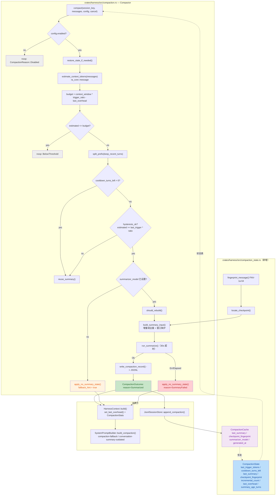
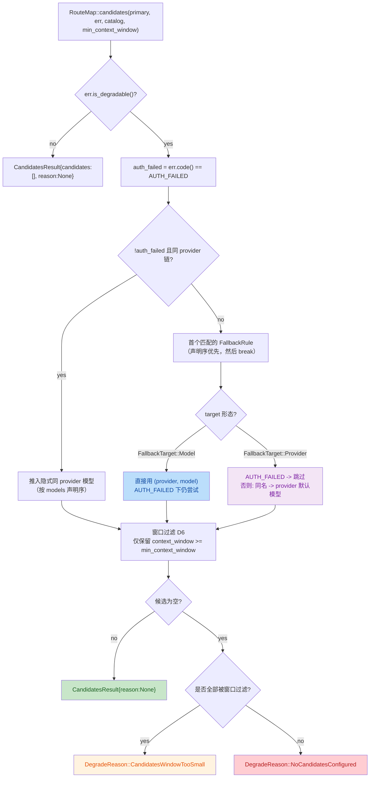
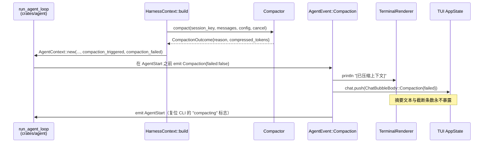
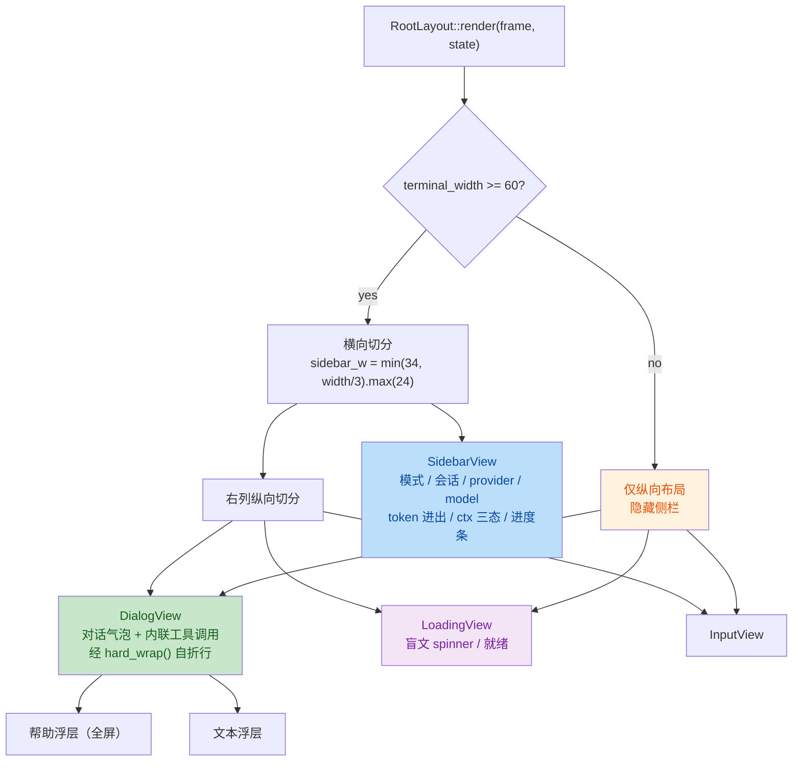
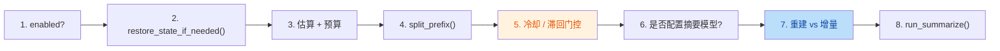

# 🔄 变更集评审摘要 — Ribo Agent 三大计划合并变更集

> **日期**：2026-11-24
> **变更范围**：跨 6 个 crate（`core`、`agent`、`provider`、`harness`、`cli`、`tui`）共 **68 个文件**变更，另含文档、示例与配置模板。三条独立设计计划同时落地——**上下文智能压缩（25 号方案）**、**统一 provider 降级路由（24 号方案 v1.3）**、**TUI 布局与命令面重构（2026-11-21/22）**。

---

## 1. 高层摘要（TL;DR）

- **影响等级：🔴 高** —— 跨 crate 架构级变更。触及公开配置 schema（`ribo.toml`）、`ra-provider` / `ra-agent` / `ra-harness` / `ra-tui` 的公开 Rust API，以及磁盘上的会话文件格式。**既有用户配置不做迁移将无法加载。**

- **关键变更：**
  1. ✨ **智能压缩**（`crates/harness/src/compaction.rs`，新增 `compaction_state.rs`）—— `Compactor` 获得按会话隔离的状态表（`DashMap`），具备**滞回**、**冷却**、**增量摘要**、**强制全量重建**、**摘要输入窗口保护**与 **JSONL 旁路持久化**（重启后仍在）。
  2. ✨ **统一降级路由**（`crates/provider/src/gateway/fallback.rs`）—— 原三层（`explicit` / `same_provider` / `cross_provider`）方案替换为单一有序 `FallbackRule` 列表（`match` → `targets`），具备**声明序优先**、通配匹配、`AUTH_FAILED` 语义、**上下文窗口过滤**与结构化 `DegradeReason`。
  3. ✨ **TUI 布局重构**（`crates/tui/src/view/`）—— 新增左侧**侧栏**（`sidebar.rs`）与**加载动画**（`loading.rs`），取代 `status_line.rs` / `tool_status.rs`；工具调用**内联进对话流**；新增**自包含 `hard_wrap()`**，使渲染与行数估算共用同一真值。
  4. ⚠️ **配置 schema 破坏性变更**（`crates/cli/src/config/schema.rs`）—— 根级 `query_model` → `[routing].default = {provider, model}`；`[[providers]].model` → `[[providers.models]]` 数组（逐模型 `context_window`）；新增 `[[routing.fallback]]` 规则与 5 个新 `[compression]` 字段。
  5. ✨ **Token 估算统一**（`crates/core/src/message/mod.rs`）—— `estimate_context_tokens()` / `estimate_tokens_from_chars()` 迁至 `ra-core` 作为唯一真值，现已**支持 CJK**（ASCII 0.25 / CJK 1.0 / 其他 0.5）。

---

## 2. 可视化概览（代码与逻辑地图）

### 2.1 智能压缩流水线 — `crates/harness/src/compaction.rs`



### 2.2 降级候选解析 — `crates/provider/src/gateway/fallback.rs`



### 2.3 压缩痕迹事件流 — `agent` → `cli` / `tui`



### 2.4 TUI 根布局 — `crates/tui/src/view/mod.rs`



---

## 3. 详细变更分析

### 3.1 `ra-core` — Token 估算成为唯一真值

**改了什么**
- `crates/core/src/message/mod.rs` 新增公开 API `estimate_tokens_from_chars(text)` 与 `estimate_context_tokens(messages)`。
- 权重以**定点 ×4 整数**计算并最终一次整除，ASCII 结果与旧公式 `chars / 4` **完全一致**。
- `is_cjk_ideograph()` 覆盖 CJK 统一表意文字基本区 + 扩展 A/B–F + 兼容表意文字；假名与谚文归入「其他 Unicode」桶。
- `Content::Image` 与 `Content::ToolCall` **不计入**（内联 base64 图片会严重高估）。

**为什么重要**：`crates/harness/src/compaction.rs` 原先私有持有 `estimate_tokens()`，该实现**被删除**并替换为 `pub use ra_core::message::estimate_context_tokens;`。压缩触发、agent 循环降级窗口与 TUI 上下文仪表盘现在共用同一函数。

| 字符类别 | 权重（token/字符） | 定点值 |
| :--- | :--- | :--- |
| ASCII | 0.25 | 1 |
| CJK 表意文字 | 1.00 | 4 |
| 其他 Unicode（Emoji、假名、谚文） | 0.50 | 2 |

消息开销：每条消息 `+ 4 token`（不变）。

---

### 3.2 `ra-agent` — 事件流中的压缩信号

| 项 | 文件 | 变更 |
| :--- | :--- | :--- |
| `AgentContext` | `crates/agent/src/types.rs` | 现为 `#[non_exhaustive]`；新增 `compaction_triggered: bool` 与 `compaction_failed: bool`；新增 crate 内构造器 `AgentContext::new(system_prompt, messages, compaction_triggered, compaction_failed)` |
| `AgentEvent::Compaction { failed }` | `crates/agent/src/events.rs` | 生命周期中**首个**新变体；在 `AgentStart` **之前**发射；`type_tag()` → `"compaction"` |
| `CompactionStats` | `crates/agent/src/session.rs` | 新增 `Copy` 结构 `{ total_tokens, compressed_tokens, current_tokens }`；以 `Mutex<Option<…>>` 存于 `Session`，配 `set_compaction_stats()` / `compaction_stats()` |
| 事件发射 | `crates/agent/src/agent_loop.rs` | `compaction_triggered` → `Compaction{failed:false}`；否则 `compaction_failed` → `Compaction{failed:true}`；冷却 / 滞回复用**不发射任何事件** |
| 降级窗口 | `crates/agent/src/agent_loop.rs` | `min_context_window = estimate_context_tokens(&context.messages) * 1.1` 传入 `StreamOptions` |

**门控决策（D8）**：两个标志**互斥**；冷却抑制与滞回抑制的轮次刻意**不产生事件**，避免每轮都刷屏。

---

### 3.3 `ra-harness` — 智能压缩器

#### 3.3.1 `compaction.rs`（大幅改造）

旧的 4 阶段函数变为 8 阶段流水线，每个出口都有明确原因。



**`CompactionReason` —— 可观测性契约：**

| 变体 | 含义 | 调用 LLM？ | 发提示段？ |
| :--- | :--- | :--- | :--- |
| `Disabled` | `compression.enabled == false` | 否 | 否 |
| `BelowThreshold` | 估算 ≤ 预算 | 否 | 否 |
| `NoSplit` | 用户轮次不足以切分 | 否 | 否 |
| `HysteresisSuppressed` | 增长 < `hysteresis_ratio` × 上次触发量 | **否**（复用摘要） | age ≥ 2 时 `outdated_hint` |
| `CooldownSuppressed` | 处于 `cooldown_turns` 窗口内 | **否**（复用摘要） | age ≥ 2 时 `outdated_hint` |
| `Summarized` | 生成了新摘要 | 是 | 否 |
| `NoSummarizer` | 未配置 `summarizer_model` | 否 | `fallback_hint = true` |
| `SummaryFailed` | 流式错误 / 空文本 / 超时 / 取消 | 尝试过 | `fallback_hint = true` |

**`CompactionOutcome` 新增字段：** `reason`、`rebuild`、`fallback_hint`、`outdated_hint: Option<u32>`、`compressed_tokens`。

**新增内部结构**
- `states: DashMap<String, CompactionState>` —— 按会话隔离，`Arc` 安全并发。
- `store: Option<Arc<JsonlSessionStore>>`（经 `Compactor::with_store()`）—— 启用持久化与重启恢复。
- `get_state_snapshot()` / `set_last_overhead()` —— D2「循环依赖破解」：本轮预算扣减**上一轮**的 system prompt 开销；本轮组装完成的 prompt 回写供下轮使用。
- `should_rebuild()` —— `incremental_count + 1 >= incremental_rebuild_every` ⇒ 全量重建；`incremental_rebuild_every == 1` ≡ 始终全量。
- `build_summary_input()` —— 增量路径先置 `<previous-summary>…</previous-summary>`，再只追加检查点之后的增量；检查点丢失时**回退到全量 prefix**（P3 失败隔离）。窗口保护随后裁掉**最旧**的增量行，保留摘要块与最新增量。
- `summary_input_limit()` —— `max_summary_input_tokens` 若 > 0 则用它，否则取主模型窗口的 70%（`SUMMARY_INPUT_WINDOW_RATIO = 0.7`）。
- `apply_no_summary_state()` —— 更新触发基线与冷却，但**刻意保留** `last_summary` / `checkpoint_fingerprint`，使失败尝试不会毁掉已有的好缓存。

#### 3.3.2 `compaction_state.rs`（新增，356 行）

| 类型 / 函数 | 职责 |
| :--- | :--- |
| `CompactionCache` | **仅 4 个字段**跨重启存活：`last_summary`、`checkpoint_fingerprint`、`summarizer_model`、`generated_at` |
| `CompactionState` | 完整进程内状态：`last_trigger_tokens`、`cooldown_turns_left`、`last_summary`、`checkpoint_fingerprint`、`last_truncated`、`incremental_count`、`last_overhead`、`summary_age_turns` |
| `CompactionStateSnapshot` | 窄只读视图，仅暴露 `last_overhead` |
| `CompactionState::from_cache()` | 恢复 4 个缓存字段中的 2 个；**所有运行时字段归零** |
| `CompactionState::to_cache()` | 仅当存在摘要时才产出缓存 |
| `fingerprint_message()` | 对序列化 JSON 取 FNV-1a 64 位哈希 |
| `metadata_fingerprint_source()` | 序列化失败时的兜底——角色 + 块数 + 每块 `kind:length` + 工具 id。**绝不包含消息正文** |
| `locate_checkpoint()` | `rposition` 匹配 → **最近一次**出现优先 |

> 🐛 **此处内置的 bug 修复**：旧实现使用 `unwrap_or_default()`，导致**每一条**无法序列化的消息都塌缩为**同一个**（空串）哈希——破坏检查点唯一性，导致增量摘要取到**错误**的增量范围。新兜底为高区分度的元数据指纹。

#### 3.3.3 `context.rs` —— 统计与提示词组装

- `compactor.compact()` 现以 `&session.key` 为首参。
- `self.prompt.build(...)` → `self.prompt.build_compaction(skills, summary, fallback_hint, outdated_hint)`。
- **阶段 3.5** —— `estimate_prompt_tokens(&system_prompt)` → `compactor.set_last_overhead(session.key, …)`。
- **阶段 3.6** —— 计算 `CompactionStats { total_tokens, compressed_tokens, current_tokens }` 并写入会话。
- 新增 `impl SessionStatsEstimator for HarnessContext` —— **冷启动**估算：`total = 转录估算`、`compressed = 0`、`current = 0`（本次进程尚未占用窗口）。

#### 3.3.4 `system_prompt.rs` —— 面向模型的提示段

`build()` 保留为新 `build_compaction()` 的薄兼容包装。

| 提示段 | 条件 | 输出文本 |
| :--- | :--- | :--- |
| `<compaction-fallback>` | `fallback_hint == true` **且** `summary.is_none()` | 「Earlier conversation turns were omitted; no summary is available for this request.」（早先的对话轮次已被省略，本次请求没有可用摘要） |
| `<conversation-summary-outdated>` | `outdated_hint == Some(N)` | 「This summary is from {N} turns ago; some recent context may be missing.」（该摘要来自 {N} 轮之前，近期上下文可能缺失） |

两个提示段都刻意**省略**摘要正文与被截断的消息条数，避免模型「假装记得」。

#### 3.3.5 `session_store.rs` —— JSONL 旁路记录

在同一份 `.jsonl` 转录文件中新增 `compaction` 记录类型：

```json
{"v":1,"type":"compaction","summary":"…","checkpoint":"12345","model":"glm-4.5-flash","ts":1700000000000}
```

| API | 行为 |
| :--- | :--- |
| `append_compaction(key, &CompactionCache)` | 写旁路记录；文件为空时自动插入 `meta` 首行；`sync_all()` 保证写后即读可见 |
| `load_compaction(key)` | 扫描文件，返回**最后一条有效**记录；损坏行记录日志并跳过 |
| `SessionReplay.compaction` | 回放时暴露最后一条有效旁路记录 |
| `ReplayDiagnosticCode::StaleCompaction` | 新增诊断：记录损坏 / 指纹非法 |

> 🛡️ **不变量**：旁路记录是**纯缓存**——它绝不截断、删除或重排任何 `message` 记录，也不决定模型从何处继续读取。

> 🐛 **竞态修复**：`append` / `append_compaction` 现在**先打开文件**再以 `metadata().len() == 0` 判定「是否新建」，取代 `try_exists`（后者存在 TOCTOU 窗口）。

#### 3.3.6 `session_provider.rs` —— 冷启动统计

新增 trait `SessionStatsEstimator` + `PersistentSessionProvider::with_stats_estimator()`。冷启动回放后，provider 写入估算的三态统计，使 TUI 侧栏与 CLI `/status` 在**第一条消息之前**就能显示数值。

---

### 3.4 `ra-provider` —— 统一降级路由

#### 3.4.1 新规则模型（`crates/provider/src/gateway/fallback.rs`）

```rust
FallbackRule {
    match_: FallbackMatch { provider: ProviderId, model: Option<ModelId> }, // None = provider 通配
    targets: Vec<FallbackTarget>,
}

enum FallbackTarget {
    Model { provider, model },  // 显式配对 —— AUTH_FAILED 下仍尝试
    Provider(provider),            // 两级解析：同名模型 → provider 默认模型
}
```

| 旧 API | 新 API | 说明 |
| :--- | :--- | :--- |
| `RouteMap::insert_explicit()` | — | **移除**（由规则 target 取代） |
| `RouteMap::insert_cross_provider()` | — | **移除**（由规则 target 取代） |
| `RouteMap::insert_same_provider()` | `insert_same_provider()` | **保留** —— 现为 D3「隐式链」，由 `[[providers.models]]` 声明序派生 |
| — | `RouteMap::insert_fallback_rules(rules)` | 有序规则列表；**声明序 = 优先级** |
| `RouteMap::candidates(...) -> Vec<Candidate>` | `RouteMap::candidates(..., min_context_window) -> CandidatesResult` | **签名破坏性变更** |

**解析顺序**（首个匹配即胜出，然后 `break`）：
1. 不可降级 → 空候选，`reason = None`。
2. **隐式同 provider 链** —— `AUTH_FAILED` 下整体跳过（同一 API key 换模型只会重现 401）。
3. **首个匹配规则** —— `Provider` target 在 `AUTH_FAILED` 下跳过；`Model` target 仍尝试（用户显式意图）。
4. **窗口过滤** —— 丢弃 `context_window < min_context_window` 的候选。
5. **原因** —— 互斥：`CandidatesWindowTooSmall`（全被窗口过滤）vs `NoCandidatesConfigured`（未配置 / 未匹配）。

| `DegradeReason` | `as_str()` | 含义 |
| :--- | :--- | :--- |
| `NoCandidatesConfigured` | `no_candidates_configured` | 无规则匹配（或所有 `Provider` target 被 AUTH 跳过）且无隐式链候选 |
| `CandidatesWindowTooSmall` | `candidates_window_too_small` | 存在候选但全被窗口尺寸过滤 |
| `ChainExhausted` | `chain_exhausted` | 存在候选且全部实际尝试并失败 |

#### 3.4.2 `gateway/mod.rs` —— 更丰富的失败诊断

| 新增项 | 说明 |
| :--- | :--- |
| `stderr_fallback_warned: AtomicBool` | 每进程**仅一次**打印 `WARN model fallback: … switching candidates` |
| `record_attempt()` / `push_attempts_entry()` | 逐候选尝试计数，按 key 归并 → `attempts: provider/model ×N (CODE)` |
| `switched:` 条目 | 实际切换到的候选 → `switched: provider/model` |
| `degraded: none (reason)` | 仅当候选解析产出**零**候选时追加 |
| 60s 软告警 | `tracing::warn!("provider fallback taking long, consider narrowing the chain")` —— 只告警一次，永不中断 |
| 再导出 | `Candidate`、`CandidatesResult`、`DegradeReason`、`FallbackMatch`、`FallbackRule`、`FallbackTarget` 现为公开 |

#### 3.4.3 `options.rs`

`StreamOptions.min_context_window: usize`（默认 `0` = 不过滤）。`crates/agent/src/agent_loop.rs` 将其设为 `estimate_context_tokens(&context.messages) * 1.1` —— 10% 余量吸收估算低估。

---

### 3.5 `ra-cli` —— 配置 schema、校验、命令

#### 3.5.1 schema 迁移（`crates/cli/src/config/schema.rs`）⚠️ 破坏性

```toml
# 之前
query_model = "your-model-name"

[[providers]]
provider_id = "chat-primary"
model = "your-model-name"

[routing.cross_provider]
"chat-primary" = ["anthropic-backup"]

# 之后
[[providers]]
provider_id = "chat-primary"
adapter = "openai-chat"
base_url = "https://your-endpoint.example.com"
api_key = "$OPENAI_API_KEY"

  [[providers.models]]
  id = "your-model-name"
  context_window = 131072        # 可选，默认 8192

[routing]
default = { provider = "chat-primary", model = "your-model-name" }

[[routing.fallback]]
match = { provider = "chat-primary" }        # { provider, model } = 精确匹配
targets = [
  { provider = "anthropic-backup" },          # 同名模型 → provider 默认模型
  { provider = "backup", model = "glm-4.5" }, # 显式配对
]
```

| 元素 | 旧 | 新 | 说明 |
| :--- | :--- | :--- | :--- |
| 默认模型 | 根级 `query_model = "…"` | `[routing].default = { provider, model }` | 必须能解析到已注册的 `(provider, model)` |
| Provider 模型 | `[[providers]].model = "…"`（单个） | `[[providers.models]]` 数组，元素为 `{ id, context_window }` | 数组必填且非空；拒绝重复 `id`；**声明序 = 隐式降级序** |
| 跨 provider 链 | `[routing.cross_provider]` 映射 | `[[routing.fallback]]` 有序规则列表 | 首个匹配规则胜出；通配规则会遮蔽后续精确规则（仅告警） |
| 上下文窗口 | 硬编码 `8192` | 逐模型 `context_window`（默认 `8192`） | 同时供 ctx 仪表盘分母与压缩预算使用 |

#### 3.5.2 新增 `[compression]` 字段

| 键 | 默认值 | 合法区间 | 含义 |
| :--- | :--- | :--- | :--- |
| `hysteresis_ratio` | `1.10` | `[1.0, 10.0]` | 估算须达到 `last_trigger × ratio` 才重新计算摘要 |
| `cooldown_turns` | `2` | `0..=100` | 此轮数内复用上次摘要且**不调用** LLM |
| `enable_incremental` | `true` | 布尔 | `false` ⇒ 始终全量重建 |
| `incremental_rebuild_every` | `8` | `[1, 32]` | 每 N 次增量摘要后强制全量重建（`1` ⇒ 始终全量） |
| `max_summary_input_tokens` | `0` | `>= 0` | `0` ⇒ 自动取模型窗口的 70% |

#### 3.5.3 装配期校验（`crates/cli/src/config/assemble.rs`）

| 校验器 | 错误码 | 范围 |
| :--- | :--- | :--- |
| `validate_routing_refs()` | `config.routing_invalid` | 仅 Real 模式 —— 校验 `[routing].default`、每条规则的 `match.provider` / `match.model` 及每个 target 的 provider/model；拒绝空 `targets`；**遮蔽仅告警** |
| `validate_compression()` | `compression_invalid` | `trigger_ratio ∈ (0,1]`、`hysteresis_ratio ∈ [1,10]`、`cooldown_turns ≤ 100`、`incremental_rebuild_every ∈ [1,32]`，且——**仅 Real 模式**——`summarizer_model` 必须被某个 provider 注册 |

**旧配置仍可加载**：`serde(default)` 会补齐 5 个新 `[compression]` 字段，故旧的 5 字段 `[compression]` 块原样通过校验。

#### 3.5.4 命令面收敛（`crates/cli/src/commands.rs`）

| 命令 | 之前 | 之后 | 适用端 |
| :--- | :--- | :--- | :--- |
| `/new [name]` | 轮换会话键 | **移除** —— 现为 `UnknownCommand` | — |
| `/sessions` | 列出键 | `/sessions` → 列出键 | `Both` |
| `/sessions <name>` | — | **新增** —— 切换到指定会话，不存在则创建 | `Both` |
| `/status` | 仅 CLI | 不变，现额外打印 ctx 三态 | **`CliOnly`** |
| `/history [n]` | 仅 CLI | 不变 | **`CliOnly`** |
| `/help`、`/stop`、`/cancel`、`/skills`、`/exit` | — | 不变 | `Both` |

`CommandMeta` 新增 `enum Target { Both, CliOnly }` —— TUI 依此过滤 `/help` 浮层与 Tab 补全，并在输入 CLI 专属命令时给出说明浮层（`"/status 仅 CLI 可用——TUI 左侧栏已常驻显示…"`）。

#### 3.5.5 其他 CLI 变更

- `Repl::handle_new()` → `Repl::handle_sessions()`（async）；`new_counter` 自动轮换字段**移除** —— 会话名改为显式。
- `print_status()` 现为 `async`，打印 `ctx: total=… | compressed=…% | current=… (…)`。
- `TerminalRenderer` 处理 `AgentEvent::Compaction` → 打印 `[已压缩上下文]`（普通色）或 `[上下文压缩失败，已回退滑窗]`（黄色）；`AgentStart` 复位 `compacting` 标志，提示永不悬挂。
- `CliSession` 新增 `provider_id`、`model_name`、`context_window`。

---

### 3.6 `ra-tui` —— 布局、内联工具调用、折行正确性

#### 3.6.1 新视图

| 文件 | 职责 |
| :--- | :--- |
| `view/sidebar.rs`（新增） | 左侧状态面板：模式、会话键、provider、model、token 进出、**上下文三态**（总量 / 已压缩 % / 当前 ÷ 窗口）、10 格彩色上下文条（绿 < 50%、黄 < 75%、红 ≥ 75%）与告警计数 |
| `view/loading.rs`（新增） | 固定 1 行页脚：在途时显示盲文 spinner（8 帧，100ms/帧）+「处理中…（Ctrl-C 取消）」，空闲显示「就绪」 |
| `view/status_line.rs` | **删除**（并入侧栏） |
| `view/tool_status.rs` | **删除**（工具调用改为内联气泡） |

#### 3.6.2 内联工具调用（`crates/tui/src/state.rs`、`crates/tui/src/app.rs`）

- `ChatBubbleBody::ToolResult` 新增 `call_id: Option<String>` 与 `running: bool`；新增 `ChatBubbleBody::Compaction { failed }` 变体；移除 `ToolRun` / `ToolPhase`。
- `ToolExecutionStart` 插入「执行中…」气泡；`ToolExecutionEnd` 按 `call_id` **更新**该气泡；回放的 `ToolResult` 消息同样经 `ChatState::tool_bubble_index(call_id)` **更新**（而非重复插入）同一气泡。
- 标记与配色：`…` 青色（执行中）/ `✓` 黄色（成功）/ `✗` 红色（失败）。
- 新增 `ChatState::clear()` 与 `invalidate_cache(id)`，支撑会话切换与行数缓存失效。

#### 3.6.3 自包含折行 —— 滚动正确性修复 ⚠️

| 之前 | 之后 |
| :--- | :--- |
| 渲染使用 ratatui 的 `WordWrapper`（按词） | 渲染使用 `hard_wrap()`（按字符，感知 CJK 宽度） |
| 估算使用 `width.div_ceil(width)`（按字符） | 估算使用**同一个** `hard_wrap()` |
| `Paragraph::wrap(...)` + `.scroll(...)` | `Paragraph` **不启用** wrap、**不启用** scroll —— 由视图预折行并预裁剪 |

> 🐛 **已修根因**：两条路径此前始终不一致，内容一长，对话尾部便不可达（内容被截断、滚动偏移错误）。现 `bubble_line_count()` 与 `DialogView::bubble_lines()` 共用 `hard_wrap()`，并新增测试 `line_count_matches_rendered_lines()` 断言 6 种气泡形态下行数相等。

`crates/tui/src/app.rs` 中的配套正确性工作：
- `RootLayout::dialog_width(terminal_width)` 是**唯一**宽度来源：`width − sidebar_w − 2`（块边框）。`draw()` 与 `scroll_by()` 均使用它（此前 `scroll_by` 用的是 `FALLBACK_WIDTH = 80`）。
- `visible_rows(area)` + 视口裁剪 —— 只有视口内的气泡才折行与渲染，成本与会话总量解耦。
- `MessageEnd` 现会失效行数缓存，修复「回合结束后终稿丢失」。
- 100ms ticker 驱动 `spinner_tick`；仅当 `need_draw` 置位才重绘（空闲时无 CPU 空转）。

#### 3.6.4 会话切换与冷启动

- `load_session_history()` 从转录重建气泡列表（此前切换会话只显示当前轮 —— 即「会话历史丢失」回归），并经 `usage_totals()` 回填 `total_input` / `total_output`（此前冷启动为 **0**，因为回放不触发 `TurnEnd` 事件）。
- `refresh_context_stats()` 从会话拉取 `CompactionStats` 并同步 `context_window`。
- `warnings_overlay_text()` 在启动时一次性展示装配告警（侧栏只显示计数）。

---

### 3.7 配置、文档、示例、依赖

| 区域 | 变更 |
| :--- | :--- |
| `ribo_example.toml` | 按新 `[routing]` / `[[providers.models]]` / `[[routing.fallback]]` schema 与 5 个新 `[compression]` 字段重写 |
| `.gitignore` | `/ribo.toml` → `/ribo*.toml` + `!/ribo_example.toml`（保留模板入库，忽略本地变体） |
| `docs/src/configuration.md`、`cli.md`、`repl.md`、`quickstart.md`、`appendix.md`、`introduction.md`、`development.md`、`plugin-dev.md`、`skills.md`、`tools.md` | 记录新 schema、`/sessions` 命令及压缩 / 降级行为 |
| `README.md`、`README.en.md` | 同步更新 |
| `crates/cli/examples/compaction_probe.rs`（新增） | 零 API 成本探针：加载 `ribo_compaction_mock.toml` 跑 6 轮脚本化对话，观察压缩日志 |
| `crates/provider/examples/gateway_fallback*.{rs,toml}`、`crates/harness/examples/harness_fallback*` | 按新路由 schema 更新 |

**依赖变更**

| crate | 包 | 旧 | 新 | 原因 |
| :--- | :--- | :--- | :--- | :--- |
| workspace | `time` | — | `0.3`（`local-offset`） | 本地时区日志时间戳 |
| workspace | `tracing-subscriber` | `0.3` | `0.3` + `time`、`local-time` | `OffsetTime::local_rfc_3339()` |
| `ra-core`、`ra-provider`、`ra-cli`、`ra-harness` | `time` | — | `workspace = true` | 日志时间戳格式化 |
| `ra-harness` | `dashmap` | — | （原已存在） | 按会话隔离的压缩状态表 |

`crates/cli/src/logging.rs` 现以**本地时区**格式化日志时间戳（`OffsetTime::local_rfc_3339()`），无法确定本地偏移时回退 UTC。

---

## 4. 影响与风险评估

### ⚠️ 破坏性变更

| # | 破坏性变更 | 影响面 | 迁移方式 |
| :-- | :--- | :--- | :--- |
| 1 | 根级 `query_model` 移除 | `ribo.toml` | → `[routing].default = { provider, model }` |
| 2 | `[[providers]].model` → `[[providers.models]]` | `ribo.toml` | 迁入 `models` 数组；补 `context_window`（默认 8192） |
| 3 | `[routing.cross_provider]` 移除 | `ribo.toml` | → `[[routing.fallback]]`，带 `match` / `targets` |
| 4 | `RouteMap::candidates()` 签名与返回类型 | `ra-provider` 使用方 | 现接收 `min_context_window`，返回 `CandidatesResult` |
| 5 | `RouteMap::insert_explicit()` / `insert_cross_provider()` 移除 | `ra-provider` 使用方 | 改用 `insert_fallback_rules()` |
| 6 | `Compactor::compact()` 新增首参 `session_key` | `ra-harness` 使用方 | 传入 `&session.key` |
| 7 | `AgentContext` 现为 `#[non_exhaustive]` | `ra-agent` 使用方 | 改用 `AgentContext::new(...)`；结构体字面量不再编译 |
| 8 | `AgentEvent` 新增变体（共 11 个） | 穷尽 `match` 处 | 补 `AgentEvent::Compaction { .. }` 分支 |
| 9 | `Command::New` 移除；`Command::Sessions` 携带 `Option<String>` | `ra-cli` 使用方 | `/new` → `/sessions <name>` |
| 10 | `ChatBubbleBody::ToolResult` 新增 `call_id` / `running`；`ToolRun` / `ToolPhase` 删除 | `ra-tui` 使用方 | 重建工具气泡构造处 |
| 11 | `AppState::new()` 新增 `provider` / `model` 参数 | `ra-tui` 使用方 | 传入新的 `CliSession` 字段 |
| 12 | `estimate_context_tokens` 从 `ra-harness` 迁至 `ra-core::message` | `ra-harness` 使用方 | `ra_harness::estimate_context_tokens` 仍再导出（非破坏性） |

### ⚠️ 风险热点

| 风险 | 为何重要 | 变更中的缓解措施 |
| :--- | :--- | :--- |
| **预算随 overhead 增长而缩水** | 新预算要扣掉 system prompt 开销，可用预算会随时间缩小 | `budget == 0` 时退化为 `raw_budget`（不会「永不触发」）；由 `overhead_writeback_keeps_second_build_alive` 守护 |
| **检查点指纹漂移** | 过期指纹会静默产出错误的增量范围 | `locate_checkpoint()` 返回 `None` → **全量重建** 回退；`from_cache()` 重置运行时字段；三重失效判定（模型变更 / 指纹缺失 / age > `cooldown × 2`） |
| **整份摘要静默降级** | `SummaryFailed` 看起来像普通一轮 | `fallback_hint` 向 system prompt 注入 `<compaction-fallback>`，让模型知道上下文缺失；失败以黄色气泡呈现 |
| **降级到过小的模型** | 降级到装不下转录的模型 | `min_context_window = estimate × 1.1` 在尝试前过滤掉此类候选 |
| **AUTH_FAILED 空转** | 同一 key 换模型只会重现 401 | 隐式链与 `{ provider }` target 在 `AUTH_FAILED` 下跳过；显式 `{ provider, model }` 仍尊重（用户意图） |
| **降级规则遮蔽** | 通配规则靠前会静默禁用后续精确规则 | 已文档化 + 装配期 `tracing::warn!("fallback rule #N is shadowed by rule #M")` |
| **渲染 / 滚动漂移** | 历史上导致尾部内容不可达 | 单一 `hard_wrap()` 真值 + 视口裁剪 + `line_count_matches_rendered_lines` 测试 |

### 🧪 测试建议

**压缩**
- 第 1 轮触发摘要；第 2 轮在 `cooldown_turns = 2` 内必须**复用**摘要且**不调用** LLM（验证 mock 脚本未被耗尽）。
- 增长低于 `hysteresis_ratio` ⇒ `HysteresisSuppressed`，第 2 轮 `outdated_hint == None`、第 3 轮为 `Some(2)`。
- `incremental_rebuild_every = 1` ⇒ 每次摘要输入都是全量 prefix（无 `<previous-summary>` 块）。
- 破坏检查点指纹 ⇒ 增量路径必须回退全量 prefix，而非崩溃。
- `max_summary_input_tokens` 设得很低 ⇒ 输入被裁剪，但 `<previous-summary>` 块与最新增量仍在。
- 重启进程 ⇒ 摘要从 JSONL 旁路记录恢复，但冷却 / 滞回基线 / 增量计数**重置**。
- 两次运行之间改 `summarizer_model` ⇒ 缓存摘要必须**失效**（陈旧缓存路径）。
- CJK 占比高的转录 ⇒ `estimate_context_tokens` 不得系统性低估（100 个汉字 ⇒ 104 token，而非 29）。

**降级路由**
- 通配规则声明在精确规则**之前** ⇒ 通配胜出（文档化的遮蔽）；调换顺序即可命中精确规则。
- `AUTH_FAILED` ⇒ 跳过隐式链与 `{ provider }` target，仍尝试 `{ provider, model }`。
- `context_window == min_context_window` 的候选通过；低于则被过滤；全被过滤 ⇒ `DegradeReason::CandidatesWindowTooSmall`。
- `models()` 列表为空的 provider ⇒ 该 target 贡献零候选。
- 最终错误消息须包含 `fallback chain: … attempts: … ×N (CODE) … switched: …`，零候选时还要有 `degraded: none (reason)`。

**配置 / 装配**
- 旧格式 `ribo.toml` ⇒ **必须**以 `config.routing_invalid` 失败（不得静默降级）。
- 仅含 5 个字段的旧 `[compression]` 块 ⇒ 以新默认值加载并通过校验。
- `summarizer_model` 指向未注册模型 ⇒ Real 模式报 `compression_invalid`；**Mock 模式接受**。

**TUI**
- 终端宽 100 ⇒ `dialog_width == 65`；宽 50 ⇒ `48` 且必须隐藏侧栏。
- 切换到有历史的会话 ⇒ 对话区必须回放历史气泡（而非只有当前轮）。
- 冗长工具输出 ⇒ 只产生一个气泡（回放的 `ToolResult` 不重复）。
- 200 个气泡 + 1 个约 200 行的气泡 ⇒ 跟随底部时尾部标记可见，向上滚动可见头部。

**CLI**
- `/new` ⇒ `UnknownCommand("/new")`。
- `/sessions work` ⇒ 切换或创建；在途 ⇒ 拒绝并提示「回合进行中」。
- 任何一轮之前 `/status` ⇒ `ctx: —`；一轮之后 ⇒ 三态行。
- 在 TUI 中输入 `/status` / `/history` ⇒ 给出说明浮层，且该命令**不出现**在 TUI `/help` 浮层与 Tab 补全中。

### ✅ 完成定义清单（按 `AGENTS.md`）

```bash
cargo fmt --all -- --check
cargo clippy --workspace --all-targets -- -D warnings
cargo check --workspace
cargo test --workspace
```

本次变更新增大量 `#[test]` 用例（压缩、指纹、路由、布局、配置校验），均按要求带中文场景注释。新增公开 API（`estimate_context_tokens`、`estimate_tokens_from_chars`、`CompactionReason`、`DegradeReason`、`FallbackRule` / `FallbackMatch` / `FallbackTarget`、`CompactionStats`、`AgentContext::new`、`format_compact_tokens`）均带文档注释；`format_compact_tokens` 与 `estimate_tokens_from_chars` 含可运行的 `# Examples` 示例。
