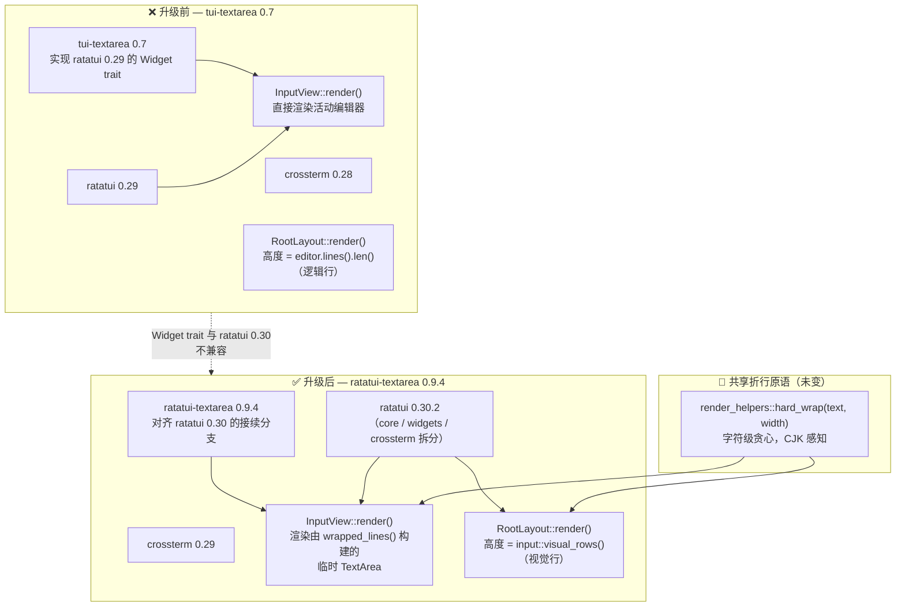
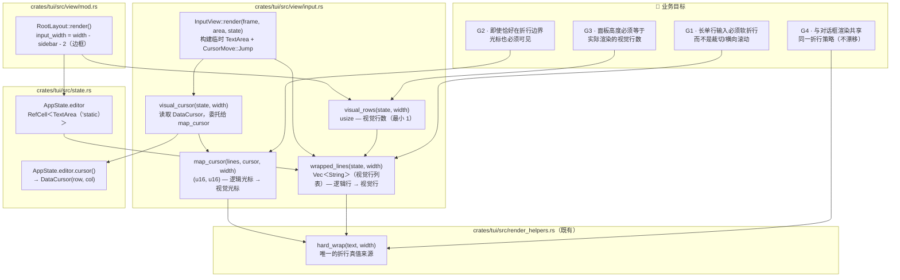
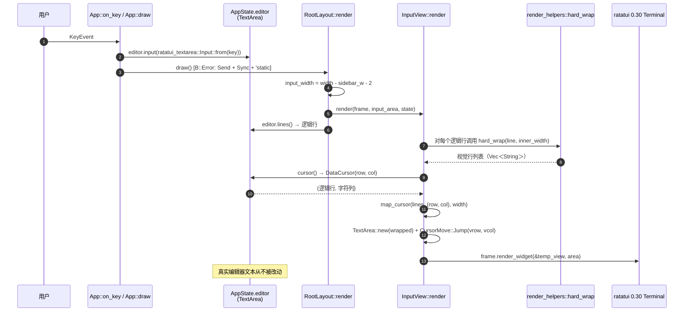

# 🔍 代码评审摘要 — `ribo-agent` 工作区

> 2026-11-25

## 1. 总体摘要（TL;DR）

* **影响：** **中等** — 一次聚焦的 **TUI 依赖升级**（`ratatui 0.29 → 0.30.2`、`crossterm 0.28 → 0.29`、`tui-textarea 0.7 → ratatui-textarea 0.9.4`），并因此重写了 `crates/tui` 中输入编辑器的软折行渲染。其余 **119 个文件中的约 113 个**仅为文档/注释层面的改动（横幅注释规范化、移除内部规划工单引用、crate `description` 清理），**运行时行为零变化**。
* **关键变更：**
    * ✨ `crates/tui/src/view/input.rs` 中的**全新软折行引擎**：`wrapped_lines()`、`visual_rows()`、`map_cursor()`、`visual_cursor()` — 复用既有的共享原语 `render_helpers::hard_wrap()`，使折行策略只有**唯一**真值来源。
    * ✨ **`InputView::render()` 现在渲染一个临时 `TextArea`**：由预先折好的视觉行构建（光标通过 `CursorMove::Jump` 跳到映射后的视觉位置），而不是直接渲染活动编辑器 — 真实编辑器的文本永远不会被改动。
    * 📐 **根布局高度**从*逻辑*行数改为*视觉*（折行后）行数（`view/mod.rs`），使布局估算与实际渲染始终一致。
    * 🔧 **`App::draw()` 泛型约束** 新增 `where B::Error: Send + Sync + 'static`，以适配 ratatui 0.30 新的关联类型 `Backend::Error`。
    * 📝 **全工作区文档清理**：每个 crate 的 `description` 去掉 `"Ribo Agent "` 前缀；剥离 `// ===== … =====` 横幅；移除内部工单引用（`R9`、`T12`、`R-B3`、`Step B`、`阶段 6`、`ai_0018`、`§13.2` 等）。

> ℹ️ **给评审者的范围说明：** 虽然 diff 涉及 **119 个文件**，但只有 **6 个文件**包含可执行代码变更（`Cargo.toml`、`crates/tui/Cargo.toml`、`crates/tui/src/{state.rs, app.rs, view/input.rs, view/mod.rs}`），另有 **11 个 `Cargo.toml`** 仅改了 description。其余全部是注释。

---

## 2. 可视化总览（代码与逻辑映射）

### 2.1 依赖迁移及其为何迫使重写



### 2.2 业务目标 ↔ 模块 ↔ 关键方法



### 2.3 帧渲染时序（按键 → 像素）



---

## 3. 变更详细分析

### 3.1 组件：`ra-tui` — 依赖升级 ⚠️

**变更内容：** TUI 的终端组件栈升级到 ratatui 0.30 世代。`tui-textarea 0.7` 实现的是 ratatui **0.29** 的 `Widget` trait，与 ratatui 0.30 二进制不兼容；因此替换为对齐 ratatui 0.30 的接续分支 `ratatui-textarea`（0.9.4）。`crossterm` 升到 0.29 是因为 `ratatui-crossterm` 绑定了它。

**位置：** `Cargo.toml`（工作区 `[workspace.dependencies]`）、`crates/tui/Cargo.toml`

| 包 | 旧版本 | 新版本 | 原因 |
|---|---|---|---|
| `ratatui` | `0.29` | `0.30.2` | 采用 0.30 世代；`ratatui-core`/`ratatui-widgets`/`ratatui-crossterm` 拆分 |
| `crossterm` | `0.28` | `0.29` | 受 `ratatui-crossterm 0.1.2` 绑定；必须一致才能让 `Input::from(KeyEvent)` 类型匹配 |
| `tui-textarea` | `0.7` | *（移除）* | 其 `Widget` impl 与 ratatui 0.30 不兼容 |
| `ratatui-textarea` | *（原先不存在）* | `0.9.4`（`features = ["crossterm"]`） | 对齐 ratatui 0.30 的接续（drop-in）分支 |
| `wasmtime` | `50` | `50` *（未变）* | 仅改写了注释；`51.x` 仍是 rc → 暂缓 |

**锁文件影响（已在 `Cargo.lock` 验证）：** `tui-textarea` 已移除；解析为 `ratatui 0.30.2`、`ratatui-core 0.1.2`、`ratatui-widgets 0.3.2`、`ratatui-crossterm 0.1.2`、`ratatui-textarea 0.9.4`、`crossterm 0.29.0`。

> ⚠️ 工作区 `Cargo.toml` 中已明确记录版本三角锁定 — **三者必须同步升级**，否则 `Input::from(KeyEvent)` 的类型匹配会断裂。

---

### 3.2 组件：`InputView` — 软折行渲染重写 ✨

**变更内容：** 以前直接渲染活动的 `TextArea`，单条长逻辑行要么横向滚动（文字被截断），要么迫使布局超出视口。现在视图实现了自己的软折行层。

**位置：** `crates/tui/src/view/input.rs`

| 新符号 | 签名 | 职责 |
|---|---|---|
| `wrapped_lines` | `fn(&AppState, u16) -> Vec<String>` | 通过 `hard_wrap` 把逻辑行展平为**视觉**行；`width.max(4)` 下限保护 |
| `visual_rows` | `fn(&AppState, u16) -> usize` | 视觉行数，下限为 `1`（空编辑器仍占一行） |
| `map_cursor` | `fn(&[String], (usize, usize), u16) -> (u16, u16)` | 逻辑 `(行, 字符列)` → 视觉 `(vrow, vcol)`；饱和转换到 `u16` |
| `visual_cursor` | `fn(&AppState, u16) -> (u16, u16)` | 从活动编辑器读取 `DataCursor`，委托给 `map_cursor` |
| `InputView::render` | *（修改）* | 构建临时 `TextArea::new(wrapped_lines(...))`，`CursorMove::Jump(vrow, vcol)`，应用边框 block，渲染 |

**关键代码 — 渲染转折点：**

```rust
// crates/tui/src/view/input.rs
let inner_width = area.width.saturating_sub(2);
let mut view = TextArea::new(wrapped_lines(state, inner_width));
let (vrow, vcol) = visual_cursor(state, inner_width);
view.move_cursor(CursorMove::Jump(vrow, vcol));
view.set_block(
 ratatui::widgets::Block::bordered()
    .title("输入 (Enter 发送 · Tab 补全 · Ctrl-C 退出)"),
);
frame.render_widget(&view, area);
```

**为什么这种形态有效：** 临时 `TextArea` 自身的 `scroll_top_row` 会跟随跳转后的光标，因此输入框在用户输入超过折行点时会**纵向**滚动，而不是退化为横向滚动加字符截断。真实编辑器的缓冲区不受影响。

**微妙之处 — 折行边界光标规则**（`map_cursor`）：

* `hard_wrap` 按**显示宽度**折行，但从不拆开字符。
* `map_cursor` 逐段累计**字符数**，因此 `col` 保持为*字符索引*（与 `ratatui-textarea` 的 `DataCursor` 语义一致）。
* 当 `remaining == segment_char_count`（光标恰好落在折行接缝上）时，光标被放到**下一视觉行的第 0 列** — 光标永远不会停留在满行的末尾而不可见。
* `col` 超出时的兜底：钳制到最后一段的末尾。

---

### 3.3 组件：`RootLayout` — 视觉行数高度计算 📐

**变更内容：** 输入面板高度此前取自编辑器的**逻辑**行数，导致单条长行会使面板分配不足（内容被推出视口）。现在改为取自**视觉**（折行后）行数。

**位置：** `crates/tui/src/view/mod.rs`

```rust
// 之前
let editor_rows = state.editor.borrow().lines().len() as u16;

// 之后
let input_width = area.width.saturating_sub(sidebar_w).saturating_sub(2);
let editor_rows = input::visual_rows(state, input_width) as u16;
let input_rows = (editor_rows + 1).min(input::MAX_INPUT_ROWS as u16) + 2;
```

* `input_width` = 全宽 − 侧栏宽度 − 2（左右边框列）。
* `MAX_INPUT_ROWS` 仍以 **6** 个视觉行为上限；`+2` 计入上下边框行。
* **单一真值来源不变式：** 布局估算器与渲染器都调用 `wrapped_lines()`，因此高度估算永远不会偏离实际绘制内容（这正是 `hard_wrap` 文档注释中针对对话框区域警告过的同类 bug）。

---

### 3.4 组件：`App::draw` — ratatui 0.30 后端错误约束 🔧

**变更内容：** 在 ratatui 0.30 中，`Backend::Error` 变成**关联类型**，不再固定为 `io::Error`。由于 `?` 要转换为 `anyhow::Error`（要求 `Send + Sync + 'static`），泛型函数需要显式约束。

**位置：** `crates/tui/src/app.rs`

```rust
fn draw<B: ratatui::backend::Backend>(
  &mut self,
  terminal: &mut ratatui::Terminal<B>,
) -> anyhow::Result<()>
where
  B::Error: Send + Sync + 'static,
{ /* ... */ }
```

* `CrosstermBackend` 和 `TestBackend` 都使用 `io::Error`，满足该约束 — 生产与测试路径均不受影响。

---

### 3.5 组件：`ra-tui` 内导入路径迁移

| 文件 | 之前 | 之后 |
|---|---|---|
| `crates/tui/src/state.rs` | `use tui_textarea::TextArea;` | `use ratatui_textarea::TextArea;` |
| `crates/tui/src/view/input.rs` | `use tui_textarea::TextArea;` | `use ratatui_textarea::{CursorMove, DataCursor, TextArea};` |
| `crates/tui/src/app.rs` | `tui_textarea::Input::from(key)` | `ratatui_textarea::Input::from(key)` |

---

### 3.6 组件：新增测试覆盖 🧪

**位置：** `crates/tui/src/view/input.rs`（`#[cfg(test)] mod tests`）

| 测试 | 断言内容 |
|---|---|
| `wraps_ascii_long_line` | 25 个 ASCII 字符 @ 宽度 10 → `["a"x10, "a"x10, "a"x5]` |
| `maps_cursor_to_visual_position` | `(0,0)→(0,0)`、`(0,15)→(1,5)`、**`(0,20)→(2,0)`**（边界 ⇒ 下一行第 0 列）、`(0,25)→(2,5)`（文本末尾） |
| `maps_cjk_cursor` | 6 个 汉（显示宽度 12）@ 宽度 10 → 2 行；`(0,4)→(0,4)`、**`(0,5)→(1,0)`**（边界）、`(0,6)→(1,1)` |
| `maps_cursor_across_logical_lines` | 2 条逻辑行 → 视觉行偏移累加：`(1,2)→(2,2)` |

> ⚠️ 注意：这些测试用手造的字符索引验证 `map_cursor` 的**契约**，并**没有**断言 `ratatui-textarea` 的 `TextArea::cursor()` 返回的确实是**字符**索引而非**字节**偏移。见风险 R2。

---

### 3.7 组件：全工作区文档清理 📝（非功能性）

**crate `description` 规范化** — 每个 crate 去掉 `"Ribo Agent "` 前缀，且 `ra-agent`（此前**完全没有** description）补上了描述：

| Crate | 旧描述 | 新描述 |
|---|---|---|
| `ra-core` | `Ribo Agent 核心库：统一错误处理与对话消息模型` | `统一错误处理与对话消息模型` |
| `ra-agent` | *（无）* | `Agent 运行时：消息循环、会话管理与工具编排` |
| `ra-cli` | `Ribo Agent 命令行交互层：REPL、流式渲染与分层配置` | `命令行交互：REPL、流式渲染与分层配置` |
| `ra-harness` | `Ribo Agent 会话容器：持久化、上下文压缩、系统提示与技能加载` | `会话容器：持久化、上下文压缩、系统提示与技能加载` |
| `ra-plugins` | `Ribo Agent 插件能力 crate：Plugin 声明层、插件注册表、AgentTool 适配器与 ACL` | `插件能力：Plugin 声明、插件注册表、AgentTool 适配器与 ACL` |
| `ra-pdk` | `Ribo Agent 插件 PDK：guest 侧 Rust SDK，封装 ABI v0（线性内存 / args 信封 / host import）` | `插件 PDK：guest 侧 Rust SDK，封装 ABI v0（线性内存 / args 信封 / host import）` |
| `ra-plug-pdk-macro` | `Ribo Agent 插件 PDK 过程宏：…` | `插件 PDK 过程宏：#[ribo_tool] 工具声明与 #[ribo_plugin] ABI 导出生成` |
| `ra-provider` | `Ribo Agent 模型提供方层：…` | `模型提供方抽象、模型目录、网关（降级/熔断/准入）与 OpenAI 兼容适配器` |
| `ra-tools` | `Ribo Agent 工具调用 crate：…` | `工具调用：AgentTool 声明、注册表、Schema 校验、熔断编排与内置工具` |
| `ra-tui` | `Ribo Agent 终端 TUI：五区全屏交互` | `终端 TUI：全屏分区交互界面` |
| `plugin-demo` | `Ribo Agent 插件端到端演示（18_ §13.2）：…` | `插件端到端演示：PDK guest 构建与宿主全链路集成测试` |
| `git-hook` | `ribo-agent 工作空间内部 Git 钩子工具（提交前质量门禁）` | `提交前质量门禁的 Git 钩子工具` |

**注释卫生清扫**（覆盖 `core`、`agent`、`cli`、`harness`、`provider`、`tools`、`plugins`、`pdk`、`tui`）：

* **横幅规范化：** `// ===== 阶段 1：Schema 编译（失败则拒绝注册） =====` → `// Schema 编译（失败则拒绝注册）`；移除 `// ==== 帧分派 ====` 一类的分节规则。
* **规划工单引用清除：** 从行文中移除内部标识符 — `R9`、`R2`、`R-B1`、`R-B2`、`R-B3`、`R-R2`、`R-R4`、`R-R5`、`G2`、`T1`、`T10`、`T12`、`T14/T15`、`T18`、`CFG-01`、`CFG-02`、`APP-01`、`D7`、`Step A/B`、`Step 8`、`阶段 6`、`ai_0018`、`18_ §13.2`、`v1`/`v3`。
* **措辞修正：** `crates/cli/src/main.rs`（`配置加载阶段` → `配置加载时`）、`crates/plugins/src/config.rs`（`Step B 恒 false` → `当前恒 false`）、`crates/plugins/Cargo.toml`（`autoexamples`/`wasm` feature 说明）、`crates/cli/Cargo.toml`（`start_paused` 虚拟时钟说明）。
* ⚠️ **这些文件中没有任何可执行语句被改动。**

---

## 4. 影响与风险评估

### 💥 破坏性变更

| 变更 | 范围 | 影响 |
|---|---|---|
| `tui-textarea` → `ratatui-textarea`（包改名） | 仅 `ra-tui` | 任何锁定 `tui-textarea` 的下游 crate 必须切换到 `ratatui-textarea`；**树内没有 `ra-tui` 之外的消费者**（已全仓 grep 验证） |
| `ratatui 0.29 → 0.30.2` | 仅 `ra-tui` | 上游破坏性变更：`Backend::Error` 变为关联类型；`Widget` trait 拆分进 `ratatui-widgets` |
| `crossterm 0.28 → 0.29` | 仅 `ra-tui` | 必须与 `ratatui-crossterm` 保持对齐 |
| `App::draw<B>()` 签名 | `ra-tui` 内部 | 新增 `B::Error: Send + Sync + 'static` 约束 — 若外部调用者使用 `Error` 不满足 `Send + Sync` 的自定义 `Backend` 会受影响（罕见） |

### ⚠️ 风险

| 编号 | 风险 | 严重度 | 缓解措施 |
|---|---|---|---|
| **R1** | **`DataCursor` 列单位不匹配。** `map_cursor` 假设 `col` 是**字符索引**；`tui-textarea` 在某些历史版本中暴露的是**字节**偏移。如果 `ratatui-textarea 0.9.4` 返回字节，CJK/emoji 光标会落错列。 | **高** | 增加一个集成断言：输入一段 CJK 字符串，读取 `editor.cursor()`，与 `map_cursor` 的预期比较 — 当前单元测试只用手工构造的元组 exercising `map_cursor`。 |
| **R2** | **每帧开销。** `InputView::render` 每帧对所有逻辑行重新折行并新建一个 `TextArea` — 每次重绘 O(总输入字符数)。 | 中 | 输入通常较短；若长文本粘贴时感到输入延迟，可考虑按 `(text, width)` 缓存折行结果。 |
| **R3** | **宽度推导耦合。** `RootLayout` 计算 `input_width = area.width - sidebar_w - 2`，而 `InputView` 从布局后收到的 area 计算 `inner_width = area.width - 2`。若侧栏可见性规则或边框宽度变化，两者可能发散。 | 中 | 两者都基于**同一** `hard_wrap` 宽度语义 — 但建议显式下传宽度而不是各自重算。 |
| **R4** | **滚动位置语义。** 临时 `TextArea` 滚动到使*映射后*光标可见的位置。若 `map_cursor` 偏差一行，输入视图可能滚到错误行。 | 中 | 已由 `maps_cursor_to_visual_position` / `maps_cjk_cursor` 覆盖 — 但建议增加输入超过 `MAX_INPUT_ROWS` 的 PTY 级测试。 |
| **R5** | **注释清扫中的隐性 UI 回归。** 约 113 个文件仅改注释；其中任何意外的语义漂移都难以察觉。 | 低 | 合并前通过完整的 `cargo test --workspace` + `cargo clippy` 门禁。 |
| **R6** | **版本锁脆弱性。** 工作区注释警告 `ratatui`、`crossterm`、`ratatui-textarea` 必须锁步升级。未来 `cargo update` 单独 bump 其中之一会破坏 `Input::from(KeyEvent)`。 | 低 | 考虑在 CI 中加 `Cargo.lock` 固定或 `cargo update -p ratatui-textarea --precise` 守卫。 |

### 🧪 测试建议

**自动化**
* `cargo test -p ra-tui` — 运行 4 个新增 `map_cursor` 单元测试及既有 TUI 单元测试。
* `cargo test -p ra-tui --test e2e` — PTY 套件（`pty_exit_restores_terminal`、`pty_cjk_and_emoji_input`）走真实终端路径，包括新 crate 下的 `Input::from(KeyEvent)`。
* `cargo test --workspace` — 确认 113 个仅注释文件仍然全绿（`ra-plugins` 的 wasm 套件与 `plugin-demo` e2e 最敏感）。
* `cargo clippy --workspace --all-targets` — 新增的 `map_cursor` / `visual_cursor` 辅助函数最可能触发 lint（如 `too_many_arguments`、无谓转换）。

**手动 / 交互式**
1. **长单行输入** — 在窄终端（如 60 列）粘贴 500 字符。预期：软折行为多个视觉行，**无**横向截断，文字完整可读。
2. **折行边界光标** — 恰好输入 `width` 个字符，观察光标跳到下一视觉行第 0 列，而不是停在满行末尾。
3. **CJK / emoji** — 输入 `你好🌍` 及一长串汉字；确认光标跟随*视觉*位置，且折行宽度正确计入双宽字符。
4. **高度上限与滚动** — 输入超过 `MAX_INPUT_ROWS`（6）个视觉行；确认面板停止增长，输入框内部滚动并保持光标可见。
5. **窄终端 / 侧栏开关** — 在 60 列侧栏阈值附近缩放终端；确认输入宽度计算与面板高度一致、无裁切。
6. **多逻辑行输入** — 编辑中途按 Enter 产生多条逻辑行；确认光标的视觉行已计入前面各行的折行累加。
7. **终端恢复** — Ctrl-C 与 `/exit` 仍能恢复备用屏与 raw 模式（`lifecycle::restore_terminal` 未动，但底层 `Backend` 类型变了）。

---

## 📋 快速文件变更索引

| 路径 | 类型 | 实质内容 |
|---|---|---|
| `Cargo.toml` | 🔧 依赖 | `ratatui 0.30.2`、`crossterm 0.29`、`ratatui-textarea 0.9.4`（替换 `tui-textarea 0.7`） |
| `crates/tui/Cargo.toml` | 🔧 依赖 | `ratatui-textarea = { workspace = true }`；`description` 重写 |
| `crates/tui/src/view/input.rs` | ✨ **功能** | 新增 `wrapped_lines` / `visual_rows` / `map_cursor` / `visual_cursor`；临时 `TextArea` 渲染；4 个单元测试 |
| `crates/tui/src/view/mod.rs` | 📐 布局 | 高度改为由 `input::visual_rows()` 计算而非逻辑行数 |
| `crates/tui/src/app.rs` | 🔧 兼容 | `B::Error: Send + Sync + 'static` 约束；`ratatui_textarea::Input` 导入 |
| `crates/tui/src/state.rs` | 🔧 导入 | `ratatui_textarea::TextArea` |
| `crates/tui/tests/e2e.rs` | 🧪 测试 | 仅 `assert!` 格式化与注释清理 |
| 11 × `*/Cargo.toml` | 📝 文档 | `description` 规范化 |
| 约 107 个其他源文件 | 📝 文档 | 仅注释横幅 / 工单引用清理 — **无运行时变更** |
