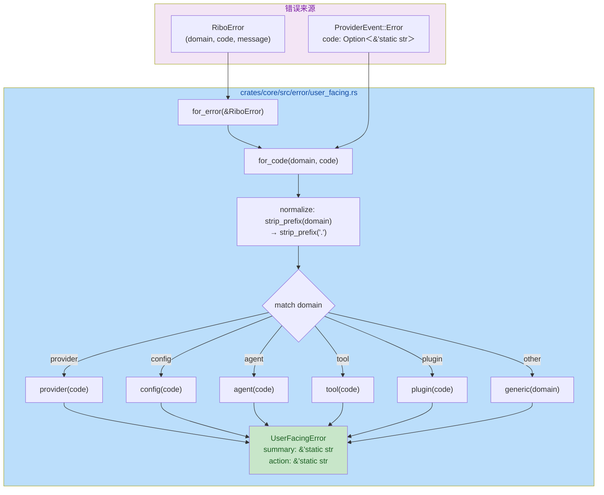
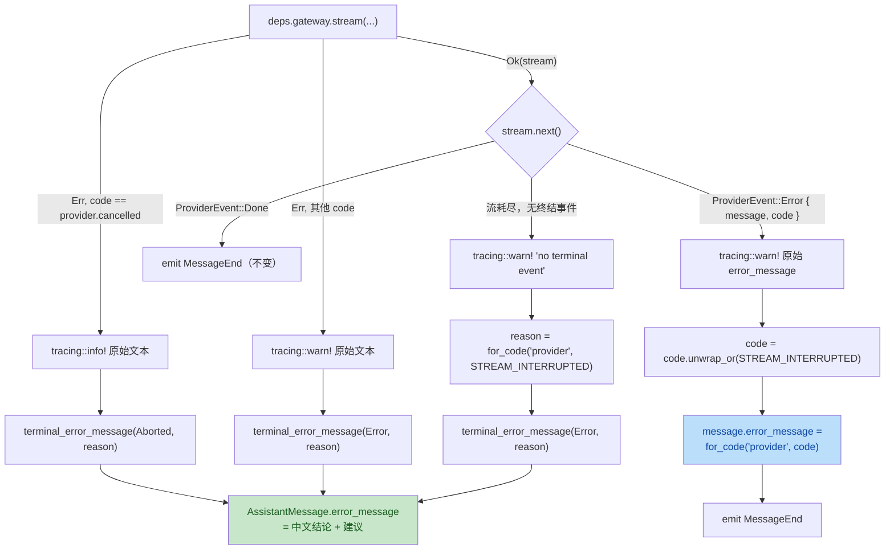
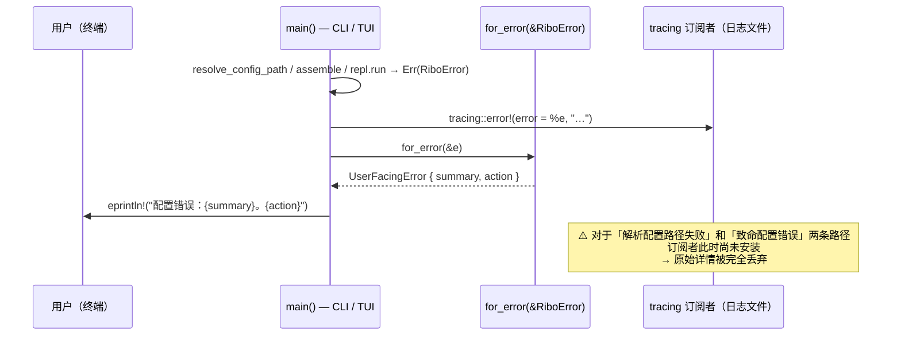
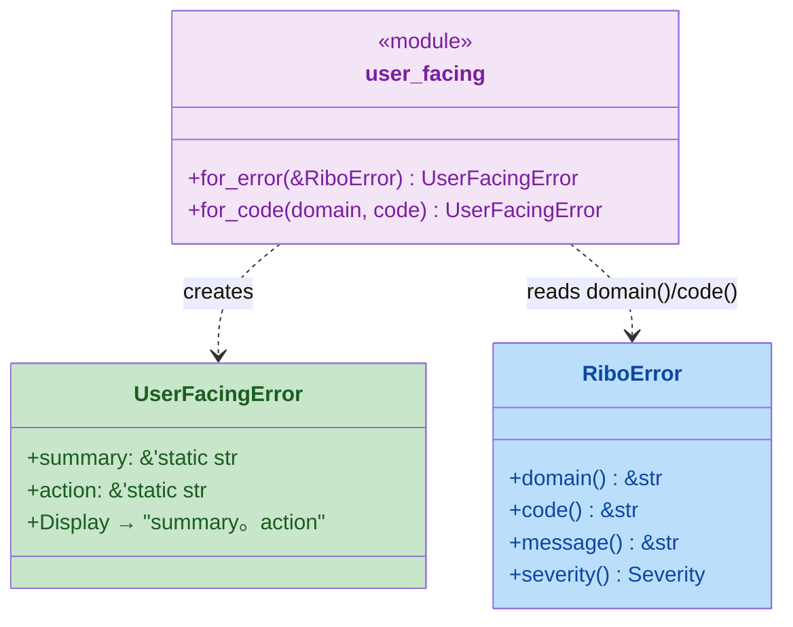

# 🔍 代码评审摘要 — `ribo-agent` 工作区

> 2026-11-26

## 1. 总体摘要（TL;DR）

* **影响：** **中等** — 在 `ra-core` 中引入全新的**用户可见错误展示层**，并接入 CLI、TUI 以及 agent 终端消息折叠的所有错误打印路径。另外，Gitee Release 同步工作流得到加固（超时、pip 缓存、无附件 Release 路径）。没有破坏任何公开 API；主要风险是**行为层面**的：上游原始错误文本不再展示给用户（并且在两条早期失败路径上，也不再写入日志）。

* **关键变更：**
  * 🆕 **新模块 `crates/core/src/error/user_facing.rs`**（270 行）— 将 `(domain, code)` 对映射为中文的**「结论 + 可操作建议」**组合（`UserFacingError { summary, action }`），针对 `provider` / `config` / `agent` / `tool` / `plugin` 各有独立映射函数，外加通用兜底。共覆盖 **55 个错误码**；未知错误码回退到域级提示，绝不泄露内部错误码。
  * 🔌 **`ra_core::error` 重新导出** `for_error(&RiboError)` 与 `for_code(domain, code)`；核心错误模块的文档已更新。
  * 🖥️ **CLI（`crates/cli/src/main.rs`）+ TUI（`crates/tui/src/main.rs`）** — 所有 `eprintln!("…{e}")` 改为打印 `for_error(&e)`；原始错误改由 `tracing::error!(error = %e, …)` 记录到日志文件，而非终端。
  * 🤖 **`crates/agent/src/agent_loop.rs`** — 终端 `AssistantMessage.error_message` 现在携带映射后的用户可见文本，而非原始 provider 消息（取消路径、建流失败路径、`ProviderEvent::Error` 路径，以及「stream ended without a terminal event」路径）。
  * 🧪 **`crates/agent/src/test_support.rs`** — 新增 `mock_gateway_no_retry()`（禁用重试），使失败折叠测试断言 **一次** provider 调用，而非「某个非空数量的调用」。
  * ⚙️ **`.github/workflows/sync-release-to-gitee.yml`** — 显式 `timeout-minutes: 60`、pip 缓存、附件数量探测，以及拆分的**有附件** / **无附件** Gitee Release 创建路径。
  * 📝 **`.github/workflows` + `crates/cli/src/config/mod.rs`** — 仅注释清理：provider 层注释不再引用已移除的根级 `query_model` 键。

---

## 2. 可视化总览（代码与逻辑映射）

### 2.1 新映射管线 — `ra-core::error::user_facing`



### 2.2 Agent 循环的错误折叠 — 原始文本何时变成用户可见文本



### 2.3 展示分流 — 终端 vs. 日志文件



### 2.4 `ra-core` 中的新公开类型



---

## 3. 变更详细分析

### 3.1 组件：`ra-core` — `crates/core/src/error/user_facing.rs`（新增）

**变更内容**

在 `error` 模块下新增一个同级模块，刻意将**展示层**与**承载层**（`RiboError`）分离。

* `UserFacingError` 是由两个 `&'static str` 字段构成的 `Copy` struct — 整个映射表都是编译期数据，正常路径**零运行时分配**。
* `Display` 渲染为 `"<结论>。<建议>"`（中文句号分隔）。
* `for_code(domain, code)` 在分派前先**规范化** code：如果存在 `"<domain>."` 前缀就剥离。这是必需的，因为代码库里存在**两种**错误码约定：
  * 带域前缀 — 例如 `ra_provider::error::RATE_LIMITED = "provider.rate_limited"`、`ra_agent::error::SESSION_BUSY = "agent.session_busy"`、`ra_plugins::error::PLUGIN_FORBIDDEN = "plugin.plugin_forbidden"`
  * 裸码 — 例如 `config_file_missing`、`compression_invalid`、`plugin_manifest_invalid`（均在 `config` 域）
* 未识别的 code 会命中各域的 `_` 兜底分支，该分支**从构造上保证安全**：绝不回显内部错误码或原始消息。
* `for_error(&RiboError)` 只是薄封装：`for_code(err.domain(), err.code())`。

**规范化验证**（为什么需要 `strip_prefix` + `strip_prefix('.')` 这一对操作）：

| 输入 `domain` | 输入 `code` | 规范化后的 key | 是否命中分支？ |
| :-- | :-- | :-- | :-- |
| `provider` | `provider.rate_limited` | `rate_limited` | ✅ |
| `config` | `config_file_missing` | `config_file_missing`（前缀无 `.`） | ✅ |
| `plugin` | `plugin.plugin_forbidden` | `plugin_forbidden` | ✅ |
| `agent` | `agent.session_busy` | `session_busy` | ✅ |

**已映射的错误码 — `provider` 域**（覆盖全部 17 个 `ra_provider::error` 常量）：

| Code | 结论 | 建议 |
| :-- | :-- | :-- |
| `rate_limited` | 模型请求过于频繁 | 请稍后重试，或切换其他模型。 |
| `auth_failed` | 模型服务拒绝了当前密钥 | 请检查 API 密钥是否与模型服务匹配。 |
| `quota_exceeded` | 模型服务额度已用尽 | 请检查账户额度，或切换其他模型。 |
| `invalid_request` | 请求未被模型服务接受 | 请缩短输入内容后重试；若持续失败，请检查模型配置。 |
| `timeout` | 模型服务响应超时 | 请稍后重试，或切换其他模型。 |
| `server_error` | 模型服务暂时不可用 | 请稍后重试。 |
| `transport_error` | 连接模型服务失败 | 请检查网络与模型服务地址后重试。 |
| `invalid_response` | 模型服务返回了无法解析的内容 | 请稍后重试；若持续失败，请更换模型服务。 |
| `content_filtered` | 内容被模型服务拦截 | 请修改输入内容后重试。 |
| `stream_interrupted` | 模型响应中途断开 | 请重试本轮对话。 |
| `cancelled` | 请求已取消 | 可重新发送本轮内容。 |
| `provider_not_found` | 配置的模型提供方不存在 | 请检查 ribo.toml 中的 provider 配置。 |
| `model_not_found` | 配置的模型不存在 | 请检查 ribo.toml 中的模型名称。 |
| `circuit_open` | 模型服务暂时被熔断 | 请稍后重试，或切换其他模型。 |
| `overloaded` | 模型服务当前繁忙 | 请稍后重试。 |
| `duplicate_provider` | 模型提供方重复配置 | 请检查 ribo.toml 中是否有重复的 provider id。 |
| `retry_provider_refused` | 模型提供方配置与网关重试策略冲突 | 请检查该提供方是否自行开启了重试。 |
| *（兜底）* | 模型请求失败 | 请检查网络、模型地址与密钥配置，或稍后重试。 |

**已映射的错误码 — `config` 域：**

| Code | 结论 | 建议 |
| :-- | :-- | :-- |
| `config_file_missing` | 未找到指定的配置文件 | 请确认文件路径，或使用 --config 指定 ribo.toml。 |
| `no_providers_in_release` | 发布版未配置模型服务 | 请在 ribo.toml 中至少启用一个模型提供方。 |
| `placeholder_in_release` | 配置仍是示例占位内容 | 请把 ribo.toml 中的占位项替换为真实配置。 |
| `query_model_unavailable_in_release` | 默认模型配置不可用 | 请检查 ribo.toml 的 [routing].default 配置（provider 与 model），并确认对应 API 密钥已设置。 |
| `compression_invalid` | 上下文压缩配置无效 | 请检查 ribo.toml 中的 compression 配置项。 |
| `mount_invalid` | 文件系统挂载配置无效 | 请检查 ribo.toml 中的 fs.mounts 配置。 |
| `plugin_file_missing` | 插件文件不存在 | 请检查 ribo.toml 中的插件路径。 |
| `plugin_load_failed` | 插件加载失败 | 请检查插件文件、依赖与来源校验配置。 |
| `plugin_trusted_keys_unreadable` | 插件信任列表无法读取 | 请检查用户目录中的信任文件权限。 |
| `plugin_trusted_keys_invalid` | 插件信任列表格式不正确 | 请检查信任文件中的公钥配置。 |
| `plugin_manifest_unreadable` | 插件清单无法读取 | 请检查插件清单文件是否存在且可读。 |
| `plugin_manifest_invalid` | 插件清单格式不正确 | 请核对插件清单内容后重试。 |
| `plugin_provenance_unreadable` | 插件来源信息无法读取 | 请检查插件来源描述文件。 |
| `plugin_duplicate_id` | 插件 id 重复 | 请检查 ribo.toml 中是否有重复的插件声明。 |
| *（兜底）* | 配置校验未通过 | 请检查 ribo.toml 与用户目录配置后重试。 |

**已映射的错误码 — `agent` / `tool` / `plugin` / `generic`：**

| 域 | Code | 结论 | 建议 |
| :-- | :-- | :-- | :-- |
| `agent` | `session_not_found` | 会话不存在 | 请切换已有会话，或新建会话后重试。 |
| `agent` | `session_create_failed` | 会话创建失败 | 请检查存储目录权限后重试。 |
| `agent` | `session_busy` | 会话正在处理 | 请等待当前回合结束后再操作。 |
| `agent` | `max_iterations` | 已达到迭代上限 | 请简化任务或分批发送。 |
| `agent` | `context_build_error` | 上下文构建失败 | 请切换会话或缩短输入后重试。 |
| `agent` | `tool_exec_error` | 工具执行失败 | 请检查工具参数后重试。 |
| `agent` | `cancelled` | 请求已取消 | 可重新发送本轮内容。 |
| `agent` | *（兜底）* | 会话处理失败 | 请重试当前操作，必要时切换会话。 |
| `tool` | `not_found` | 工具未注册 | 请检查工具配置或更换工具名称。 |
| `tool` | `already_registered` | 工具重复注册 | 请检查插件或工具配置中是否有重复声明。 |
| `tool` | `invalid_arguments` | 工具参数不正确 | 请检查参数后重试。 |
| `tool` | `exec_failed` | 工具执行失败 | 请检查工具参数或目标文件后重试。 |
| `tool` | `cancelled` | 工具执行已取消 | 可重新发送本轮内容。 |
| `tool` | `rate_limited` | 工具调用过于频繁 | 请稍后重试。 |
| `tool` | `plugin_forbidden` | 当前域不允许该工具写入 | 请检查工具的目标域配置。 |
| `tool` | *（兜底）* | 工具执行失败 | 请稍后重试。 |
| `plugin` | `plugin_exec_failed` | 插件执行失败 | 请检查插件参数或插件实现后重试。 |
| `plugin` | `plugin_timeout` | 插件执行超时 | 请稍后重试或更换插件。 |
| `plugin` | `plugin_forbidden` | 插件缺少所需能力授权 | 请检查插件的能力声明与信任配置。 |
| `plugin` | `plugin_internal` | 插件宿主内部错误 | 请稍后重试；若持续失败，请禁用该插件。 |
| `plugin` | `plugin_invalid_arguments` | 插件收到非法参数 | 请检查插件接口实现。 |
| `plugin` | `plugin_signature_invalid` | 插件来源校验失败 | 请确认插件签名与信任列表。 |
| `plugin` | `plugin_duplicate_id` | 插件 id 重复 | 请检查是否有同名插件。 |
| `plugin` | `plugin_invalid_name` | 插件名称不合法 | 请检查插件 id 与工具名是否符合命名规则。 |
| `plugin` | `plugin_schema_invalid` | 插件工具参数定义无效 | 请检查插件的工具 Schema。 |
| `plugin` | `plugin_batch_failed` | 插件批量注册失败 | 请检查插件之间是否存在冲突。 |
| `plugin` | *（兜底）* | 插件加载或执行失败 | 请检查插件配置与来源校验设置。 |
| `io` | *（域兜底）* | 文件读写失败 | 请检查路径与权限后重试。 |
| *（其他）* | *（域兜底）* | 操作未完成 | 请稍后重试。 |

**新增单元测试**（位于 `crates/core/src/error/user_facing.rs` 模块内）：

| 测试 | 断言内容 |
| :-- | :-- |
| `maps_prefixed_provider_code` | `"provider.rate_limited"` → 模型请求过于频繁；原始 `HTTP 429` 响应体**不**出现 |
| `maps_bare_config_code` | 裸 code → 默认模型配置不可用；包含 `[routing].default` 与 `API 密钥`；**不**包含内部 `query` / `发布版` / `release build` 措辞 |
| `unknown_code_falls_back_to_domain_hint` | `provider.internal_mystery` → 模型请求失败；code 与 `secret detail` 均不泄露 |

---

### 3.2 组件：`ra-core` — `crates/core/src/error.rs`

**变更内容** — 最小且纯增量：

* 模块树中新增 `pub mod user_facing;`。
* 从 `ra_core::error` 重新导出 `pub use user_facing::{UserFacingError, for_code, for_error};`。
* 模块文档把 `for_error` 列为第 4 个公开条目，并记录其意图（「把底层错误映射为『中文结论 + 可操作建议』，供 CLI/TUI 展示」）。

---

### 3.3 组件：Agent 循环 — `crates/agent/src/agent_loop.rs`

**变更内容** — 抵达渲染层/TUI 的**终端消息**（`AssistantMessage.error_message`）现在携带映射后的文本，而非原始 provider 消息。

| 路径（来源：`crates/agent/src/agent_loop.rs`） | 之前 | 之后 |
| :-- | :-- | :-- |
| 建流取消（`err.code() == CANCELLED`，L448-463） | `terminal_error_message(deps, StopReason::Aborted, err.message())` | `for_error(&err).to_string()` → 保留 `StopReason::Aborted` |
| 建流失败（其他 `Err`，L464-479） | `err.message()` | `for_error(&err).to_string()` |
| `ProviderEvent::Error`（L493-509） | 原始 `message.error_message` 直接透传 | 先 `tracing::warn!` 记录原始文本，再**覆盖**为 `for_code("provider", code)`；`code = None` → `STREAM_INTERRUPTED` |
| 流结束但无终结事件（L531-540） | 硬编码英文 `"stream ended without a terminal event"` | `for_code("provider", STREAM_INTERRUPTED)` → 「模型响应中途断开。请重试本轮对话。」 |

**关键代码**（`ProviderEvent::Error` 分支 — 注意日志发生在覆盖之前，因此原始详情不会从日志中丢失）：

```rust
ProviderEvent::Error { mut message, code, .. } => {
  tracing::warn!(
    code = ?code,
    error = message.error_message.as_deref().unwrap_or(""),
    "provider stream error event"
  );
  let code = code.unwrap_or(ra_provider::error::STREAM_INTERRUPTED);
  message.error_message = Some(for_code("provider", code).to_string());
  emitter.emit(AgentEvent::MessageEnd { message: Message::from(message.clone()) }).await;
  return message;
}
```

**测试变更**（同文件 `mod tests` 中）— 断言从「存在错误消息」变为「存在正确的中文结论**且**上游文本不存在」：

* `test_run_no_retry(steps, default_behavior)` — 新增辅助函数，构建禁用网关重试的环境。
* `gateway_stream_failure_folds_to_error_terminal` — 现在断言 `run.provider.record().len() == 1`（原先：非空即可），并断言终端文本包含「模型服务暂时不可用」且**不**包含 `upstream down` / `no more mock responses queued`。
* 同组的取消路径测试同样断言映射后的结论，并显式排除 `mock stream failed as scripted`。

---

### 3.4 组件：测试支撑 — `crates/agent/src/test_support.rs`

**变更内容**

| 函数 | 之前 | 之后 |
| :-- | :-- | :-- |
| `mock_gateway_with_recorder(steps)` | 内联构造网关，使用 `GatewayConfig::default()` | 委托给新增的私有 `mock_gateway_with_config(steps, GatewayConfig::default())` |
| `mock_gateway_with_config(steps, config)` *（新增，私有）* | — | 构造 `Gateway::new(config)` 并注册 mock provider 的唯一入口 |
| `mock_gateway_no_retry(steps)` *（新增，公开）* | — | `config.retry.max_retries = 0` → 建流失败在首次尝试即传播，不再消耗更多脚本步骤 |

**为何重要：** 以前，建流失败测试可能被网关重试，消耗 mock 脚本并掩盖原始失败（断言甚至被迫弱化为「记录非空」）。有了 `max_retries = 0`，测试可以断言 provider 调用的**精确**次数（`1`），这是严格更强的不变式。

---

### 3.5 组件：CLI / TUI 展示 — `crates/cli/src/main.rs`、`crates/tui/src/main.rs`

**变更内容** — 每一处面向用户的错误打印都从原始 `RiboError`（`[domain] code: message`）切换为映射文本，原始错误改走 `tracing`：

| 文件 | 行号 | 现在打印给用户 | 现在记录到日志 |
| :-- | :-- | :-- | :-- |
| `crates/cli/src/main.rs` | 51 | `配置路径错误：{summary}。{action}` | `tracing::error!(error = %e, "resolve config path failed")` |
| `crates/cli/src/main.rs` | 70 | `命令失败：{summary}。{action}` | `tracing::error!(error = %e, "one-shot command failed")` |
| `crates/cli/src/main.rs` | 84 | `配置错误：{summary}。{action}` | `tracing::error!(error = %err, "fatal config error")` |
| `crates/cli/src/main.rs` | 126 | `装配失败：{summary}。{action}` | `tracing::error!(error = %e, "assemble failed")` *(原为 `code = %e.code()`)* |
| `crates/cli/src/main.rs` | 141 | `错误：{summary}。{action}` | `tracing::error!(error = %e, "repl run failed")` |
| `crates/tui/src/main.rs` | 67 | `配置路径错误：{summary}。{action}` | `tracing::error!(error = %e, "resolve config path failed")` |
| `crates/tui/src/main.rs` | 79 | `配置错误：{summary}。{action}` | `tracing::error!(error = %err, "fatal config error")` |
| `crates/tui/src/main.rs` | 162 | `装配失败：{summary}。{action}` | `tracing::error!(error = %err, "assemble failed")` *(原为 `code = %err.code()`)* |

> 注意 `assemble` 处虽小但有意义的一点改进：日志字段从 `code = %e.code()` 改为 `error = %e`，因此日志现在携带**完整**错误（域 + code + 消息），而不只是 code。

---

### 3.6 组件：配置 schema 注释 — `crates/cli/src/config/mod.rs`

**变更内容** — 仅注释，一行：

```diff
-    // provider 层特殊：query_model/[[providers]]/[routing] 均为根级键，
+    // provider 层特殊：[[providers]] / [routing] 均为根级键，
```

这让文档注释与 schema 保持一致：`ProviderSchema` 中已不存在根级 `query_model` 键（只有 `[[providers]]` 与 `[routing]` 是根级键）。错误码 `query_model_unavailable_in_release` 仍然存在且与已移除的配置键无关 — 它在 `config` 表中被正确映射。

---

### 3.7 组件：CI/CD — `.github/workflows/sync-release-to-gitee.yml`

**变更内容**

| 方面 | 之前 | 之后 |
| :-- | :-- | :-- |
| Job 超时 | 隐式（GitHub 默认 360 分钟） | **显式 `timeout-minutes: 60`** — 注释记录了实测完整同步耗时约 39 分钟（Python 依赖 + 跨境附件上传） |
| pip 依赖 | 每次运行重新安装 | `actions/cache@v4` 缓存 `~/.cache/pip`，key 由 OS + 工作流文件哈希构成，带 `restore-keys` 前缀回退 |
| Release 查询 | `gh release view --json name,body,targetCommitish` | 增加 `assets` → 新增 `asset_count` 输出（`jq '.assets \| length'`） |
| 附件下载 | `gh release download "$TAG_NAME" --dir release_assets`（无附件时失败） | `ASSET_COUNT == 0` 时跳过；下载**仍不**包裹 `\|\| true`，因此真实网络/权限失败仍会让 job 失败 |
| 空目录检测 | 无 | 新增步骤输出 `HAS_ASSETS=false\|true`，由 `ls -A release_assets` 推导 |
| Gitee Release 创建 | 单步骤，总是上传 `release_assets/*` | 拆成两个条件步骤：**Create Gitee Release with Assets**（`HAS_ASSETS == 'true'`，保留 `gitee_files` + `gitee_upload_retry_times: 3`）与 **Create Gitee Release (No Assets)**（`HAS_ASSETS == 'false'`，仅元数据） |
| 清理 | `rm -rf release_assets/` | 不变（`if: always()`） |

---

## 4. 影响与风险评估

### 4.1 破坏性变更

| 方面 | 评估 |
| :-- | :-- |
| **Rust 公开 API** | 🟢 **纯增量。** `ra_core::error::{UserFacingError, for_code, for_error}` 均为新增。没有改动任何既有签名。`ra-agent`、`ra-cli`、`ra-tui` 原本已依赖 `ra-core` — 无需修改 `Cargo.toml`。 |
| **屏幕上的错误文本** | 🟡 **用户可见的行为变更。** 上游原始文本（HTTP 状态码、provider 响应体、`upstream down` 等）**不再**展示。任何依赖旧文本绕过的东西（`grep`、快照测试、文档、支持手册）都会失效。 |
| **`AssistantMessage.error_message`** | 🟡 **行为变更 + 持久化数据。** 终端助手消息现在携带映射后的中文文本。该值会写入会话记录，因此**此前持久化的会话保留旧措辞** — UI 在新旧会话间会呈现混合格式。 |
| **CI 行为** | 🟡 `timeout-minutes: 60` 可能杀死确实很慢的同步（文档记录的测量值约 39 分钟，余量约 1.5 倍）。缓存 key 变更（工作流文件编辑）会使 pip 缓存失效一次 — 无害。 |

### 4.2 ⚠️ 本次 diff 中发现的具体风险

1. **两条早期失败路径上原始错误详情被静默丢弃。**
   在 `crates/cli/src/main.rs` 与 `crates/tui/src/main.rs` 中，`"resolve config path failed"` 和 `"fatal config error"` 的 `tracing::error!` 调用发生在 `init_file_logging_with_fallback(...)` 安装订阅者**之前**（`cli/main.rs` L47-51 & L82-84 vs. L92；`tui/main.rs` L63-79 vs. L86）。没有订阅者时，`tracing` 宏是空操作 → 原始错误**既不**打印到 stderr（已被替换），**也不**写入日志文件。`assemble` / `repl run` 路径没问题（届时日志已生效）。
   *建议：* 要么在这些检查之前初始化日志，要么在这两条路径的 `eprintln!` 中包含原始错误。

2. **`tool` 域的 `plugin_forbidden` 映射不可达。**
   `ra_tools::error` 使用 `DOMAIN = "tool"`，但常量是 `PLUGIN_FORBIDDEN = "plugin.plugin_forbidden"`（刻意复用 plugin 的 code）。`for_code("tool", "plugin.plugin_forbidden")` 只剥离 `"tool."` 前缀 → key 仍是 `plugin.plugin_forbidden` → `tool()` 分支中的 `"plugin_forbidden"` 永不匹配 → 兜底为通用的「工具执行失败。请稍后重试。」。
   *后果：* 命名域写入被拒被当作普通工具失败上报。`plugin()` 域中的 `plugin_forbidden` 分支没问题（域 `plugin` → 剥离为 `plugin_forbidden`）。
   *建议：* 规范化时剥离**任意**已知域前缀，或在 `tool()` 中显式增加 `"plugin.plugin_forbidden"` 分支。

3. **映射表是错误码常量的手工副本。**
   没有编译期穷尽性检查 — `match` 的是 `&str` 且有 `_` 兜底，因此新增错误码会**静默**降级为模糊的域级消息。已有两个保留但未映射的 `agent` code：`agent.retrieval_error` 与 `agent.subagent_error`（都兜底为「会话处理失败」）。可用宏生成表格，或加一个 `#[deny]` 风格的测试，交叉核对 `ra_provider::error` / `ra_agent::error` / `ra_tools::error` / `ra_plugins::error` 常量与映射表，防止漂移。

4. **用户可见文本丢失了「具体发生了什么」的细节。**
   所有映射文案都足够笼统，两种不同失败（例如 `timeout` 与 `transport_error`）给出的建议非常相似。细节现在只在日志里 — 对终端 UX 可以接受，但这让日志文件成为排障的**必需品**，应验证日志的保留期与详细级别。

5. **`ProviderEvent::Error` 路径无条件覆盖 `message.error_message`。**
   任何预先格式化了*更具体*消息（例如含 HTTP 状态码）的 provider，现在都会被替换。原始文本会先记入日志（很好），但该分支仍忽略事件的 `reason: StopReason` 字段（既有问题）— 某些路径下 provider 发送的 `StopReason::Aborted` 仍会呈现为 `StopReason::Error`。

### 4.3 🧪 测试建议

**待覆盖的新行为**

| 场景 | 位置 | 预期 |
| :-- | :-- | :-- |
| 配置文件缺失（`--config` 指向不存在路径） | `ra-cli` | stderr 显示「未找到指定的配置文件。请确认文件路径，或使用 --config 指定 ribo.toml。」且**不**含原始路径/消息 |
| 发布版无 provider | `ra-cli` / `ra-tui` | 「发布版未配置模型服务。请在 ribo.toml 中至少启用一个模型提供方。」 |
| 网关返回 HTTP 429 | provider mock | 「模型请求过于频繁。请稍后重试，或切换其他模型。」 |
| 网关返回 HTTP 401 | provider mock | 「模型服务拒绝了当前密钥。请检查 API 密钥是否与模型服务匹配。」 |
| 回答中途流断开 | provider mock | 终端消息包含「模型响应中途断开」 |
| 流结束但无任何终结事件 | provider mock | 终端消息包含「模型响应中途断开」（此前是英文字面量） |
| 建流期间取消 | provider mock | `StopReason::Aborted` **且**文本「请求已取消。可重新发送本轮内容。」 |
| 命名域写入被拒（`tool` 域） | 工具注册表 | ⚠️ 目前产出通用工具消息 — 见风险 2 |
| 未知 / 未来错误码 | 单元测试 | 回退到域级提示；code 与原始消息均不泄露 |

**回归检查**

* 运行完整工作区测试套件 — `agent_loop.rs` 中两条重写后的断言包含*否定*条件（`!reason.contains("upstream down")`），因此任何其他断言旧原始错误文本的测试都会暴露出来。
* 验证日志文件对 `assemble failed` 与 `repl run failed` 路径确实包含原始错误（应该包含），并确认两条早期路径的行为（当前会丢失 — 风险 1）。
* 对一次失败的 CLI 运行做终端输出快照，确认新中文文案在非 UTF-8 / 窄终端下正确渲染（消息比旧的更长）。
* 分别用**有附件**和**无附件**的 Release 演练 Gitee 同步工作流，确认 `HAS_ASSETS` 分流选中正确步骤，且 60 分钟超时对约 39 分钟的同步足够宽裕。
