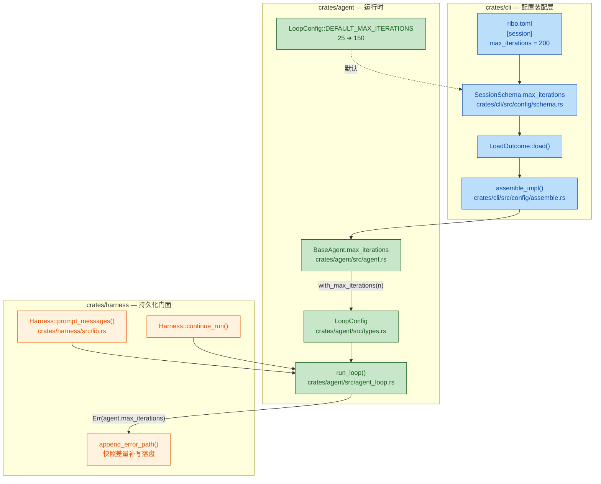
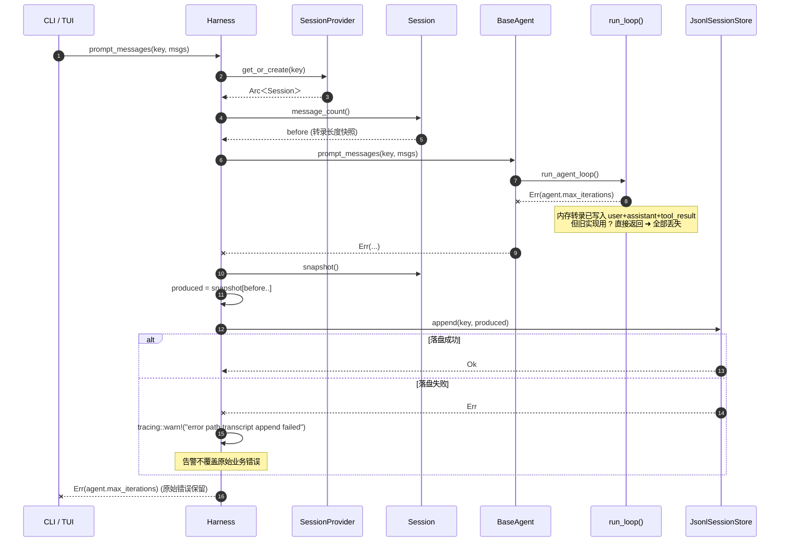
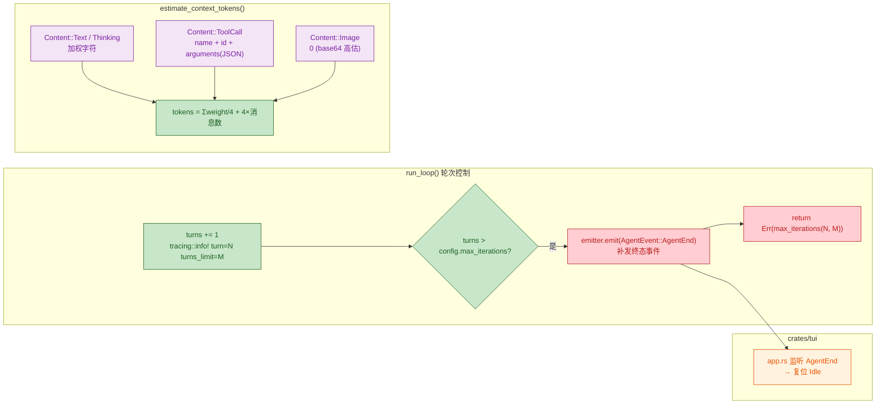

# 🔍 代码评审摘要 — Ribo Agent `v0.0.4`

> 2026-11-27

## 1. 总体摘要（TL;DR）

* **影响：** **高** — 本次发布加固了 Agent 运行时循环：把每回合的迭代上限改为可配置（默认 25 → 150），保证失败前已产生的成果**落盘而非丢失**，修复了一个 **TUI 卡死**问题（turn 停留在 `InFlight`），并修正了**上下文 token 低估**缺陷——该缺陷导致压缩从未触发。

* **关键变更：**

| # | 主题 | 变更 |
|---|-------|--------|
| 1 | ⚙️ 配置 | 新增 `[session] max_iterations` 键；`LoopConfig::DEFAULT_MAX_ITERATIONS` 从 `25` 提升到 `150`；经由 `BaseAgent::with_max_iterations()` → `LoopConfig::with_max_iterations()` 逐层透传 |
| 2 | 💾 持久性 | `Harness::append_error_path()` 在 `Err` 时回写转录**差量**（此前用 `?` 短路，直接丢弃整轮成果） |
| 3 | 🐛 TUI 卡死 | `run_loop()` 在返回 `agent.max_iterations` 之前补发终止事件 `AgentEvent::AgentEnd`（TUI 收到 `AgentEnd` 后复位 turn 状态） |
| 4 | 📏 正确性 | `estimate_context_tokens()` 现在计入 `ToolCall` 的 name / id / arguments JSON（此前计为 `0`）→ 压缩真正得以触发；内联图片仍计 `0` |
| 5 | 🧪 覆盖度 | 新增 `agent_mock_loop` 示例（3 个场景）+ 4 个压缩测试、2 个 WASM start 段 trap 测试、1 个失败持久化集成测试 |
| 6 | 🧹 清理 | TUI 移除未使用依赖（`ra-harness`、`once_cell`、`tracing-appender`）；工作区版本 `0.0.3 → 0.0.4`；新增 `CHANGELOG.md`；工具链文档统一为 Rust `1.100.0` |

---

## 2. 可视化总览（代码与逻辑映射）

### 2.1 配置注入链路 — `[session] max_iterations`



### 2.2 失败路径持久化时序（此前成果会丢失）



### 2.3 终态事件契约与 token 估算



---

## 3. 变更详细分析

### 3.1 组件：`BaseAgent` / `LoopConfig` — 迭代上限改为可配置

**变更内容**

* `LoopConfig::DEFAULT_MAX_ITERATIONS` 从 **`25` 提升到 `150`**（来源：`crates/agent/src/types.rs`）。代码注释给出的理由是：150 足以覆盖「读十几个文件 + 分析 + 总结」这类任务，同时保留循环保护。
* `BaseAgent` 新增私有的 `max_iterations: usize` 字段，以及 **builder 风格**的 `with_max_iterations(mut self, n) -> Self`。`prompt_messages()` 与 `continue_run()` 现在都用 `LoopConfig::for_session(&session).with_max_iterations(self.max_iterations)` 构造其 `LoopConfig`（来源：`crates/agent/src/agent.rs`）。
* 该值**只**经由 CLI 装配层注入；未调用该 builder 的调用方保留默认值。

| 符号 | 种类 | 文件 | 用途 |
|---|---|---|---|
| `LoopConfig::DEFAULT_MAX_ITERATIONS` | 常量 | `crates/agent/src/types.rs` | 默认上限（25 → 150） |
| `BaseAgent::with_max_iterations()` | builder | `crates/agent/src/agent.rs` | 注入按 agent 设定的上限 |
| `SessionSchema.max_iterations` | 字段 | `crates/cli/src/config/schema.rs` | 面向 TOML 的配置键 |
| `assemble_impl()` 接线 | 调用点 | `crates/cli/src/config/assemble.rs` | `BaseAgent::new(...).with_max_iterations(outcome.session.max_iterations)` |

### 3.2 组件：CLI 配置层

**变更内容**

* `SessionSchema` 新增 `pub max_iterations: usize`，默认值为 `ra_agent::types::LoopConfig::DEFAULT_MAX_ITERATIONS` —— CLI 默认值**派生自 agent 常量**，两者不会漂移。
* 由于 `SessionSchema` 派生 `Deserialize` 时带 `#[serde(default)]`，**既有的 `ribo.toml` 无需该键也能照常加载**（无需迁移）。
* `crates/cli/src/config/mod.rs` 中新增测试断言：默认值为 `150`；文件级 `max_iterations = 200` 会覆盖默认值。

| 配置键 | 类型 | 旧值 | 新值 | 说明 |
|---|---|---|---|---|
| `[session] max_iterations` | `usize` | *无（硬编码 25）* | `150` | 每回合最大迭代次数（1 回合 = 1 次助手响应 + 其工具批次）。超限 → `agent.max_iterations`；已产出消息保留供续跑。 |

### 3.3 组件：`Harness` — 失败路径转录持久化 🐛

**变更内容**

* 此前 `Harness::prompt_messages()` / `continue_run()` 使用 `?`，因此在**任意**循环错误时，已产出消息（用户输入、助手消息、工具结果）只存在于内存会话中，**重启即丢**。
* 现在 harness 先物化会话，以 `session.message_count()` 记录差量起点，出错时调用新增的私有 `append_error_path()`：计算 `snapshot[before..]` 并追加到 store。
* **失败语义：** 回写失败只产生 `tracing::warn!("error path transcript append failed")` —— 刻意**不掩盖原始业务错误**（`agent.max_iterations` 等）。

```rust
// crates/harness/src/lib.rs — append_error_path()
let snapshot = session.snapshot();
if snapshot.len() <= before { return; }
let produced = &snapshot[before..];
if let Err(err) = self.store.append(key, produced).await {
    tracing::warn!(session_key = %key, error = %err, "error path transcript append failed");
}
```

### 3.4 组件：`Session` — 低成本读取转录长度

**变更内容**

* 新增 `Session::message_count() -> usize`（来源：`crates/agent/src/session.rs`）：获取**读锁并返回 `.len()`**，不对 `Vec<Message>` 做深拷贝。与 `Session::snapshot()` 形成对比——后者克隆整个转录。
* 理由（据 CHANGELOG）：避免长会话中**每回合两次全量转录深拷贝**；错误路径以此为差量起点。
* ⚠️ 注意：`append_error_path()` 仍会调用 `session.snapshot()` —— 错误路径上**仍有一次**全量拷贝（可接受，因为该路径是终结性的）。

### 3.5 组件：`agent_loop` — 终态事件与可观测性

**变更内容**

* **终态事件修复：** 当 `turns > config.max_iterations` 时，`run_loop()` 现在在返回 `Err` **之前**发出 `AgentEvent::AgentEnd { messages }`。这是 `run_loop()` 中唯一一条不通过 `AgentEnd` 收敛的错误路径；缺少它时，TUI 的 turn 会永久停留在 `InFlight`，因为 `app.rs` 依赖 `AgentEnd` 复位到 `Idle`。
* **每轮日志：** 每轮开头新增一条 `tracing::info!`，输出 `session_key`、`turn = N`、`turns_limit = M`，消息为 `"agent loop turn start"` —— 因此轮次耗尽无需数 `turn start` 日志行即可诊断（明确指向早前的「27 号日志」事件）。
* **错误日志增强：** 失败日志现在包含 `error = %err`，单条日志即可看到 `N > M` 的轮次耗尽细节。
* `run_loop()` 签名新增 `session_key: &str` 参数，以支持结构化日志字段。

| 事件 | 之前 | 之后 |
|---|---|---|
| `agent.max_iterations` 返回 | ❌ 无终态事件 | ✅ 发出 `AgentEnd`（恰好一次，且为最后一个事件） |
| 轮次日志 | 无 | `info!(turn=N, turns_limit=M)` |
| 失败日志 | 仅 `error_code` | `error_code` **+** `error` 文本 |

### 3.6 组件：`ra-core` — 上下文 token 估算修正 📏

**变更内容**

* `estimate_context_tokens()` 此前把 `Content::ToolCall(_)` 计为 **0**。由于 `ToolCall.arguments` 是原样发给模型的 JSON，长会话会系统性**低估**上下文大小 → 压缩永不触发 → 真实 provider 请求超出上下文窗口（HTTP 400 / code 1261）。
* 现在 tool-call 分支对 `call.name`、`call.id`、`call.arguments.to_string()` 的字符做加权求和。内联**图片仍计 0**（base64 会严重高估）。

| Content 变体 | 旧权重 | 新权重 | 理由 |
|---|---|---|---|
| `Content::Text(t)` | 加权字符数 | *不变* | — |
| `Content::Thinking(t)` | 加权字符数 | *不变* | — |
| `Content::ToolCall(call)` | **`0`** | **`name` + `id` + `arguments`（JSON）加权字符数** | 参数会发给模型；忽略会低估数千 token |
| `Content::Image(_)` | `0` | `0`（不变） | base64 会高估 |

* 共享调用方自动受益：**压缩触发**、`agent_loop` 降级窗口、**TUI 上下文占比**。CHANGELOG 报告实测会话上下文占比由 **66% 修正为 81%**。

### 3.7 组件：新增示例 — `agent_mock_loop` 🧪

**变更内容**

新增文件 `crates/agent/examples/agent_mock_loop.rs`（408 行，零新增依赖、无需 API 密钥），使用脚本化 `MockProvider` 演示完整的「prompt → 工具批次 → 持久化」链路：

| 场景 | 函数 | 证明内容 |
|---|---|---|
| 1. 多轮工具调用 | `demo_multi_turn()` | `echo` → `calculator` → 文本收敛；**3 次 LLM 调用**、**2 条工具结果**回灌 |
| 2. steering 注入 | `demo_steering()` | 在工具执行期经 `session.enqueue_steering()` 入队的一条消息，出现在**下一次** LLM 请求中 |
| 3. abort 中止 | `demo_abort()` | `MockStep::Silent` 窗口 + `agent.stop()` → 取消级联、循环以 `Aborted` 收敛、运行标志复位 |

辅助函数：`text_step()`、`tool_call_step()`、`text_assistant()`、`print_events()`、`build_agent()`，以及自定义的 `SteerEchoTool`（实现 `AgentTool`，可通过 `ctx.signal().cancelled()` 取消）。

### 3.8 组件：测试套件新增

| 测试 | 文件 | 覆盖场景 |
|---|---|---|
| `summary_timeout_falls_back_to_sliding_window` | `crates/harness/src/compaction.rs` | `SUMMARY_TIMEOUT`（30s）经**虚拟时钟**（`start_paused`）→ 原因 `SummaryFailed`、`summary=None`、滑窗回退（4 条消息） |
| `cancelled_token_falls_back_before_summary` | `crates/harness/src/compaction.rs` | 预先取消的 `CancelToken` → 网关在建流前检测 → 回退（使用「本应成功」的 step，确保取消未传播时测试会失败） |
| `run_summarize_reports_no_text_for_empty_stream` | `crates/harness/src/compaction.rs` | 空流 → `Err("summary stream produced no text")` |
| `cooldown_expires_then_resummaries` | `crates/harness/src/compaction.rs` | `cooldown_turns=1` → 成功 → 冷却抑制（复用摘要）→ 越过滞回 1.10× → **重新摘要** |
| `max_iterations_output_persists_and_can_continue` | `crates/harness/tests/integration.rs` | limit=1 + `tool_use` → `Err(agent.max_iterations)` → 磁盘上 **3 条消息** → 重启回放 3 条 → `continue_run` 成功 → 磁盘 4 条 |
| `start_section_trap_maps_to_exec_failed` | `crates/plugins/src/wasm/tests.rs` | 实例化时真实 `(start ...)` `unreachable` → `Trap::UnreachableCodeReached` → `plugin.plugin_exec_failed`（**不是** `plugin_internal`，后者会误触发熔断） |
| `start_section_deadloop_is_interrupted_by_epoch` | `crates/plugins/src/wasm/tests.rs` | `(start ...)` 死循环 → epoch `Trap::Interrupt` → `plugin.plugin_timeout`（资源限制，不触发熔断） |
| `message_count_matches_snapshot_len` | `crates/agent/src/session.rs` | `message_count()` == `snapshot().len()`；空追加不改变计数 |
| `max_iterations_returns_error_and_writes_back`（扩展） | `crates/agent/src/agent_loop.rs` | 现在断言**恰好一个**终态事件，且它是**最后一个**事件 |

* `crates/harness/Cargo.toml` 在 **dev-dependencies** 中新增 `tokio = { workspace = true, features = ["test-util"] }` —— 因为 tokio 的 `full` feature 并**不**包含 `test-util`，而 `start_paused` 虚拟时钟测试需要它。

### 3.9 组件：依赖与工作区元数据

| 包 | Crate | 旧 | 新 | 原因 |
|---|---|---|---|---|
| `ra-harness` | `ra-tui` | 已声明 | **移除** | TUI 二进制未使用 |
| `once_cell` | `ra-tui` | 已声明 | **移除** | 未使用 |
| `tracing-appender` | `ra-tui` | 已声明 | **移除** | 未使用 |
| `once_cell` | 工作区根 | `"1"` | **移除** | 移除 TUI 声明后成为孤儿 |
| `tokio`（dev） | `ra-harness` | — | **新增**，`features = ["test-util"]` | 虚拟时钟超时测试 |

| 工作区元数据 | 旧 | 新 |
|---|---|---|
| `version` | `0.0.3` | `0.0.4` |

### 3.10 组件：文档与变更日志

| 文件 | 变更 |
|---|---|
| `CHANGELOG.md` | **新增文件** —— Keep a Changelog 格式，含 `v0.0.4` 段落（新增 / 变更 / 修复 / 移除），并回填 `0.0.3` / `0.0.2` / `0.0.1` |
| `docs/src/configuration.md` | **新增章节** `session.max_iterations`（类型 `usize`，默认 `150`，使用建议：调低以熔断失控的工具循环） |
| `README.md` / `README.en.md` / `docs/src/quickstart.md` | 工具链统一：Rust `1.85.0+` / `stable` → **`1.100.0`**（由 `rust-toolchain.toml` 固定） |
| `README.en.md` | "six independent layers" → **"eight"**（provider / routing / retry / compression / session / tools / harness / global），与中文 README 一致 |
| `AGENTS.md` | 新增规则 **「禁止提交代码」** |

---

## 4. 影响与风险评估

### 🔴 破坏性 / 行为变更

| 项目 | 影响 | 缓解措施 |
|---|---|---|
| **默认迭代上限 25 → 150** | 失控的工具调用循环现在可以多跑 **6 倍**时间才触发 `agent.max_iterations` —— 更多 token 消耗、更长耗时、磁盘上更大的转录 | 对成本敏感的配置显式设置 `[session] max_iterations`（例如 `25–30`）；`configuration.md` 已文档化 |
| **工具调用的 token 估算现在非零** | 对工具密集型会话，压缩会比以前**更早**触发；估算上下文占比由 66% 升至 81% | 若压缩过于激进，重新调整 `compression` 阈值；验证摘要失败时压缩不会循环（新增的回退测试已覆盖） |
| **`agent.max_iterations` 现在发出 `AgentEnd`** | 依赖此前「出错无事件」行为的消费者会观察到一个额外的终态事件 | 终态事件契约现在为「每次运行恰好一个 `AgentEnd`」——在 `agent_loop` 测试中断言，并在 `crates/cli/tests/e2e.rs` 事件计数中镜像 |

### 🟢 非破坏性 / 向后兼容

* 新配置键是**增量的**（`SessionSchema` 上带 `#[serde(default)]`）——既有 `ribo.toml` 无需修改即可加载。
* `BaseAgent::with_max_iterations()` 是 **builder**；既有 `BaseAgent::new(...)` 调用点保留默认值。
* `Session::message_count()` 是纯新增；`snapshot()` 语义不变。
* 依赖移除只影响 `ra-tui` crate 中未使用的声明。

### 🧪 给评审者的测试建议

1. **配置接线：** 在 `ribo.toml` 中设置 `[session] max_iterations = 3`；确认循环在 3 轮后中止、错误消息携带 `3 > 3` 形式的轮次细节，且**恰好发出一个** `AgentEnd` 事件。
2. **失败持久化：** 在回合中途触发 `agent.max_iterations`；重启进程后确认已产出的助手 / 工具消息仍可回放，会话可**续跑**（而非从头开始）。
3. **追加失败韧性：** 强制 `store.append` 失败（例如会话目录只读）——harness 必须仍返回**原始** `agent.max_iterations` 错误，只记录一条 `warn!`。
4. **TUI 卡死回归：** 在 TUI 中复现 max-iterations 场景，确认 turn 指示器回到 `Idle`（而非卡在 `InFlight`）。
5. **token 记账：** 使用长工具调用参数载荷，验证 TUI 上下文占比上升且压缩触发——并验证摘要超时或 token 被取消时滑窗回退仍生效。
6. **WASM trap 分类：** 运行两个新增 start 段 guest，确认 `plugin_exec_failed` / `plugin_timeout` —— 特别确认**两者都未**打开熔断器。
7. **示例冒烟测试：** `cargo run -p ra-agent --example agent_mock_loop` —— 三个场景都必须通过断言。

### ⚡ 性能说明

* `Session::message_count()` 消除了每轮一次全量转录克隆（读锁 + `len()`）。
* `append_error_path()` 仍执行**一次** `snapshot()` 克隆 —— 但仅在终结性错误路径上。
* `estimate_context_tokens()` 现在遍历工具调用参数 JSON，CPU 开销与参数大小成正比 —— 相对于正确性收益可接受。

---

*来源：`crates/agent/src/{agent.rs, agent_loop.rs, session.rs, types.rs}`、`crates/harness/src/{lib.rs, compaction.rs}`、`crates/harness/tests/integration.rs`、`crates/cli/src/config/{schema.rs, assemble.rs, mod.rs}`、`crates/core/src/message/mod.rs`、`crates/plugins/src/wasm/tests.rs`、`crates/agent/examples/agent_mock_loop.rs`、`Cargo.toml`、`crates/{harness,tui}/Cargo.toml`、`docs/src/{configuration.md, quickstart.md}`、`README.md`、`README.en.md`、`AGENTS.md`、`CHANGELOG.md`。*
